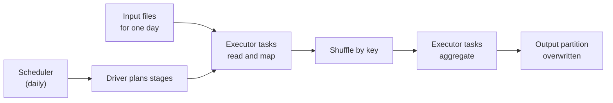
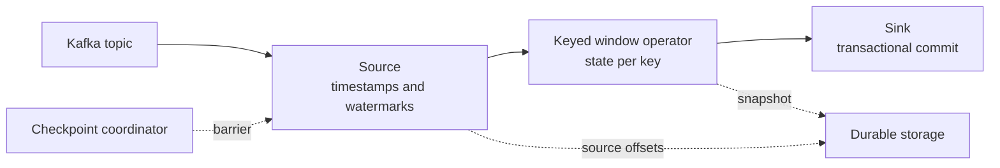
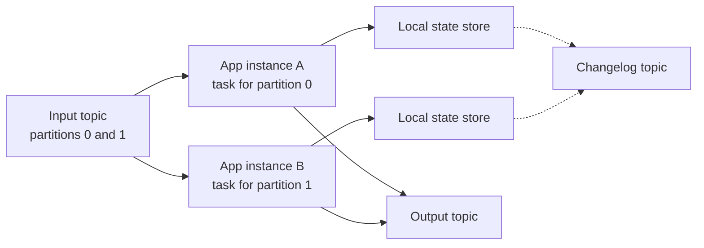
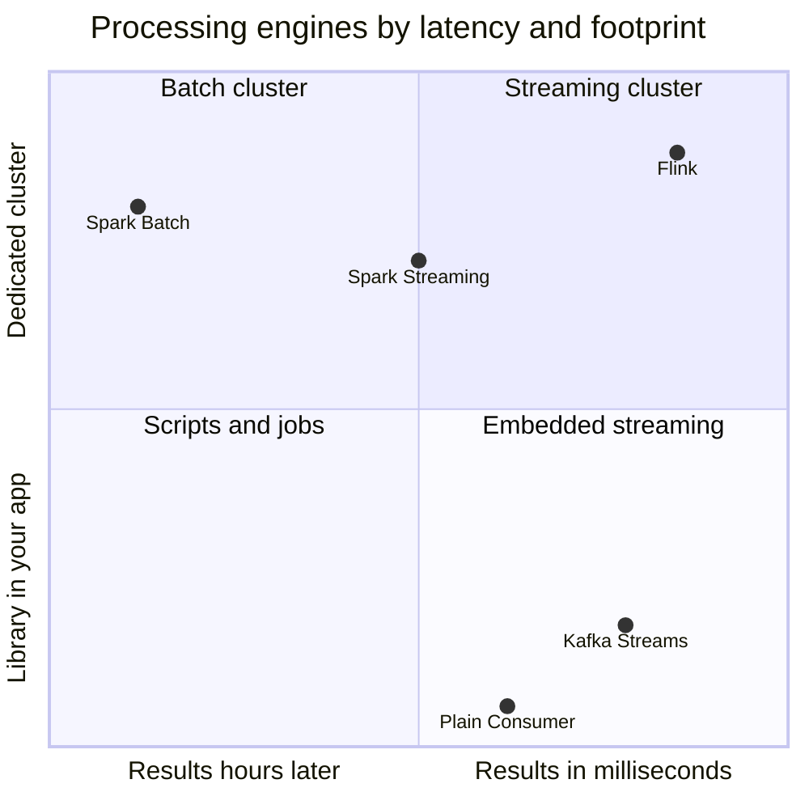
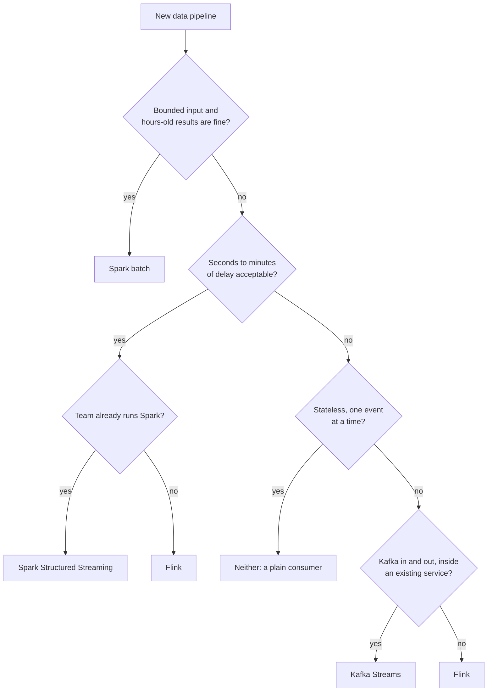

# Batch vs Stream Processing (Spark vs Flink, with Kafka Streams)

A comparison of processing data in bounded chunks after the fact (batch, typified by Apache Spark) and processing it continuously as it arrives (streaming, typified by Apache Flink and Kafka Streams), for analytics, pipelines and event-driven features.

## Explain it like I'm 5

There are two ways to count cookies sold at the fair. One grown-up waits until the fair closes, piles up every receipt, and counts them all at once. It is calm and cheap, but nobody knows the total until bedtime. A helper at the gate counts each receipt the moment it arrives and keeps a running total on a card, so people see it right away. Receipts from far booths come late, so the helper waits a little before calling each hour's count done.

*For grown-ups:* The bedtime count is batch processing over bounded data, the card is the stream processor's state, and waiting a little for late receipts is a watermark on event time.

## The short answer

Batch jobs read a bounded input (yesterday's files, a table snapshot), compute, write a result, and exit. They are simple to reason about, cheap per record, and trivially re-runnable, but their results are as old as the schedule. Stream processors run forever over unbounded input, keep state between events, and emit results continuously; they need event-time handling, checkpoints and careful sink design, and they cost a cluster that never turns off. Spark is batch-first and runs streaming as a series of small batches (with a new real-time mode in 4.1 for stateless queries). Flink is stream-first and runs batch as a bounded stream. Kafka Streams is a library for stream processing between Kafka topics inside your own service.

**Pick batch (Spark) when** the answer can be hours old: reports, model training, large joins over history, backfills, and anything where re-running the whole job is the simplest form of correctness.

**Pick streaming (Flink) when** the value decays in seconds: fraud checks, alerting, live metrics, real-time features, and pipelines with large keyed state and event-time windows across many sources and sinks.

**Pick Kafka Streams when** input and output are Kafka topics and the processing belongs inside an existing JVM service, with no separate cluster to run.

## At a glance

| Dimension | Batch (Spark) | Stream (Flink) | Kafka Streams |
| --- | --- | --- | --- |
| Input | Bounded: files, tables, snapshots | Unbounded: logs and queues, plus bounded inputs | Kafka topics only |
| Execution | Job starts, runs stages, exits | Long-running job of always-on operators | Library threads inside your app instances |
| Result freshness | Schedule interval (hours, sometimes minutes) | Per event or per window | Per event or per window |
| Time model | Usually whatever column you group by | Event time with watermarks, or processing time | Stream time from record timestamps, with grace periods |
| State | Recomputed each run | Keyed state in memory, RocksDB or ForSt, snapshotted by checkpoints | Local state stores backed by Kafka changelog topics |
| Failure recovery | Re-run failed tasks from lineage or input | Restore last checkpoint and rewind sources | Restore stores from changelogs, resume from committed offsets |
| Exactly-once | Natural: overwrite the output partition | Consistent state; end to end with transactional or idempotent sinks | `exactly_once_v2` across Kafka reads, state and writes |
| Cost shape | Pay while the job runs | Pay for an always-on cluster sized for peak | Pay for the app instances you already run, plus Kafka |
| Typical latency class | Minutes to hours | Milliseconds to seconds | Milliseconds to seconds |

## How each one works

### Batch: Spark over a bounded input

The driver turns the query into stages, executors run one task per input split, a shuffle moves rows with the same key to the same task, and the job writes its output and exits. A failed task is simply re-run on the same input. Because the input is fixed, "late data" does not exist inside a run: it is just data that will be in tomorrow's run, or in a re-run of today's.

### Stream: Flink with event time and checkpoints

Sources assign event timestamps and emit watermarks, which tell downstream operators that event time has reached a point. Operators keep state per key and fire windows when the watermark passes their end. Periodically the coordinator injects barriers into the stream; each operator snapshots its state when the barrier passes, so the snapshot plus the source offsets form a consistent cut. On failure, Flink restores the last completed checkpoint and rewinds the sources to the matching offsets.

### Kafka Streams: processing as a library

Each input partition becomes a task owned by one instance of your application. State lives in a local store (RocksDB by default) and every update is also written to a compacted changelog topic, so a task that moves to another instance rebuilds its state from Kafka. With `exactly_once_v2`, consuming, updating state and producing happen in one Kafka transaction.

## Where each one sits

*Positions are qualitative judgments for comparison, not measurements.*

Moving right buys freshness and costs always-on resources and harder correctness. Spark Structured Streaming sits in the middle because micro-batches add a trigger interval of latency. Kafka Streams and a hand-written consumer loop give the same latency as Flink without a cluster, but they only read and write Kafka and they leave rescaling and large state to you.

## Decision guide

## Trade-offs in depth

### Event time, watermarks and late data

A streaming job must decide when a window is complete, but events arrive out of order: phones go offline, partitions lag, producers retry. Processing time (the operator's clock) is simple and fast but gives different answers on a re-run. Event time (the timestamp in the record) gives the same answer on every run, at the cost of waiting. A watermark is the engine's declaration that event time has reached `t`, usually "the largest timestamp seen minus a bound". An operator with several inputs takes the minimum, so one idle or lagging partition holds every window open. Events that arrive after the watermark are late: drop them, accept them within an allowed lateness and re-emit corrected results, or send them to a side output. Kafka Streams expresses the same idea as a grace period on windows. Batch does not have this problem inside a run, which is a large part of why it is easier.

### State and recovery

Batch jobs hold no state across runs; recovery is re-running a task. Streaming jobs hold state for as long as the logic needs it (open windows, join buffers, per-user counters), so the engine must snapshot it. Flink's checkpoints are asynchronous barrier snapshots inspired by Chandy-Lamport: barriers flow in line with records, and each operator snapshots when they pass. Aligned checkpoints make multi-input operators wait for all barriers; unaligned checkpoints let barriers overtake buffered data to avoid that wait, at the cost of storing in-flight records. Flink 2.0 added disaggregated state (the ForSt backend) that keeps state primarily in a distributed file system, aimed at containers with small local disks and slow rescaling of very large state. Kafka Streams stores state locally and restores it from changelog topics, which can take a while for large stores unless standby replicas are kept warm.

### What exactly-once actually means

Every engine here can make its own state exactly-once: after a failure, each input record has affected the state once. The outside world is the hard part. A sink that is replayed after a restore writes again unless it is transactional (Flink's Kafka sink commits a Kafka transaction when the checkpoint completes, a two-phase commit) or idempotent (upsert by key). Spark's guide makes the same split: replayable sources plus checkpointed offsets plus idempotent sinks. Kafka Streams with `exactly_once_v2` covers reads, state and writes as long as everything is in Kafka; a call to an external API from inside the topology is still at-least-once. Batch gets exactly-once almost for free by overwriting a whole output partition on every run.

### Latency against cost

A stream job is sized for peak and runs at 3 a.m. too, and its state and checkpoints cost storage. A batch job uses resources only while it runs and can use cheap, preemptible capacity, because a lost task is just re-run. Micro-batching sits between them: Spark schedules a small job per trigger, which amortises overhead but puts a floor under latency. Spark 4.1 added a real-time mode for Structured Streaming that targets sub-second latency, initially for stateless Scala queries. Ask what a minute of staleness is worth before paying for milliseconds.

### Lambda against Kappa

The Lambda architecture runs a batch layer for correct, complete results and a speed layer for fresh, approximate ones, and merges them at query time. It works, but the same logic lives in two code bases that drift apart. Jay Kreps proposed the Kappa architecture in 2014: keep the input in a replayable log, run one streaming job, and to reprocess, start a second copy of the job from the beginning of the log writing to a new table, then switch readers over. Kappa needs a log with long enough retention and a job that can process history fast enough to catch up. Many teams now land somewhere between: a streaming pipeline for freshness, and batch backfills over the same tables in a lakehouse when logic changes.

### Reprocessing and backfills

Batch re-runs are the easiest correctness tool there is: fix the code, re-run the affected dates. In streaming, a fix must either be replayed from the log (Kappa), restored from a savepoint with a compatible state schema, or covered by a batch backfill. Flink runs the same DataStream or SQL program in batch execution mode over bounded input, which makes "same code for live and backfill" realistic; Flink 2.0 removed the old DataSet API in favour of this.

## Common misconceptions

- **"Streaming makes batch obsolete."** Training sets, large historical joins, regulatory reports and backfills are still cheaper and simpler as batch. Most streaming platforms run batch jobs alongside.
- **"Spark cannot stream."** Structured Streaming has been production-grade for years; its latency floor comes from micro-batching, and 4.1 added real-time mode for stateless queries.
- **"Exactly-once means no duplicates anywhere."** It means consistent state inside the engine. End to end needs transactional or idempotent sinks.
- **"Watermarks guarantee completeness."** A watermark is a heuristic about lateness. Data later than the watermark still arrives and needs a policy.
- **"Kafka Streams is a lightweight Flink."** It is a library with no cluster, which is its strength, but it only connects Kafka to Kafka and scales with the partition count of its input topics.

## In this repo

- [Windowed stream aggregation](../../patterns/distributed/windowed-stream-aggregation): event-time windows, watermarks and allowed lateness with re-emission.
- [Split, process, merge](../../patterns/distributed/split-process-merge): the map, shuffle and merge shape of a batch job.
- [Per-key ordering](../../patterns/distributed/per-key-ordering): partition by key so stateful operators see each key in order.
- [Backpressure](../../patterns/distributed/backpressure): what happens when one operator falls behind the rest.
- [Idempotent consumer](../../patterns/distributed/idempotent-consumer): making sinks safe to replay.
- [Event sourcing](../../patterns/data/event-sourcing) and [Materialized view](../../patterns/data/materialized-view): a replayable log and the derived tables Kappa rebuilds from it.
- [CDC cache invalidation](../../patterns/data/cdc-cache-invalidation): a change stream feeding derived state.
- [Out-of-order events](../../scenarios/out-of-order-events): an incident caused by trusting arrival order.
- [Video pipeline](../../scenarios/video-pipeline): a multi-stage processing pipeline.

## Interview follow-ups

- *One Kafka partition stops receiving data and every window stops firing. Why?* The operator's watermark is the minimum across its inputs, and the idle partition's watermark never advances. Mark idle sources so they are excluded, or emit watermarks from a time-based heartbeat.
- *How would you compute daily active users both live and exactly?* Stream an approximate count (for example HyperLogLog per window) for the dashboard, and run a nightly batch job that writes the exact figure over the same table. That is Lambda in miniature; say so and say why it is acceptable here.
- *How do you deploy a new version of a stateful Flink job?* Take a savepoint, deploy the new job from it, keeping operator IDs and state schemas compatible, or run the new job alongside from an earlier log offset and switch over.
- *When is micro-batching the better choice?* When seconds of latency are fine and the team already knows Spark: one engine and one set of skills for batch and streaming, with throughput-friendly scheduling.
- *What makes a sink exactly-once?* Either it takes part in the checkpoint (a transaction committed when the checkpoint completes), or writes are idempotent by key so a replay overwrites rather than duplicates.

## Further reading

- [Flink: timely stream processing](https://nightlies.apache.org/flink/flink-docs-stable/docs/concepts/time/): event time, processing time and watermarks.
- [Flink: stateful stream processing](https://nightlies.apache.org/flink/flink-docs-stable/docs/concepts/stateful-stream-processing/): keyed state, barrier snapshots, aligned and unaligned checkpoints.
- [Apache Flink 2.0.0 announcement](https://flink.apache.org/2025/03/24/apache-flink-2.0.0-a-new-era-of-real-time-data-processing/): disaggregated state, ForSt and removal of the DataSet API.
- [Spark Structured Streaming programming guide](https://spark.apache.org/docs/latest/streaming/getting-started.html): the incremental model, watermarking and end-to-end exactly-once.
- [Spark 4.1.0 release notes](https://spark.apache.org/releases/spark-release-4.1.0.html): real-time mode for Structured Streaming.
- [Kafka Streams core concepts](https://kafka.apache.org/44/streams/core-concepts/): stream time, grace periods, state stores and `exactly_once_v2`.
- [Jay Kreps, Questioning the Lambda Architecture](https://www.oreilly.com/radar/questioning-the-lambda-architecture/): the 2014 essay that proposed Kappa.
