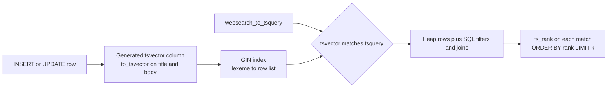
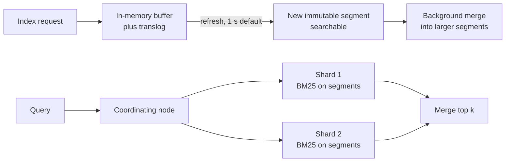
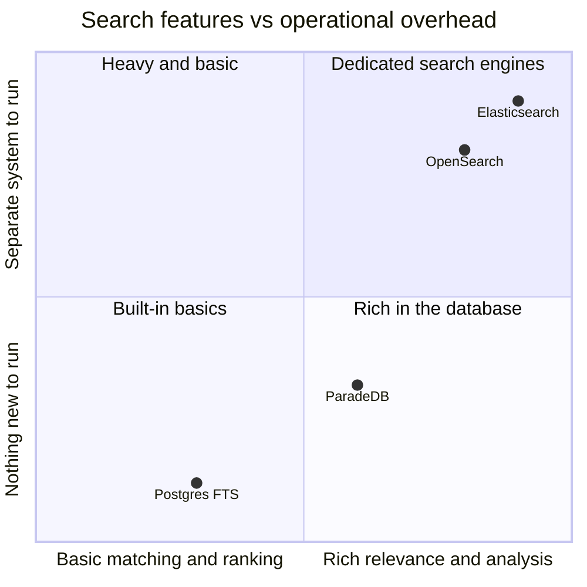
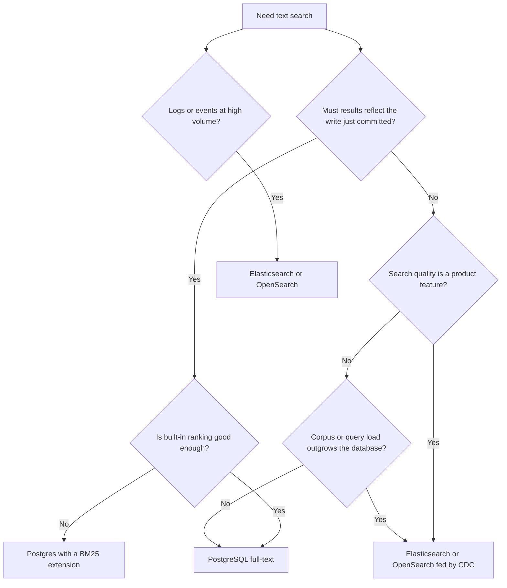

# Elasticsearch/OpenSearch vs PostgreSQL full-text search

A dedicated search engine compared with the search built into the database you already run, for the job of finding and ranking documents by the words in them.

## Explain it like I'm 5

The school keeps every story in one big filing cabinet. To find stories about dragons, the teacher can flip through the cabinet's own word list, which is always up to date and right there. Or the school can hire a librarian with a huge card catalogue next door. The librarian is great at guessing which story you really want, even with misspelled words, but needs a copy of every new story and is a second later to hear about it.

*For grown-ups:* The cabinet is PostgreSQL with a GIN index on a tsvector, the librarian is Elasticsearch or OpenSearch with its inverted index and BM25, and copying stories over is keeping the index in sync with CDC.

## The short answer

PostgreSQL full-text search is good enough for a lot more than people expect: it stems words, supports phrases and weights, uses a GIN index, and is transactionally consistent with your rows, with no second system to run. Its weak spot is ranking: the built-in ranking functions use no corpus-wide statistics, and ranking a large match set is expensive. Elasticsearch and OpenSearch are built for search: BM25 scoring by default, rich analysers, fuzzy matching, facets, highlighting, relevance tuning and horizontal scaling, at the cost of a separate cluster, near-real-time (not immediate) visibility and a sync pipeline from your database. Start in Postgres; move when relevance or scale, not habit, demands it.

**Pick PostgreSQL full-text when** the corpus fits on the database you already run, results must reflect the latest committed write, filters and joins on relational columns matter as much as the text, and "good" ranking is enough.

**Pick Elasticsearch or OpenSearch when** search quality is a product feature (typo tolerance, synonyms, per-field boosting, facets on millions of documents), the corpus or query load outgrows one database, or you search logs and events at volume.

**Use both when** Postgres stays the system of record and a search cluster is a derived read model fed by change data capture, which is the most common production shape.

## At a glance

| Dimension | PostgreSQL full-text | Elasticsearch / OpenSearch |
| --- | --- | --- |
| Index structure | GIN (inverted) or GiST (lossy signature) index over a `tsvector` | Lucene inverted index split into immutable segments per shard |
| Default ranking | `ts_rank` / `ts_rank_cd`: term frequency, proximity, weights; no global IDF | BM25 (k1 = 1.2, b = 0.75), configurable per field |
| Text analysis | Text search configurations: parser, dictionaries, stemming, stop words | Analysers: tokenisers, filters, synonyms, n-grams, per-language plugins |
| Fuzzy and typo tolerance | Via `pg_trgm` similarity, separate from full-text | Built in (`fuzziness`, n-grams, suggesters) |
| Freshness | Visible at commit, in the same transaction | Near real time: searchable after the next refresh (1 s default) |
| Consistency with source data | Same database, same transaction | Separate copy, eventually consistent via a sync pipeline |
| Scaling model | Scale up, read replicas, or shard the database | Shards and replicas spread across nodes |
| Aggregations and facets | SQL `GROUP BY` over matches | Aggregations built in, designed for facets at scale |
| Operational cost | Nothing new to run | A cluster to size, upgrade and monitor, plus the sync pipeline |
| Licence (2026) | PostgreSQL licence | Elasticsearch: AGPLv3, SSPL or Elastic License 2.0; OpenSearch: Apache 2.0 |

## How each one works

Text is normalised into a `tsvector` of stemmed lexemes, often as a generated column, and a GIN index maps each lexeme to the rows containing it. A `tsquery` finds matching rows through the index in the same transaction as any other query, so you can join and filter freely. Ranking happens after matching: `ts_rank` has to read the `tsvector` of every matching row, and it scores each document on its own, without knowing how rare a word is across the table.

Each shard is a Lucene index. New documents sit in a buffer until a refresh writes them into a new segment, and only then do searches see them; background merges combine small segments. A query fans out to one copy of every shard, each scores its matches with BM25 using term statistics, and the coordinating node merges the top results. That fan-out and the segment design are what make it fast at scale and what make it only near real time.

## Where each one sits

*Positions are qualitative judgments for comparison, not measurements.*

Built-in Postgres search sits bottom left: modest ranking, zero new infrastructure. Elasticsearch and OpenSearch sit top right, with very similar capabilities since OpenSearch forked from Elasticsearch 7.10.2 in 2021. ParadeDB's `pg_search` extension, which adds a Tantivy-based BM25 index inside Postgres, shows that the middle ground exists, though you still run and upgrade an extension.

## Decision guide

## Trade-offs in depth

### Ranking: BM25 vs per-document scoring

BM25 combines three signals: how often the term appears in the document (with diminishing returns, controlled by k1), how rare the term is across the whole index (IDF), and document length relative to the average (controlled by b). Rare words count for more, so a query for "postgres replication slot" weights "slot" above "postgres" in a corpus full of Postgres articles. PostgreSQL's `ts_rank` and `ts_rank_cd` look at term frequency, proximity (for `ts_rank_cd`), field weights A to D and optional length normalisation, but the docs state plainly that they use no global information. You can get decent ordering with weights (title above body) and normalisation, but not true IDF without building it yourself or using an extension.

### Relevance tuning

Search engines expose relevance as configuration: per-field boosts, synonym sets, analysers per language, edge n-grams for search-as-you-type, fuzzy matching for typos, function scores for recency or popularity, and explain output showing why a document scored as it did. In Postgres the equivalents are text search configurations and dictionaries, weights, `pg_trgm` for similarity, and arbitrary SQL in the `ORDER BY`. That is flexible, but each piece is assembled by hand, and typo tolerance lives outside the full-text machinery. If a product manager will tune relevance weekly, a search engine gives them far better tools.

### Freshness: commit vs refresh

A Postgres search sees a row the moment its transaction commits, even inside the same transaction. Elasticsearch makes new documents searchable at the next refresh, which runs every second by default, but only on shards that have been searched in the last 30 seconds; idle shards skip background refreshes until a search arrives. You can force a refresh per request, at a cost in segment count and indexing throughput. "I saved it and search does not show it" is a normal property of a search engine, so UIs often read the record back by ID after a write instead of re-running the search.

### Write cost and index maintenance

Updating one word in a row rewrites the row's `tsvector` and its GIN entries; with `fastupdate` on, new entries go to a pending list first, which speeds writes but makes searches scan that list until it is merged. GiST is cheaper to update but lossy, so it rechecks rows and suits smaller or very write-heavy tables. In Elasticsearch an update is a delete plus a re-index of the whole document into a new segment, and merges reclaim the space later. Both handle heavy indexing; neither likes many small updates to large documents.

### Operational cost

Postgres full-text adds an index and a column. A search cluster adds nodes, shard sizing (the primary shard count is fixed at index creation, so growth means splitting or reindexing), JVM and disk monitoring, version upgrades, snapshots, security, and a pipeline from the database. That pipeline is usually the larger cost: it needs monitoring for lag, a way to rebuild the index from scratch, and a story for deletes and schema changes.

### Keeping a search index in sync

Dual writes from the application (write the row, then index the document) drift: a crash between the two, or any writer that bypasses the code path, leaves the index wrong with nothing to repair it. The robust option is change data capture: a connector such as Debezium reads the Postgres write-ahead log through logical decoding (`pgoutput`) and a replication slot, takes an initial snapshot, then streams every committed change in commit order to a consumer that indexes or deletes documents. Delivery is effectively at least once after restarts, so indexing must be idempotent: use the primary key as the document ID and the row version or log position as an external version, so a replayed old change cannot overwrite a newer one. Watch the replication slot: if the consumer stops, Postgres keeps WAL for it and disk usage grows. The [transactional outbox](../../patterns/distributed/transactional-outbox) is the alternative when you want to publish shaped events rather than raw row changes.

### Licensing

Elastic moved Elasticsearch and Kibana from Apache 2.0 to SSPL and the Elastic License in 2021. AWS forked the last Apache release, 7.10.2, as OpenSearch, which moved to the Linux Foundation's OpenSearch Software Foundation in September 2024. In August 2024 Elastic added AGPLv3 as an option. OpenSearch remains Apache 2.0. PostgreSQL uses its own permissive licence.

## Common misconceptions

- **"Postgres full-text search does not scale."** A GIN index handles large corpora well for matching. What gets expensive is ranking a very large set of matches, because each one is scored by reading its `tsvector`. Narrow with filters first, or limit the candidate set.
- **"Elasticsearch is a database you can use as the source of truth."** It is durable, but it has no multi-document transactions, near-real-time visibility, and mapping changes often mean a reindex. Keep the source of truth elsewhere and be able to rebuild the index.
- **"`LIKE '%word%'` is full-text search."** It cannot use a normal B-tree index, does no stemming and gives no ranking. Use a `tsvector` with GIN, or `pg_trgm` for substring and similarity matching.
- **"OpenSearch and Elasticsearch are interchangeable."** They share a 2021 code base and much of the query DSL, but have diverged since in features, plugins and client libraries. Pick one and test against it.

## In this repo

- [CDC cache invalidation](../../patterns/data/cdc-cache-invalidation): tails the database change log with versioned, idempotent apply; the same mechanism keeps a search index in sync.
- [Transactional outbox](../../patterns/distributed/transactional-outbox): publish index events in the same transaction as the write, instead of dual writes.
- [Idempotent consumer](../../patterns/distributed/idempotent-consumer): why a replayed change must not corrupt the index.
- [Per-key ordering](../../patterns/distributed/per-key-ordering): changes to one document must be applied in order.
- [CQRS](../../patterns/data/cqrs) and [materialized view](../../patterns/data/materialized-view): a search index is a read model derived from the write model.
- [LSM tree](../../patterns/data/lsm-tree): immutable segments plus background merges, the same shape as Lucene's segment design.
- [RAG retrieval](../../patterns/ai/rag-retrieval): implements BM25 from term statistics and fuses it with dense retrieval.

## Interview follow-ups

*A user edits a product and the search page still shows the old title. Is it a bug?* Probably not. The index is updated asynchronously through the pipeline and the refresh interval. Show the edited record by ID after save, measure pipeline lag, and only force refresh where the latency cost is acceptable.

*How would you rebuild the search index without downtime?* Create a new index with the new mapping, backfill it from a consistent snapshot, replay changes from the log position the snapshot was taken at, then switch an alias from old to new and delete the old index.

*Why might Postgres rank a long, rambling page above a short, precise one?* With default normalisation `ts_rank` ignores document length, so more occurrences win. Use a normalisation option such as dividing by log length, or weight the title higher.

*How do you stop the CDC consumer from applying an old update after a newer one?* Index with the primary key as the document ID and an external version from the row or log position, so the engine rejects versions older than what it holds.

*When is adding Elasticsearch the wrong call?* When the corpus is modest, relevance needs are simple and the team would be adding a cluster and a sync pipeline mainly to get search they could have in Postgres.

## Further reading

- [PostgreSQL: controlling text search](https://www.postgresql.org/docs/current/textsearch-controls.html): parsing queries, `ts_rank` and `ts_rank_cd`, the no-global-statistics note, and `ts_headline` cost.
- [PostgreSQL: text search index types](https://www.postgresql.org/docs/current/textsearch-indexes.html): GIN as the preferred index and GiST's lossy signatures.
- [Elasticsearch similarity settings](https://www.elastic.co/docs/reference/elasticsearch/index-settings/similarity): BM25 as the default and its k1 and b parameters.
- [Elasticsearch near real-time search](https://www.elastic.co/docs/manage-data/data-store/near-real-time-search): segments, refresh and commits.
- [Elasticsearch index settings](https://www.elastic.co/docs/reference/elasticsearch/index-settings/index-modules): `refresh_interval` defaults and search-idle shards.
- [Elasticsearch is open source again](https://www.elastic.co/blog/elasticsearch-is-open-source-again): Elastic's August 2024 post adding AGPL next to SSPL and ELv2.
- [About OpenSearch](https://opensearch.org/about/): the project's origin as an Apache 2.0 fork of Elasticsearch and Kibana.
- [Debezium PostgreSQL connector](https://debezium.io/documentation/reference/stable/connectors/postgresql.html): logical decoding, replication slots, snapshots and restart behaviour.
- [ParadeDB](https://github.com/paradedb/paradedb): the `pg_search` extension that adds BM25 inside Postgres.
