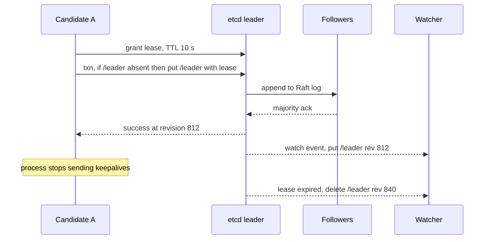
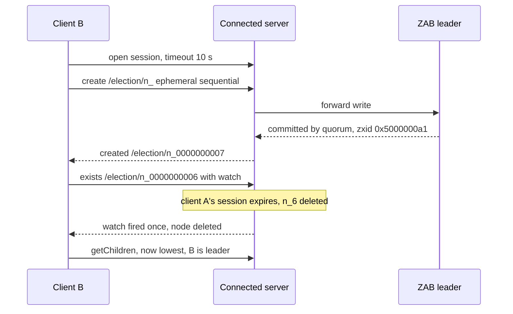
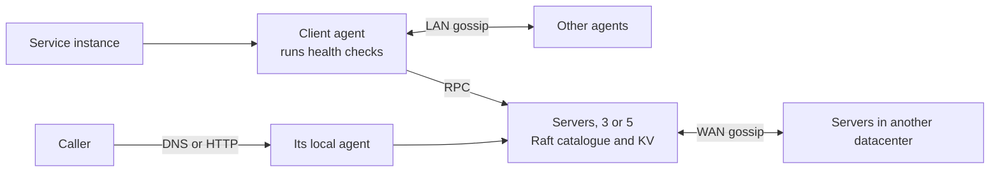
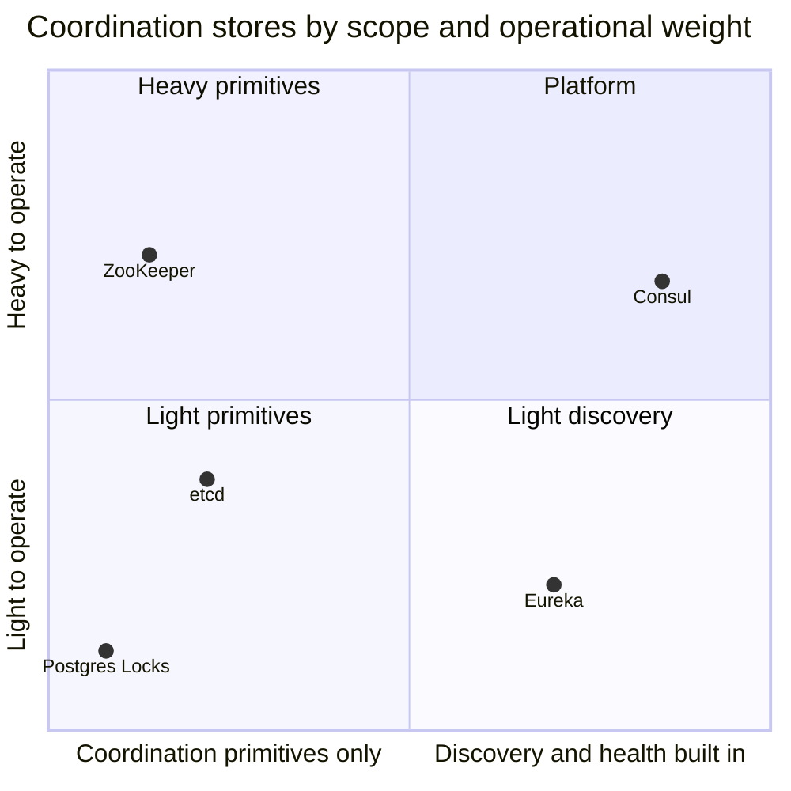
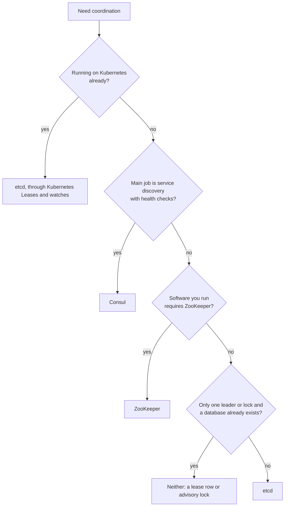

# etcd vs ZooKeeper vs Consul

A comparison of three consensus-backed stores used for coordination: leader election, locks, configuration, membership and service discovery.

## Explain it like I'm 5

The class needs one kid to hold the art closet key, and everyone must agree who. The helpers vote with a show of hands, and nothing counts until most hands go up. The kid with the key must keep waving at the helpers; stop waving, and the key goes back. Other kids can ask to be told the moment the key changes hands. One team of helpers also keeps a list of who is good at which job and checks they are awake.

*For grown-ups:* The show of hands is a consensus quorum (Raft or ZAB), waving is a lease or session heartbeat, being told is a watch, and the list of awake helpers is Consul's service catalogue with health checks.

## The short answer

All three keep a small amount of critical data on 3 or 5 servers, agree on every write through a leader and a majority, and let clients hold something that disappears when they die (a lease, an ephemeral node, a session). The differences are in the client model and in what comes in the box. etcd is a small key-value store with revisions, streaming watches and leases, and it is the store behind Kubernetes. ZooKeeper is the older, tree-shaped coordination service with ephemeral and sequential nodes; it is the backbone of much of the Hadoop ecosystem and was required by Kafka until KRaft. Consul is a service networking tool: a catalogue of services with health checks, a DNS interface and multi-datacenter support, with a key-value store and sessions for coordination on the side.

**Pick etcd when** you need a general coordination store (leader election, locks, configuration with watches), or you are on Kubernetes and can use its Lease and watch APIs, which sit on etcd.

**Pick ZooKeeper when** the software you run requires it (HBase, SolrCloud, Hadoop high availability, Kafka clusters older than 4.0), or your team already operates it well.

**Pick Consul when** the main job is service discovery and health checking across many machines or datacenters, especially outside Kubernetes or alongside Nomad and Vault.

## At a glance

| Dimension | etcd | ZooKeeper | Consul |
| --- | --- | --- | --- |
| Data model | Flat keys with prefixes, versioned by a global revision | Tree of znodes with data, version and children | Key-value store plus a catalogue of nodes, services and checks |
| Consensus | Raft | ZAB (ZooKeeper Atomic Broadcast) | Raft among servers; gossip (Serf) for membership |
| Default reads | Linearizable; serializable reads opt-in | Served by the connected server, may be stale; `sync()` first to catch up | Served by the leader, with a short stale window after leader changes; DNS uses stale reads |
| Liveness primitive | Lease with a TTL, renewed by keepalives; many keys per lease | Session; ephemeral znodes die with it | Session tied to a node and its health checks, optional TTL |
| Change notification | Watch stream from a revision, ordered, no gaps within history | One-time watches; persistent and recursive watches since 3.6 | Blocking queries (long polling on an index) and watches built on them |
| Ordering helpers | Revisions, transactions with compare | Sequential znodes, zxid | `ModifyIndex`, `LockIndex`, check-and-set |
| Service discovery | Build it from leases and prefix watches | Build it (for example the Apache Curator recipe) | Built in: catalogue, health checks, DNS and HTTP |
| Runtime | Go binary | JVM ensemble | Go binary; servers plus an agent per node |
| Licence | Apache 2.0, CNCF graduated | Apache 2.0 | Business Source License 1.1 since August 2023 |

## How each one works

### etcd: revisions, leases and watches

Every change gets a cluster-wide revision, so a watcher can say "everything after 812" and receive changes in order without gaps, as long as that history has not been compacted. A key attached to a lease is deleted when the lease expires, and that deletion is an ordinary event that watchers see. Transactions compare a key's version or revision before writing, which is how compare-and-swap, election and locks are built.

### ZooKeeper: sessions, ephemeral and sequential znodes

A client holds a session with the ensemble by sending heartbeats; ephemeral znodes it created are deleted when the cluster decides the session has expired. Sequential znodes get a counter appended by the server, which gives a fair queue. In the election recipe each candidate watches only its predecessor, so one departure wakes one client rather than all of them. Classic watches fire once and must be set again.

### Consul: agents, gossip and a Raft core

Every node runs an agent that registers local services and runs their health checks. Agents gossip with each other to detect failed nodes, and only the servers take part in Raft. Callers ask their local agent, over DNS or HTTP, for healthy instances of a service. The key-value store and sessions (a session tied to a node's health checks) provide locks and leader election through the same Raft core.

## Where each one sits

*Positions are qualitative judgments for comparison, not measurements.*

etcd and ZooKeeper offer similar primitives, but etcd is a single Go binary with a simpler client model, while ZooKeeper needs a JVM ensemble and careful session tuning. Consul is heavier because it puts an agent on every node, which is exactly what buys it health checks and local discovery. For one leader or one lock, a lease row or advisory lock in a database you already run can beat all three.

## Decision guide

## Trade-offs in depth

### Raft vs ZAB in practice

Both are leader-based protocols where a write commits once a majority has it, so both tolerate one failure with three servers and two with five, and both stop accepting writes without a majority. ZAB numbers transactions with a zxid whose high bits are the leader's epoch and low bits a counter; Raft uses a term and a log index. The protocol difference rarely decides anything. What does is the read path: etcd reads are linearizable by default (the leader confirms it is still leader), ZooKeeper reads are answered by whichever server the client is connected to and may lag the leader until the client calls `sync()`, and Consul's default mode reads from the leader with a small stale window, offering `consistent` and `stale` modes on either side. If correctness depends on reading the latest value, know which mode you are in.

### Leases, sessions and what "dead" means

A client is declared dead when it stops renewing: an etcd lease's TTL runs out, a ZooKeeper session times out, or a Consul session is invalidated because the node's health check went critical, the node left gossip, or an optional TTL expired. None of this can tell a crashed client from a paused one (a long GC pause, a frozen VM), so a former leader can wake up still believing it holds the lock. The fix is a fencing token checked by the resource being protected: etcd's revision for the key, the ZooKeeper sequential node number or zxid, or Consul's `LockIndex`. Consul also adds a lock-delay (15 seconds by default) before a released lock can be re-acquired, which narrows but does not close the window.

### Watches and missed changes

etcd watches are a stream that starts at a revision; they are ordered, never duplicated, and resumable from the last revision seen, unless that revision has been compacted, in which case the client must re-read and start again. Kubernetes informers follow the same list-then-watch pattern with `resourceVersion`. ZooKeeper's classic watches fire once, so between the event and re-registering a client can miss intermediate changes; the recipe is to re-read the data while setting the next watch. Persistent and recursive watches, added in 3.6.0, remove the re-registration step. Consul uses blocking queries: an HTTP request carries the last `X-Consul-Index` and is held until the index moves or the wait (up to 10 minutes) expires, which is long polling with a cursor.

### Service discovery

Consul does this natively. Agents run HTTP, TCP, script or TTL checks next to each service, failed instances drop out of DNS and HTTP answers, and the WAN pool connects datacenters. With etcd or ZooKeeper you build discovery yourself: each instance writes a key under a service prefix with a lease or as an ephemeral node, and clients watch the prefix. That covers liveness of the process but not health of the service, unless you add checks. On Kubernetes the platform already provides discovery through Services and EndpointSlices, so Consul there is mainly about multi-cluster or mesh features.

### Data size and write load

These are stores for small, hot metadata, not databases. etcd's default request limit is 1.5 MiB, its default storage quota is 2 GiB and the suggested maximum is 8 GiB. ZooKeeper keeps the whole tree in memory and caps each znode's data at about 1 MB by default. Every write goes through the leader and a durable write on a majority, so write throughput is bounded by disk sync latency on those servers: put them on fast, dedicated disks, and keep high-churn data (metrics, queues, per-request state) elsewhere.

### Who uses each, and what changed

Kubernetes stores all API server state in etcd, which is why etcd's health is the control plane's health. ZooKeeper underpins HBase, SolrCloud and Hadoop NameNode failover; Kafka depended on it for metadata until Kafka 4.0 (March 2025) removed ZooKeeper in favour of KRaft, its built-in Raft quorum. Consul is the discovery and service mesh layer of the HashiCorp stack and integrates with Nomad and Vault. HashiCorp moved its products, Consul included, from MPL 2.0 to the Business Source License 1.1 in August 2023, and IBM completed its acquisition of HashiCorp in February 2025; check whether the licence matters for how you plan to use it.

## Common misconceptions

- **"A distributed lock from etcd or ZooKeeper is safe on its own."** Leases expire while a client is paused. Without a fencing token checked by the protected resource, two holders can act at once.
- **"ZooKeeper reads are linearizable."** Writes are linearizable; reads are served locally and may be behind. Use `sync()` when it matters.
- **"Kafka needs ZooKeeper."** Not since 4.0. New clusters run KRaft, and migration from ZooKeeper had to happen on 3.x releases first.
- **"Consul is just a key-value store."** The key-value store is a side feature. Its main value is the catalogue, health checks, DNS interface and multi-datacenter federation.
- **"More servers make it faster."** More voters mean more acknowledgements per write. Three or five servers is the norm; scale reads with serializable or stale reads, or with caches fed by watches.

## In this repo

- [Leader election](../../patterns/distributed/leader-election): lease-based election with terms, the simplified version of what these stores provide.
- [Distributed lock with fencing tokens](../../patterns/distributed/distributed-lock-fencing): why a lease alone is not enough and how storage rejects stale holders.
- [Service discovery](../../patterns/architecture/service-discovery): a registry with heartbeat leases and client-side caching.
- [Quorum](../../patterns/distributed/quorum): majority reads and writes, the arithmetic under Raft and ZAB.
- [Gossip](../../patterns/distributed/gossip): epidemic membership and failure detection, the role Serf plays in Consul.
- [Presence](../../patterns/architecture/presence): TTL leases renewed by heartbeats, with a grace period.
- [Health check](../../patterns/reliability/health-check): the checks Consul agents run next to services.
- [Long polling](../../patterns/architecture/long-polling): the mechanism behind Consul blocking queries and etcd-style watches resuming from a cursor.
- [Write-ahead log](../../patterns/data/write-ahead-log): the replicated log at the heart of each store.

## Interview follow-ups

- *Why does etcd need 3 or 5 members, and not 4?* A majority of 4 is 3, so 4 members tolerate one failure, the same as 3, while needing more acknowledgements per write.
- *How do you implement leader election on ZooKeeper without a herd effect?* Each candidate creates an ephemeral sequential node and watches only the node just before its own. When that node goes away, exactly one candidate wakes up and checks whether it is now the lowest.
- *A watcher in etcd gets a "compacted" error. What should it do?* Re-read the current state (a list or a get at the latest revision), then start a new watch from that read's revision. Kubernetes informers do exactly this.
- *Why might Consul DNS return an instance that has just died?* DNS queries use stale reads by default and are cached by resolvers, and failure detection takes time. Use short TTLs, client retries and outlier detection.
- *When would you skip all three?* When you need one lock or one leader and already run a database: a row with an expiry and a version column, updated with compare-and-swap, gives the same semantics with one fewer system.

## Further reading

- [etcd API](https://etcd.io/docs/v3.6/learning/api/): revisions, watches, leases and transactions.
- [etcd API guarantees](https://etcd.io/docs/v3.6/learning/api_guarantees/): linearizable and serializable reads, and watch ordering and reliability.
- [etcd system limits](https://etcd.io/docs/v3.6/dev-guide/limit/): request size and storage quota defaults.
- [ZooKeeper Programmer's Guide](https://zookeeper.apache.org/doc/current/zookeeperProgrammers.html): znodes, sessions, watches including persistent watches, and consistency guarantees.
- [ZooKeeper Internals](https://zookeeper.apache.org/doc/current/zookeeperInternals.html): ZAB, quorums and the zxid.
- [Consul consensus protocol](https://developer.hashicorp.com/consul/docs/architecture/consensus): Raft among servers and recommended server counts.
- [Consul gossip protocol](https://developer.hashicorp.com/consul/docs/architecture/gossip): Serf LAN and WAN pools and failure detection.
- [Consul sessions](https://developer.hashicorp.com/consul/docs/dynamic-app-config/sessions): sessions, lock-delay and building locks and elections on the KV store.
- [Consul consistency modes](https://developer.hashicorp.com/consul/api-docs/features/consistency) and [blocking queries](https://developer.hashicorp.com/consul/api-docs/features/blocking): read modes and long-polling watches.
- [Kubernetes components](https://kubernetes.io/docs/concepts/overview/components/): etcd as the backing store for API server data.
- [HashiCorp adopts the Business Source License](https://www.hashicorp.com/en/blog/hashicorp-adopts-business-source-license): the August 2023 licence change.
