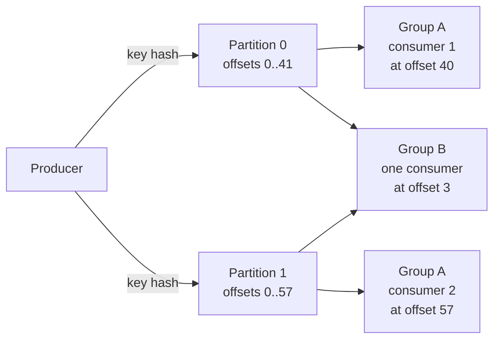
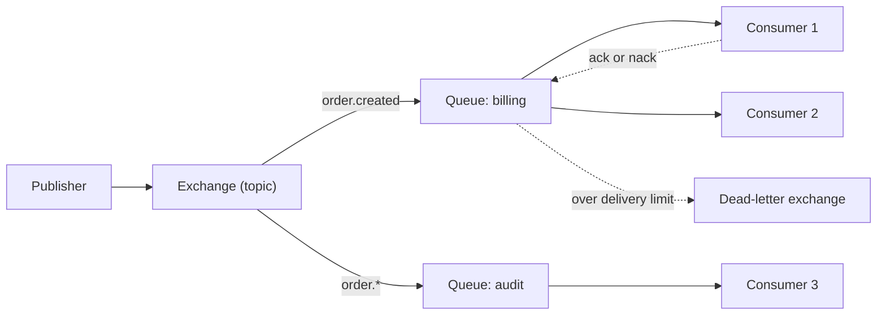
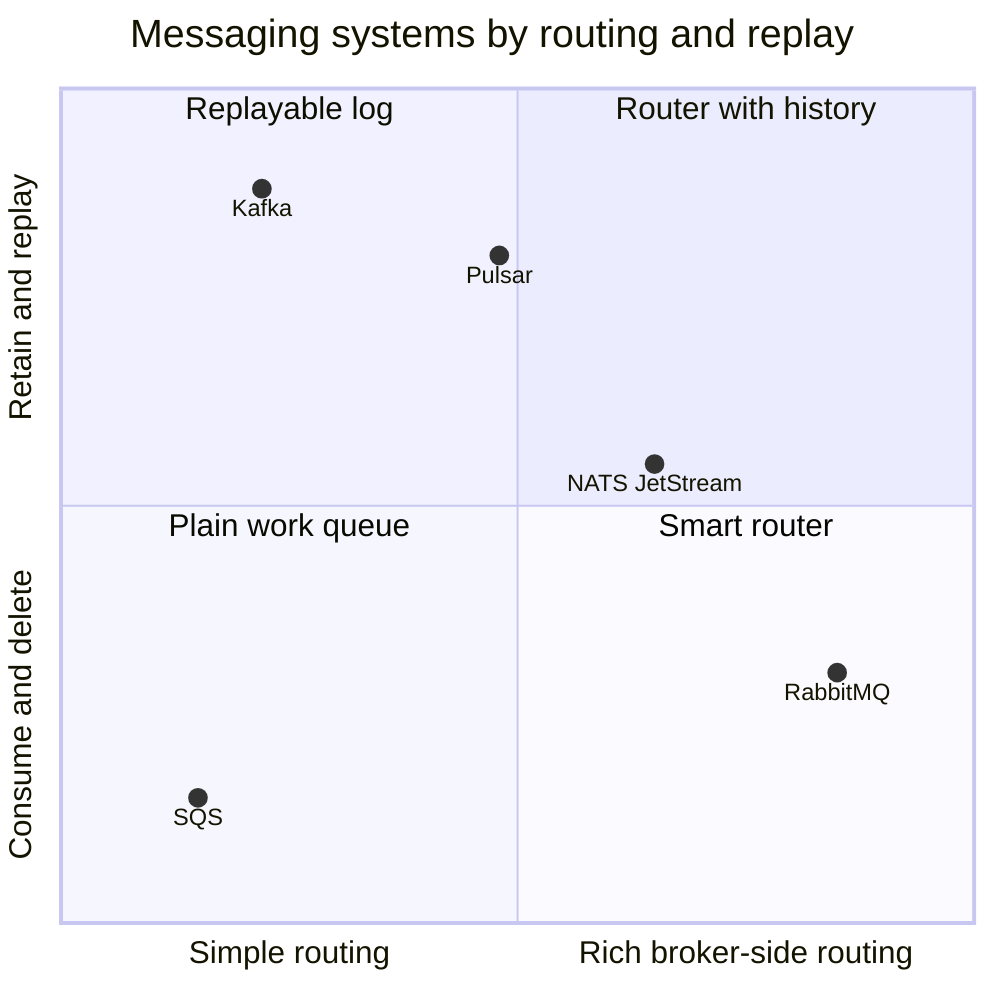
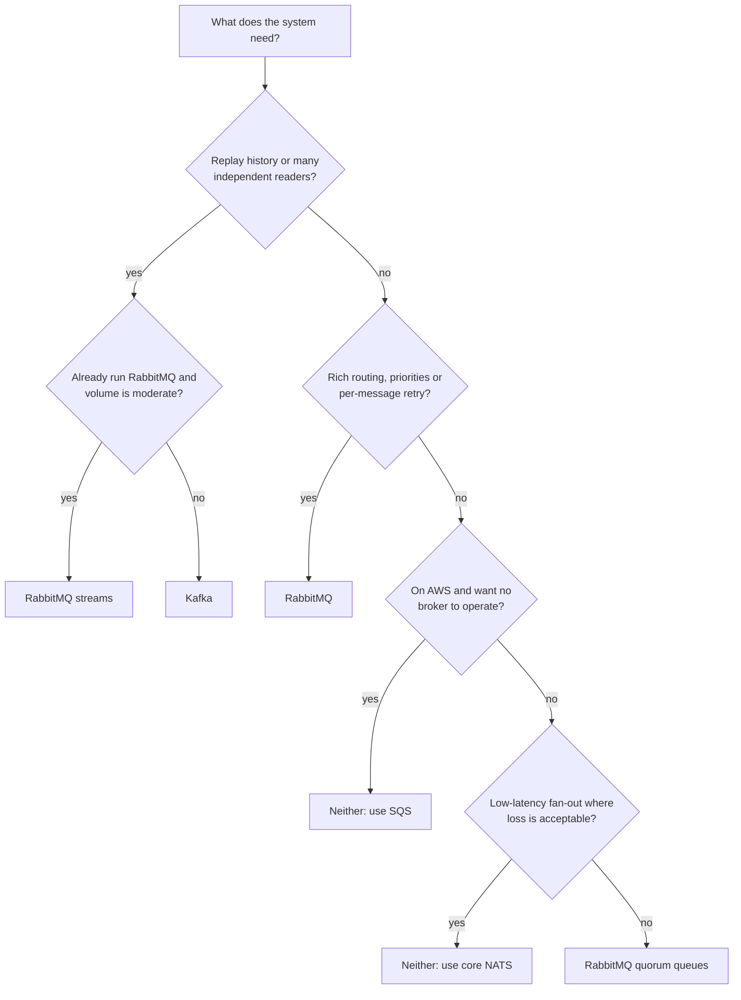

# Kafka vs RabbitMQ

A comparison of Apache Kafka and RabbitMQ as the backbone for moving messages and events between services.

## Explain it like I'm 5

Two ways to share class news. First, the teacher writes every note in one big notebook and never tears out a page. Each kid keeps a bookmark and reads at their own speed, and a new kid can start from page one. Second, a helper reads the label on each note and drops it in the right kids' trays. A kid takes a note, says "got it", and the note is gone. If a kid wanders off without saying it, the helper gives that note to someone else.

*For grown-ups:* The notebook is Kafka's append-only log, bookmarks are consumer offsets, the helper is a RabbitMQ exchange routing into queues, and "got it" is a per-message acknowledgement.

## The short answer

Kafka is a distributed, partitioned log. Messages stay on disk for a retention period whether or not anyone has read them, and each consumer group tracks its own position, so many independent readers and full replays are cheap. RabbitMQ is a message broker. It routes each message through exchanges into queues, pushes it to a consumer, and forgets it once that consumer acknowledges it, which makes per-message routing, priorities, retries and dead-lettering first-class. The gap has narrowed: RabbitMQ has had replayable streams for several releases, and Kafka 4.2 made share groups (queue-style consumption, KIP-932) production-ready. The deciding question is still whether your data is a history to be re-read or a list of jobs to be done.

**Pick Kafka when** events are a shared history: many teams consume the same stream, you need to replay after a bug or to backfill a new service, you feed stream processors, or volume is high and sustained.

**Pick RabbitMQ when** messages are tasks or commands: you need flexible routing by key or header, per-message acknowledgement and retry, priorities, or request-reply, at moderate volume.

**Use both when** a company has an event backbone (Kafka) and separate task queues for work that is retried message by message (RabbitMQ). This is common and not a smell.

## At a glance

| Dimension | Kafka | RabbitMQ |
| --- | --- | --- |
| Core model | Partitioned append-only log; consumers pull from an offset | Exchanges route to queues; broker pushes to consumers |
| What a read does | Nothing to the data; the consumer's offset moves | Classic and quorum queues: the ack removes the message. Streams: non-destructive |
| Retention | By time or size, independent of consumption | Until acked (queues); by age or size (streams) |
| Ordering | Per partition | Per queue, best effort once redeliveries or several consumers are involved |
| Parallelism | Up to one consumer per partition per group; share groups lift this | Any number of competing consumers on one queue, bounded by prefetch |
| Routing | Topic and partition key chosen by the producer | Direct, fanout, topic and headers exchanges, plus bindings |
| Per-message features | Few: no per-message ack in classic consumer groups, no priorities | Acks, nacks, requeue, dead-letter exchanges, delivery limits, priorities, TTLs |
| Replication | Leader and follower replicas per partition; KRaft for metadata | Quorum queues and streams replicate with Raft |
| Operational shape | Plan partitions and retention; rebalances on group changes | Watch queue depth and memory; long queues are a warning sign |
| Ecosystem | Kafka Connect, Kafka Streams, Flink, most CDC tools | AMQP 0-9-1, AMQP 1.0, MQTT and STOMP clients, many languages |

## How each one works

### Kafka: a log that readers move through

A producer appends each record to one partition, picked by hashing its key, so all records for one key stay in order. Every consumer group reads every partition, and within a group each partition is owned by one consumer at a time. Groups only store an offset per partition, which is why group B can be far behind or replaying from the start without affecting group A, and why the broker never needs to track individual messages.

### RabbitMQ: a router that hands out work

A publisher sends to an exchange with a routing key, and bindings decide which queues receive a copy. Each queue delivers a message to one of its consumers, at most `prefetch` unacknowledged messages per channel. An ack removes the message; a consumer that dies before acking causes redelivery to another consumer; repeated failures can go to a dead-letter exchange. The broker tracks the state of each message, which is what makes the per-message features possible.

## Where each one sits

*Positions are qualitative judgments for comparison, not measurements.*

Kafka and Pulsar sit at the top because retention is their default; RabbitMQ sits bottom right because routing is its strength and its classic queues delete on ack. RabbitMQ streams would plot near Pulsar, which is the main reason "RabbitMQ can't replay" is no longer true. SQS is the low-effort corner: one queue, no routing, no replay.

## Decision guide

## Trade-offs in depth

### Ordering and parallelism

Kafka orders records within a partition and nowhere else. Parallelism in a classic consumer group is capped by the partition count, because one partition has one owner per group; that is the price of the ordering. Pick the key so that the things that must stay in order (one account, one order) share a partition, and size partitions for peak consumer count. Adding partitions later changes which partition a key hashes to, so per-key order breaks across the change.

RabbitMQ delivers a queue in FIFO order, but with several consumers a nack or a crashed consumer puts a message back for redelivery, and it can then be processed after messages that came behind it. The RabbitMQ docs recommend streams, or a queue with a single active consumer, when order matters. Per-key ordering with parallelism needs one queue per key range (for example the consistent hash exchange plugin) or a resequencer on the consumer side.

### Acknowledgement, retries and poison messages

A Kafka consumer commits an offset, which says "everything before this is done". It cannot skip one bad record and come back to it later: a record that always fails blocks its partition (head-of-line blocking) until the consumer gives up, writes it to a dead-letter topic of its own making, and moves on. Retries with delay are usually built from extra retry topics.

RabbitMQ acknowledges each message on its own. A consumer can nack a single message, the broker can count deliveries, and quorum queues drop or dead-letter a message after a delivery limit (20 by default since RabbitMQ 4.0). Delays and retries come from TTLs and dead-letter exchanges. For a stream of independent jobs with occasional bad inputs, this is much less code.

Kafka share groups (KIP-932) bring per-record acknowledgement to Kafka: several consumers read the same partition, each record is acquired with a lock timeout, and the consumer accepts, releases or rejects it, with a delivery count. They were early access in Kafka 4.0 and production-ready in 4.2. Ordering is not preserved within a share group, which is the same trade RabbitMQ makes.

### Replay and retention

Kafka keeps data for a configured time or size regardless of consumers, and compacted topics keep the latest value per key indefinitely. That turns the log into a source of truth: a new service can rebuild its state from it, and a buggy consumer can reset its offset and reprocess. This is the property behind [event sourcing](../../patterns/data/event-sourcing) and change data capture pipelines.

RabbitMQ queues are not meant to hold history; a long queue means consumers are behind. RabbitMQ streams are an append-only, replicated log with retention by age or size, and consumers attach at an offset, a timestamp or the end. Super streams partition a stream across nodes. For moderate volumes this gives you replay without running a second system.

### Routing

RabbitMQ routes on the broker: topic exchanges match wildcard patterns, headers exchanges match message headers, and a new consumer can bind its own queue to exactly the subset it wants without the producer changing. In Kafka the producer chooses the topic and the key, and consumers that want a subset read the whole topic and filter, or someone runs a stream job that writes filtered topics.

### Where the throughput comes from

Kafka's write path is an append to the end of a partition file, done in batches, with data served to consumers largely from the operating system's page cache. Because the broker tracks offsets, not per-message state, a slow consumer costs the broker nothing except disk retention. RabbitMQ does more work per message (routing, per-consumer delivery state, ack tracking), which is the cost of its per-message features. Both are fast enough for most systems; the difference shows at sustained high volume and with many consumer groups reading the same data. Benchmarks vary widely with message size, replication and acknowledgement settings, so test with your own workload.

### Operations in 2026

Kafka 4.0 (March 2025) removed ZooKeeper; clusters run KRaft, where a Raft quorum of controller nodes stores the metadata. You still plan partition counts, retention, replication factor and the rebalance behaviour of consumer groups (KIP-848's broker-driven protocol has been generally available since 4.0). RabbitMQ 4.0 removed classic mirrored queues, so replicated queues are quorum queues (Raft) or streams. Operating RabbitMQ is mostly about keeping queues short and watching memory and disk alarms.

### Where SQS, NATS and Pulsar fit

- **Amazon SQS** is a managed queue with per-message visibility timeouts. Standard queues are at-least-once with best-effort ordering; FIFO queues order within a message group. Choose it when you are on AWS and want no broker to run.
- **NATS**: core NATS is fire-and-forget pub-sub to currently connected subscribers, with subject wildcards. JetStream adds persistence, replay and at-least-once delivery. It suits edge, IoT and low-latency internal messaging.
- **Apache Pulsar** separates stateless brokers from storage in BookKeeper and offers exclusive, failover, shared and key-shared subscriptions, so one system covers both log and queue styles, at the cost of more moving parts.

## Common misconceptions

- **"Kafka is a queue."** It is a log. Reading does not remove anything, and two groups reading the same topic each get every record. Share groups add queue semantics on top; they do not change the storage model.
- **"RabbitMQ cannot replay messages."** Classic and quorum queues cannot, but streams can, from an offset or a timestamp.
- **"Kafka guarantees ordering."** Only within a partition. A topic with twelve partitions has twelve independent orders.
- **"Kafka's exactly-once means my database write happens once."** Kafka transactions make read-process-write within Kafka atomic. Side effects outside Kafka still need an [idempotent consumer](../../patterns/distributed/idempotent-consumer).
- **"RabbitMQ is not durable."** Quorum queues with publisher confirms replicate to a majority before confirming. Durability depends on the queue type and on whether the publisher waits for confirms.

## In this repo

- [Pub-sub](../../patterns/distributed/pub-sub): topic fan-out to many subscribers, the shape both systems implement.
- [Competing consumers](../../patterns/distributed/competing-consumers): a shared work queue with visibility timeouts and acks, the RabbitMQ and SQS model.
- [Per-key ordering](../../patterns/distributed/per-key-ordering): partition by key plus a resequencer, which is how Kafka gets order and parallelism.
- [Dead-letter queue](../../patterns/distributed/dead-letter-queue): parking messages that keep failing.
- [Idempotent consumer](../../patterns/distributed/idempotent-consumer): making at-least-once delivery safe.
- [Transactional outbox](../../patterns/distributed/transactional-outbox): publishing to either broker without losing events when the database commit and the publish disagree.
- [Backpressure](../../patterns/distributed/backpressure): bounding what a slow consumer can pile up.
- [Consumer double processing](../../scenarios/consumer-double-processing): what redelivery looks like when consumers are not idempotent.
- [Out-of-order events](../../scenarios/out-of-order-events): ordering breaking across partitions or redeliveries.

## Interview follow-ups

- *A Kafka topic has 6 partitions and you need 20 consumers. What happens?* In a classic consumer group 14 sit idle. Increase partitions (accepting the key remapping), process each partition's records concurrently inside a consumer with per-key ordering, or use a share group if order does not matter.
- *How do you handle a poison message in Kafka?* Catch the failure, publish the record and the error to a dead-letter topic, commit past it, and alert. Retry topics with increasing delays handle transient failures without blocking the partition.
- *Why would you put a log in front of a database rather than a queue?* Because the log can be replayed: new consumers can build their own views, and a fixed bug can be reprocessed from an old offset.
- *How does RabbitMQ stop a slow consumer from being flooded?* Prefetch limits unacknowledged messages per channel, so the broker stops pushing to a consumer that is not acking, and the rest of the queue goes to others.
- *What changed when Kafka removed ZooKeeper?* Metadata moved into a Raft-replicated log managed by controller nodes (KRaft), so there is one system to run and metadata changes propagate as log records instead of ZooKeeper watches.

## Further reading

- [Apache Kafka 4.0 release announcement](https://kafka.apache.org/blog/2025/03/18/apache-kafka-4.0.0-release-announcement/): ZooKeeper removal, KRaft only, KIP-848 GA and KIP-932 early access.
- [Apache Kafka 4.2 release announcement](https://kafka.apache.org/blog/2026/02/17/apache-kafka-4.2.0-release-announcement/): share groups become production-ready, with the new RENEW acknowledgement.
- [RabbitMQ AMQP 0-9-1 model explained](https://www.rabbitmq.com/tutorials/amqp-concepts): exchanges, bindings, acknowledgements and prefetch.
- [RabbitMQ queues](https://www.rabbitmq.com/docs/queues): FIFO behaviour and what reorders messages.
- [RabbitMQ quorum queues](https://www.rabbitmq.com/docs/quorum-queues): Raft replication, delivery limits and the removal of mirrored queues in 4.0.
- [RabbitMQ streams](https://www.rabbitmq.com/docs/streams): append-only replicated logs, offsets, retention and super streams.
- [Pulsar messaging concepts](https://pulsar.apache.org/docs/next/concepts-messaging/): subscription types and BookKeeper persistence.
- [NATS JetStream](https://docs.nats.io/nats-concepts/jetstream): how JetStream adds persistence and at-least-once delivery to core NATS.
