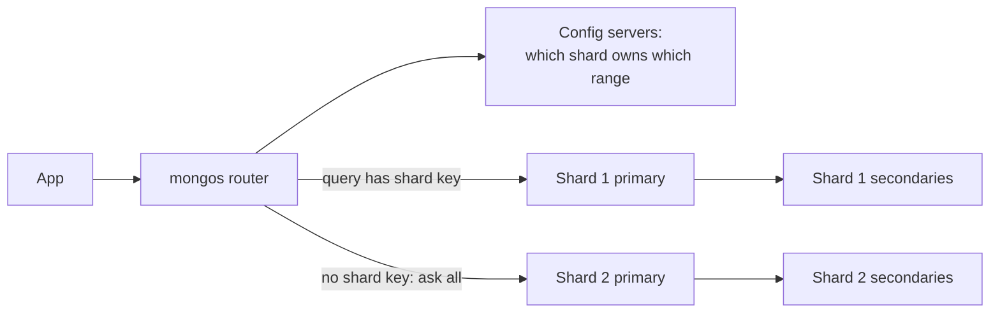
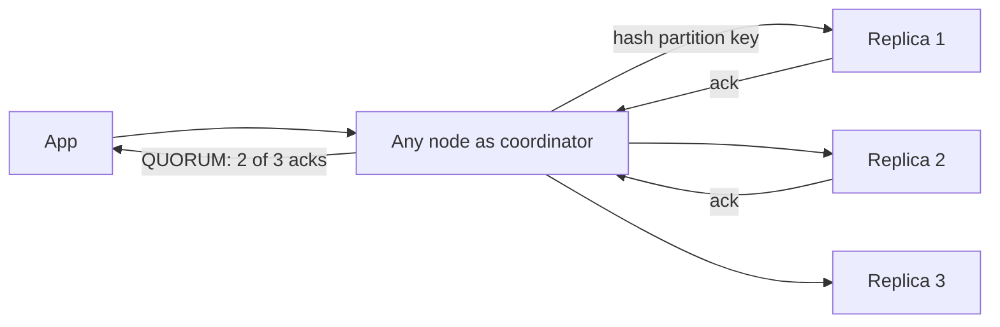
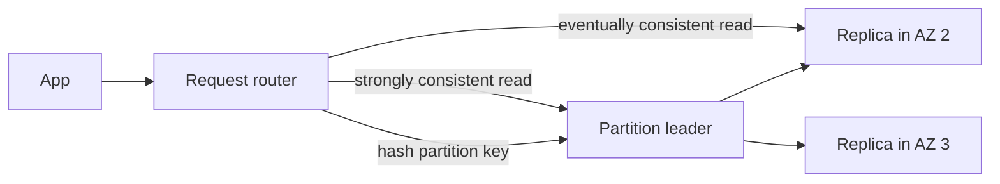
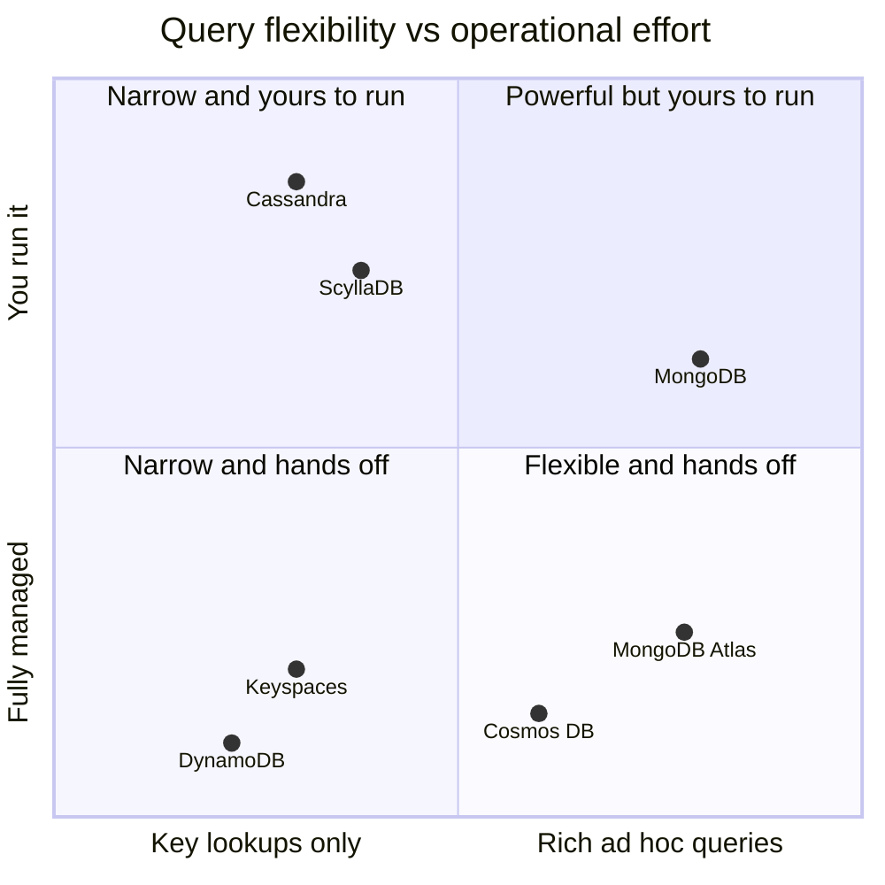
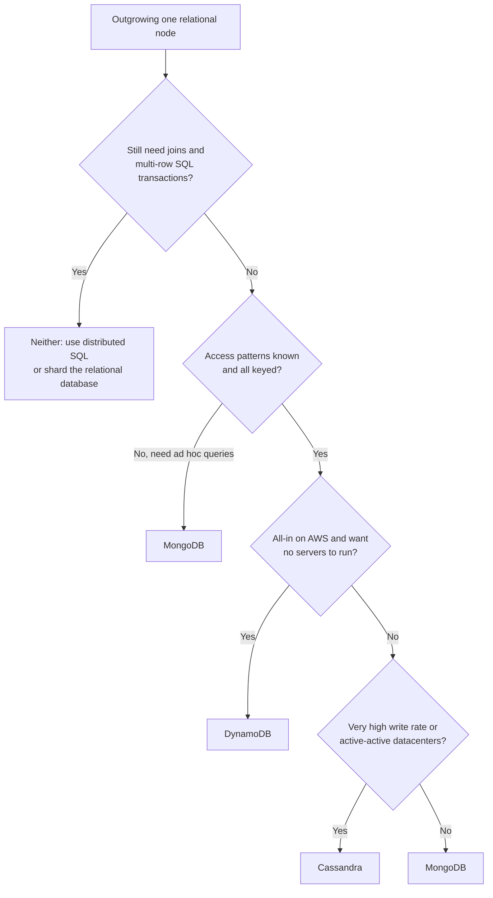

# MongoDB vs Cassandra vs DynamoDB

This page compares MongoDB, Apache Cassandra and Amazon DynamoDB as the operational database for a workload that has outgrown a single relational node.

## Explain it like I'm 5

Three toy shops have too many toys for one room.

The first shop has several rooms, each with a boss. A desk at the door looks at the toy's label and says which room it lives in. Each boss has helpers who copy everything.

The second shop has no bosses. Every room keeps copies of some toys, and you ask any room, which asks two others to be sure.

The third shop is run by someone else. You hand toys over the counter and pay for each one.

*For grown-ups:* The first shop is MongoDB's router and sharded replica sets, the second is Cassandra's leaderless ring with tunable quorums, and the third is DynamoDB as a managed service.

## The short answer

All three spread data across machines by a key you choose, and all three reward you for designing around your access patterns. They differ in how much querying they offer and who runs them. MongoDB is the most general: rich queries and secondary indexes over documents, with sharding added when you need it. Cassandra is a leaderless wide-column store built for heavy write rates and multi-datacenter replication, with consistency you tune per request. DynamoDB is a fully managed key-value and document service with predictable latency at any scale, as long as every query goes through a key.

**Pick MongoDB when** you want flexible documents and ad hoc queries now, with the option to shard later, or you want the same database across clouds (Atlas) or on your own servers.

**Pick Cassandra when** writes are very heavy (events, time series, messaging), you need active-active replication across datacenters you control, and you have the people to run it, or you use a compatible managed service.

**Pick DynamoDB when** you are on AWS, the access patterns are known and keyed, and you want no servers, no upgrades and pay-per-request pricing.

## At a glance

| Dimension | MongoDB | Cassandra | DynamoDB |
| --- | --- | --- | --- |
| Data model | Documents (BSON), nested fields and arrays | Tables of rows grouped into partitions, sorted by clustering columns | Items with a partition key and optional sort key |
| Query language | MQL and aggregation pipelines | CQL (SQL-like, no joins) | API calls and PartiQL; `Query` needs a partition key |
| Secondary indexes | Many types on any field | Storage-attached indexes (5.0), materialised tables per query | GSIs (eventually consistent) and LSIs |
| Partitioning | Shard key, ranged or hashed, balancer moves ranges | Token ring with vnodes, hash of partition key | Automatic, hash of partition key, splits for size and heat |
| Replication | Replica set per shard: one primary, secondaries | Leaderless, replication factor per datacenter | Three replicas per partition across availability zones, one leader |
| Consistency | Write concern and read concern per operation, default majority writes | Consistency level per request (`ONE`, `QUORUM`, `LOCAL_QUORUM` ...) | Eventually consistent reads by default, strongly consistent on request |
| Transactions | Multi-document ACID, including across shards | Lightweight transactions per partition (Paxos) | `TransactWriteItems` and `TransactGetItems`, up to 100 items, one region |
| Multi-region | Replica set members or zones in other regions, one primary per shard | Active-active across datacenters by design | Global tables: eventual (last writer wins) or strong (three regions) |
| Who runs it | You, or MongoDB Atlas | You, a compatible service (Amazon Keyspaces, DataStax Astra) or a compatible engine (ScyllaDB) | AWS only |
| Item size | 16 MB per document | No small fixed cap, but large partitions hurt | 400 KB per item |

## How each one works

### MongoDB: router, config servers, sharded replica sets

Each shard is a replica set with an elected primary that takes all writes for its ranges. The `mongos` router looks up the chunk map held by the config servers and sends a query to one shard when the filter includes the shard key, or to every shard when it does not. With write concern `majority` (the default in most topologies), a write is acknowledged once a majority of data-bearing voting members have it, so it survives a primary failover.

### Cassandra: leaderless ring with tunable quorums

Any node can coordinate a request. It hashes the partition key to find the replicas on the token ring and always sends a write to all of them; the consistency level says how many acknowledgements to wait for. Conflicts are resolved per column by timestamp, last write wins, so clocks matter. Hinted handoff and read repair help replicas converge, and regular anti-entropy repair is what guarantees it.

### DynamoDB: managed partitions with a leader per replication group

A table is split into partitions by the hash of the partition key, and each partition is a replication group across three availability zones. The group elects a leader with Multi-Paxos; the leader takes writes and serves strongly consistent reads, and a write is acknowledged once a quorum has logged it. Eventually consistent reads can go to any replica, which is why they cost half as much. Each partition serves up to 3,000 read units and 1,000 write units per second, and DynamoDB splits busy or large partitions for you.

## Where each one sits

*Positions are qualitative judgments for comparison, not measurements.*

Running a database yourself and choosing how much it can query are separate decisions. Both MongoDB and Cassandra can move down the chart through managed offerings (Atlas, Amazon Keyspaces) without changing the data model. DynamoDB has no self-run version for production, and its query model stays narrow by design; that narrowness is what makes its latency predictable.

## Decision guide

## Trade-offs in depth

### Modelling by access pattern

In all three you list the queries first and design the keys second, but the penalty for getting it wrong differs. MongoDB forgives the most: a missing index can be added, and a query without the shard key still works, it just asks every shard. Cassandra forgives least: a table answers the queries its partition key and clustering columns were designed for, so a new query usually means a new table written in parallel. DynamoDB sits between: you can add global secondary indexes later, and single-table design packs several entity types into one table with overloaded keys so that one `Query` returns a customer and their orders together.

### Choosing the partition key

The partition key decides both distribution and what a single request can do. It needs high cardinality and even traffic: a status flag, a country, or today's date as the whole key sends most traffic to a few partitions. In DynamoDB that shows up as throttling on one partition while the table as a whole looks idle, which the [hot partition scenario](../../scenarios/hot-partition) walks through. In Cassandra, a partition that grows without bound (all events for a busy tenant) becomes slow to read, compact and repair, so time-bucket it (`tenant_id, day`). In MongoDB, a monotonically increasing ranged shard key (a timestamp or ObjectId) sends every insert to the last chunk; use a hashed key or a compound key. MongoDB can change a shard key after the fact (`reshardCollection`, which needs spare disk and I/O while it copies), which the other two cannot.

### Consistency settings

MongoDB writes go to the shard primary; `w: "majority"` makes them durable across failover, `readConcern: "majority"` avoids reading data that could roll back, and causally consistent sessions give read-your-writes even when reading from secondaries. Cassandra lets each request choose: `QUORUM` writes with `QUORUM` reads overlap (W + R > RF), so a read sees the latest acknowledged write; `LOCAL_QUORUM` keeps that guarantee within one datacenter without paying cross-region latency; `ONE` is fastest and may be stale. DynamoDB reads are eventually consistent unless you set `ConsistentRead`, which is not available on GSIs or streams.

### Multi-region

Cassandra was designed for this: `NetworkTopologyStrategy` keeps a replication factor per datacenter, every datacenter accepts writes, and `LOCAL_QUORUM` keeps each region's latency local, with last-write-wins across regions. MongoDB keeps one primary per shard, so cross-region writes travel to that primary; zone sharding can pin each region's data to shards whose primaries live there. DynamoDB global tables offer two modes chosen at creation: multi-region eventual consistency (any region writes, replication usually within a second, last writer wins) and multi-region strong consistency, which needs exactly three regions (or two plus a witness) and gives an RPO of zero but does not support transactions or TTL.

### Transactions and conditional writes

MongoDB has full multi-document ACID transactions, across shards too, with a performance cost. DynamoDB transactions cover up to 100 items in one region, cost twice the capacity of normal writes, and are only atomic in the region that ran them on a global table. Cassandra offers lightweight transactions (compare-and-set on one partition using Paxos), which take several round trips. Apache Cassandra 6.0, still pre-release in 2026, brings the Accord protocol for multi-partition ACID transactions. In all three, a conditional write on a version attribute ([optimistic locking](../../patterns/data/optimistic-locking)) covers many cases more cheaply.

### Managed vs self-run, and cost shape

Self-running MongoDB or Cassandra gives you control over hardware, versions and cost per node, and makes you own upgrades, repair, backups, capacity and on-call. MongoDB Atlas and Cassandra-compatible services take that away while keeping a portable data model. DynamoDB is only on AWS, and its bill follows requests and storage (on-demand) or reserved capacity (provisioned), so a scan-heavy design or a forgotten GSI shows up directly in cost.

## Common misconceptions

- **"Cassandra is eventually consistent."** It is as consistent as the level you ask for. `QUORUM` reads and writes give read-after-write for acknowledged writes; `ONE` does not.
- **"DynamoDB scales infinitely, so the key does not matter."** Each partition has a throughput ceiling, and one hot key can only use one partition. A bad key throttles regardless of table capacity.
- **"MongoDB loses data."** That reputation came from old defaults. Since 5.0 the default write concern is `majority` in most deployments, which survives a primary failover.
- **"DynamoDB is just a key-value store."** It also stores nested documents, supports sort-key range queries, secondary indexes, transactions and streams.
- **"Multi-region means my data is the same everywhere."** Asynchronous replication with last-writer-wins can silently drop one of two concurrent updates to the same item.

## In this repo

- [Sharding](../../patterns/data/sharding): hash vs range partitioning, the choice behind MongoDB's hashed and ranged shard keys.
- [Consistent hashing](../../patterns/data/consistent-hashing): the token ring that places Cassandra partitions.
- [Quorum](../../patterns/distributed/quorum): N, R and W, the arithmetic behind Cassandra consistency levels.
- [Hot-key salting](../../patterns/data/hot-key-salting): spreading one hot partition key over several.
- [Gossip](../../patterns/distributed/gossip): how leaderless clusters such as Cassandra share membership.
- [LSM tree](../../patterns/data/lsm-tree): the storage engine design behind Cassandra's cheap writes.
- [Leader election](../../patterns/distributed/leader-election): the idea behind MongoDB primaries and DynamoDB partition leaders.
- [Hot partition scenario](../../scenarios/hot-partition): a DynamoDB-style table throttled by one key.

## Interview follow-ups

- *Design the key for a chat app's messages in each store.* Partition by conversation and sort by message time or ID: a DynamoDB partition key `conv#123` with a sort key of a time-ordered ID, a Cassandra table keyed `((conversation_id, month), message_id)`, or a MongoDB collection sharded on hashed `conversation_id` with an index on `(conversation_id, sent_at)`.
- *How do you get a new access pattern in DynamoDB without a rewrite?* Add a GSI with the new key; it backfills and stays updated asynchronously, so its reads are eventually consistent.
- *What happens in Cassandra if a replica is down during a `QUORUM` write with RF 3?* Two replicas still acknowledge, so the write succeeds; the coordinator may store a hint for the third, and repair brings it up to date if the hint is lost.
- *Why might you still choose Postgres?* If the data fits on one primary plus replicas for the foreseeable future, a relational database gives you joins, ad hoc queries and simple transactions with less design work up front.

## Further reading

- [MongoDB write concern](https://www.mongodb.com/docs/manual/reference/write-concern/): `majority` default, journaling and the arbiter exception.
- [MongoDB shard keys](https://www.mongodb.com/docs/manual/core/sharding-shard-key/): hashed and ranged sharding, refining and resharding.
- [MongoDB resharding](https://www.mongodb.com/docs/manual/core/sharding-reshard-a-collection/): requirements and cost of changing a shard key.
- [MongoDB causal consistency](https://www.mongodb.com/docs/manual/core/read-isolation-consistency-recency/): session guarantees and read concern levels.
- [Cassandra Dynamo architecture](https://cassandra.apache.org/doc/latest/cassandra/architecture/dynamo.html): token ring, replication strategies, consistency levels and repair.
- [Cassandra 5.0 new features](https://cassandra.apache.org/doc/5.0/cassandra/new/index.html): storage-attached indexes, vector search and trie storage.
- [DynamoDB partition key design](https://docs.aws.amazon.com/amazondynamodb/latest/developerguide/bp-partition-key-design.html): per-partition throughput limits.
- [DynamoDB read consistency](https://docs.aws.amazon.com/amazondynamodb/latest/developerguide/HowItWorks.ReadConsistency.html): eventual vs strong reads and where each is allowed.
- [DynamoDB global tables](https://docs.aws.amazon.com/amazondynamodb/latest/developerguide/V2globaltables_HowItWorks.html): MREC and MRSC modes and their limits.
- [Amazon DynamoDB, USENIX ATC 2022](https://www.usenix.org/conference/atc22/presentation/elhemali): the paper describing partitions, Multi-Paxos replication groups and leader reads.
