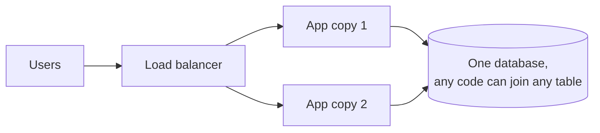
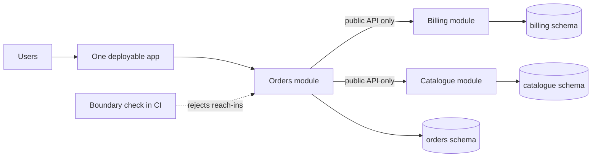
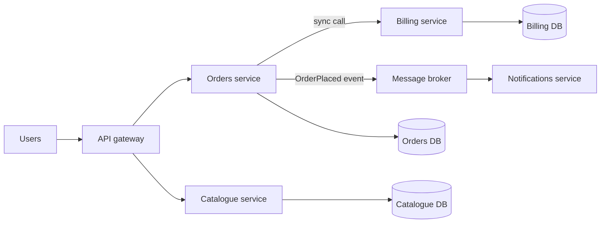
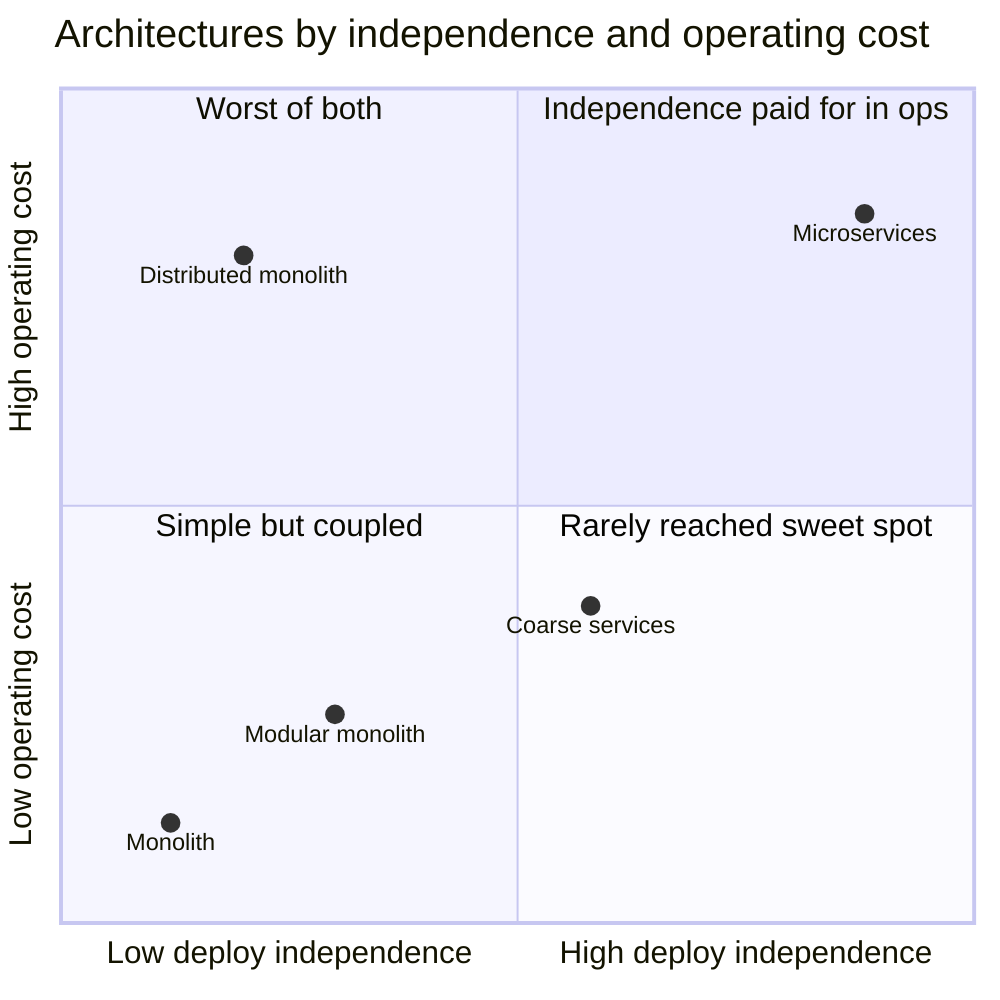
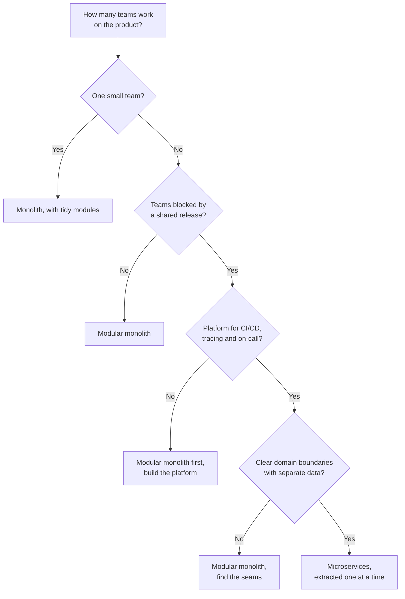

# Monolith vs Modular Monolith vs Microservices

Three ways to structure a backend, compared for the job of letting a growing number of engineers keep shipping one product without stepping on each other or breaking production.

## Explain it like I'm 5

A class builds one huge castle out of blocks. At first everyone builds on the same table, and it is quick, because you can grab any block you need. As the class grows, kids knock over each other's towers. So the table gets taped into areas, one per group, with a door between areas. Later, some groups move to their own tables in other rooms. Nobody knocks their towers over now, but every time they need a block from another group, they must walk down the hall and ask.

*For grown-ups:* The shared table is a monolith, the taped areas with doors are a modular monolith's enforced module boundaries, and separate rooms are microservices, where every borrowed block is a network call that can be slow or fail.

## The short answer

A monolith is one deployable unit with one database, and it is the fastest way for a small team to build a product. A modular monolith keeps the single deploy but splits the code into modules with public interfaces and private internals, with tooling that stops one module reaching into another's tables or classes. Microservices split those modules into separately deployed services, each owning its data, so teams can release and scale independently. That independence is paid for in distributed-system costs: network failures, eventual consistency, harder debugging and more infrastructure. The structure should follow team boundaries, and most products should earn their way from the first to the third, not start there.

**Pick a monolith when** one small team is building a new product and the domain boundaries are still being discovered.

**Pick a modular monolith when** several teams share the codebase and stepping on each other is the problem, but one deploy is still workable.

**Pick microservices when** teams need to release on independent schedules, parts of the system have very different scaling, security or technology needs, and you can afford the platform work to run many services.

**Use both when** you migrate: a modular monolith with a few extracted services is a normal, often permanent, end state.

## At a glance

| Dimension | Monolith | Modular monolith | Microservices |
| --- | --- | --- | --- |
| Deployable units | One | One | Many, one per service |
| Code boundaries | By convention | Enforced by tooling or the compiler | Enforced by the network |
| Data ownership | Shared schema | Schema per module, often one database | Database per service |
| Calls between parts | In-process function calls | In-process calls through public interfaces | Network calls (HTTP, gRPC, messages) |
| Consistency | Local transactions | Local transactions | Sagas, outbox, eventual consistency |
| Scaling | Whole app together | Whole app together | Per service |
| Failure modes | Process crash takes all down | Same as monolith | Partial failure, timeouts, cascades |
| Team fit | One or a few teams | Several teams, one release train | Many teams, independent releases |
| Operational cost | Low | Low to moderate | High: CI/CD, observability, platform |
| Refactoring across boundaries | Easy | Moderate | Hard, needs API versioning |

## How each one works

### Monolith

Every feature lives in one codebase, built and deployed as one unit and scaled by running more copies behind a load balancer. Any code can call any other code and join any tables, which is what makes early development fast and what lets the code tangle as the team grows.

### Modular monolith

The code is split into modules that expose a small public interface and hide everything else, and a build-time check rejects any change that crosses a boundary. Each module owns its own tables, even if they live in one database. Shopify described this approach for its main Rails application, with a tool called Packwerk that checks references between components on every pull request. It keeps local transactions and one deploy while getting most of the code-ownership benefit.

### Microservices

Each service is deployed, scaled and owned by one team, and it is the only thing allowed to touch its own database. Other services get data through its API or by consuming its events. Every arrow is now a network hop, so every call needs a timeout, a retry policy and a plan for when the other side is down.

## Where each one sits

*Positions are qualitative judgments for comparison, not measurements.*

Monoliths and modular monoliths are cheap to run, but release together. Microservices buy independence with platform and operational cost. The trap is the top-left: a distributed monolith, where services share a database or must be released in lockstep, so the team pays the network costs without gaining independence. A few coarse-grained services split along real team boundaries often sit in a reasonable middle.

## Decision guide

## Trade-offs in depth

### Team size and boundaries

Conway's law, which the original microservices article by Lewis and Fowler leans on, says a system's structure tends to mirror how the organisation communicates. With one team, a single codebase matches how people already talk. With many teams, a shared codebase means shared releases, merge conflicts and unclear ownership, and boundaries start to matter. The right boundaries follow business capabilities (orders, billing, catalogue), not technical layers (controllers, database). Get the boundaries wrong and microservices make it worse, because moving a responsibility between services is far harder than moving it between modules.

### Deployment

A monolith ships everything at once, so one broken feature blocks or rolls back everyone's changes, and build and test times grow with the codebase. Microservices let each team ship many times a day without coordinating, but only if services are truly independent: if a change needs three services released in a set order, you have the costs of both models. Independent deploys also demand backward-compatible APIs and events, because the caller and the callee will run different versions during every rollout.

### Data ownership

A shared database is the strongest coupling there is. If two services read and write the same tables, neither can change its schema alone, and independent deploys are a fiction. Microservices therefore give each service its own data and expose it only through APIs or events. The cost is that queries spanning services lose JOINs: you compose them at runtime ([scatter-gather](../../patterns/architecture/scatter-gather)) or maintain read models from events ([CQRS](../../patterns/data/cqrs), [materialised views](../../patterns/data/materialized-view)). A modular monolith can enforce the same ownership rule with schema-per-module while keeping transactions, which makes it a good rehearsal.

### Distributed-system costs

A function call either returns or throws. A network call can also time out with the work half done, succeed twice after a retry, or arrive after a newer one. Moving to microservices means designing for that on every edge: [timeouts](../../patterns/reliability/timeout), [retries with backoff](../../patterns/reliability/retry-backoff), [circuit breakers](../../patterns/reliability/circuit-breaker), [idempotent consumers](../../patterns/distributed/idempotent-consumer), and [sagas](../../patterns/distributed/saga-orchestration) instead of database transactions. Debugging needs distributed tracing, and latency adds up across hops. These costs are permanent, not a one-off migration expense.

### Scaling and cost

Microservices let a hot component scale alone, which matters when one part has very different load or resource needs. Monoliths scale by running more full copies, which is usually fine until one heavy component forces large machines for everything. The opposite case also happens: Prime Video's video quality monitoring team reported in 2023 that moving one service from distributed serverless components (Step Functions, Lambda, S3 for intermediate data) to a single process on ECS cut its infrastructure cost by over 90%, because passing data in memory was far cheaper than passing it between components. That was one workload, not all of Prime Video, but it shows that splitting has a cost per hop.

### Migration paths

The safest route from a monolith is incremental. Put a routing facade in front, rebuild one capability at a time, move its traffic over by percentage with instant rollback, and retire the old code path once nothing uses it. This is Martin Fowler's [strangler fig](../../patterns/architecture/strangler-fig) application, named after a vine that grows around a host tree. Doing it well usually starts inside the monolith: carve out a module with a clean interface and its own tables first, so extracting it as a service later is a deployment change rather than a redesign. Moving data is the hard part; the [transactional outbox](../../patterns/distributed/transactional-outbox) and [CDC](../../patterns/data/cdc-cache-invalidation) help keep old and new stores in step during the move. Big-bang rewrites remain the riskiest option.

## Common misconceptions

- **"Monoliths do not scale."** Many large products run as monoliths scaled horizontally. What stops scaling first is usually the team's ability to work in one codebase, not the runtime.
- **"Microservices make a system more reliable."** They isolate some failures, but they add network failure modes, and without timeouts and bulkheads one slow service can still [cascade](../../scenarios/cascading-failure) through the rest.
- **"Small services are better services."** Size is not the goal. A service should match a business capability one team can own; very fine-grained services multiply network hops and coordination.
- **"We can share the database for now."** Shared tables couple every service that touches them, which is the distributed monolith. Separate data ownership is the part you cannot skip.
- **"A modular monolith is just a monolith with folders."** The difference is enforcement: boundaries checked by tooling or the compiler on every change, and private data per module.

## In this repo

- [Strangler fig](../../patterns/architecture/strangler-fig): a routing facade with sticky, per-route percentage rollout and instant rollback, the main migration path.
- [API gateway](../../patterns/architecture/api-gateway) and [backend for frontend](../../patterns/architecture/backend-for-frontend): the edge layer microservices need for auth and per-client shaping.
- [Saga orchestration](../../patterns/distributed/saga-orchestration) and [saga choreography](../../patterns/distributed/saga-choreography): multi-service workflows without a shared transaction.
- [Transactional outbox](../../patterns/distributed/transactional-outbox): publishing events reliably when each service owns its database.
- [Idempotent consumer](../../patterns/distributed/idempotent-consumer): handling the duplicate deliveries that come with messaging between services.
- [CQRS](../../patterns/data/cqrs) and [materialised view](../../patterns/data/materialized-view): read models that replace cross-service JOINs.
- [Service discovery](../../patterns/architecture/service-discovery) and [sidecar](../../patterns/architecture/sidecar): the plumbing for finding and talking to many services.
- [Circuit breaker](../../patterns/reliability/circuit-breaker), [timeout](../../patterns/reliability/timeout) and [bulkhead](../../patterns/reliability/bulkhead): the defences every network edge needs.
- [Cascading failure](../../scenarios/cascading-failure) and [charged but no order](../../scenarios/charged-but-no-order): incidents that only exist once work spans services.

## Interview follow-ups

*How would you decide where to split a monolith?* Look for business capabilities with their own data, their own rate of change and a natural owning team. Tables that are written by only one area of code are a strong signal. Avoid splitting along layers, and avoid splits that would need a distributed transaction for common operations.

*How do you keep data consistent across services without two-phase commit?* Each service commits locally and publishes an event through an outbox. A saga coordinates the steps and runs compensating actions on failure, and consumers are idempotent because delivery is at least once.

*What is a distributed monolith and how do you spot one?* Services that share a database, must be deployed together, or call each other synchronously in long chains for every request. The symptoms are lockstep releases and outages that spread across all services at once.

*How would you migrate a live monolith without downtime?* Strangler fig: put a router in front, extract one capability, shadow or canary traffic to it by percentage with sticky routing, compare results, ramp to 100%, then delete the old code. Migrate data with dual writes through an outbox or with CDC.

*When would you merge microservices back together?* When services always change and deploy together, when chatty calls between them dominate latency or cost, or when one team owns them all anyway.

## Further reading

- [Microservices, by James Lewis and Martin Fowler](https://martinfowler.com/articles/microservices.html): the 2014 article defining the style, including decentralised data and Conway's law.
- [MonolithFirst](https://martinfowler.com/bliki/MonolithFirst.html): Fowler's 2015 argument for starting with a monolith and finding boundaries first.
- [Strangler Fig Application](https://martinfowler.com/bliki/StranglerFigApplication.html): incremental replacement of a legacy system.
- [Shopify Engineering on its modular monolith](https://shopify.engineering/shopify-monolith): a 2020 case study of a modular monolith with Packwerk.
- [InfoQ on Prime Video's move to a single process](https://www.infoq.com/news/2023/05/prime-ec2-ecs-saves-costs/): coverage of the 2023 cost reduction and its scope.
