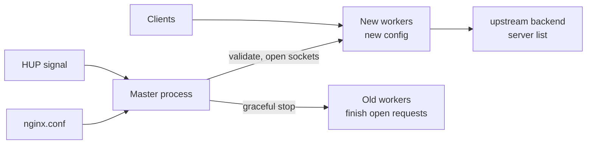
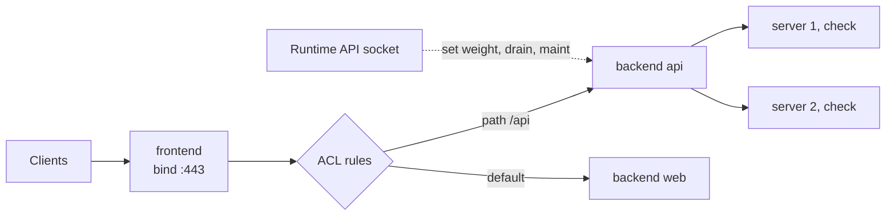
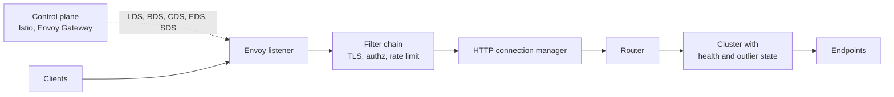
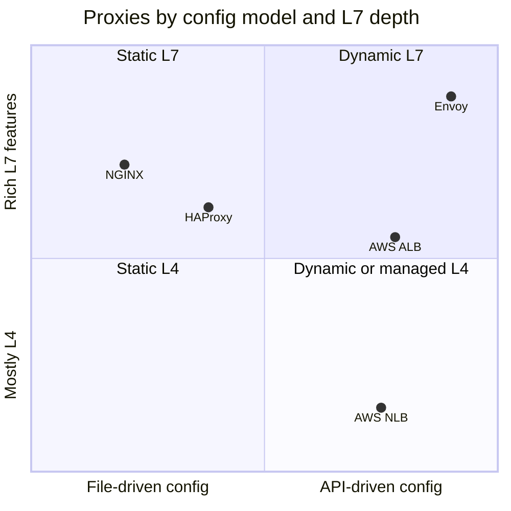
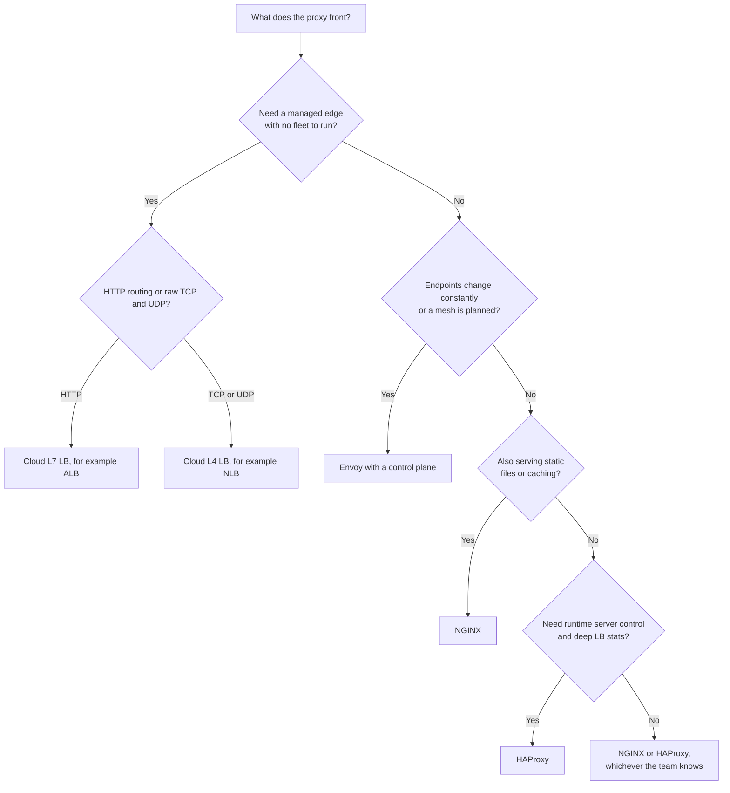

# NGINX vs HAProxy vs Envoy

Three open-source proxies compared for the job of load balancing and proxying traffic: at the edge of a system, in front of a service tier, and inside a service mesh, with a note on where managed cloud load balancers fit.

## Explain it like I'm 5

Three crossing guards help kids get to the right classroom. The first guard reads a rule book printed every morning. To change a rule, a new guard with the new book steps in, and the old guard finishes walking the kids already crossing. The second guard has the same kind of book but also a walkie-talkie for small changes, like "room 3 is closed". The third guard has no book at all and listens to the head teacher on the walkie-talkie all day.

*For grown-ups:* The printed book is a static config file reloaded by new worker processes (NGINX), the walkie-talkie for small changes is HAProxy's Runtime API, and the guard who only listens is Envoy receiving everything over xDS from a control plane.

## The short answer

All three can proxy TCP and HTTP, terminate TLS, balance across backends and survive config changes without dropping connections, so the choice is rarely about raw capability. The real difference is the configuration model. NGINX is a web server and reverse proxy driven by a config file, ideal when you also serve static content or want one familiar tool at the edge. HAProxy is a dedicated load balancer with a config file, rich health checking and statistics, and a Runtime API for changing server state without reloading. Envoy was built to be configured by a control plane over APIs (xDS), which is why it sits under Istio, many API gateways and several cloud load balancers. Managed cloud load balancers remove the fleet you would otherwise run, and are often placed in front of one of these three.

**Pick NGINX when** you need a web server and proxy in one, serve static files or cached content, and change routing through deploys rather than at runtime.

**Pick HAProxy when** the job is pure load balancing at high connection counts and you value detailed health checks, stats and runtime server control with a stable file-based config.

**Pick Envoy when** endpoints and routes change constantly (Kubernetes, service mesh), you want per-request L7 policy for gRPC and HTTP/2, or a control plane will own configuration.

**Use more than one when** layers differ: a cloud L4 balancer at the edge, NGINX or HAProxy as the ingress tier, and Envoy sidecars or waypoints inside the mesh is a common stack.

## At a glance

| Dimension | NGINX (open source) | HAProxy (community) | Envoy |
| --- | --- | --- | --- |
| Origin and focus | Web server plus reverse proxy | Dedicated TCP and HTTP load balancer | L7 proxy built for service architectures |
| Layers | HTTP, plus TCP and UDP via `stream` | TCP mode and HTTP mode | L3/L4 network filters and HTTP filters |
| Config model | Static file, reload to apply | Static file, Runtime API for live state | Static bootstrap or dynamic xDS APIs |
| Changing config | Signal reload, new workers | Seamless reload, socket hand-over | Pushed over xDS, no restart for most changes |
| Health checks | Passive (`max_fails`); active is in NGINX Plus | Active and passive | Active and passive, plus outlier ejection |
| Built-in metrics | Instance-wide counters (`stub_status`) | Stats page and Prometheus exporter | Detailed per-cluster stats, tracing |
| Protocols | HTTP/1.1, HTTP/2, gRPC proxying; HTTP/3 still marked experimental | HTTP/1.1, HTTP/2, gRPC; HTTP/3 over QUIC in recent versions | HTTP/1.1, HTTP/2, HTTP/3, gRPC, translating between them |
| Service mesh role | Rare | Rare | Data plane for Istio and others |
| Operational feel | Familiar, file-first | Predictable, file-first | Powerful but verbose, control plane expected |

## How each one works

### NGINX

A master process reads the config and forks worker processes that each run an event loop. On reload the master validates the new file, rolls back if it cannot open sockets or logs, starts fresh workers with the new config and tells the old ones to stop accepting and exit when their clients finish. Upstream membership lives in that file. Open-source NGINX can now re-resolve upstream hostnames at runtime (`resolve`, open source since 1.27.3), but adding or removing servers through an API is an NGINX Plus feature.

### HAProxy

Traffic enters a `frontend`, ACLs pick a `backend`, and the backend balances across `server` lines that HAProxy health-checks actively. The Runtime API changes the running state (enable, disable or reweight servers, update maps) without a reload, but those changes live only in memory and are lost on the next reload unless written back to the file. Structural changes go through the file and a seamless reload that passes the listening sockets to the new process.

### Envoy

Envoy is built from listeners, filter chains, routes and clusters, and each of those can arrive over its own discovery API: listeners (LDS), routes (RDS), clusters (CDS), endpoints (EDS) and secrets (SDS), optionally on one aggregated stream (ADS) and as deltas. A control plane watches the platform (for example Kubernetes) and pushes updates, so an endpoint change reaches every proxy without a file edit or restart. A fully static config is possible, but then changes need a hot restart.

## Where each one sits

*Positions are qualitative judgments for comparison, not measurements.*

NGINX and HAProxy share the file-driven top-left, with HAProxy nudged right by its Runtime API. Envoy owns the top-right because both its L7 features and its config arrive through APIs. Cloud load balancers are API-driven by nature (you configure them through the provider), and they split by layer: ALB routes HTTP requests, NLB routes TCP and UDP flows.

## Decision guide

## Trade-offs in depth

### L4 vs L7

An L4 proxy sees TCP or UDP flows. It picks a backend per connection, forwards bytes, and cannot route by path or retry a single request. An L7 proxy parses HTTP, so it can route by host, path or header, retry idempotent requests, add headers and balance per request. The difference matters most for HTTP/2 and gRPC, which multiplex many requests over one long-lived connection: an L4 balancer pins all of a client's requests to one backend, while an L7 proxy spreads them. All three tools do both layers (NGINX through its `stream` module, available since 1.9.0 with UDP since 1.9.13; HAProxy through `mode tcp`; Envoy through network filters), so the question is which layer each hop needs, not which tool supports it.

### Configuration model: static files vs xDS

A static file is easy to review, diff and roll back, and suits fleets where backends change through deploys. It strains when backends change by the second, as in Kubernetes. The usual workaround for NGINX and HAProxy is a controller that rewrites the file and reloads, or DNS re-resolution. Envoy inverts the model: the proxy holds no source of truth and accepts typed resources from a control plane, so a new pod becomes an EDS update. The cost is that you now operate (or adopt) that control plane, and debugging means asking "what config did this proxy receive" rather than reading a file.

### Hot reload and long-lived connections

All three avoid dropping connections on change, through different mechanisms. NGINX starts new workers and lets old ones drain. HAProxy hands its listening sockets to the new process; in master-worker mode the master does this through an internal socket pair, so no extra stats socket is needed. Envoy's hot restart passes listening sockets and statistics from the old process to the new one over a Unix socket, with a configurable drain time, though under xDS most changes need no restart at all. The shared weak spot is long-lived connections such as WebSockets and gRPC streams: old processes keep running until those close, so frequent reloads can stack up processes and memory unless you cap the drain time.

### Observability

Envoy emits detailed statistics for every listener, cluster and route, exposes them on an admin port and supports distributed tracing, which is a large part of why meshes use it. HAProxy has a long-standing stats page and a built-in Prometheus exporter (since 2.0), with per-frontend, backend and server counters. Open-source NGINX's `stub_status` reports only instance-wide connection and request counters, with no per-upstream breakdown; deeper metrics come from access logs, third-party exporters or NGINX Plus.

### Service mesh

A mesh needs a proxy that can be reconfigured continuously, issue and rotate certificates and report per-request telemetry, which is why Envoy became the default data plane. Istio originally put an Envoy sidecar in every pod. Its ambient mode, generally available since Istio 1.24 (November 2024), replaces sidecars with a per-node L4 proxy written in Rust (ztunnel) for mTLS and L4 policy, and adds Envoy-based waypoint proxies only where L7 features are needed. The [sidecar](../../patterns/architecture/sidecar) trade-off is the reason: one proxy per pod costs memory and upgrade effort for every workload.

### Where cloud load balancers fit

Managed load balancers take away scaling, patching and high availability of the proxy fleet. AWS splits them by layer: an Application Load Balancer evaluates listener rules per HTTP request, a Network Load Balancer hashes each TCP connection to one target for its lifetime, and a Gateway Load Balancer forwards flows to appliances over GENEVE. Google Cloud's Application Load Balancers run on Google Front Ends or on Envoy, depending on the variant; the regional and internal ones are managed Envoy fleets. The usual pattern is a cloud balancer at the edge and your own proxy behind it where you need custom logic.

### The Kubernetes ingress shift

The community `ingress-nginx` controller, a separate project from NGINX itself, was retired by Kubernetes in March 2026 and no longer gets releases or security fixes. The Kubernetes committees recommend migrating to the Gateway API or another controller. F5's own NGINX Ingress Controller is a different project and is still maintained. This is a change of controller, not a verdict on NGINX as a proxy.

## Common misconceptions

- **"NGINX is only for HTTP."** The `stream` module proxies and balances raw TCP and UDP.
- **"Reloading a proxy drops connections."** All three hand over listening sockets or drain old processes. The real risk is long-lived connections keeping old processes alive.
- **"Envoy is only for service meshes."** It also runs as an edge proxy and API gateway, and Google Cloud uses it inside managed load balancers.
- **"A cloud load balancer means you do not need a proxy."** It covers routing and TLS at the edge, but per-service retries, rate limits, auth filters and mesh policy still need something closer to the services.
- **"ingress-nginx retiring means NGINX is going away."** Only that community Kubernetes controller was retired; NGINX and other NGINX-based controllers continue.

## In this repo

- [Load balancing](../../patterns/architecture/load-balancing): round robin vs power of two choices on in-flight counts, the algorithms these proxies offer.
- [Outlier detection](../../patterns/reliability/outlier-detection): passive ejection of slow or failing hosts, as Envoy does per cluster.
- [Health check](../../patterns/reliability/health-check): the active checks HAProxy and Envoy run against backends.
- [Sidecar](../../patterns/architecture/sidecar): the per-pod proxy model that Envoy made common and ambient mesh reduces.
- [Service discovery](../../patterns/architecture/service-discovery): the registry that a control plane turns into EDS updates.
- [API gateway](../../patterns/architecture/api-gateway): edge auth and identity headers, a job often built on Envoy or NGINX.
- [Connection pool](../../patterns/architecture/connection-pool): upstream connection reuse and limits, which every proxy manages.
- [Circuit breaker](../../patterns/reliability/circuit-breaker) and [token bucket](../../patterns/reliability/rate-limiter-token-bucket): limits a proxy can enforce on behalf of services.
- [Graceful shutdown](../../patterns/reliability/graceful-shutdown): the draining behaviour that makes reloads and deploys safe.
- [Gateway bottleneck](../../scenarios/gateway-bottleneck) and [cascading failure](../../scenarios/cascading-failure): incidents where the proxy tier is the cause or the cure.

## Interview follow-ups

*Your gRPC service sits behind an L4 load balancer and one backend is overloaded. Why?* gRPC multiplexes all calls on long-lived HTTP/2 connections and an L4 balancer picks a backend per connection, so a few busy clients pin their load. Balance per request with an L7 proxy, use client-side balancing, or cap connection age so clients reconnect.

*How would you change backend servers without dropping traffic?* With HAProxy, drain or disable the server through the Runtime API, then update the file. With Envoy, the control plane removes the endpoint via EDS and the proxy drains it. With NGINX, mark it `down` or remove it and reload, relying on graceful worker shutdown.

*Why did service meshes pick Envoy?* It was designed for API-driven config (xDS), has rich per-request stats and tracing, and handles HTTP/2 and gRPC natively, which is what a control plane needs from thousands of proxies.

*When would you skip running your own proxy at all?* When a managed L7 balancer covers routing, TLS and health checks, and there is no need for custom filters, mesh policy or per-request logic beyond what the provider offers.

*What is the cost of a sidecar per pod, and what replaces it?* Extra memory and CPU per pod, an extra hop and a proxy upgrade tied to every workload. Node-level L4 proxies with optional shared L7 proxies, as in Istio ambient mode, cut that cost.

## Further reading

- [NGINX: controlling nginx](https://nginx.org/en/docs/control.html): how a HUP reload starts new workers and retires old ones.
- [NGINX upstream module](https://nginx.org/en/docs/http/ngx_http_upstream_module.html): `resolve`, `zone`, passive failure handling and which features are commercial.
- [NGINX stream core module](https://nginx.org/en/docs/stream/ngx_stream_core_module.html): TCP and UDP proxying.
- [NGINX stub_status module](https://nginx.org/en/docs/http/ngx_http_stub_status_module.html): the built-in open-source metrics.
- [HAProxy Runtime API](https://www.haproxy.com/documentation/haproxy-runtime-api/): changing running state without a reload.
- [HAProxy Prometheus exporter](https://www.haproxy.com/documentation/haproxy-configuration-tutorials/alerts-and-monitoring/prometheus/): the built-in metrics endpoint.
- [HAProxy: truly seamless reloads](https://www.haproxy.com/blog/truly-seamless-reloads-with-haproxy-no-more-hacks): socket hand-over between processes.
- [What is Envoy](https://www.envoyproxy.io/docs/envoy/latest/intro/what_is_envoy): filter architecture, protocols and observability.
- [Envoy dynamic configuration](https://www.envoyproxy.io/docs/envoy/latest/intro/arch_overview/operations/dynamic_configuration): the xDS APIs, ADS and delta xDS.
- [Envoy hot restart](https://www.envoyproxy.io/docs/envoy/latest/intro/arch_overview/operations/hot_restart): socket and stats hand-over between processes.
- [Istio ambient mode overview](https://istio.io/latest/docs/ambient/overview/) and [ambient GA announcement](https://istio.io/blog/2024/ambient-reaches-ga/): ztunnel and waypoint proxies.
- [How Elastic Load Balancing works](https://docs.aws.amazon.com/elasticloadbalancing/latest/userguide/how-elastic-load-balancing-works.html): ALB, NLB and Gateway Load Balancer routing.
- [Google Cloud Application Load Balancer overview](https://docs.cloud.google.com/load-balancing/docs/application-load-balancer): which variants run on Envoy.
- [Ingress NGINX retirement](https://kubernetes.io/blog/2025/11/11/ingress-nginx-retirement/): the Kubernetes announcement and migration advice.
