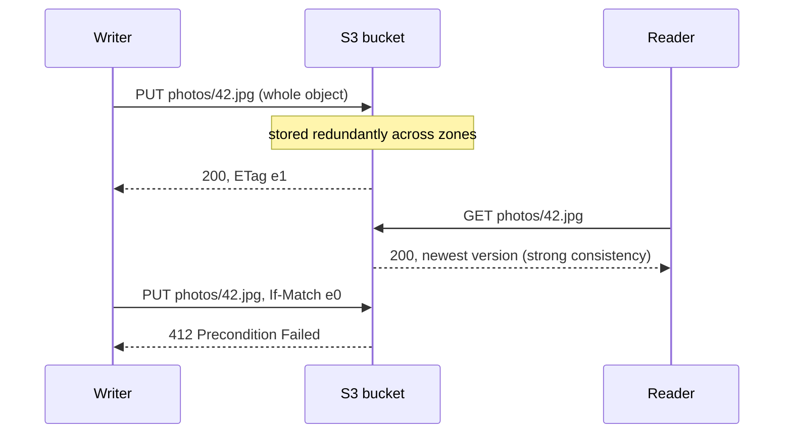
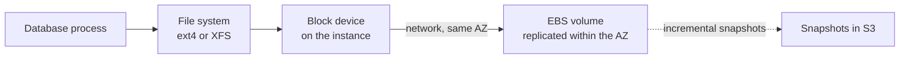
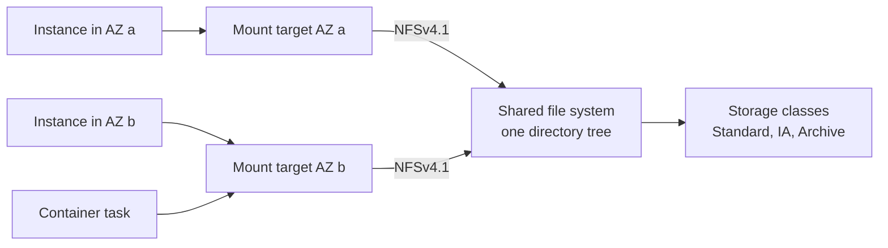
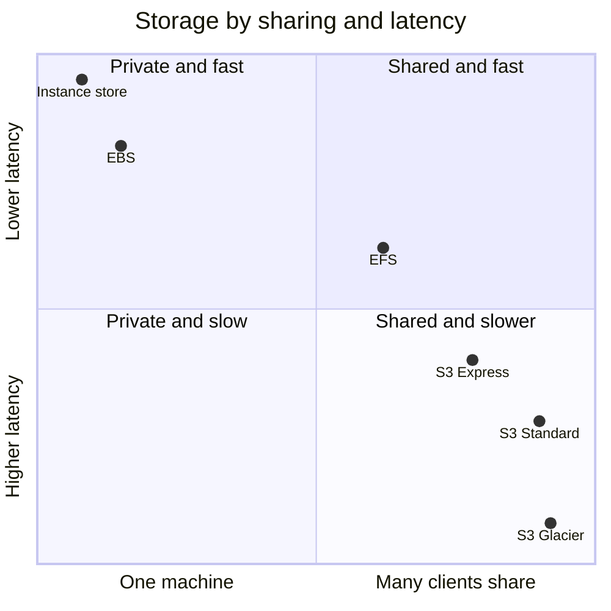
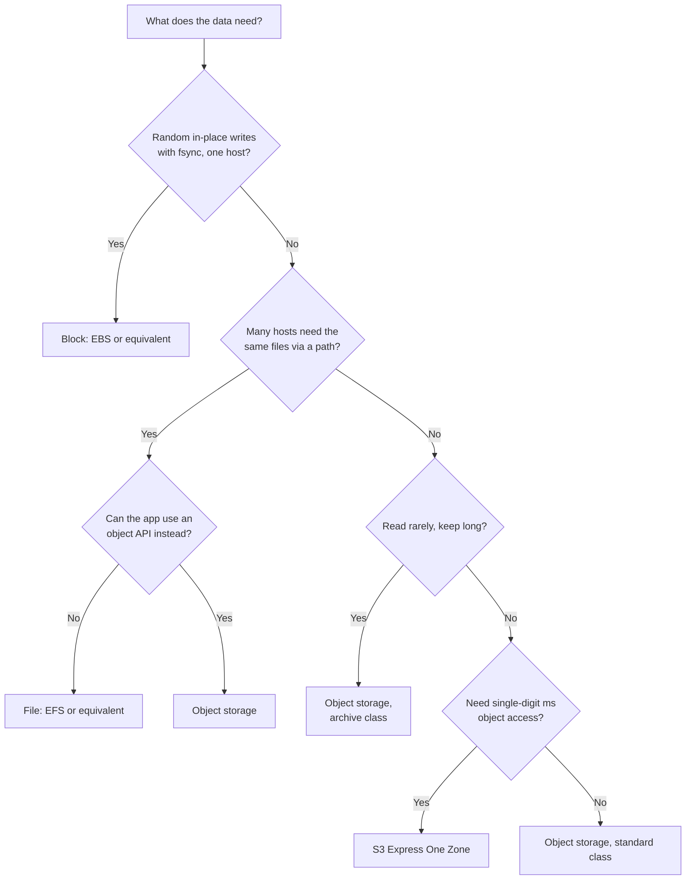

# Object vs Block vs File Storage

Three ways to store bytes in the cloud, compared for the job of picking where each kind of data should live: Amazon S3 (object), Amazon EBS (block) and Amazon EFS (file), with their Azure and Google Cloud equivalents.

## Explain it like I'm 5

Think of three places to keep your things. The first is a giant warehouse with numbered boxes. You hand over a whole box and get a ticket, and anyone with the ticket can fetch it, but you cannot open a box there and swap one crayon. The second is your own desk drawer, right next to you, very quick, but only you can reach it. The third is the classroom cupboard with labelled shelves that the whole class can open at once.

*For grown-ups:* The warehouse is object storage (whole objects by key over HTTP), the desk drawer is a block volume attached to one machine, and the shared cupboard is a network file system many machines mount at once.

## The short answer

Object storage keeps whole objects under keys, reached over an HTTP API, and scales to practically unlimited size at the lowest cost per gigabyte; it is the default for media, backups, logs and data lakes. Block storage is a raw disk attached to one machine; the operating system puts a file system on it, and it gives the low, steady latency that databases and boot volumes need. File storage is a shared file system over NFS or SMB that many machines mount at once, with directories, permissions and locks, for applications that expect a POSIX path. The differences come from the access model, and that model decides consistency, latency and how you pay.

**Pick object storage when** data is written once and read many times, is accessed by key from many places, or must scale without capacity planning.

**Pick block storage when** one machine needs a fast disk: databases, message broker logs, boot volumes, anything that does random in-place writes and `fsync`.

**Pick file storage when** several machines must share the same directory tree through ordinary file calls, such as shared content, home directories or lift-and-shift applications.

**Use more than one when** a system has more than one kind of data, which is almost always: a database on block volumes, its backups and user uploads in object storage, and shared configuration or assets on a file system.

## At a glance

| Dimension | Object (S3) | Block (EBS) | File (EFS) |
| --- | --- | --- | --- |
| Access model | HTTP API: PUT, GET, LIST by key | Raw device; the OS adds a file system | NFS mount with POSIX paths |
| Who can access | Any authorised client, anywhere | One instance (Multi-Attach for io1 and io2) | Many instances across zones |
| Update granularity | Whole object replaced | Any block, in place | Any byte range in a file |
| Consistency | Strong read-after-write (since December 2020) | Single writer, the file system decides | Close-to-open, as NFS clients expect |
| Concurrency control | Conditional writes (`If-None-Match`, `If-Match`) | None across hosts without a cluster file system | Advisory NFS locks |
| Latency class | Milliseconds (single digit with Express One Zone) | Lowest of the three, local-disk-like | Sub-millisecond first byte on Standard |
| Scope of failure | Region (multi-AZ by default) | One Availability Zone | Region, or one zone for One Zone |
| Capacity | Grows with use, no provisioning | Provisioned size | Grows with use |
| Cost model | Per GB stored, plus requests and egress | Per GB provisioned, plus extra IOPS and throughput | Per GB stored by class, plus access and throughput |
| Azure | Blob Storage | Managed Disks | Azure Files |
| Google Cloud | Cloud Storage | Persistent Disk and Hyperdisk | Filestore |

## How each one works

### Object storage

Objects are written and read whole, by key, over HTTPS. There are no in-place edits: changing one byte means uploading a new version of the object. Since December 2020, S3 gives strong read-after-write consistency for GET, PUT and LIST, including overwrites and deletes, so a successful write is visible to the next read. Conditional writes add compare-and-set: `If-None-Match: *` refuses to overwrite an existing key, and `If-Match` refuses if the ETag has changed.

### Block storage

The volume looks like a local disk: the OS reads and writes fixed-size blocks at any offset, and a file system on top provides files and directories. Because one file system owns the device, consistency is whatever that file system and `fsync` give you. An EBS volume lives in one Availability Zone and attaches to instances in that zone; it is replicated within the zone, and snapshots copy changed blocks to S3 to survive beyond it.

### File storage

Clients mount the file system over NFS through a mount target in their zone and use ordinary file calls. The service handles the shared directory tree, permissions and locks, and grows as data is added. EFS gives close-to-open consistency: changes a client writes before closing a file are visible to any client that opens the file afterwards, and synchronous writes or closing the file make the data durable across zones. Locks are advisory, so writers must cooperate.

## Where each one sits

*Positions are qualitative judgments for comparison, not measurements.*

Latency and sharing pull against each other: the closer storage is to one machine, the faster and more private it is. Instance store (physically attached, lost when the instance stops) and EBS hold the fast, private corner, EFS trades some latency for many readers and writers, and object storage spreads down the right side by storage class, from S3 Express One Zone to archive tiers whose retrieval takes minutes to hours.

## Decision guide

## Trade-offs in depth

### Access model

The access model is the root of every other difference. Object storage is an HTTP API, so any client with credentials can reach it from anywhere, but each operation is a request with request-level latency and cost, and there is no partial update: you replace whole objects (large ones are uploaded in parts). Block storage is a disk, so it supports the small random writes, in-place updates and `fsync` that databases are built on, but only the machine that mounted it can use it. File storage sits between them: real files and directories many hosts can open, with the coordination that requires. Adapters such as Mountpoint for S3 make a bucket look like a file system, but they cannot add what the API lacks, so editing files in place, directory renames and symlinks are poor fits.

### Consistency

S3 used to be eventually consistent for overwrites and listings, which forced tools such as S3Guard and EMRFS consistent view. Since December 2020 every GET, PUT and LIST is strongly consistent, for all objects, at no extra cost. Strong consistency is not locking, though: two writers can still overwrite each other, so use conditional writes, where S3 lets the first writer finish and returns `412 Precondition Failed` to the rest. Block storage has a single writer by design. EBS Multi-Attach lets up to 16 Nitro instances in one zone share an io1 or io2 volume, but ordinary file systems such as ext4 and XFS will corrupt it; you need a cluster-aware file system and write ordering. EFS gives close-to-open semantics, and read-after-write for synchronous, non-appending writes, with advisory byte-range locks for coordination.

### Latency class

Block storage is the fastest of the three because it behaves like a local disk on a dedicated path, which is why databases and logs live there. EFS Standard gives sub-millisecond first-byte latency, with infrequent-access classes in the tens of milliseconds. S3 Standard is in the milliseconds per request, and S3 Express One Zone offers single-digit millisecond requests from directory buckets in one zone you choose. Archive classes trade minutes to hours of retrieval time for the lowest storage price. For object storage, throughput comes from parallelism (many concurrent requests and parts) rather than from a faster single request.

### Cost model

The three bill differently, and the difference matters more than the headline price. EBS charges for provisioned capacity whether or not you fill it, and gp3 includes a baseline of 3,000 IOPS and 125 MB/s with extra performance billed on top. EFS charges for what you actually store in each class, plus access charges for infrequent-access data and, in Elastic throughput mode, for data transferred. S3 charges for bytes stored over time per class, per request, for retrievals from infrequent and archive classes, and for most data transferred out. Infrequent and archive classes add minimum storage durations (30, 90 or 180 days) and, for some, a 128 KB minimum billable object size, which punishes many tiny objects.

### Durability and failure scope

S3 storage classes are designed for eleven nines of durability, and the standard classes store data across at least three Availability Zones, so losing a zone does not lose data. One Zone classes keep data in a single zone and can lose it if that zone is destroyed. An EBS volume is replicated within its zone but lives and dies with that zone, so cross-zone safety comes from snapshots, which are incremental and stored in S3. Regional EFS stores data across zones; One Zone EFS is cheaper and bound to one zone.

### Which workloads fit each

Block: relational and NoSQL databases, Kafka or other broker logs, boot volumes, and anything with a [write-ahead log](../../patterns/data/write-ahead-log) or an [LSM tree](../../patterns/data/lsm-tree) that wants fast `fsync`. Object: user uploads, images and video, static site assets behind a [CDN](../../patterns/architecture/tiered-cache), backups and snapshots, logs, and data lakes queried in place. File: shared web content or CMS uploads across a fleet, home directories, build caches, machine-learning datasets read by many workers, and legacy applications that expect a shared path.

## Common misconceptions

- **"S3 is eventually consistent."** That was true before December 2020. GET, PUT and LIST are now strongly consistent for all objects.
- **"Strong consistency means S3 is safe for concurrent writers."** It means reads see the latest completed write. Two writers can still overwrite each other; use `If-Match` or `If-None-Match` conditional writes for compare-and-set.
- **"Multi-Attach turns EBS into shared storage."** Only for io1 and io2, only within one zone, and only with a cluster-aware file system and application-level write ordering. For ordinary sharing, use a file system service.
- **"You can run a database on object storage through a FUSE mount."** Mount adapters do not support in-place edits well, and every operation is an HTTP request. Databases belong on block storage; object storage holds their backups.
- **"File storage is the safe default because everything understands paths."** It costs more per GB than object storage and needs care with concurrent writers. Use it when sharing a path is the requirement, not by default.

## In this repo

- [Write-ahead log](../../patterns/data/write-ahead-log): append, `fsync`, then apply; the access pattern block storage is built for.
- [LSM tree](../../patterns/data/lsm-tree): immutable sorted files and compaction, the design that lets databases (and some systems that write to object storage) avoid in-place updates.
- [Conditional requests](../../patterns/architecture/conditional-requests): ETag with `If-None-Match` and `If-Match`, the same mechanism behind S3 conditional writes.
- [Optimistic locking](../../patterns/data/optimistic-locking): versioned compare-and-set, the general form of a conditional overwrite.
- [Tiered cache](../../patterns/architecture/tiered-cache): CDN edges and an origin shield in front of an object store origin.
- [Split, process, merge](../../patterns/distributed/split-process-merge) and the [video pipeline](../../scenarios/video-pipeline) scenario: chunked processing of large objects with checkpoints.
- [Quorum](../../patterns/distributed/quorum) and [consistent hashing](../../patterns/data/consistent-hashing): the replication and placement ideas inside distributed object stores.
- [Async request-reply](../../patterns/architecture/async-request-reply): the job-ID flow used for long uploads and archive restores.

## Interview follow-ups

*Where would you store user-uploaded photos for a social app, and why not on the web servers' disks?* In object storage behind a CDN. It is shared by every server, scales without provisioning, and survives a zone failure; local or block disks tie each file to one machine and one zone.

*How would you stop two workers overwriting the same object in S3?* Use conditional writes. Create with `If-None-Match: *` so only the first writer succeeds, or update with `If-Match` on the ETag you read, and re-read and retry on `412`.

*Your database runs on an EBS volume. How do you survive losing the Availability Zone?* The volume itself cannot cross zones, so replicate at the database level to an instance in another zone, and keep incremental snapshots in S3 to restore from.

*When does EFS make sense over S3?* When unmodified software needs a shared POSIX path, in-place edits or file locks across many hosts. If you control the code and access data whole by key, S3 is cheaper and scales further.

*Why can lots of tiny objects make an S3 bill surprising?* Requests are billed per call, and infrequent-access classes bill a 128 KB minimum per object, so pack small items into larger objects or keep them in Standard.

## Further reading

- [S3 strong read-after-write consistency announcement](https://aws.amazon.com/blogs/aws/amazon-s3-update-strong-read-after-write-consistency/): the December 2020 change and what it covers.
- [S3 consistency overview](https://aws.amazon.com/s3/consistency/): which operations are strongly consistent.
- [S3 conditional writes](https://docs.aws.amazon.com/AmazonS3/latest/userguide/conditional-writes.html): `If-None-Match`, `If-Match` and their 412 and 409 behaviour.
- [S3 storage classes](https://aws.amazon.com/s3/storage-classes/): durability, zones and retrieval times per class.
- [S3 Express One Zone](https://aws.amazon.com/s3/storage-classes/express-one-zone/): directory buckets and single-digit millisecond access.
- [S3 pricing](https://aws.amazon.com/s3/pricing/): billing components, minimum durations and minimum object sizes.
- [Mountpoint for Amazon S3](https://github.com/awslabs/mountpoint-s3): what a file interface over S3 can and cannot do.
- [Amazon EBS volumes](https://docs.aws.amazon.com/ebs/latest/userguide/ebs-volumes.html) and [EBS features](https://docs.aws.amazon.com/ebs/latest/userguide/EBSFeatures.html): zone scope, replication and snapshots.
- [EBS Multi-Attach](https://docs.aws.amazon.com/ebs/latest/userguide/ebs-volumes-multi.html): limits and the need for a clustered file system.
- [EBS pricing](https://aws.amazon.com/ebs/pricing/): provisioned capacity and gp3 baseline performance.
- [How Amazon EFS works](https://docs.aws.amazon.com/efs/latest/ug/how-it-works.html): NFS mounts and mount targets across zones.
- [Amazon EFS features](https://docs.aws.amazon.com/efs/latest/ug/features.html): close-to-open consistency, locking, storage classes and billing.
