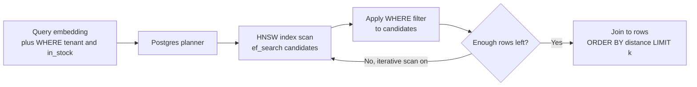
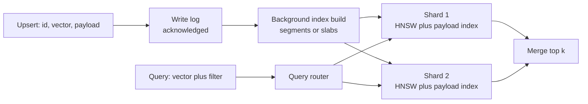
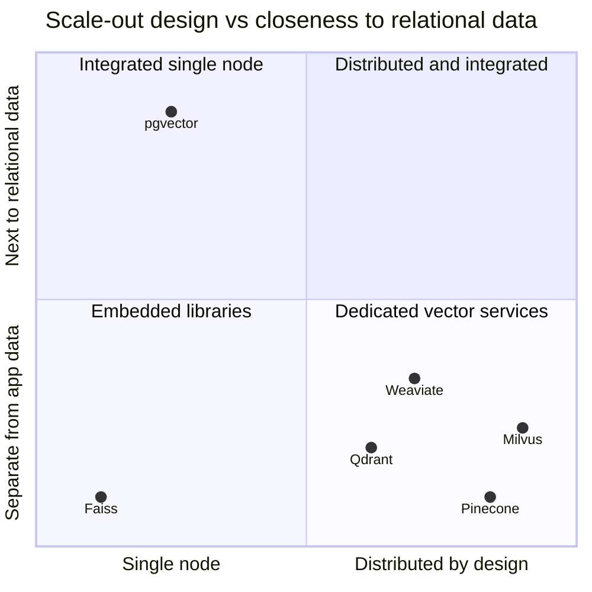
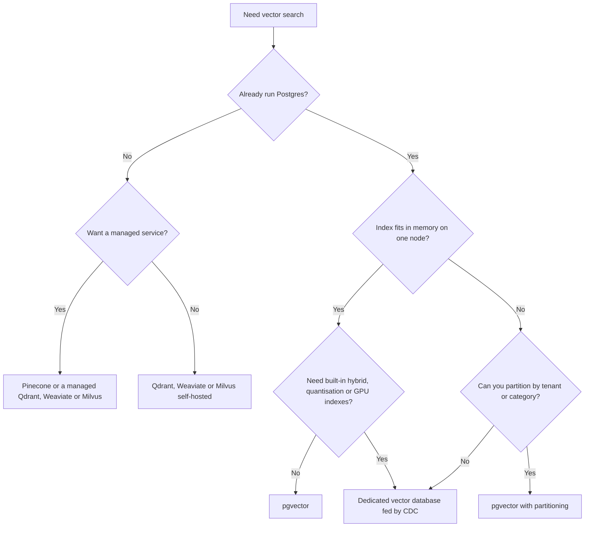

# pgvector vs dedicated vector databases (Pinecone, Milvus, Qdrant, Weaviate)

Storing and searching embeddings inside PostgreSQL compared with running a purpose-built vector database, for semantic search, RAG retrieval and recommendations.

## Explain it like I'm 5

The toy shop keeps a notebook for every toy: price, shelf, who bought it. Now it also wants to find toys that feel alike. One idea: write a "feels like" note into the same notebook, so the shopkeeper can ask "soft, under five coins, in stock" all at once. The other idea: hire a second shop next door that only sorts toys by feel. It is very quick with millions of toys, but every new toy must be told to both shops.

*For grown-ups:* The notebook is Postgres with pgvector, the feel notes are embeddings in a column, the shop next door is a dedicated vector database, and telling both shops is the sync pipeline you take on.

## The short answer

pgvector adds a `vector` column type, distance operators and approximate indexes (HNSW and IVFFlat) to PostgreSQL. For most applications with up to a few tens of millions of vectors, it is the simplest correct answer: embeddings sit in the same row as the data they describe, filters are ordinary `WHERE` clauses, writes are transactional, and there is nothing new to operate. Dedicated vector databases earn their place when vector search is the main workload and the scale or the features outgrow one Postgres node: billions of vectors, disk-based or GPU indexes, quantisation, built-in hybrid fusion, filter-aware graph indexes, or a managed service that scales reads and writes separately. The price is a second system and a pipeline that keeps it in step with your source of truth.

**Pick pgvector when** you already run Postgres, the vectors describe rows you already store, queries mix similarity with relational filters or joins, and the index fits comfortably in memory on one node.

**Pick a dedicated vector database when** vectors are the product (large-scale semantic search, recommendations), the corpus is far beyond one node's memory, you need features such as disk-based ANN, quantisation or native hybrid ranking, or you want a managed service to absorb scaling.

**Use both when** Postgres stays the system of record and a vector database is a derived index fed by change data capture, with IDs linking results back to rows.

## At a glance

| Dimension | pgvector | Dedicated vector databases |
| --- | --- | --- |
| Data model | `vector`, `halfvec`, `bit`, `sparsevec` columns in ordinary tables | Collections of vectors with an ID and a JSON-like payload or metadata |
| Index types | HNSW and IVFFlat | HNSW everywhere; plus IVF variants, product quantisation, DiskANN and GPU indexes (Milvus), quantisation (Qdrant), object-storage slabs (Pinecone) |
| Filtering | SQL `WHERE`; ANN indexes filter after the scan, with iterative scans since 0.8.0 | Payload or metadata filters built into the search, some filter-aware graphs (Qdrant) |
| Hybrid search | Combine with Postgres full-text in SQL, fuse yourself | Built in for several: Weaviate (BM25F plus vector), Qdrant (RRF, DBSF), Pinecone (full-text, dense and sparse in one index) |
| Consistency with app data | Same transaction as the row | Separate copy, eventually consistent |
| Scaling model | One Postgres node, read replicas, partitioning, or a sharding layer | Designed to shard and replicate; Milvus and Pinecone separate compute from storage |
| Dimension limits | Index up to 2,000 dims for `vector`, 4,000 for `halfvec` | Product-specific, generally higher |
| Operational cost | An extension on a database you already run | A new system or a managed bill, plus a sync pipeline |
| Licence | PostgreSQL licence | Milvus and Qdrant: Apache 2.0; Weaviate: mostly BSD-3-Clause; Pinecone: proprietary managed service |

## How each one works

The vector is a column, and an HNSW or IVFFlat index lets the planner fetch approximate nearest neighbours in distance order. The index does not know about the `WHERE` clause, so it returns `hnsw.ef_search` candidates (40 by default) and Postgres filters them afterwards; a filter that keeps 10% of rows leaves about four results. Iterative index scans, added in 0.8.0, go back to the index for more candidates until enough rows survive. Everything else, joins, transactions, backups, row-level security, is plain Postgres.

A dedicated vector database is built around this one query. Writes land in a log, then indexes are built in the background over segments (Pinecone stores immutable slabs in object storage and keeps recent writes searchable from memory). Payload indexes sit next to the vector index so the engine can plan filters, and in Qdrant's case add filter-aware edges to the HNSW graph. Queries fan out across shards and merge. This is what lets it spread vectors over many machines, at the cost of a separate store that your application must keep in sync.

## Where each one sits

*Positions are qualitative judgments for comparison, not measurements.*

pgvector sits top left: the vectors live in your tables, and scale is bounded by a Postgres node. The dedicated databases cluster bottom right, built to shard and replicate, with Milvus and Pinecone furthest right because they separate compute from storage. A library such as Faiss sits bottom left: a fast index inside your process, with persistence, filtering and distribution left to you.

## Decision guide

## Trade-offs in depth

### HNSW vs IVF: graph or clusters

IVF clusters vectors with k-means and, at query time, scans only the `probes` nearest clusters (`ivfflat.probes` defaults to 1). It builds quickly and uses little memory, but needs representative data before you build it, and recall drops when new data drifts away from the trained centroids. HNSW builds a layered proximity graph and walks it greedily from a sparse top layer down to the dense bottom layer; `m` (default 16) sets edges per node, `ef_construction` (default 64) the build-time search width, and `ef_search` the query-time width. HNSW has a better speed-to-recall trade-off and needs no training, but builds more slowly and uses more memory. Both are knobs that trade recall for work, and the only way to set them is to measure recall against exact search on your own queries.

### Filtering is where systems really differ

"Nearest ten products in stock for tenant 42" is the normal query, not the edge case. With a post-filter, a selective filter throws away most of the candidates and returns too few results. pgvector's answers are iterative scans, a B-tree on the filter column so the planner can choose exact search when the filter is very selective, partial indexes for low-cardinality filters, and partitioning for multitenancy. Dedicated engines push filtering into the search: Qdrant uses payload indexes to estimate filter cardinality and pick a strategy, and builds extra filter-aware HNSW edges if payload indexes exist before the graph is built. Test your actual filter selectivities; this is where benchmarks without filters mislead.

### Hybrid search

Embeddings are poor at exact tokens: product codes, error strings, names. Hybrid search runs keyword and vector retrieval and fuses them. In Postgres you can run a `tsvector` query and a vector query and merge them with reciprocal rank fusion in SQL; it works, but you write it. Weaviate fuses BM25F and vector scores, with relative score fusion as the default since 1.24. Qdrant fuses dense and sparse results with RRF or distribution-based score fusion. Pinecone serves full-text, dense and sparse search from one index. If hybrid ranking is central, a built-in implementation saves real work.

### Scale limits

HNSW performs best when the graph fits in memory, so the practical ceiling for pgvector is the RAM of one Postgres node, split with everything else that database does. Partitioning and read replicas extend it; beyond that you need a sharding layer. Index dimension limits matter too: `vector` indexes cap at 2,000 dimensions and `halfvec` at 4,000, so very large embeddings need half precision or dimension reduction. Dedicated systems are built for larger corpora: Milvus offers DiskANN for data larger than memory and GPU indexes, Qdrant offers quantisation to cut memory use, and Pinecone keeps data in object storage and scales its read and write paths separately.

### Keeping vectors next to relational data

When the embedding is a column, a product deleted in a transaction disappears from search in the same commit, access control is the same row-level security as everything else, a backup restores both together, and "similar items under 50 euros that the user has not bought" is one SQL query with a join. With a separate store, each of those is a design problem: deletes and updates flow through a pipeline with lag, permissions are copied into metadata, and results come back as IDs to hydrate from Postgres. That integration value is the main reason to start with pgvector.

### Operating a second system

A self-hosted vector database is another cluster to size, upgrade, back up and monitor, and a managed one is another bill and vendor. Either way you need the sync pipeline: change data capture or an outbox from Postgres, idempotent upserts keyed by row ID, a way to rebuild from scratch, and recall monitoring, because a wrong answer does not raise an error. Re-embedding the corpus when the model changes is a full rebuild on either side.

## Common misconceptions

- **"You need a vector database to do RAG."** Many RAG systems retrieve from a few million chunks, which pgvector handles well. Retrieval quality depends more on chunking, hybrid search and evaluation than on the store.
- **"Approximate means slightly wrong, so it does not matter."** Recall can fall sharply with selective filters or after data drift, silently. Measure recall@k against exact search, and re-measure as data changes.
- **"pgvector is only brute force."** It has had HNSW and IVFFlat indexes for years; exact search is what you get only without an index, or when the planner judges it cheaper.
- **"Dedicated vector databases are always faster."** Without filters, on data that fits in memory, a tuned HNSW index behaves similarly wherever it lives. The differences show up at scale, under selective filters, and in operational features.

## In this repo

- [Vector ANN index](../../patterns/ai/vector-ann-index): an IVF index built from k-means, with `nprobe` as the recall-for-work dial and retraining after drift.
- [RAG retrieval](../../patterns/ai/rag-retrieval): chunking, dense plus BM25 retrieval fused with RRF, a relevance gate, and recall@k and MRR evaluation.
- [Semantic cache](../../patterns/ai/semantic-cache): nearest-neighbour lookup on prompt embeddings, with tenant isolation as part of the key.
- [Slow vector search](../../scenarios/slow-vector-search): flat search slowing with growth, then IVF recall collapsing for new categories until retraining.
- [Chatbot hallucinates](../../scenarios/chatbot-hallucinates): what goes wrong when retrieval hands the model the wrong passage.
- [CDC cache invalidation](../../patterns/data/cdc-cache-invalidation) and [transactional outbox](../../patterns/distributed/transactional-outbox): the two ways to keep an external vector index in sync with Postgres.
- [Sharding](../../patterns/data/sharding): what you take on when one node is no longer enough.

## Interview follow-ups

*Your filtered vector query returns three results instead of ten. Why?* The ANN index returned its candidate set first and the filter removed most of them. In pgvector, enable iterative scans, raise `ef_search`, index the filter column so the planner can choose exact search, or partition by the filter; in a dedicated engine, add a payload index before building the vector index.

*HNSW or IVF for a corpus that grows by new categories every month?* HNSW, because it needs no training and inserts adapt the graph. IVF needs retraining when new data falls outside the trained centroids, as the slow-vector-search scenario shows.

*How do you know approximate search is good enough?* Keep a set of real queries, compute exact top-k with a flat scan offline, and track recall@k of the production index against it, per filter pattern and after each growth step.

*When would you move off pgvector?* When the HNSW index no longer fits in memory alongside the rest of the database, when vector query load competes with transactional load, or when you need disk-based or GPU indexes, quantisation or built-in hybrid fusion at scale.

*How do deletes reach a separate vector database?* Through the same change stream as updates: a delete event triggers a delete by ID, applied idempotently, with lag monitored so a deleted item cannot linger in results for long.

## Further reading

- [pgvector README](https://github.com/pgvector/pgvector): types, HNSW and IVFFlat parameters and defaults, dimension limits, filtering advice and iterative scans.
- [Qdrant indexing](https://qdrant.tech/documentation/concepts/indexing/): payload indexes and the filterable HNSW graph.
- [Qdrant repository](https://github.com/qdrant/qdrant): licence, payload filtering, quantisation, sparse vectors and fusion methods.
- [Milvus index explained](https://milvus.io/docs/index-explained.md): FLAT, IVF, HNSW, DiskANN and GPU index types and when each fits.
- [Milvus repository](https://github.com/milvus-io/milvus): licence, LF AI and Data governance, and the distributed architecture.
- [Weaviate hybrid search](https://docs.weaviate.io/weaviate/search/hybrid): BM25F plus vector fusion and the alpha weighting.
- [Weaviate repository](https://github.com/weaviate/weaviate): licence and implementation.
- [Pinecone serverless architecture](https://docs.pinecone.io/reference/architecture/serverless-architecture): object-storage slabs and separate read and write paths.
- [Pinecone overview](https://docs.pinecone.io/guides/get-started/overview): namespaces, metadata filtering and combined full-text, dense and sparse search.
