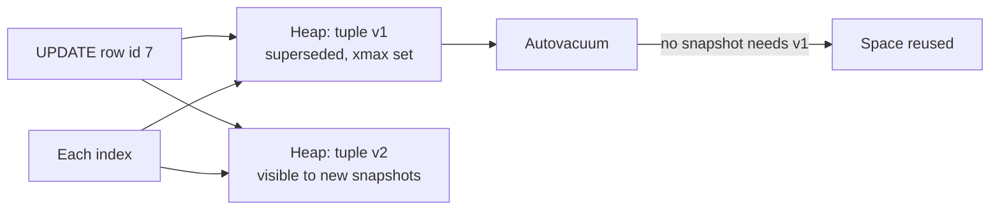
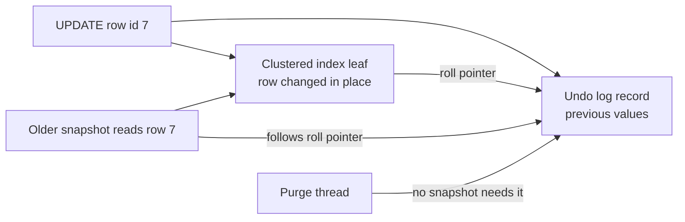
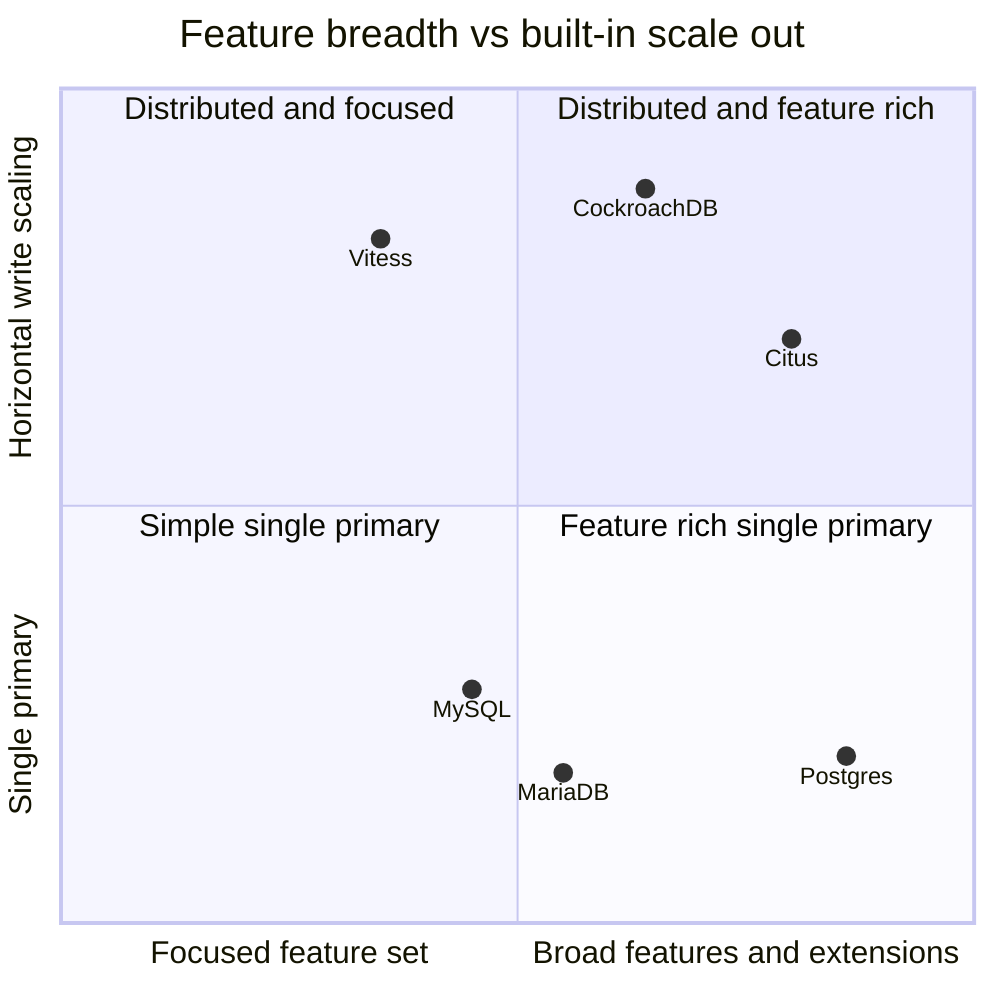
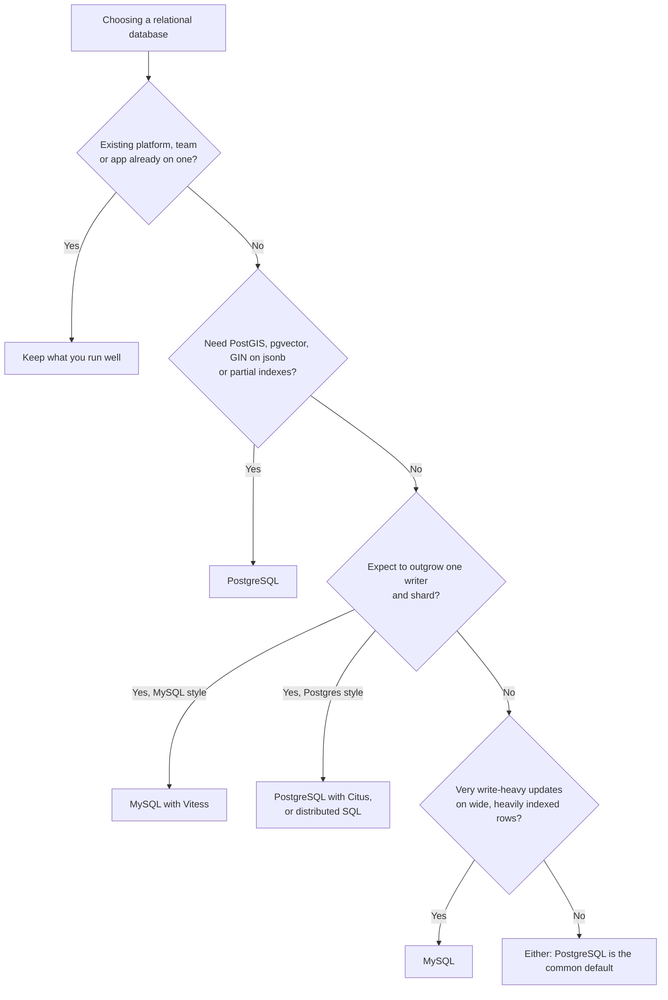

# PostgreSQL vs MySQL

This page compares PostgreSQL with MySQL using its default InnoDB storage engine, as the general-purpose relational database behind an application.

## Explain it like I'm 5

Two libraries let kids fix mistakes in their books.

In the first library, a kid who changes a page writes a whole new page and puts it in the book. The old page stays too, so anyone still reading sees it. Later a cleaner walks round and throws away pages nobody needs.

In the second library, the kid rubs out the page and writes on it. A note in a side drawer says what it used to say, and readers who started earlier check the drawer.

*For grown-ups:* The first library is PostgreSQL's MVCC with VACUUM, and the second is InnoDB's in-place update with undo logs and purge.

## The short answer

Both are mature, free, ACID relational databases that run most web workloads well, and both are offered managed by every major cloud. The differences are in how they store row versions, how far you can extend them, and the tooling around replication and sharding. PostgreSQL gives you a richer type system, more index types, transactional DDL and an extension ecosystem (PostGIS, pgvector, Citus). MySQL gives you a simpler operational model, a clustered primary key layout that suits primary-key lookups, and battle-tested horizontal sharding through Vitess.

**Pick PostgreSQL when** you want rich SQL (window functions, CTEs, `jsonb`, partial and expression indexes), geospatial or vector search in the same database, or strict behaviour by default. It is a common default for new projects.

**Pick MySQL when** the team or platform already runs it, the workload is simple OLTP dominated by primary-key access, or you expect to shard with Vitess. Software built for it, such as WordPress, also decides the question.

## At a glance

| Dimension | PostgreSQL | MySQL (InnoDB) |
| --- | --- | --- |
| Row versioning | New tuple version in the heap, old one left for VACUUM | Update in place, old version in undo log, removed by purge |
| Table layout | Heap; every index points at a tuple location | Clustered B+tree on the primary key; secondary indexes store the primary key |
| Default isolation | Read Committed | Repeatable Read |
| Serializable | Serializable Snapshot Isolation (non-blocking predicate locks) | Locking-based: plain reads take shared locks when autocommit is off |
| Index types | B-tree, Hash, GiST, SP-GiST, GIN, BRIN, plus extensions | B-tree, full-text, spatial (R-tree), multi-valued for JSON arrays |
| Partial indexes | Yes (`WHERE` clause) | No |
| JSON | `json` and `jsonb`, GIN indexes, jsonpath, `JSON_TABLE` | Binary `JSON`, generated columns and multi-valued indexes, `JSON_TABLE` |
| DDL | Transactional (roll back a schema change) | Atomic per statement, implicit commit; many changes run online or instantly |
| Replication | Physical streaming of WAL, logical publication and subscription | Binary log replication, semi-sync, Group Replication |
| Built-in HA | Needs external tooling (for example Patroni) for automatic failover | Group Replication and InnoDB Cluster include automatic election |
| Extensibility | Extensions add types, indexes, languages | Plugins and components, fewer third-party extensions |
| Connection model | Process per connection, so a pooler is usual | Thread per connection |
| Horizontal sharding | Citus extension, or distributed SQL that speaks Postgres | Vitess |

## How each one works

### PostgreSQL: new version per update, VACUUM later

An update writes a complete new tuple and marks the old one with the transaction that ended it. Every transaction checks those markers against its snapshot to decide which version it sees, so readers never block writers. Dead tuples stay in the table and its indexes until VACUUM removes them, and VACUUM must also freeze old rows before the 32-bit transaction ID counter wraps. When no indexed column changes and the page has room, a heap-only tuple (HOT) update avoids touching the indexes.

### MySQL InnoDB: update in place, undo for old readers

The table itself is a B+tree ordered by primary key, and the row is changed where it sits. Before changing it, InnoDB writes the old values to an undo log and points the row at them. A reader with an older snapshot follows that pointer to rebuild the version it should see. Purge deletes undo records and delete-marked rows once no snapshot needs them. Secondary indexes hold the primary key, so a lookup by secondary index then walks the clustered index.

## Where each one sits

*Positions are qualitative judgments for comparison, not measurements.*

On its own, each database is a single-writer system, so both sit low on the chart. PostgreSQL sits further right because of its type system, index methods and extensions. Each has a well-known path upward: Vitess shards MySQL behind a proxy that speaks the MySQL protocol, Citus distributes Postgres tables as an extension, and distributed SQL databases such as CockroachDB reimplement a Postgres-compatible front end on a different storage design.

## Decision guide

## Trade-offs in depth

### MVCC housekeeping: VACUUM vs purge

Both engines keep old versions so readers do not block writers, and both suffer if a long transaction pins old snapshots. They suffer differently. In PostgreSQL the dead tuples live in the table and its indexes, so a long-running transaction, an abandoned prepared transaction or a stale replication slot stops VACUUM from cleaning up, tables and indexes bloat, and in the worst case the database stops assigning transaction IDs to avoid wraparound. Autovacuum tuning is therefore part of running Postgres. In InnoDB the old versions live in the undo tablespace, so a long transaction makes the undo log grow and slows readers that must walk long version chains; the MySQL manual advises committing regularly, even for read-only transactions. In both, monitor the oldest open transaction.

### Write amplification and table layout

A PostgreSQL update that cannot be HOT writes a new tuple and a new entry in every index, even indexes on columns that did not change. InnoDB changes the row in place and only touches secondary indexes whose columns changed, so tables with many indexes and frequent updates write less. The reverse trade is on reads: an InnoDB secondary-index lookup is two B-tree walks (secondary, then clustered), while a Postgres index points straight at the heap. InnoDB's clustered layout also makes range scans on the primary key cheap, and makes a random primary key (such as UUIDv4) costly because inserts land all over the tree. Time-ordered keys help both; PostgreSQL 18 added a built-in `uuidv7()`.

### Isolation and concurrency defaults

PostgreSQL defaults to Read Committed: each statement sees data committed before it began. Its Repeatable Read is snapshot isolation and aborts a transaction that tries to update a row changed after its snapshot, and its Serializable uses SSI, which tracks read and write dependencies without blocking and aborts one transaction when an anomaly is possible. InnoDB defaults to Repeatable Read, where plain `SELECT`s use the transaction's first snapshot but locking reads and updates see the latest committed rows and take gap or next-key locks on ranges. Code that is correct under one default can behave differently under the other, so be explicit about the isolation level for anything like [seat booking](../../scenarios/seat-double-booking).

### Replication and high availability

PostgreSQL streams its write-ahead log to physical standbys, which are exact copies of the primary that can serve reads. Logical replication (publications and subscriptions) sends row changes per table, which allows version upgrades and partial copies; PostgreSQL 17 added failover control for logical replication slots. `synchronous_commit` and `synchronous_standby_names` choose whether a commit waits for a standby, and `remote_apply` waits until the change is visible there. Automatic failover is not built in, so teams use tools such as Patroni or a managed service. MySQL replicates through its binary log, asynchronously by default or semi-synchronously. Group Replication adds a Paxos-based group with automatic primary election in single-primary mode, and InnoDB Cluster bundles it with MySQL Shell and MySQL Router.

### Extensions, types and indexes

PostgreSQL lets extensions add data types, operators, index methods and procedural languages. That is how PostGIS (geospatial), pgvector (vector similarity search) and Citus (distribution) exist, and why GIN, GiST, SP-GiST and BRIN indexes cover arrays, full text, ranges and very large append-only tables. Partial indexes (`WHERE status = 'pending'`) keep an index small. MySQL has B-tree indexes plus full-text and spatial indexes, functional key parts (8.0.13 and later), invisible indexes for safe testing, and multi-valued indexes over JSON arrays. MySQL 9.0 added a `VECTOR` column type; on Postgres, pgvector adds vector types plus approximate nearest-neighbour indexes (HNSW and IVFFlat).

### JSON

PostgreSQL's `jsonb` stores parsed binary JSON, and a GIN index on the column answers containment and jsonpath queries over any key without declaring it in advance. Since version 17 it also supports the SQL/JSON standard functions, including `JSON_TABLE`. MySQL's `JSON` type is also stored in a binary format; to index a field you usually expose it through a generated column or a functional index, and a multi-valued index covers membership in an array. Both work well for occasional semi-structured fields; Postgres is more comfortable when you query JSON ad hoc.

### Versions and support as of 2026

PostgreSQL releases one major version a year (18 shipped in September 2025, with asynchronous I/O, virtual generated columns and `uuidv7()`), each supported for five years. MySQL moved to LTS and Innovation tracks: MySQL 8.0 reached end of life in April 2026, 8.4 is an LTS line, and 9.7 became the next LTS in April 2026. If you are on MySQL 8.0, plan the upgrade to 8.4 or 9.7.

## Common misconceptions

- **"MySQL is not ACID."** That was true of the old MyISAM engine. InnoDB, the default for many years, is transactional and crash-safe.
- **"PostgreSQL is always slower for simple queries."** The engines make different trade-offs (heap vs clustered index, process vs thread per connection). Results depend on the workload, schema and tuning; measure your own queries.
- **"Only MongoDB does JSON."** Both databases store binary JSON, index into it and query it with SQL.
- **"VACUUM is a sign something is wrong."** It is a normal part of PostgreSQL's MVCC design. Problems start when autovacuum cannot keep up or is blocked by a long transaction.
- **"Read replicas make reads consistent."** Replicas in both systems are asynchronous by default, so a read straight after a write can miss it unless you route it to the primary or wait for the replica.

## In this repo

- [Write-ahead log](../../patterns/data/write-ahead-log): the durability mechanism both databases build on, and the stream Postgres replicates.
- [Read replicas](../../patterns/data/read-replicas): leader-follower replication, replica lag and read-your-writes routing.
- [Optimistic locking](../../patterns/data/optimistic-locking): version-checked updates that behave the same on either engine.
- [Connection pool](../../patterns/architecture/connection-pool): why Postgres deployments put a pooler in front of the database.
- [Sharding](../../patterns/data/sharding): what Vitess and Citus do for you.
- [Seat double-booking scenario](../../scenarios/seat-double-booking): a race that isolation levels and locking reads decide.

## Interview follow-ups

- *Why does a long-running analytics query hurt a busy Postgres primary?* Its snapshot keeps every row version created since it started from being vacuumed, so tables and indexes bloat. Run it on a replica, and be aware that `hot_standby_feedback` pushes the same problem back to the primary.
- *Why are random UUID primary keys worse on InnoDB?* The table is clustered on the primary key, so random keys insert all over the B+tree, splitting pages and spoiling cache locality. A time-ordered key (UUIDv7, Snowflake-style IDs) appends at the right edge.
- *How would you upgrade a major version with little downtime?* In Postgres, set up logical replication to a new-version server, let it catch up, then switch writes. In MySQL, replicate from the old version to a new-version replica and promote it.
- *Which one would you choose for a new SaaS product?* Usually PostgreSQL, for its types, indexes and extensions, unless the team's experience, the platform or a Vitess sharding plan points to MySQL. Both are safe choices.

## Further reading

- [PostgreSQL routine vacuuming](https://www.postgresql.org/docs/current/routine-vacuuming.html): dead tuples, the visibility map and transaction ID wraparound.
- [PostgreSQL transaction isolation](https://www.postgresql.org/docs/current/transaction-iso.html): Read Committed default, snapshot isolation and SSI.
- [PostgreSQL index types](https://www.postgresql.org/docs/current/indexes-types.html): B-tree, Hash, GiST, SP-GiST, GIN and BRIN.
- [PostgreSQL WAL settings](https://www.postgresql.org/docs/current/runtime-config-wal.html): what each `synchronous_commit` level waits for.
- [PostgreSQL 18 release announcement](https://www.postgresql.org/about/news/postgresql-18-released-3142/): asynchronous I/O, `uuidv7()` and virtual generated columns.
- [InnoDB multi-versioning](https://dev.mysql.com/doc/refman/8.4/en/innodb-multi-versioning.html): hidden row fields, undo logs and purge.
- [InnoDB isolation levels](https://dev.mysql.com/doc/refman/8.4/en/innodb-transaction-isolation-levels.html): Repeatable Read default, consistent reads and next-key locks.
- [MySQL Group Replication background](https://dev.mysql.com/doc/refman/8.4/en/group-replication-background.html): async, semi-sync and Paxos-based group replication.
- [MySQL CREATE INDEX](https://dev.mysql.com/doc/refman/8.4/en/create-index.html): functional, invisible and multi-valued indexes.
