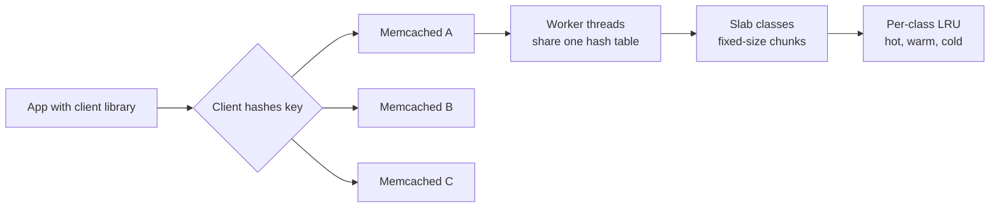
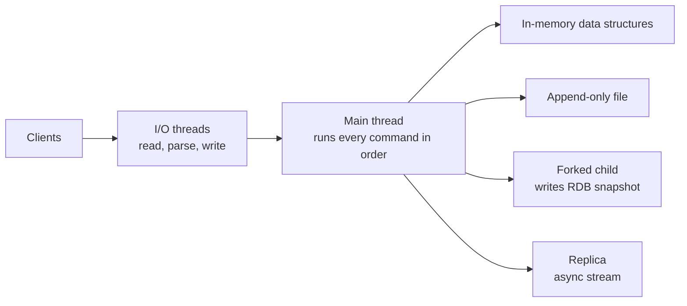
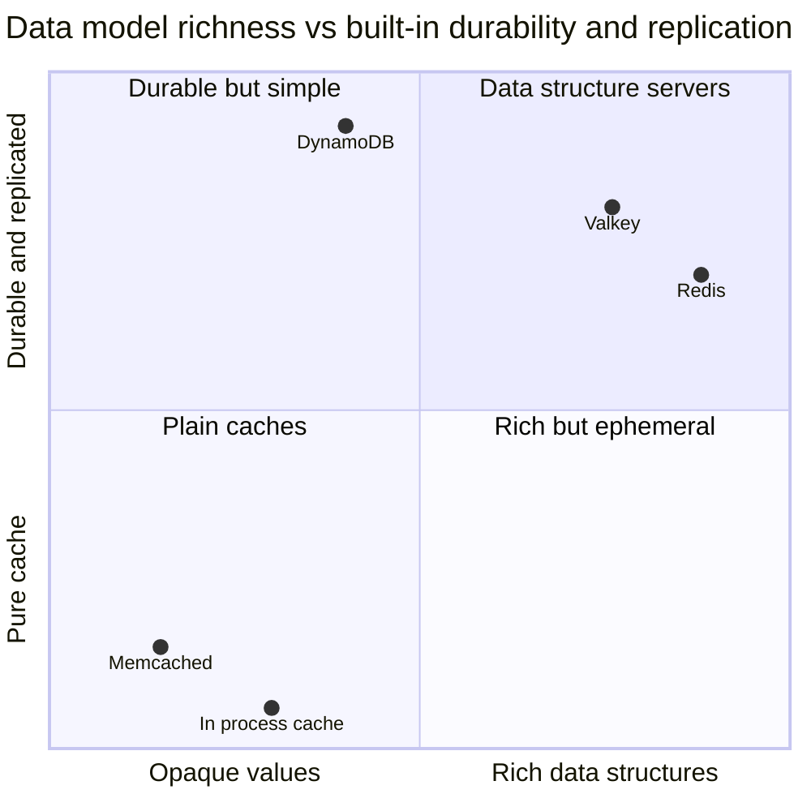
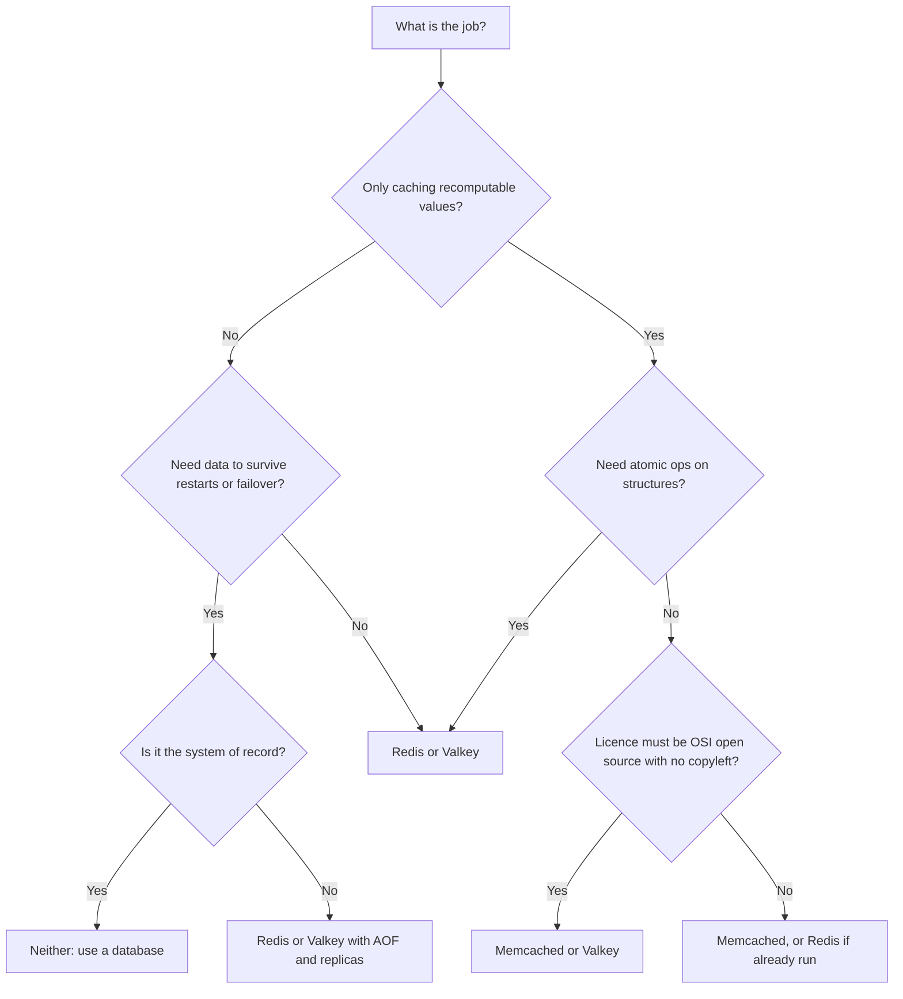

# Redis vs Memcached (and Valkey)

Three in-memory key-value servers compared for the jobs teams actually give them: a cache in front of a database, and a fast shared store for counters, sessions, queues and leaderboards.

## Explain it like I'm 5

Two helpers keep things on a big table so nobody has to walk to the far cupboard. The first helper has many hands and only holds plain boxes, each with a name tag. When the table fills up, the dustiest box goes back. The second helper works alone but can hold lists, piles sorted by score and tally sheets, and writes a diary so things survive a nap. Later, the second helper's family split in two, and both halves still do the same job.

*For grown-ups:* The first helper is multi-threaded Memcached storing opaque values, the second is single-threaded Redis with data structures and persistence, and the family split is the 2024 Valkey fork.

## The short answer

Memcached is a cache and nothing else: opaque values, many threads, no persistence and no server-side replication, so the client decides which server owns a key. Redis is a data-structure server that happens to be an excellent cache, with lists, hashes, sorted sets, streams and more, optional persistence, replication and a built-in cluster mode. Valkey is the Linux Foundation fork of Redis 7.2.4, created in March 2024 after Redis left the BSD licence, and for most application code it is a drop-in replacement. In 2026 the real choice is usually "Redis or Valkey", with Memcached still the right call for a large, simple, multi-threaded cache.

**Pick Memcached when** the job is purely caching opaque blobs (rendered fragments, serialised objects), the data can be recomputed from a source of truth, and you want one process to use every core with almost nothing to configure.

**Pick Redis or Valkey when** you need atomic operations on structured values (increment a counter, add to a sorted set, pop from a list), expiry plus eviction policies, replicas with failover, or persistence across restarts.

**Use both when** a very large, low-value cache lives in Memcached and the smaller set of keys that need structures or atomic updates (rate limits, leaderboards, locks) lives in Redis or Valkey.

## At a glance

| Dimension | Memcached | Redis | Valkey |
| --- | --- | --- | --- |
| Data model | Opaque byte values per key | Strings, lists, hashes, sets, sorted sets, streams, bitmaps, HyperLogLog, geo; Redis 8 also ships JSON, search, time series, probabilistic types and vector sets (beta) | Redis 7.2 core types, plus later additions such as hash field expiry and numbered databases in cluster mode (9.0) |
| Command execution | Multi-threaded workers sharing the cache | Single main thread; optional I/O threads for network work | Single main thread; reworked I/O threading since 8.0 |
| Persistence | None (a restart empties the cache) | RDB snapshots and/or append-only file | Same as Redis |
| Replication | None server-side | Asynchronous primary to replica, Sentinel or Cluster for failover | Same model |
| Sharding | Client-side hashing across independent servers | Redis Cluster: 16,384 hash slots, client redirects | Same, with atomic slot migration in 9.0 |
| Eviction | Per-slab-class segmented LRU | Configurable: noeviction (default), LRU, LFU, random, TTL, and LRM since 8.6 | LRU, LFU, random, TTL family |
| Atomic multi-step logic | `incr`/`decr` and compare-and-set on one key | Transactions, Lua scripts and functions | Same |
| Licence (2026) | BSD-3-Clause | 8.0 and later: RSALv2, SSPLv1 or AGPLv3 | BSD-3-Clause |
| Typical latency class | Sub-millisecond on a LAN | Sub-millisecond on a LAN | Sub-millisecond on a LAN |
| Operational cost | Very low | Low to moderate (persistence, failover, memory headroom for fork) | Same as Redis |

## How each one works

Memcached servers do not know about each other. The client library hashes each key to pick a server, so adding a server moves keys and losing one loses its share of the cache. Inside a server, worker threads each run their own event loop and share the cache through locks. Memory is split into pages that are carved into fixed-size chunks per slab class, and each class has its own LRU split into hot, warm and cold segments so one-off reads do not push out popular items.

Redis and Valkey run every command on one main thread, which is why each command is atomic without locks and why a single slow command (a huge `SUNION`, `KEYS` in production) stalls everyone. I/O threads can take socket reads, parsing and writes off the main thread, but they do not execute commands. Durability comes from an append-only file, periodic snapshots written by a forked child, and asynchronous replication to replicas.

## Where each one sits

*Positions are qualitative judgments for comparison, not measurements.*

Memcached and an in-process cache sit in the plain-cache corner: fast, cheap, and fine to lose. Redis and Valkey sit together in the top right, with Redis slightly further right because Redis 8 bundles search, JSON and vector sets into the core distribution. A durable key-value database such as DynamoDB is shown for contrast: replicated and durable by design, but with a much thinner set of in-place data operations.

## Decision guide

## Trade-offs in depth

### Data structures move work to the server

Memcached can increment a numeric value atomically, but anything richer, such as adding to a list or a ranked set, means read, modify in the application, then write back with compare-and-set and retry on conflict. With Redis, `INCR`, `ZADD`, `LPUSH` or `HINCRBY` do it in one round trip and are atomic because they run on the single command thread. That is the reason rate limiters, leaderboards and job queues land on Redis: the data structure is the feature. The cost is that some commands are O(N) on large values, and on a single-threaded server one of them blocks every client until it finishes.

### Threading: many cores vs one command lane

Memcached scales a single process across cores, because its workers share the hash table through fine-grained locks and its operations are simple. Redis keeps command execution on one thread, which gives you atomicity for free but caps one instance at roughly one core of command work. Since Redis 6 (and reworked in Redis 8 and Valkey 8) I/O threads take socket work off the main thread, which helps when parsing and network writes are the bottleneck. To use many cores for commands you run several instances, usually as a cluster. Valkey's own benchmark for 8.0 (8 I/O threads, 512-byte SETs, 650 clients on an AWS c7g.16xlarge) reported about 1.19 million requests per second against about 360,000 for Valkey 7.2; treat that as one vendor setup, not a general number.

### Persistence and the fork cost

Memcached has no persistence. Its flash extension (extstore) moves values onto SSD to make the cache bigger, but keys stay in RAM and a restart still empties it. Redis offers RDB snapshots and an append-only file with `appendfsync` set to `always`, `everysec` or `no`; `everysec` is the usual compromise and can lose about a second of writes on a crash. Snapshots and AOF rewrites fork the process, and copy-on-write during a busy fork can need a lot of extra memory, so Redis needs headroom that Memcached does not. Persistence makes Redis restart warm, but it does not turn it into a database with transactions across keys on different shards.

### Replication and clustering

Memcached servers are independent. High availability means accepting a partial cold cache when a node dies, or having the client write to two servers. Redis replicates asynchronously from primary to replicas, with Sentinel or Cluster handling failover. Because replication is asynchronous, a write acknowledged by the primary can be lost if the primary dies before a replica receives it; `WAIT` narrows that window but does not give strong consistency. Redis Cluster splits keys into 16,384 slots by `CRC16(key) mod 16384`. Multi-key commands only work when all keys are in one slot, which is what `{hash tags}` are for.

### Eviction behaviour

Memcached always evicts: when a slab class is full it reuses expired items or drops the coldest. Because memory pages are assigned to slab classes and, by default, kept there, a change in value sizes over time can leave one class starved while another has spare memory. Redis defaults to `noeviction` with no memory limit on 64-bit builds, which is right for a store and wrong for a cache: set `maxmemory` and an `allkeys-*` policy when Redis is a cache. Redis LRU and LFU are approximations that sample keys (`maxmemory-samples`, default 5), close enough to exact LRU for skewed access patterns.

### Licensing history

Redis was BSD-licensed until 7.2. In March 2024 Redis Ltd. moved 7.4 onwards to a dual RSALv2 and SSPLv1 licence, neither of which is OSI-approved. Within weeks the Linux Foundation announced Valkey, continuing from Redis 7.2.4 under BSD-3-Clause, backed by AWS, Google Cloud, Oracle, Ericsson and Snap. Valkey 8.0 shipped in September 2024 and 9.0 in October 2025. With Redis 8.0 (GA May 2025) Redis added AGPLv3 as a third option, which is OSI-approved but copyleft: if you modify Redis and offer it over a network, you must publish your changes. Memcached has been BSD-licensed throughout. For most teams who just run the server unmodified, all three are usable; the licence matters most to anyone building a hosted service or shipping a modified server.

### When plain Memcached is still the right call

A very large cache of opaque, recomputable values with a simple get, set and delete access pattern, where losing a node only costs a burst of misses. Memcached uses every core in one process, has very few settings to get wrong, and has no persistence or failover to operate. If you never use a Redis data structure and never need a replica, Memcached is the simpler system.

## Common misconceptions

- **"Redis is single-threaded, so it cannot use more than one core."** Commands run on one thread, but background threads handle disk sync and freeing memory, and I/O threads can handle network work. Scaling commands across cores still means more instances.
- **"Redis persistence makes it a safe primary database."** With `everysec` you can lose about a second of writes, and asynchronous replication can drop acknowledged writes on failover. It is a durable cache or a store for data you can afford to lose a little of.
- **"Memcached is obsolete."** It is maintained, has a meta protocol, TLS, a built-in proxy and flash storage, and is still a sensible pure cache.
- **"Valkey is a different product to learn."** It forked from Redis 7.2.4 and speaks the same protocol and commands; features added to either side since 2024 are where they differ.
- **"Redis is no longer open source."** From 8.0, Redis can be used under AGPLv3, an OSI-approved licence. Versions 7.4 to 7.8 are RSALv2 or SSPLv1 only.

## In this repo

- [Cache-aside](../../patterns/data/cache-aside): the read-through-by-hand pattern both servers are used for.
- [Cache eviction](../../patterns/data/cache-eviction): LRU, LFU and friends, the policies behind `maxmemory-policy` and Memcached's LRU.
- [Consistent hashing](../../patterns/data/consistent-hashing): how Memcached clients spread keys so adding a server moves few of them.
- [Two-tier cache](../../patterns/data/two-tier-cache): an in-process cache in front of a shared one such as Redis or Memcached.
- [Leaderboard and top-K](../../patterns/data/leaderboard-top-k): the sorted-set workload that makes people choose Redis.
- [Sliding window rate limiter](../../patterns/reliability/sliding-window-rate-limiter) and [token bucket](../../patterns/reliability/rate-limiter-token-bucket): atomic counters and scripts are why these usually live in Redis.
- [Distributed lock with fencing](../../patterns/distributed/distributed-lock-fencing): why a Redis lock alone is not safe across failover, and what fencing tokens add.
- [Hot-key salting](../../patterns/data/hot-key-salting) and the [hot short link](../../scenarios/hot-short-link) scenario: one key overloading one shard, a problem both servers share.
- [Cache stampede](../../scenarios/cache-stampede): what happens when a hot key expires, whichever cache you use.

## Interview follow-ups

*How would you make a Redis cache survive a node failure?* Run replicas with Sentinel or Redis Cluster for automatic failover, accept that asynchronous replication can drop the last writes, and design the cache so a miss falls back to the database rather than failing.

*Why can a Redis cluster reject `MGET user:1 user:2`?* The keys may hash to different slots on different primaries. Put a hash tag in both keys, such as `user:{42}:profile` and `user:{42}:settings`, so they share a slot, or issue per-slot requests.

*Memcached is full and the hit rate dropped after a release that made values larger. Why?* Pages are assigned to slab classes. The new, larger values fall in a class with few pages while memory sits in classes for the old sizes, so that class evicts aggressively. Per-class eviction stats show it; the fixes are rebalancing memory between classes or tuning the slab growth factor (`-f`).

*Your Redis cache hits OOM errors on writes. What is wrong?* The default policy is `noeviction`. For a cache, set `maxmemory` with headroom for replication and fork buffers, and choose `allkeys-lru` or `allkeys-lfu`.

*Would you pick Redis or Valkey for a new service in 2026?* Use whichever your platform runs as a managed service. The protocol is the same. Check licence needs if you will modify or host it, and check whether you need features that exist on only one side, such as Redis 8's bundled search and vector sets.

## Further reading

- [Redis licences](https://redis.io/legal/licenses/): which Redis versions are BSD, RSALv2/SSPLv1, or tri-licensed with AGPLv3.
- [Redis 8 GA announcement](https://redis.io/blog/redis-8-ga/): the AGPLv3 option, new I/O threading and new data types in 8.0.
- [Redis key eviction](https://redis.io/docs/latest/develop/reference/eviction/): every eviction policy, the `noeviction` default, approximate LRU and LFU, and LRM from 8.6.
- [Diagnosing Redis latency](https://redis.io/docs/latest/operate/oss_and_stack/management/optimization/latency/): the single-threaded design, slow commands, fork cost and AOF fsync trade-offs.
- [Redis Cluster specification](https://redis.io/docs/latest/operate/oss_and_stack/reference/cluster-spec/): hash slots, hash tags, redirects and the asynchronous replication write-loss window.
- [Linux Foundation launches Valkey](https://www.linuxfoundation.org/press/linux-foundation-launches-open-source-valkey-community): the March 2024 fork from Redis 7.2.4 and its backers.
- [Valkey 8 I/O threading](https://valkey.io/blog/unlock-one-million-rps/): what I/O threads do, why command execution stays single-threaded, and the benchmark setup.
- [Valkey blog](https://valkey.io/blog/): release announcements for 8.0, 8.1 and 9.0.
- [Memcached performance guide](https://docs.memcached.org/serverguide/performance/): worker threads, slab classes, per-class LRU and client-side distribution.
- [Memcached flash storage (extstore)](https://docs.memcached.org/features/flashstorage/): values on SSD, keys in RAM, and why a restart still empties it.
- [Memcached modern LRU](https://memcached.org/blog/modern-lru/): the hot, warm and cold segmented LRU.
