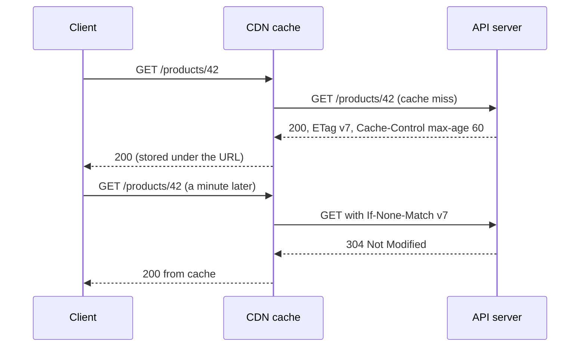
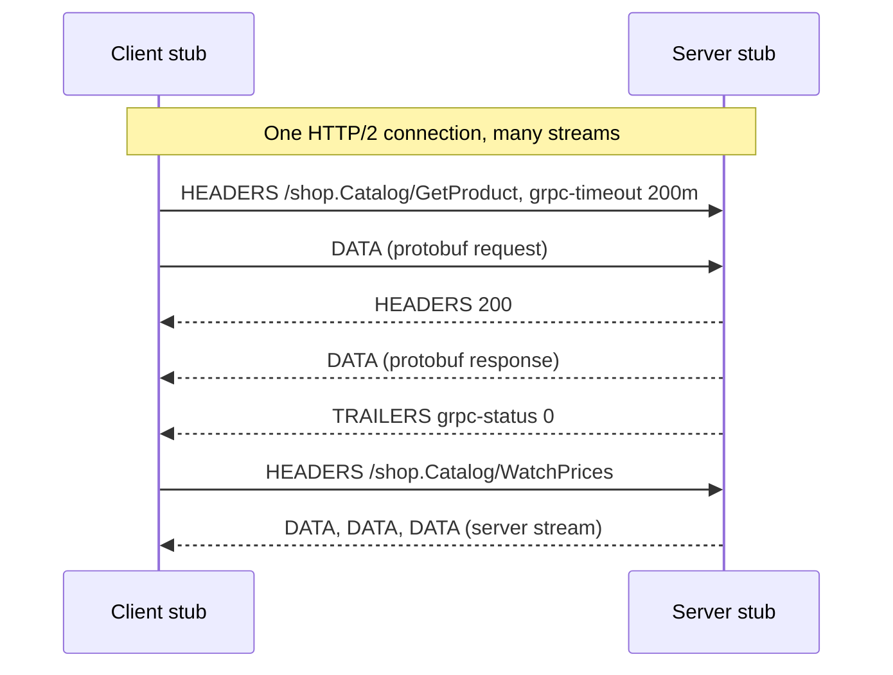
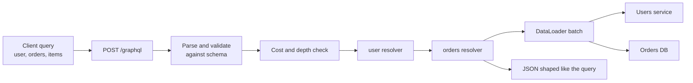
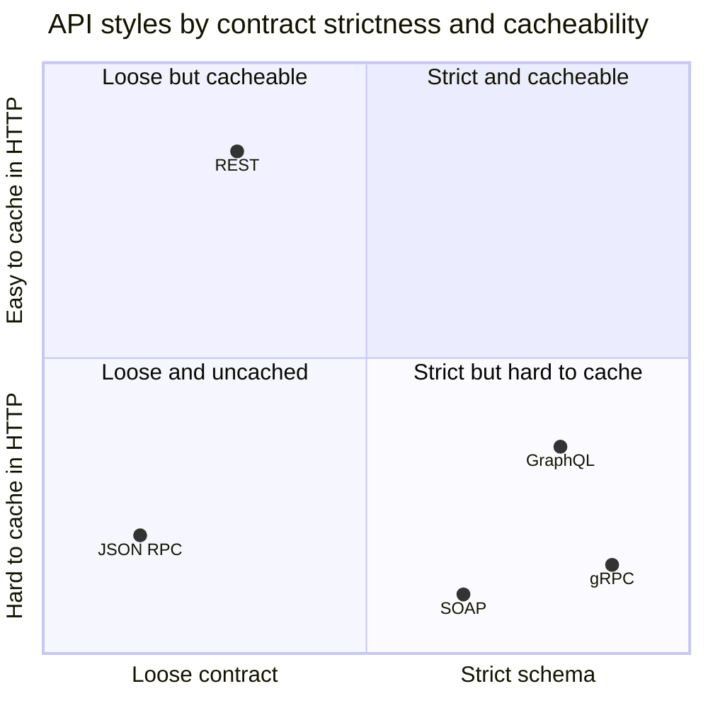
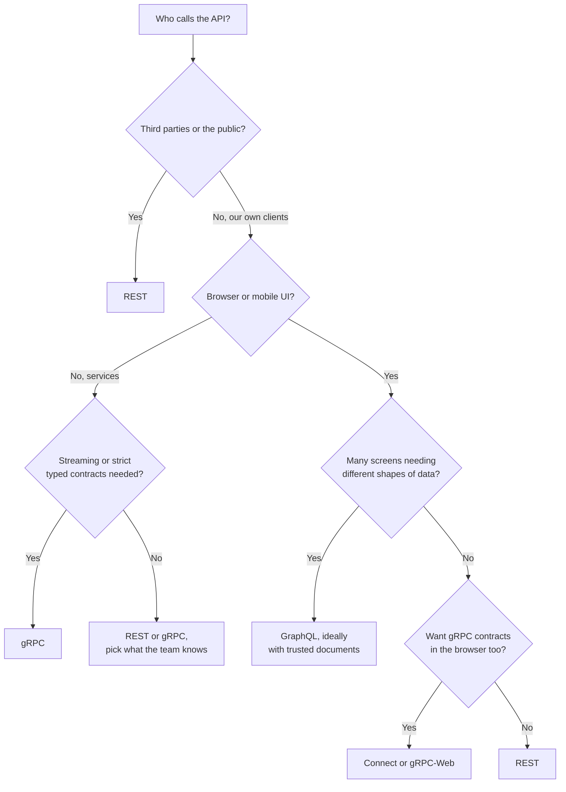

# REST vs gRPC vs GraphQL

Three styles of API for the same job, one program asking another for data or actions over a network, compared for public APIs, browser and mobile clients, and service-to-service calls.

## Explain it like I'm 5

The school kitchen has three ways to hand out snacks. At the first, every snack has its own window with a sign, and a helper keeps spare copies of popular snacks at the front so nobody waits. At the second, you and the cook share a secret card with numbered boxes, so orders are tiny and quick, but only kids holding the card can order. At the third, there is one window. You draw exactly what you want on one plate, and the cook runs all over the kitchen to fill it.

*For grown-ups:* The signed windows are REST resources at URLs with HTTP caching, the shared card is gRPC's Protocol Buffers contract with generated stubs, and the drawn plate is a GraphQL query that resolvers fill field by field.

## The short answer

REST is the default for public and browser-facing APIs because it uses HTTP as designed: URLs name resources, methods say what is safe to retry, and status codes and cache headers mean something to every proxy and CDN on the path. gRPC is a contract-first RPC framework on HTTP/2 with Protocol Buffers, best when both sides are services you own, share generated code, and want deadlines and streaming built in. GraphQL puts one typed schema in front of many backends and lets each client choose its fields, which suits product teams building many screens over connected data. The price of GraphQL is harder HTTP caching and the need to limit query cost. None of the three is faster in general: each moves work to a different place.

**Pick REST when** the API is public, consumed by people you do not control, or benefits from CDN and browser caching.

**Pick gRPC when** the calls are internal, high-volume and typed, need streaming in either direction, or must propagate deadlines across many hops.

**Pick GraphQL when** many clients need different shapes of the same connected data and the alternative is a growing pile of bespoke endpoints.

**Use more than one when** you have both kinds of traffic. A common split is gRPC between services and REST or GraphQL at the edge, often in a [backend for frontend](../../patterns/architecture/backend-for-frontend).

## At a glance

| Dimension | REST | gRPC | GraphQL |
| --- | --- | --- | --- |
| Unit of the API | Resource at a URL | Method on a service | Field on a typed graph |
| Contract | Optional (OpenAPI is common) | Required `.proto` file, code generated | Required schema, introspectable |
| Usual wire format | JSON, any media type | Protocol Buffers binary | JSON |
| Transport | Any HTTP version | HTTP/2 (gRPC-Web and Connect relax this) | HTTP, usually one endpoint |
| HTTP caching | Native: URL keys, ETag, Cache-Control | Not used by intermediaries | Only with GET or persisted queries |
| Streaming | Not built in (SSE, chunked responses) | Server, client and bidirectional | Subscriptions, usually over WebSockets |
| Browser support | Native | Through gRPC-Web or Connect | Native |
| Response shape | Fixed by the server | Fixed by the message type | Chosen by the client |
| Typical evolution | URL or header versions, additive fields | Additive fields, never reuse field numbers | Versionless, deprecate fields |
| Debugging | curl and a browser | Needs tools that know the schema | Explorer tools via introspection |
| Typical home | Public and partner APIs | Service mesh, internal RPC | Product APIs for web and mobile |

## How each one works

### REST

Each resource has its own URL, and the method tells every hop what the request does. Because GET is defined as safe, a cache can key the response on the URL and revalidate with an ETag instead of fetching the body again. That shared vocabulary between client, server and everything in between is the main reason REST still dominates public APIs.

### gRPC

Both sides generate code from the same `.proto` file, so a call looks like a local function. Every call is an HTTP/2 stream on a shared connection, the deadline travels as a header, and the result code arrives in trailers after the body. That last detail is why browsers cannot speak native gRPC: browser fetch APIs do not give scripts the low-level control of HTTP/2 framing and trailers that the protocol needs.

### GraphQL

There is one endpoint, and the request body is a query document. The server validates it against the schema, then walks the requested fields, calling a resolver for each. Resolvers fetch from whatever lies behind them, so a naive tree of resolvers turns one query into many backend calls unless a batching layer such as DataLoader groups them.

## Where each one sits

*Positions are qualitative judgments for comparison, not measurements.*

REST sits alone at the top because its requests map onto URLs that shared caches understand. gRPC and GraphQL both buy a strict schema but send most traffic in ways intermediaries treat as opaque. GraphQL sits a little higher because queries sent by GET or as persisted query hashes can be cached at a CDN, while RPC styles that tunnel everything through POST (JSON-RPC, SOAP, plain gRPC) cannot.

## Decision guide

## Trade-offs in depth

### Contracts and schemas

gRPC and GraphQL make the schema the source of truth: the server will not run without it, and clients generate code or validate queries against it. REST does not require one. OpenAPI fills that gap well, but only if the team keeps it in step with the code, because nothing in HTTP itself enforces it. A strict schema catches breaking changes at build time and gives typed clients for free; a loose contract is easier to start with and easier for strangers to call with curl.

### HTTP caching

REST gets caching from HTTP itself: GET is safe, the URL is the cache key, and `Cache-Control`, `ETag` and `304 Not Modified` let browsers, CDNs and reverse proxies serve or revalidate responses without touching your code. gRPC calls are POSTs on HTTP/2 with binary bodies, so caching moves into the application. GraphQL over HTTP requires POST support and allows GET only for queries. GET makes CDN caching possible, but long documents hit URL length limits, which is why persisted queries send a hash instead of the full text. Client libraries add a second layer, normalising responses by object ID into a local cache.

### Streaming

gRPC has four call types: unary, server streaming, client streaming and bidirectional streaming, all multiplexed over one HTTP/2 connection with flow control. REST has no streaming model of its own; teams reach for [server-sent events](../../patterns/architecture/server-sent-events), chunked responses or [WebSockets](../../patterns/architecture/websocket-hub). GraphQL defines subscriptions as an operation type, but the transport is left to the implementation, and WebSockets are the common choice.

### Browsers: gRPC-Web and Connect

Native gRPC needs HTTP/2 trailers and framing control that browser scripts cannot reach. gRPC-Web solves this with a modified protocol and, for most servers, a translating proxy such as Envoy. It supports unary and server streaming only; client and bidirectional streaming are not supported. Connect, a CNCF sandbox project, takes another route: its servers speak gRPC, gRPC-Web and the Connect protocol on the same port, so browsers can call them without a proxy, and the Connect protocol works over HTTP/1.1 as well as HTTP/2. Browser clients are still limited to unary and server streaming, because browsers have not agreed on streaming request bodies in fetch.

### Over-fetching, under-fetching and N+1

A REST endpoint returns a fixed shape. A mobile screen that needs three fields gets thirty (over-fetching), and a screen that needs a user, their orders and each order's items may need several round trips (under-fetching). GraphQL fixes both on the client side by moving the joining to the server, but the work does not disappear. A query for 50 orders whose resolvers each fetch their own customer runs one query for the list plus 50 for customers: the N+1 problem. The standard fix is a per-request batching layer (DataLoader is the reference implementation) that collects keys during one tick and issues one batched lookup. REST and gRPC APIs face the same problem whenever a server composes data from other services; they just hide it behind an endpoint the server team controls.

### Query cost limits

With REST and gRPC the server decides what each call costs, so rate limiting by request count works. With GraphQL the client chooses the cost: a shallow query with 100 aliases, or a deeply nested friends-of-friends query, can be far more expensive than its size suggests. GraphQL's security guidance recommends limits on depth (stricter for nested lists), on breadth and aliases, and on batched operations, plus complexity analysis that weights fields, rejects queries above a budget, and can charge the cost against a per-client [rate limit](../../patterns/reliability/rate-limiter-token-bucket). For first-party clients, trusted documents go further: only operations registered at build time are allowed to run.

### Versioning and evolution

GraphQL deliberately avoids versions. Clients only receive fields they ask for, so new fields are never breaking, and old ones are marked `@deprecated` and removed once usage drops. gRPC evolves through Protocol Buffers rules: adding fields is wire-safe, removed field numbers must be marked `reserved` and never reused, and unknown fields are preserved. Breaking changes go into a new package, such as `v2`. REST has no single rule. Additive changes are safe if clients ignore unknown fields, and breaking changes usually get a new URL prefix or media type, which means running both versions for a while.

## Common misconceptions

- **"gRPC is always faster than REST."** Protobuf is compact and HTTP/2 multiplexes, but for many calls the time goes to the network and the handler. REST over HTTP/2 also multiplexes. Measure your own workload before switching for speed.
- **"GraphQL cannot be cached."** It cannot use URL-keyed caches when queries go by POST. GET for queries plus persisted query hashes makes CDN caching workable, and clients cache normalised objects.
- **"gRPC does not work in browsers."** Not natively, but gRPC-Web and Connect both reach browsers, with unary and server-streaming calls.
- **"GraphQL is a database query language."** It is an API layer. Resolvers call your existing services and databases, and the server still owns authorisation and performance.
- **"REST means JSON CRUD over HTTP."** REST is an architectural style built on constraints such as statelessness, cacheability and a uniform interface. Most APIs called REST are resource-oriented HTTP APIs, which is fine, but caching and safe retries come from following HTTP semantics, not from using JSON.

## In this repo

- [Conditional requests](../../patterns/architecture/conditional-requests): ETag, `If-None-Match` and `304`, the revalidation REST caching relies on, plus `If-Match` for safe updates.
- [Tiered cache](../../patterns/architecture/tiered-cache): CDN edges and an origin shield, the layer that makes cacheable GETs cheap.
- [Backend for frontend](../../patterns/architecture/backend-for-frontend): per-client response shaping, the problem GraphQL also targets.
- [Scatter-gather](../../patterns/architecture/scatter-gather): one request fanned out to many backends and merged, which is what a GraphQL resolver tree does.
- [Timeout and deadline propagation](../../patterns/reliability/timeout): the idea gRPC builds in with `grpc-timeout`.
- [Server-sent events](../../patterns/architecture/server-sent-events) and [WebSocket hub](../../patterns/architecture/websocket-hub): how REST and GraphQL stacks add streaming.
- [Cursor pagination](../../patterns/architecture/cursor-pagination): opaque cursors, used by REST APIs, GraphQL connections and gRPC page tokens alike.
- [Idempotency key](../../patterns/reliability/idempotency-key): making non-idempotent POSTs and RPCs safe to retry.
- [Token bucket](../../patterns/reliability/rate-limiter-token-bucket): a budget you can charge GraphQL query cost against.

## Interview follow-ups

*Why does gRPC load-balance badly behind a plain TCP load balancer?* gRPC keeps one long-lived HTTP/2 connection and multiplexes every call over it. An L4 balancer picks a backend per connection, so all calls from a client land on one server. Use an L7 proxy that balances per request (Envoy, for example) or client-side load balancing.

*How would you protect a public GraphQL API from an expensive query?* Paginate every list field with a maximum page size, cap depth, breadth and aliases before execution, compute a weighted cost and reject or rate-limit by it, and time out resolvers. For first-party apps, allow only trusted documents.

*How would you expose an internal gRPC service to a web app?* Put Connect on the server so the browser can call it directly, or put a gRPC-Web proxy such as Envoy in front. If the browser needs client or bidirectional streaming, neither covers it, so use WebSockets or reshape the API.

*How do you evolve each style without breaking clients?* REST: only additive changes on a version, new version for breaking ones. gRPC: add fields, reserve removed numbers and names, new package for breaking changes. GraphQL: add fields, deprecate old ones, watch field usage before removing.

*Where does the N+1 problem come from in GraphQL and how do you fix it?* Each resolver fetches its own data independently, so a list of N parents triggers N child lookups. Batch per request with a DataLoader-style cache, or compile the selection set into one backend query.

## Further reading

- [gRPC core concepts](https://grpc.io/docs/what-is-grpc/core-concepts/): the four call types, deadlines and metadata.
- [gRPC-Web on GitHub](https://github.com/grpc/grpc-web): supported call modes and the proxies that translate gRPC-Web.
- [Connect introduction](https://connectrpc.com/docs/introduction): the three protocols Connect serves and browser calls without a proxy.
- [Protocol Buffers proto3 guide](https://protobuf.dev/programming-guides/proto3/): field numbers, `reserved`, and which schema changes are wire-safe.
- [GraphQL: serving over HTTP](https://graphql.org/learn/serving-over-http/): GET and POST rules, status codes, and the GraphQL over HTTP draft.
- [GraphQL: performance](https://graphql.org/learn/performance/): N+1, DataLoader, GET caching and persisted queries.
- [GraphQL: security](https://graphql.org/learn/security/): depth, breadth and alias limits, cost analysis and trusted documents.
- [GraphQL: schema design](https://graphql.org/learn/schema-design/): why GraphQL evolves without versions.
