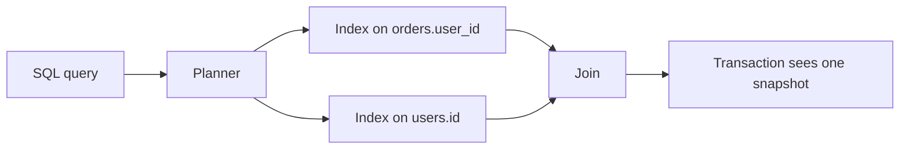
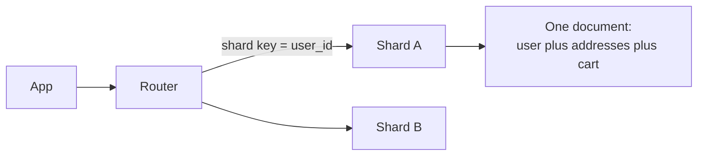
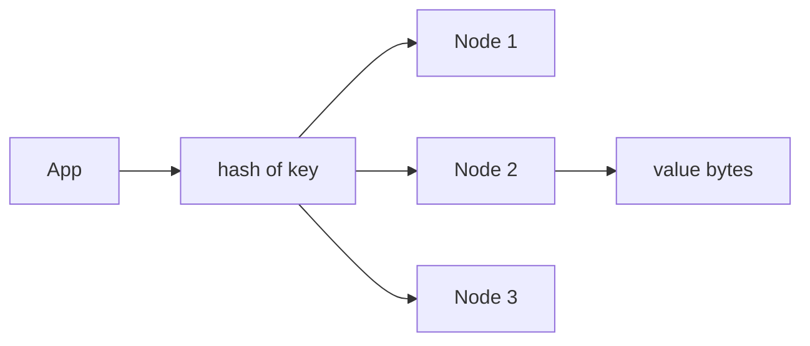
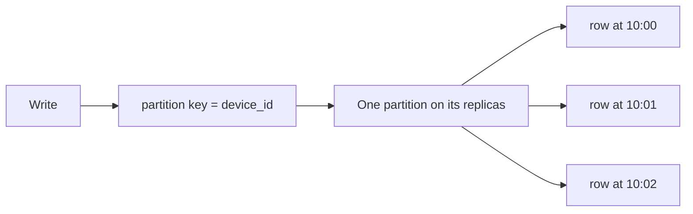
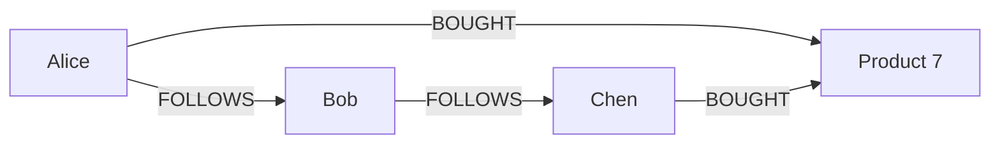
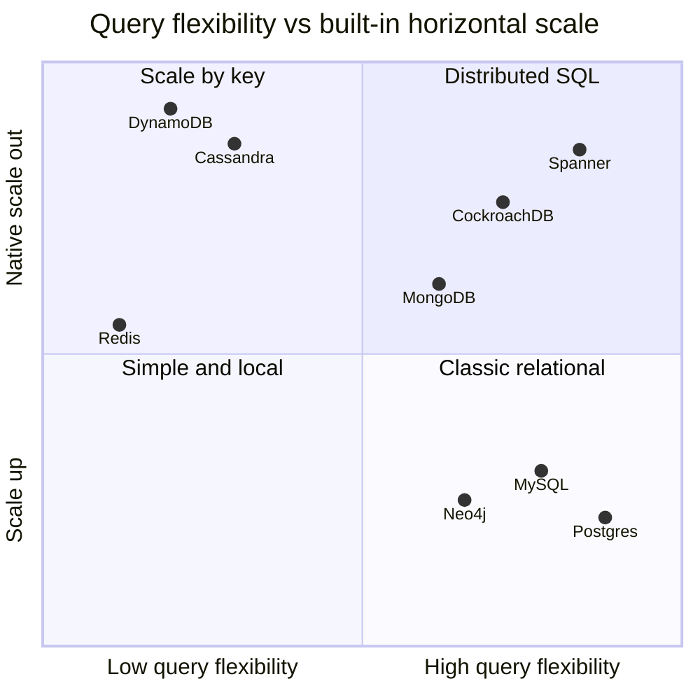
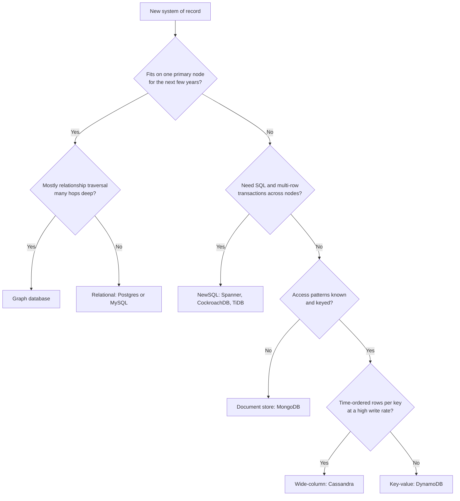

# SQL vs NoSQL

This page compares relational databases with the four main NoSQL families (document, key-value, wide-column and graph) as places to keep an application's system of record.

## Explain it like I'm 5

A family keeps its things in a big cupboard. Every shelf has a label, every box on a shelf is the same size, and a list on the door says which box goes with which. Finding anything is easy, but only one person fits in front of the cupboard.

The neighbours do it differently. One keeps a bag per child with everything that child owns. One has a wall of numbered hooks. One has a long row of drawers, one per street. One has strings tied between friends' photos.

*For grown-ups:* The cupboard is a relational database with a schema and joins on one node, and the neighbours are document, key-value, wide-column and graph stores.

## The short answer

"SQL vs NoSQL" is less a choice between two products than a choice of data model and of where the work happens. A relational database lets you store data once, normalised, and ask questions you did not plan for, with joins and multi-row transactions. NoSQL families usually ask you to shape the data around the queries you already know, and in return make it easier to spread data across many machines. The line has blurred: PostgreSQL and MySQL store and index JSON, MongoDB and DynamoDB have multi-item transactions, and NewSQL systems such as Spanner and CockroachDB offer SQL with horizontal scaling.

**Pick relational when** the data has relationships you will query in several directions, correctness across rows matters (money, inventory, bookings), or you do not yet know every access pattern. This is the right default for most new systems.

**Pick a NoSQL family when** the access patterns are known and narrow, the data or write rate is beyond one node, or the shape of the data fits one family naturally (a self-contained document, a hot key, a time series per device, a dense graph).

**Use both when** one store is the system of record and another serves a specific read path, for example Postgres for orders and a key-value cache or search index fed from it.

## At a glance

| Dimension | Relational | Document | Key-value | Wide-column | Graph |
| --- | --- | --- | --- | --- | --- |
| Examples | PostgreSQL, MySQL, SQL Server | MongoDB, Couchbase | Redis, Valkey, DynamoDB | Cassandra, ScyllaDB, HBase, Bigtable | Neo4j, Amazon Neptune |
| Unit of data | Row in a table with a fixed schema | Nested document (JSON-like) | Opaque value under a key | Rows grouped in a partition, sorted by clustering key | Nodes and edges with properties |
| Schema | Enforced by the database | Flexible, optional validation | None | Table schema, sparse columns | Usually optional |
| Joins | First class | Limited (`$lookup`), embed instead | None | None, denormalise per query | Traversals are the join |
| Transactions | Multi-row ACID | Single document atomic, multi-document available | Single key, some multi-key | Per partition, lightweight transactions | ACID in most products |
| Scaling model | Scale up, read replicas, sharding is extra work | Built-in sharding | Built-in partitioning | Built-in partitioning, leaderless | Mostly scale up and replicas |
| Query flexibility | High (ad hoc SQL) | Medium-high | Low (get and put by key) | Low (by partition key) | High for relationship queries |
| Typical fit | Systems of record | Catalogues, profiles, content | Sessions, caches, counters | Time series, event logs, high write rates | Fraud rings, recommendations, networks |

## How each one works

### Relational

Data is normalised into tables, and the planner decides at query time how to combine them using indexes. Because every table lives in one database with one transaction log, a transaction can change many rows atomically. The cost is that the whole thing is designed around one writer node; spreading it out is something you add later.

### Document

Data that is read together is stored together as one document, so the common read is a single lookup with no join. A shard key decides which shard owns each document. A single-document write is atomic; multi-document transactions exist in MongoDB (replica sets since 4.0, sharded clusters since 4.2), but MongoDB's own docs say they cost more than single-document writes and are no substitute for good schema design.

### Key-value

The store only knows keys. A hash of the key picks the node, so every operation is one hop to one place and scaling out is a matter of adding nodes. Anything other than "get this key" is your job: secondary lookups become extra keys you maintain yourself.

### Wide-column

A table is split by partition key, and inside a partition rows are kept sorted by a clustering key. Reading "the last hour for device 42" is one sequential scan of one partition. Cassandra and ScyllaDB write to a log-structured merge tree, which makes writes cheap appends. You design one table per query, so the same data is often written to several tables.

### Graph

Relationships are stored as first-class edges, so a query such as "friends of friends who bought this" follows edges from a starting node instead of joining large tables. Traversal cost grows with the part of the graph you touch, not with the total size. Partitioning a graph across machines is hard because traversals cross partitions, so most graph databases scale up and add read replicas.

## Where each one sits

*Positions are qualitative judgments for comparison, not measurements.*

The classic trade is visible as a diagonal: relational stores sit bottom-right and key-based NoSQL stores sit top-left. Distributed SQL systems (Spanner, CockroachDB) reach the top-right by paying with cross-node coordination on every write, which shows up as latency rather than lost features. MongoDB sits in the middle: richer queries than a key store, built-in sharding, but queries that miss the shard key fan out to every shard.

## Decision guide

## Trade-offs in depth

### Schema: on write or on read

A relational database checks the schema when you write, so every reader can trust the shape of a row. Document stores move that check to the application: old documents keep their old shape until something rewrites them, and every reader must cope with every version. That is genuinely useful when records vary (product attributes per category) and a slow leak of special cases when they do not. MongoDB's schema validation and Postgres `jsonb` columns let each side borrow the other's approach for part of the data.

### Joins versus denormalisation

Normalised data is stored once, so an update touches one row and a join assembles views at read time. NoSQL families usually ask you to store the data the way it is read: embed the addresses in the user document, or write each event into a table per query. Reads become one lookup, but updates must reach every copy, and the copies can disagree for a while. The [join-free feed scenario](../../scenarios/join-free-feed) shows the point where a read-time join stops being affordable.

### Transactions

Relational databases make multi-row, multi-table transactions the normal case. NoSQL stores began with single-item atomicity and have been adding more: MongoDB multi-document transactions, DynamoDB `TransactWriteItems` (up to 100 items, all in one region), and Cassandra lightweight transactions on a single partition. These work, but they are usually slower than the store's native operation and come with limits, so a design that needs them everywhere is a hint that the relational model fitted better.

### Scaling out

A relational database is easiest to run as one primary plus [read replicas](../../patterns/data/read-replicas). Going past one writer means [sharding](../../patterns/data/sharding) yourself or adding a layer (Vitess for MySQL, Citus for Postgres). Key-value, wide-column and document stores partition data by key from day one, often with [consistent hashing](../../patterns/data/consistent-hashing), so adding nodes is routine. The catch is the partition key: a skewed key concentrates load on one partition no matter how many nodes you have, as the [hot partition scenario](../../scenarios/hot-partition) shows.

### The modern overlap

The families now borrow from each other. PostgreSQL has `jsonb` with GIN indexes and, since version 17, SQL/JSON functions such as `JSON_TABLE`; MySQL has a binary `JSON` type with multi-valued indexes on arrays. NewSQL systems keep SQL and serialisable transactions while splitting data into ranges replicated by consensus: Spanner uses TrueTime timestamps to give externally consistent transactions, CockroachDB defaults to `SERIALIZABLE` and speaks the PostgreSQL wire protocol, and TiDB is MySQL-compatible. Graph queries are also arriving in SQL: ISO published the GQL standard in 2024, and SQL itself has a property graph query extension (SQL/PGQ).

### Operational cost

A single Postgres or MySQL node is well understood, and every cloud offers it managed. Self-run Cassandra or sharded MongoDB means planning capacity, repairs and rebalancing. Fully managed services (DynamoDB, MongoDB Atlas, Spanner) remove most of that, at the price of vendor lock-in and a pricing model you must design around.

## Common misconceptions

- **"NoSQL means no schema."** The schema still exists; it lives in your application code and in every document already written. Changing it means migrating data or handling old shapes forever.
- **"NoSQL is faster."** A key lookup is fast in any database with an index. NoSQL stores are easier to *scale out* for keyed access, which is a different property from speed on one machine.
- **"NoSQL databases have no transactions."** MongoDB, DynamoDB and others have them now, with limits. The real question is whether your common operations need them.
- **"SQL databases cannot scale."** Single-node Postgres and MySQL handle a lot, read replicas add read capacity, and Vitess, Citus and NewSQL systems scale writes horizontally. Scaling relational writes is more work, not impossible.
- **"Pick one database for everything."** Many systems keep a relational system of record and feed caches, search indexes or key-value read models from it.

## In this repo

- [Sharding](../../patterns/data/sharding): hash vs range partitioning, the mechanism every NoSQL family relies on.
- [Consistent hashing](../../patterns/data/consistent-hashing): how key-value and wide-column stores place keys on nodes.
- [LSM tree](../../patterns/data/lsm-tree): the write path behind Cassandra, ScyllaDB and many key-value stores.
- [Read replicas](../../patterns/data/read-replicas): the usual first step for scaling a relational database.
- [Materialized view](../../patterns/data/materialized-view): precomputed read models, the relational answer to denormalisation.
- [CQRS](../../patterns/data/cqrs): separate write and read models, often in different kinds of store.
- [Join-free feed scenario](../../scenarios/join-free-feed): when a SQL join becomes too expensive and data is reshaped for reads.
- [Hot partition scenario](../../scenarios/hot-partition): why a partition key decides how far a NoSQL table can scale.

## Interview follow-ups

- *You picked Postgres. When would you move part of the system to NoSQL?* When one access pattern outgrows the primary (for example a write-heavy event log or a very hot key), move that pattern alone to a store built for it, fed by change data capture or an outbox, and keep the rest relational.
- *How do you model a one-to-many relationship in a document store?* Embed the children when they are bounded, owned by the parent and read with it (order lines in an order). Reference them by ID when they are unbounded or shared, because documents have a size limit (16 MB in MongoDB) and embedded copies must be updated everywhere.
- *What does NewSQL give up compared with single-node SQL?* Latency: a write needs a consensus round across replicas, and a transaction spanning ranges needs a distributed commit. Some features and extensions of the database it imitates are also missing.
- *Why is a graph database better than recursive SQL for friends-of-friends?* Each hop follows stored edges from the current nodes, so the cost depends on the neighbourhood touched. A recursive SQL query does an index lookup per hop and can explode in intermediate rows. For one or two hops, SQL is often fine.

## Further reading

- [MongoDB transactions](https://www.mongodb.com/docs/manual/core/transactions/): multi-document transaction support and the advice to prefer schema design.
- [PostgreSQL JSON types](https://www.postgresql.org/docs/current/datatype-json.html): `json` vs `jsonb`, GIN operator classes and jsonpath.
- [PostgreSQL 17 release notes](https://www.postgresql.org/about/news/postgresql-17-released-2936/): `JSON_TABLE` and the SQL/JSON functions.
- [MySQL CREATE INDEX](https://dev.mysql.com/doc/refman/8.4/en/create-index.html): functional key parts and multi-valued indexes on JSON arrays.
- [DynamoDB constraints](https://docs.aws.amazon.com/amazondynamodb/latest/developerguide/Constraints.html): item size, transaction limits and per-call limits.
- [Spanner TrueTime and external consistency](https://docs.cloud.google.com/spanner/docs/true-time-external-consistency): how Spanner orders transactions globally.
- [CockroachDB transactions](https://docs.cockroachlabs.com/docs/stable/transactions): default `SERIALIZABLE` isolation and the `READ COMMITTED` option.
- [Cassandra Dynamo architecture](https://cassandra.apache.org/doc/latest/cassandra/architecture/dynamo.html): partitioning, replication and tunable consistency.
