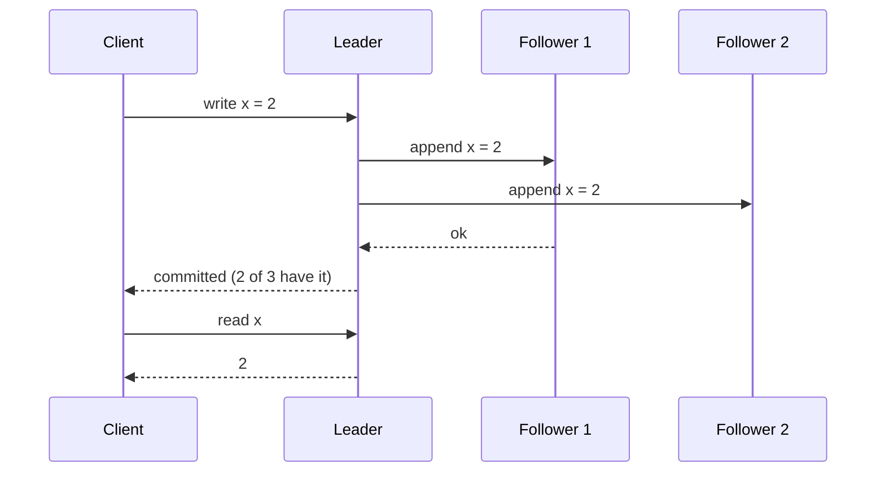
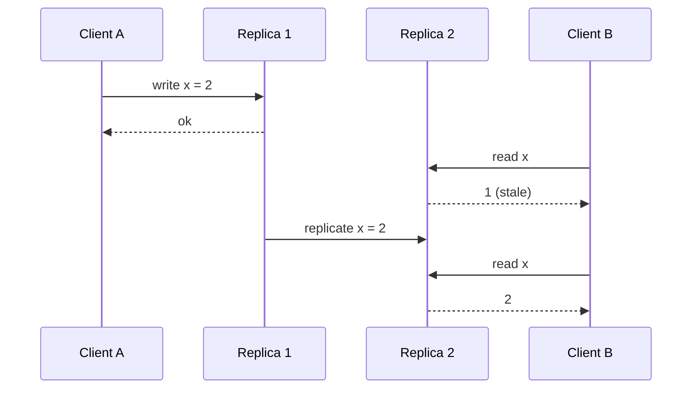
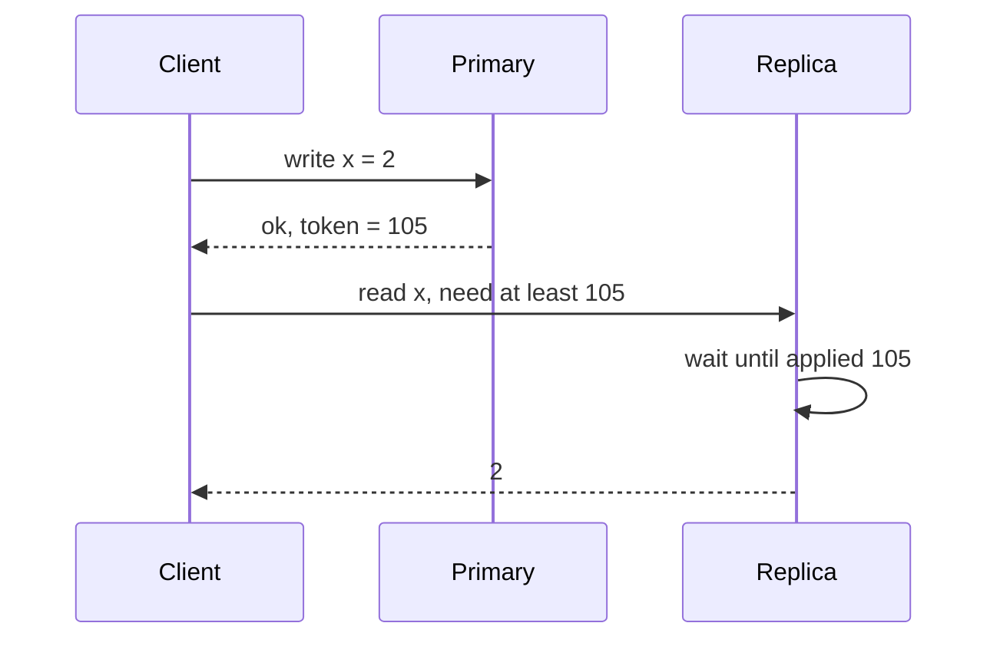
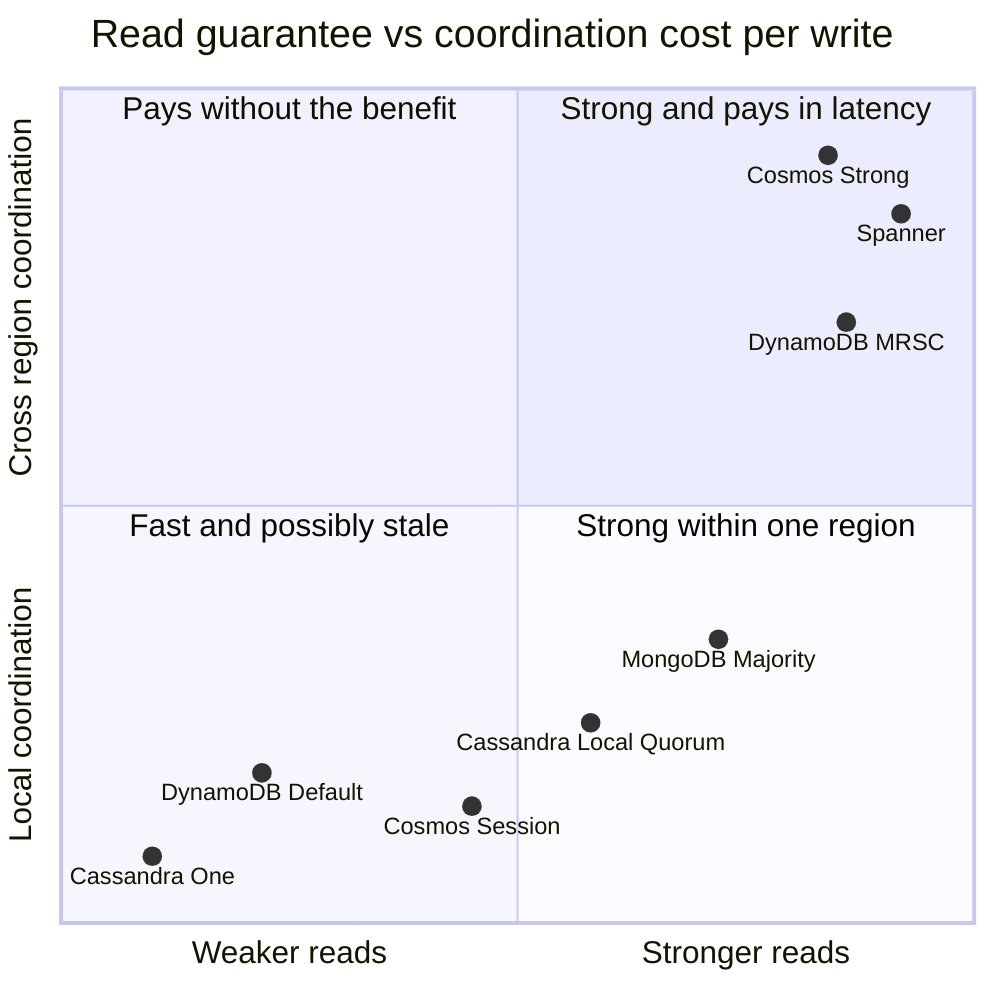
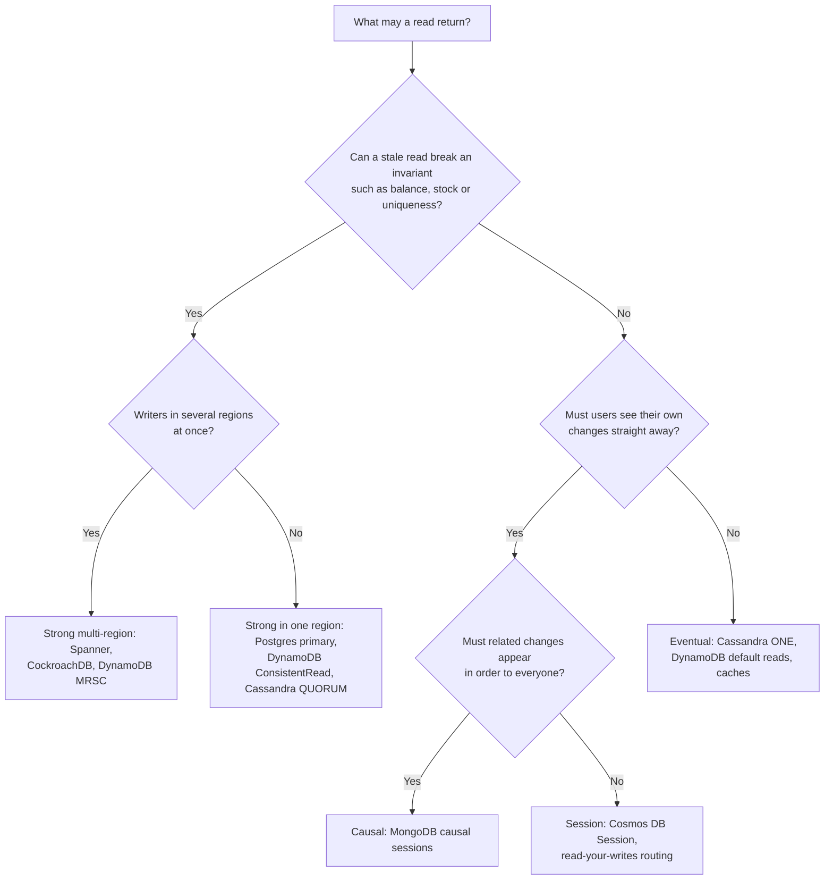

# Strong vs Eventual Consistency

This page compares strong and eventual consistency, and the models between them, as the guarantee a replicated database gives about what a read can return.

## Explain it like I'm 5

A class keeps its score on three blackboards in three rooms.

In the strict class, nobody can change the score until a runner has written it on at least two boards, and anyone asking checks with those boards first. Answers are always right, but slow, and if the runners cannot get through, the boards say "wait".

In the relaxed class, each room changes its own board straight away and sends a runner later. Answers are quick and never refused, but a room might be behind for a bit.

*For grown-ups:* The boards are replicas, the runner is replication, the strict class is strong (linearizable) consistency with majority quorums, and the relaxed class is eventual consistency.

## The short answer

Strong consistency (in the precise sense, linearizability) means the system behaves as if there were one copy of the data: once a write is acknowledged, every later read sees it. Eventual consistency only promises that replicas converge if writes stop; a read may return an old value, and two reads in a row may go backwards. Between them sit useful guarantees such as read-your-writes, monotonic reads and causal consistency, which fix the anomalies users notice at a fraction of the cost. Strong consistency costs coordination on every operation, which shows up as latency all the time and as unavailability on the minority side of a network partition. Most real databases let you choose per request.

**Pick strong when** a stale read can break an invariant: balances, stock counts, seat holds, unique usernames, leader leases, configuration that must not diverge.

**Pick eventual when** staleness is harmless and availability or latency matters more: like counts, view counts, feeds, recommendations, presence, caches, metrics.

**Use both when** one system has both kinds of data, which is the usual case: strong reads for the checkout path, eventually consistent replicas or caches for browsing, and session guarantees so users see their own changes.

## At a glance

| Dimension | Strong (linearizable) | Session guarantees (read-your-writes, monotonic reads) | Causal | Eventual |
| --- | --- | --- | --- | --- |
| A read returns | The latest acknowledged write | At least your own latest writes, never going backwards for you | Effects never appear before their causes | Some value that was written, possibly old |
| Coordination per operation | Leader or quorum on every read and write | Client carries a token or sticks to a replica | Track dependencies (version vectors, timestamps) | None beyond local write |
| During a partition | Minority side cannot serve | Works while the client can reach a suitable replica | Works while the client can reach a suitable replica | Every side keeps serving |
| Latency | Includes a round trip to a quorum or leader, cross-region if replicas are | Close to local | Close to local, plus metadata | Local |
| Anomalies allowed | None for single objects | Other users may see stale data | Concurrent writes can be seen in different orders | Stale reads, reads going backwards, lost updates under last-writer-wins |
| Typical mechanism | Raft or Paxos leader, majority quorums, TrueTime | Session tokens, sticky routing, wait-for-LSN | Causal sessions, vector clocks | Asynchronous replication, gossip, anti-entropy |
| Examples | etcd, Spanner, DynamoDB `ConsistentRead`, Postgres primary | Cosmos DB Session (default), MongoDB causal sessions | MongoDB causal sessions | Cassandra `ONE`, DynamoDB default reads, async read replicas |

## How each one works

### Strong: a leader commits only after a majority has the write

A write is acknowledged only once a majority of replicas have it, and reads go through the leader (which must confirm it is still leader) or through a quorum that overlaps every write quorum. Any read after the acknowledgement therefore sees the write. If the leader is cut off from the majority, it can no longer commit or serve linearizable reads, and the majority side elects a new one.

### Eventual: accept locally, replicate later

Any replica accepts the write and acknowledges at once, then sends it to the others in the background. A read that reaches a replica the change has not arrived at yet returns the old value. If two replicas accept conflicting writes, a rule such as last-writer-wins by timestamp, or a merge such as a CRDT, decides the final value.

### In between: a session token gives read-your-writes

The client remembers the position of its last write and asks any replica to answer only once it has caught up to that position (or routes the read to the primary if the replica is too far behind). The client sees its own writes and never goes backwards, while other clients may still see older data. MongoDB causally consistent sessions and Cosmos DB session tokens both work this way.

## Where each one sits

*Positions are qualitative judgments for comparison, not measurements.*

Each point is a database in a particular configuration, because the same product moves across the chart depending on its settings. Strong guarantees across regions sit top-right and cost at least one inter-region round trip per write. Many systems choose the bottom-right corner: strong within one region, where a quorum round trip is cheap, and asynchronous across regions.

## Decision guide

## Trade-offs in depth

### What CAP actually says

Brewer's conjecture, proved by Gilbert and Lynch in 2002, uses narrow definitions. Consistency means linearizability. Availability means every request received by a non-failing node gets a non-error response, not "the service is usually up". Partition tolerance means the network may drop or delay messages between nodes. The theorem says that **while a partition is happening**, a system cannot be both linearizable and available: a node that cannot reach the others must either refuse (keeping consistency) or answer from what it has (keeping availability). It says nothing about how the system behaves when the network is healthy, and nothing about latency. Partitions are not optional in a distributed system, so "CA" is not a real choice; Brewer himself argued in 2012 that "pick two of three" misleads and that the choice applies only during partitions, can differ per operation, and is a matter of degree.

### Why most databases are neither "CP" nor "AP"

The labels only fit systems that offer exactly linearizability or exactly total availability, and most offer neither. A Postgres primary with asynchronous replicas is not CAP-available (clients cut off from the primary cannot write) and its replica reads are not linearizable. Cassandra at `QUORUM` cannot serve on the minority side, so it is not available, and with last-writer-wins timestamps it is not strictly linearizable either. ZooKeeper reads come from one server by default and are not linearizable unless you call `sync`. Describe a system by the guarantee each operation gives and what happens when replicas cannot reach each other, rather than by a letter pair.

### PACELC: the trade-off that exists every day

Abadi's PACELC (2012) extends CAP: if there is a **P**artition, choose **A**vailability or **C**onsistency; **E**lse, in normal operation, choose **L**atency or **C**onsistency. The second half matters more in practice because partitions are rare and latency is constant: to read the latest value you must contact a leader or a quorum, and if replicas are in other regions that is a long round trip on every request. Abadi classed the default configurations of Dynamo, Cassandra and Riak as PA/EL and fully ACID systems such as VoltDB as PC/EC. Many modern systems let you pick per request, so the classification belongs to a setting rather than a product.

### The models in between

Session guarantees (Terry and colleagues, 1994) are cheap and fix the anomalies people notice. **Read-your-writes**: after you change your profile, you see the change. **Monotonic reads**: once you have seen a value you never see an older one, which stops comments appearing and disappearing as requests hit different replicas. **Monotonic writes** and **writes-follow-reads** keep your own writes in order. **Causal consistency** extends this to everyone: if a reply was written after reading a post, no one sees the reply without the post. Jepsen's hierarchy classes read-your-writes and causal as "sticky available": they survive partitions as long as each client keeps talking to the same replicas. Sequential consistency and linearizability cannot be kept available during a partition.

### Where common databases sit, and their settings

| Database | Default | Tunable towards strong | Tunable towards fast |
| --- | --- | --- | --- |
| PostgreSQL | Primary reads are current; streaming replicas are asynchronous | `synchronous_standby_names` with `synchronous_commit = remote_apply` makes commits visible on the standby before returning | Read from async replicas; `synchronous_commit = off` per transaction (may lose recent commits on crash) |
| MongoDB | Writes `w: "majority"` (5.0 and later), reads from the primary | `readConcern: "linearizable"` for single documents; causal sessions for read-your-writes on secondaries | `w: 1`, `readConcern: "local"`, secondary read preference |
| Cassandra | Chosen by the client; common drivers default to `LOCAL_ONE` | `QUORUM` reads and writes (W + R > RF); `SERIAL` for lightweight transactions | `ONE` or `LOCAL_ONE` |
| DynamoDB | Eventually consistent reads | `ConsistentRead=true` on tables and LSIs; MRSC global tables across three regions | Default reads cost half the capacity |
| Cosmos DB | Session | Bounded staleness or Strong (not with multiple write regions) | Consistent prefix or Eventual |
| Spanner and CockroachDB | Serializable, externally consistent (Spanner) | Already strong | Stale or follower reads at a bounded timestamp |

### Cost of strong consistency

Every linearizable read must check that it is not missing a newer write: a leader confirms it still holds its lease, or a quorum is consulted. Every write waits for a majority. Within one region the replicas are close, so this is cheap; across continents it adds the round-trip time between regions to every write, which no amount of hardware removes. Cosmos DB's documentation, for example, puts multi-region strong write latency at about twice the round-trip time between the two farthest regions, and DynamoDB MRSC tables have higher write latency than their eventually consistent equivalent. That is why systems confine strong consistency to the data that needs it.

## Common misconceptions

- **"CAP means pick any two of three."** You cannot give up partitions. CAP is only about what happens during a partition, and then only between linearizability and total availability.
- **"Eventual consistency means data might be lost."** It is about visibility, not durability. Data loss comes from acknowledging writes before they are durable or from last-writer-wins silently overwriting a concurrent update.
- **"ACID consistency is the same as CAP consistency."** The C in ACID means a transaction keeps the database's invariants. The C in CAP means linearizability across replicas. A serializable database can still serve non-linearizable reads from replicas.
- **"Quorums make Cassandra linearizable."** Overlapping quorums make reads see acknowledged writes, but last-writer-wins on timestamps and failed partial writes can still produce non-linearizable histories. Use lightweight transactions for compare-and-set.
- **"Strong consistency is always slow."** Within one region, leader reads and majority writes are cheap. The real cost is coordination across regions.

## In this repo

- [Quorum](../../patterns/distributed/quorum): N, R and W, and why overlapping quorums see the latest write.
- [Read replicas](../../patterns/data/read-replicas): replica lag and read-your-writes routing.
- [Leader election](../../patterns/distributed/leader-election): lease-based leadership, the basis of leader reads.
- [Lamport and vector clocks](../../patterns/distributed/lamport-vector-clocks): tracking causality between events.
- [Gossip](../../patterns/distributed/gossip): how eventually consistent clusters spread updates.
- [Two-phase commit](../../patterns/distributed/two-phase-commit): atomic commit across nodes, and why it blocks during failures.
- [Distributed lock with fencing](../../patterns/distributed/distributed-lock-fencing): what goes wrong when a lock holder's view is stale.
- [Stale rider location scenario](../../scenarios/stale-rider-location): stale and out-of-order reads seen by users.

## Interview follow-ups

- *A user updates their profile and the page still shows the old name. How do you fix it without making everything strong?* Give that user read-your-writes: route their reads to the primary for a short window after a write, or pass the write's log position and have the replica wait until it has applied it.
- *Is a single-node database CP or AP?* Neither label is useful. With one node there is no partition between replicas; if the node or the network to it fails, it is simply unavailable.
- *How does Spanner give strong consistency across regions?* Each write is replicated by Paxos, and TrueTime's bounded clock uncertainty lets Spanner assign commit timestamps that respect real-time order, so a transaction that commits later always has a later timestamp. The price is a Paxos round trip across replicas on every write.
- *When is eventual consistency actually dangerous?* When two clients read the same stale value and both act on it: overselling the last ticket, double-spending a balance, or two nodes both believing they hold a lock. Use a conditional write or a strongly consistent read for those decisions.
- *What does R + W > N give you, and what does it not?* Every read quorum overlaps every write quorum, so a read contacts at least one replica with the latest acknowledged write. It does not by itself give linearizability, because concurrent writes, failed writes and clock-based conflict resolution can still produce surprising orders.

## Further reading

- [CAP Twelve Years Later, Eric Brewer (2012)](https://www.infoq.com/articles/cap-twelve-years-later-how-the-rules-have-changed/): why "two of three" misleads and how to handle partitions.
- [Consistency Tradeoffs in Modern Distributed Database System Design, Daniel Abadi (2012)](https://www.cs.umd.edu/~abadi/papers/abadi-pacelc.pdf): the PACELC formulation and example classifications.
- [Please stop calling databases CP or AP, Martin Kleppmann (2015)](https://martin.kleppmann.com/2015/05/11/please-stop-calling-databases-cp-or-ap.html): CAP's narrow definitions and why most systems fit neither label.
- [Jepsen consistency models](https://jepsen.io/consistency/models): the hierarchy of models and which can stay available during partitions.
- [Azure Cosmos DB consistency levels](https://learn.microsoft.com/en-us/azure/cosmos-db/consistency-levels): five levels from strong to eventual, with their quorum and latency costs.
- [MongoDB causal consistency and read concern](https://www.mongodb.com/docs/manual/core/read-isolation-consistency-recency/): session guarantees and the `majority` and `linearizable` read concerns.
- [DynamoDB read consistency](https://docs.aws.amazon.com/amazondynamodb/latest/developerguide/HowItWorks.ReadConsistency.html): default eventual reads and `ConsistentRead`.
- [DynamoDB global tables](https://docs.aws.amazon.com/amazondynamodb/latest/developerguide/V2globaltables_HowItWorks.html): eventual and strong multi-region modes.
- [Cassandra Dynamo architecture](https://cassandra.apache.org/doc/latest/cassandra/architecture/dynamo.html): consistency levels and the W + R > RF rule.
- [PostgreSQL WAL settings](https://www.postgresql.org/docs/current/runtime-config-wal.html): `synchronous_commit` levels and what each waits for.
- [Spanner TrueTime and external consistency](https://docs.cloud.google.com/spanner/docs/true-time-external-consistency): external consistency and stale reads.
