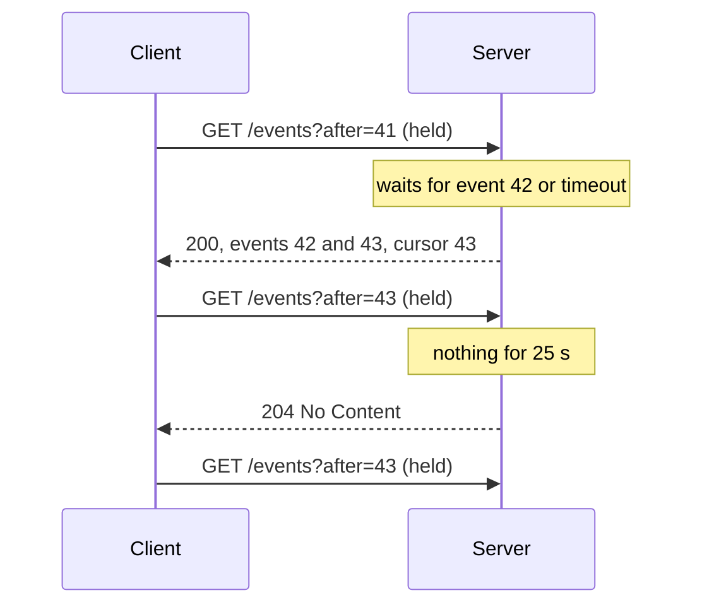
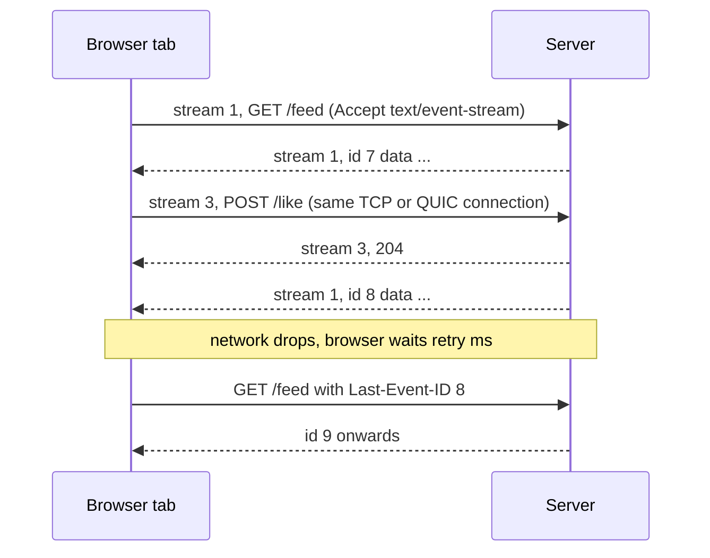
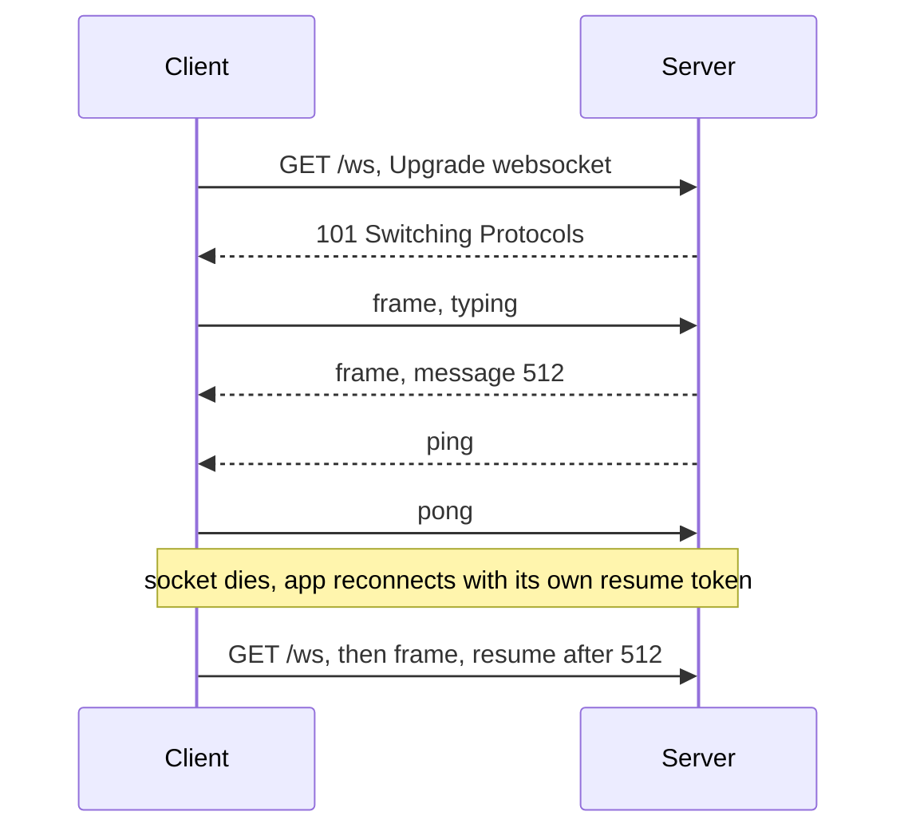
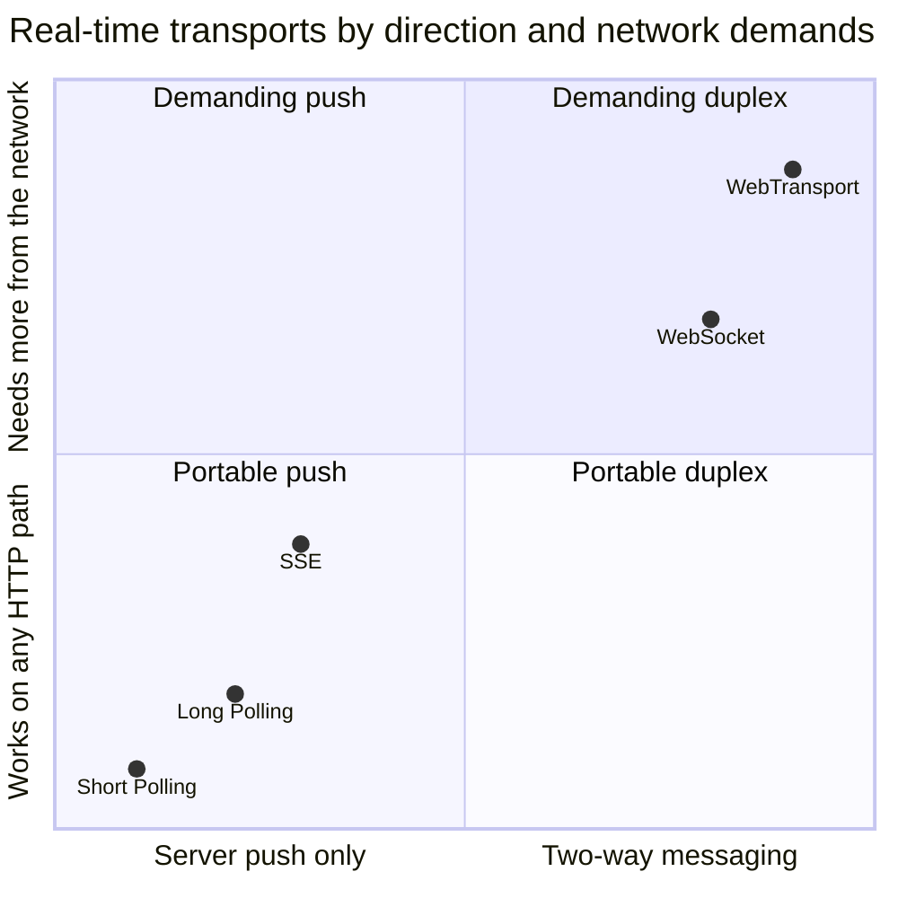
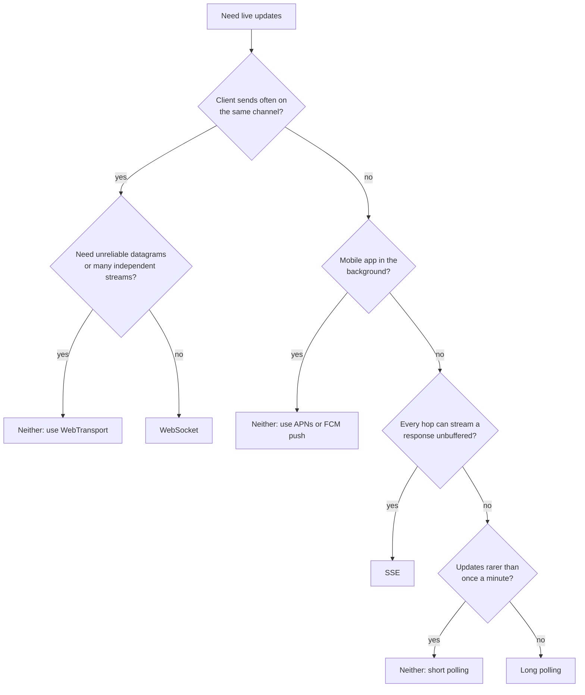

# WebSocket vs Server-Sent Events vs Long Polling

A comparison of the three common ways to push fresh data from a server to browsers and apps, for live feeds, notifications, chat and collaborative features.

## Explain it like I'm 5

Three kids want to know when the cookies are ready. Mia asks the baker, and the baker stays quiet until a batch is done, answers, and Mia asks again. Leo sits by the kitchen door, and the baker calls out every batch as it comes, but Leo can only listen. Ava and the baker each hold a walkie-talkie, so both can talk any time, but the batteries run down and someone has to keep asking "still there?"

*For grown-ups:* Mia's question is a long poll held until there is news, Leo's doorway is a Server-Sent Events stream, and the walkie-talkie is a WebSocket with ping/pong heartbeats.

## The short answer

All three deliver server events with near-push latency; they differ in what the network path must support, who can send, and what happens when the connection breaks. Long polling is ordinary request and response, so it works through anything, but it pays a full request per delivery. Server-Sent Events (SSE) is one long HTTP response that the server keeps writing to, with reconnection and resume built into the browser; over HTTP/2 or HTTP/3 it shares the page's connection. WebSocket upgrades the connection into a full-duplex message channel with tiny frames, and leaves reconnection, resume and heartbeats to you. On mobile, the battery cost comes mostly from how often the radio wakes, not from which protocol keeps the connection.

**Pick SSE when** data flows mostly server to client (notifications, dashboards, progress, LLM tokens) and client actions can be ordinary HTTP requests.

**Pick WebSocket when** the client also sends often on the same channel (chat typing, games, collaborative cursors) or messages are binary.

**Pick long polling when** streaming responses do not survive the network path, as a fallback for either of the others, or for machine clients that want "block until something changes".

## At a glance

| Dimension | Long polling | SSE | WebSocket |
| --- | --- | --- | --- |
| Direction | Client asks; server answers when it has data | Server to client; client uses separate requests | Both ways on one connection |
| Wire format | Any HTTP response body | UTF-8 text events (`id:`, `event:`, `data:`) | Binary or text frames |
| Runs over | HTTP/1.1, HTTP/2, HTTP/3 | HTTP/1.1, HTTP/2, HTTP/3 | HTTP/1.1 upgrade; HTTP/2 and HTTP/3 via extended CONNECT where supported |
| Browser connection cost on HTTP/1.1 | One connection while the request is held | One of about 6 connections per origin, shared by all tabs | Its own TCP connection per socket |
| Reconnect and resume | Cursor in every request | Automatic reconnect, `retry:`, `Last-Event-ID` | None in the protocol |
| What breaks it | Proxy idle timeouts shorter than the hold | Proxies that buffer or compress the response | Hops that drop the `Upgrade` or cut idle sockets |
| Server state per client | A parked request between deliveries | An open response | An open socket with read and write state |
| Load balancing | Any instance can answer, given a shared log | Sticky for the stream's life; resume anywhere with shared history | Pinned for the socket's life |

## How each one works

### Long polling

Every delivery is a complete exchange, and the cursor travels with each request, so resume is part of the design and any server instance can answer. The cost is per delivery: headers, authentication and routing for every batch, and a re-poll from every client after a broadcast.

### Server-Sent Events over HTTP/2

The feed is one HTTP response that never ends. Over HTTP/2 or HTTP/3 it is just one stream on the connection the page already has, so the client's own actions travel as ordinary requests beside it. When the stream breaks, the browser reconnects by itself and sends the last ID it saw.

### WebSocket

After the upgrade the connection is no longer HTTP: both sides send frames whenever they like, with a few bytes of header each. Nothing above that is defined, so message IDs, acknowledgements, resume and heartbeats are application protocol.

## Where each one sits

*Positions are qualitative judgments for comparison, not measurements.*

The bottom-right corner is nearly empty: two-way messaging has always needed something beyond plain request and response. SSE and long polling trade direction for the ability to pass through almost anything. WebTransport, built on HTTP/3 and QUIC, goes furthest on capability (many streams and unreliable datagrams) and also asks the most of the path, since UDP must be allowed end to end.

## Decision guide

## Trade-offs in depth

This repo's [SSE](../../patterns/architecture/server-sent-events), [long polling](../../patterns/architecture/long-polling) and [WebSocket hub](../../patterns/architecture/websocket-hub) pages already compare per-message overhead, proxy idle timeouts, the thundering re-poll and per-node connection limits. The sections below cover what those pages do not.

### Direction is about frequency, not capability

Every one of the three lets the client talk to the server; the question is how often and how cheaply. With SSE the client sends ordinary `POST`s, and over HTTP/2 those ride the same connection as the feed, so a chat app where users read far more than they type works well on SSE. WebSocket pays off when client messages are frequent and small (keystrokes, cursor positions, game inputs), where a request per message would mean headers and routing for a few bytes of payload, or when ordering between client and server messages on one channel matters.

### HTTP/2, HTTP/3 and what the path supports

The classic WebSocket handshake is an HTTP/1.1 `Upgrade`, which HTTP/2 does not have. RFC 8441 (2018) defines extended `CONNECT` so a WebSocket runs on one HTTP/2 stream, and RFC 9220 (2022) does the same for HTTP/3. Support varies across browsers, servers and load balancers, so check every hop; where it is missing, each WebSocket is its own TCP and TLS connection. SSE and long polling are ordinary HTTP, so they use whatever version the page uses. Under HTTP/1.1 browsers allow about six connections per origin, shared across tabs, so a user with several tabs of an SSE app can starve the page of connections; under HTTP/2 the limit is the negotiated stream count (commonly 100). HTTP/3 runs over QUIC, which removes TCP head-of-line blocking between streams and lets a connection survive a change of network address, such as moving from Wi-Fi to cellular. Networks that block UDP push clients back to HTTP/2, so design for both.

### Reconnection and resume

Disconnects are normal, not exceptional: deploys, load balancer timeouts, phones changing networks. The HTML standard gives SSE most of what you need: the browser reconnects after the `retry:` delay and sends `Last-Event-ID`, and a response that is not `200` with `text/event-stream` (including `204`) stops it from reconnecting, which is how a server says "go away". With WebSocket you build the same thing: a sequence number per message, a resume request carrying the last one seen, a bounded replay buffer, and a "too far behind, refetch the snapshot" answer. In every case the server needs a numbered history to replay from; if that history is local to one node, a client that reconnects elsewhere cannot resume. When a node dies, all its clients reconnect at once, so add jittered backoff on the client and drain sockets gradually on planned shutdown.

### Scaling connection state

A long-poll request lives for seconds, so any instance can serve the next one and scaling is ordinary HTTP scaling. SSE and WebSocket connections live for minutes or hours, which turns three easy problems into hard ones. Deploys must drain connections instead of waiting for requests to finish. New instances start empty and stay underloaded under round-robin, so use least-connections balancing and occasionally ask clients to reconnect. And a message for a user must reach whichever node holds that user's connection, which needs a pub-sub bus or a connection registry between nodes. Managed gateways (for example AWS API Gateway WebSocket APIs) take the sockets off your servers and give you a connection ID to post to instead.

### Mobile battery

On a phone the expensive part is waking the radio. Android's guidance describes a radio that stays in a high-power state for several seconds after every transfer, then lingers in a lower-power state before standby, so small transfers every few seconds keep it awake permanently. That means the heartbeat interval matters more than the protocol: a WebSocket pinging every 15 seconds, an SSE comment every 15 seconds and a 25-second long poll all keep waking the radio. Batch updates, use longer heartbeats where the network path allows, and close the connection when the app is in the background. In the background the operating system will suspend sockets anyway; APNs and FCM exist so one shared system connection can wake the app. The SSE standard even allows a browser to hand the stream to a network push proxy and let the device sleep.

### Where WebTransport fits

WebTransport runs over HTTP/3 and gives a page several reliable streams plus unreliable datagrams on one QUIC connection. MDN marks it Baseline 2026, newly available, so it is now usable across current browsers but not older ones. It suits games, live media and telemetry where a late update is worse than a lost one. It is not yet the default for chat or notifications, where WebSocket and SSE are simpler and work on more networks.

## Common misconceptions

- **"SSE is one-way, so it cannot do chat."** The client sends with ordinary requests. Many chat-style apps read far more than they write.
- **"WebSocket is always faster."** Once the connection is open, an SSE event and a WebSocket frame both arrive in about one network trip. The differences are framing overhead and who can send, not raw latency.
- **"WebSocket handles reconnection."** The protocol does not. Browsers' `WebSocket` objects do not reconnect; libraries such as Socket.IO add it at the application layer.
- **"Long polling is obsolete."** It is still the transport that survives every proxy and the standard fallback, and APIs such as Consul blocking queries and the Telegram Bot API use it on purpose.
- **"HTTP/2 makes WebSocket faster."** Only where RFC 8441 is supported end to end, and then mostly by sharing a connection, not by speeding up frames.

## In this repo

- [Server-Sent Events](../../patterns/architecture/server-sent-events): a broker with bounded replay history, `Last-Event-ID` resume and reset events.
- [Long polling](../../patterns/architecture/long-polling): held requests with a cursor, hold timeouts and a held-request cap.
- [WebSocket hub](../../patterns/architecture/websocket-hub): a connection registry across nodes, bounded send queues and ping/pong heartbeats.
- [Presence](../../patterns/architecture/presence): heartbeats as leases, with a grace period for flapping connections.
- [Pub-sub](../../patterns/distributed/pub-sub): the bus that gets a message to the node holding a user's connection.
- [Backpressure](../../patterns/distributed/backpressure): what to do with a client that reads too slowly.
- [Graceful shutdown](../../patterns/reliability/graceful-shutdown): draining long-lived connections on deploy.
- [Retry with backoff](../../patterns/reliability/retry-backoff): jittered reconnects so a node failure does not become a reconnect storm.
- [Stale rider location](../../scenarios/stale-rider-location): routed WebSocket pushes with a drop-oldest queue for live positions.
- [Duplicate chat messages](../../scenarios/duplicate-chat-messages): what happens when resends after reconnects are not idempotent.

## Interview follow-ups

- *A user opens your SSE dashboard in eight tabs and the page hangs. Why?* Under HTTP/1.1 the browser allows about six connections per origin across tabs, and each tab's stream holds one. Serve over HTTP/2, or share one stream across tabs with a `SharedWorker` or `BroadcastChannel`.
- *How do you give WebSocket clients resume after a reconnect?* Number every message per user or per channel, keep a bounded history in a shared store, and have the client send its last number on reconnect. Replay the gap or tell it to refetch a snapshot when the gap is too old.
- *One gateway node with 200,000 sockets crashes. What happens next?* All those clients reconnect within seconds. Jittered exponential backoff on the client, connection rate limits at the load balancer, and capacity headroom keep it from cascading.
- *How would you push to a mobile app?* Foreground: an SSE stream or WebSocket with a long heartbeat interval. Background: APNs or FCM, with the app fetching details when it wakes.
- *Why do SSE streams sometimes arrive all at once after a delay?* A proxy or compression layer is buffering the response. Disable buffering for that route (for nginx, `X-Accel-Buffering: no`) and send periodic comment lines.

## Further reading

- [HTML Standard: Server-sent events](https://html.spec.whatwg.org/multipage/server-sent-events.html): reconnection, `retry`, `Last-Event-ID`, failure statuses, keep-alive comments and push proxies.
- [MDN: EventSource](https://developer.mozilla.org/en-US/docs/Web/API/EventSource): the browser API and the per-origin connection limit under HTTP/1.1 and HTTP/2.
- [RFC 9220: Bootstrapping WebSockets with HTTP/3](https://www.rfc-editor.org/rfc/rfc9220.html): extended CONNECT for HTTP/3, building on RFC 8441 for HTTP/2.
- [MDN: WebTransport API](https://developer.mozilla.org/en-US/docs/Web/API/WebTransport_API): streams and datagrams over HTTP/3, and its Baseline 2026 status.
- [Android: Optimize network access](https://developer.android.com/develop/connectivity/network-ops/network-access-optimization): the radio state machine and why frequent small transfers drain the battery.
