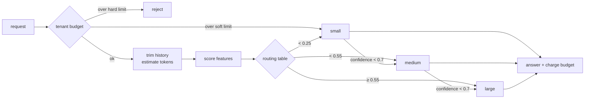

# Model Router (LLM Cascades)

## Problem

An AI feature launches on the biggest, most capable model because that is what the prototype used. Then traffic grows:

- **Most requests are simple.** Greetings, "what are your opening hours?", ticket classification, short rewrites. A small model answers them just as well, at a few percent of the price.
- **Cost grows linearly with traffic.** Every request pays large-model prices for input and output tokens, so doubling users doubles the bill, and nothing in the design bends that line.
- **Latency is high for everyone.** Large models generate tokens more slowly, so a "hi" waits as long as a code review.
- **The obvious fix breaks quality.** Moving everything to the small model makes the bill tiny and the hard 10% of requests (multi-step reasoning, code, tool use) mostly wrong.

## Solution

Put a **router** in front of several model tiers and give each request the cheapest tier that should handle it well:

1. **Score** the request with cheap, local features: prompt length, keywords that signal reasoning ("explain why", "compare", "code"), number of questions, whether tools are needed, conversation depth. No model call, microseconds of CPU.
2. **Route** through a table of ascending thresholds: score below the first goes to small, below the second to medium, otherwise large.
3. **Escalate on low confidence** (a cascade): every non-top model returns a confidence with its answer. Below a threshold, the request is retried on the next tier. Both calls are paid for, so escalation only pays off when it is rare.
4. **Cap spend per tenant per day**: past a soft limit, downgrade to the cheapest tier with no escalation; past a hard limit, reject. Reset at midnight.
5. **Reduce tokens** before the call: keep the last N turns of conversation history and replace older ones with a summary.

## Diagram



## How this implementation works

- `New(models, thresholds, opts...)` takes models ordered cheapest first and `len(models)-1` strictly ascending thresholds in (0, 1]. A score exactly on a threshold goes to the higher tier. A single model with no thresholds is a valid "always this model" baseline, which is how the example builds always-large and always-small.
- Options: `WithEscalation(minConfidence)`, `WithBudget(*Budget)`, `WithHistoryLimit(keep)`, `WithScorer(Scorer)`.
- `Model` is an interface (`Name`, `Pricing`, `Complete`). `Pricing.Cost(in, out)` uses dollars per 1K input and output tokens.
- `Scorer` is a struct of weights and caps; `DefaultScorer()` is what the example uses. Each feature adds at most its cap, and the total is clamped to 1. The score uses the *full* conversation depth even when history is then trimmed.
- `Route` returns a `Result` with the answering model, the tier the table picked (`RoutedTier`) and the tier that answered (`Tier`), every `Attempt`, total `Cost` and `Latency` summed across attempts (a cascade is sequential), and the `Escalated`, `Downgraded` and `TrimmedTurns` flags. `Stats` counts requests, escalations, downgrades, rejections, spend and answers per model.
- `Budget` (`NewBudget(soft, hard, WithBudgetClock(now))`) keeps per-tenant spend for the current UTC day and resets it on the first check of a new day. A downgraded request goes to tier 0 and never escalates.
- `EstimateTokens` is characters / 4, rounded up, counting Unicode code points. That is the usual rule of thumb for English with BPE tokenizers; code, numbers and non-Latin scripts tokenize worse. It is good enough for routing and budgets, not for billing. `EstimateRequestTokens` adds 4 tokens of per-message overhead for each turn.
- `TrimHistory(history, keep)` keeps the last `keep` turns and puts one system turn `[summary of N earlier turns]` in front.
- `FakeModel` is the test double: correct with probability `MaxAccuracy / (1 + exp(Steepness·(difficulty − Skill)))`, decided by a hash of (seed, request ID, model name), so it is deterministic and needs no shared random state. Its confidence is that probability plus ±0.1 of noise. Output length grows with difficulty, and latency is a base plus a cost per output token.

**Simplification.** Real routers are rarely hand-weighted: they are classifiers trained on labelled or preference data, and they are re-evaluated as models and traffic change. The fake models are *calibrated*: their confidence tracks their real chance of being right. Real LLM confidence (token log-probabilities, self-rating, a verifier model) is noisier and often overconfident, so a real escalation threshold catches fewer mistakes. The budget checks before the call and charges after it, so concurrent in-flight requests can overshoot the hard limit by one request each. Production systems either accept that or reserve an estimated cost up front. The summary placeholder stands in for a real summary, which would cost a cheap model call and should be cached.

## Trade-offs

| Pro | Con |
| --- | --- |
| Cost drops in proportion to how much traffic is easy: 30–45% of always-large in the example | Misrouted hard prompts get a worse answer, and nothing tells the user |
| Easy requests get small-model latency | Escalation adds latency *and* cost to the requests it retries |
| Escalation recovers most of the quality lost to misrouting | Confidence signals are imperfect; a confidently wrong small model is never escalated |
| Budget caps turn a runaway tenant into degraded service, not a surprise bill | Thresholds and weights drift as models, prompts and traffic change, so routing needs ongoing evaluation |
| History trimming cuts input tokens without changing the routing | The router itself costs something: CPU for a heuristic, a model call for a learned one |

## When to use / when not to

**Use it** when traffic is mixed and skewed towards easy requests (support bots, assistants, classification, extraction), when you can measure quality offline on a labelled sample, and when cost or latency per request matters to the business.

**Don't use it** when almost every request is hard (then route by other means, or not at all), when you cannot evaluate quality per tier (you will not know what routing costs you), or when one wrong answer is very expensive (medical, legal, financial advice) and the large model's extra accuracy is worth any price. For low traffic, the engineering effort costs more than it saves.

## Real-world examples

- **RouteLLM** (LMSYS, 2024): open-source framework that trains routers on human preference data to choose between a strong and a weak model per query, reporting large cost reductions at near strong-model quality.
- **OpenRouter** exposes many providers behind one API, with an auto-router model and ordered fallback lists when a model is down or rate limited. **LiteLLM**'s proxy and Router do the same in your own infrastructure: fallbacks, retries, latency- and cost-based routing strategies, and spend limits per key, team or user.
- **Martian** sells a model router that picks a model per request to optimise cost and quality.
- **FrugalGPT** (Chen, Zaharia, Zou, 2023) popularised the *LLM cascade*: try cheap models first, have a learned scorer judge each answer, and stop at the first acceptable one. Follow-up research on cascades and routing (for example AutoMix and Hybrid LLM) studies better stop signals such as self-verification and answer consistency.
- Most large AI products use some form of this: a small model for intent detection, safety and simple turns, and a large model only when needed.

## Run it

```sh
go run ./patterns/ai/model-router/example
go test ./patterns/ai/model-router/
```

The example sends 5,000 seeded synthetic requests (3,531 easy, 936 medium, 533 hard) through each strategy:

| Strategy | Cost | vs large | Mean latency | Correct | Hard correct | Escalated |
| --- | ---: | ---: | ---: | ---: | ---: | ---: |
| always-large | $19.25 | 100% | 4.417s | 94.6% | 72.4% | 0% |
| always-small | $0.69 | 4% | 761ms | 77.2% | 4.9% | 0% |
| routed | $5.86 | 30% | 1.661s | 86.7% | 59.5% | 0% |
| routed+escalation | $8.72 | 45% | 2.448s | 90.9% | 72.4% | 9.2% |
| routed+escalation+trim(4) | $7.57 | 39% | 2.448s | 90.9% | 72.4% | 9.2% |

What to read from it:

- **Routing alone** keeps 30% of the cost and 38% of the latency, and loses 8 points of quality. Most of that loss is misrouting: the synthetic traffic deliberately includes long "summarise this thread" requests with no reasoning keywords (scored as easy) and short, keyword-free hard questions ("is clause 7 consistent with clause 12?").
- **Escalation** retries 9.2% of requests and wins back half the lost quality for 15 more points of cost. On hard requests it exactly matches always-large (72.4%): small and medium are unsure about every hard request, so all of them climb to large, and the fake model's outcome is seeded per request and model, so large gives the same answers it would have given directly. The remaining gap to always-large is easy and medium requests the small model got wrong *confidently*, which no confidence threshold can catch.
- **Trimming** to 4 turns cuts average input from 311 to 255 tokens and cost from 45% to 39%. It does not change quality or latency here only because the fake models ignore history and their latency depends on output tokens. With real models, a poor summary can drop context the answer needed.

The budget run sends the same requests from one tenant over two days (soft $1.20, hard $1.35 per day). Each day the router routes normally until about 06:30, downgrades everything to small until about 16:45, and then rejects the rest of the day, roughly 750 requests. Accuracy over the day's answered requests is about 82%, against 90.9% with no cap. At midnight the counter resets and day two repeats the pattern.

The tests cover routing-table boundaries (a score exactly on a threshold goes up), each scorer feature and its cap, the full escalation path with summed cost and latency, the budget's allow, downgrade and reject phases and its reset at UTC midnight with a fake clock, token estimates (including multi-byte text), history trimming, concurrent routing under `-race`, and constructor validation.

## Related patterns

- [Semantic cache](../semantic-cache): the cheapest model call is the one you skip; cache before you route
- [Fallback](../../reliability/fallback): provider outages and rate limits need an ordered fallback list, the availability twin of routing for cost
- [Token bucket rate limiter](../../reliability/rate-limiter-token-bucket): limits requests or tokens per second, where the budget here limits dollars per day
- [API gateway](../../architecture/api-gateway): where a router usually lives, next to authentication and per-tenant quotas

To see what each call really costs in production, trace token counts and spend per call: the companion repo [llm-otel-go](https://github.com/neerajsinghi/llm-otel-go) shows OpenTelemetry tracing for LLM calls in Go.

## Further reading

- Arvind Kumar, [AI Platform Suddenly Becomes Very Expensive](https://codefarm0.medium.com/ai-platform-suddenly-becomes-very-expensive-system-design-deep-dive-on-token-reduction-model-473a3a2920a2), a system design walk-through of token reduction, model routing and cost controls for an AI platform
- Lingjiao Chen, Matei Zaharia, James Zou, [FrugalGPT: How to Use Large Language Models While Reducing Cost and Improving Performance](https://arxiv.org/abs/2305.05176) (2023), the paper that introduced LLM cascades with a learned answer scorer
