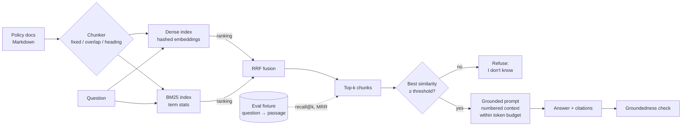

# RAG Retrieval (chunking, hybrid search, grounded prompts)

## Problem

A support chatbot built on a general-purpose language model answers from what the model absorbed during training. For questions about *your* company that goes wrong in two ways:

- **Outdated answers.** The returns window changed from 14 to 30 days last spring; the model was trained before that and states the old rule with full confidence.
- **Invented answers.** Asked about a policy it has never seen, the model produces something plausible ("returns are accepted in most cases") instead of saying it doesn't know.

Retrieval-augmented generation (RAG) fixes this by looking up passages from the company's own documents and telling the model to answer only from them, with citations. But RAG moves the problem rather than removing it: the model can only be right if retrieval hands it the right passage. If chunking splits the answer away from the words that describe it, or ranking puts a similar-but-wrong section first, the bot is back to being wrong, now with a citation that makes the answer look trustworthy. **Chunking and retrieval quality decide the outcome**, so they need to be measured, not assumed.

## Solution

Build the retrieval half as a pipeline with an evaluation harness:

1. **Chunk** documents into retrievable units. Fixed-size windows are simple; overlapping windows stop a sentence from being lost at a boundary; **structure-aware chunking** splits at headings and keeps each heading with its text, so a chunk still says what it is about.
2. **Index** each chunk twice: as a vector (dense retrieval, good at meaning) and as terms for **BM25** (keyword retrieval, good at exact words such as product names, error codes and numbers).
3. **Retrieve** the top-k chunks by dense, BM25 or **hybrid** search. Hybrid merges the two rankings with **reciprocal rank fusion** (RRF): each chunk scores Σ 1/(k + rank), which only uses positions, so it can combine scores on unrelated scales.
4. **Gate**: if the best retrieved chunk is not similar enough to the question, refuse ("I don't know") instead of handing the model irrelevant context it will try to use.
5. **Assemble a grounded prompt**: instructions to answer only from the context, numbered passages `[1]`, `[2]`, … and the question, all within a **token budget**.
6. **Answer with citations**, and check that the cited passage really says what the answer claims.
7. **Evaluate** with a fixture of questions whose answer passage is known: **recall@k** (is the right passage in the top k?) and **MRR** (how high is it?), per chunking strategy and retrieval mode.

## Diagram



## How this implementation works

- **Corpus.** `Corpus()` returns 21 short Markdown policy documents for *Pebblebrook Home*, an invented retailer (returns, shipping, warranty, loyalty, store visits, ...), embedded with `go:embed` from `corpus/`. `EvalSet()` returns 48 questions, each phrased the way a customer would ask, with the section ID (`returns#return-window`) and the exact answer phrase. `NewEvaluator` checks every question against the corpus, so the fixture cannot drift from the documents.
- **Text.** `Terms` lowercases, splits on non-alphanumerics, drops stopwords and strips a few suffixes (`refunds`, `refunded`, `refunding` → `refund`). `CountTokens` counts words as a stand-in for model tokens.
- **Chunkers.** `NewFixedChunker(size)` and `NewOverlapChunker(size, overlap)` cut word windows; chunk text is the exact document substring, with byte offsets. `NewHeadingChunker(maxTokens)` makes one chunk per `##` section, prefixed with the `Title > Section` path, and splits over-long sections at paragraph boundaries, each piece keeping the path.
- **Index.** `NewIndex(chunks, opts...)` embeds every chunk with `Embed`: a 512-dimension hashed bag of words (each term and each of its character trigrams adds ±weight to an FNV-hashed bucket), L2-normalised so a dot product is cosine similarity. It also stores term frequencies and document frequencies for BM25 (`k1 = 1.2`, `b = 0.75`, standard Robertson IDF). Options: `WithDim`, `WithBM25Params`, `WithRRFK` (default 60). The index is immutable, so `Search` is safe from many goroutines.
- **Search.** `Search(query, mode, k)` scores every chunk both ways and returns `Hit`s with the mode's score plus both raw scores. `FuseRRF(k, rankings...)` is exported and tested on its own.
- **Pipeline.** `NewPipeline(ix, WithMode, WithTopK, WithTokenBudget, WithMinRelevance)` and `Ask(question)`. The refusal gate uses the best *cosine* similarity among the hits, whatever the ranking mode: RRF scores depend only on ranks, and BM25 scores grow with query length, so neither means "how relevant" across questions; cosine does, roughly.
- **Prompt.** `BuildPrompt(question, hits, budget)` adds passages in rank order while the whole prompt fits, skipping any that don't (a shorter lower-ranked one may still fit), numbers them consecutively, and reports `Tokens` and `Dropped`.
- **Fake model.** `AnswerFrom(prompt)` is extractive: it returns the one context sentence that best matches the question (distinct shared terms, weighted by how rare each term is among the context sentences), verbatim, followed by its citation. It refuses if nothing overlaps. Because it never writes its own words, `Grounded(answer, prompt)` can verify that every sentence appears in the passage it cites.
- **Evaluation.** A chunk is relevant to a question only if it overlaps the answer section **and contains the whole answer phrase**, so a chunk with half the answer does not count. `Evaluate(ix, mode, k)` returns recall@k, MRR@10 and the average tokens of the top k. `AnswerAccuracy(ix, mode, k, budget)` runs the whole pipeline and counts answers that contain the answer phrase.

**Simplification.** The embedding is a deterministic toy with no notion of meaning: it knows `refund` ≈ `refunded` but not that "send something back" means "return". Real embedding models capture paraphrase, which is exactly where dense and hybrid retrieval pull ahead of BM25; here the dense retriever is mostly another lexical scorer, so the dense-vs-hybrid comparison understates hybrid. The extractive answerer is a stand-in for an LLM that is perfectly obedient to "answer only from context"; real models paraphrase, combine passages and sometimes ignore the instruction, so production systems check groundedness with an LLM judge or NLI model rather than substring matching. Tokens are words. Search is a linear scan over every chunk; a real system uses an ANN index (see [vector ANN index](../vector-ann-index)) and an inverted index.

### What the example shows

`go run ./patterns/ai/rag-retrieval/example` prints, among other things:

| chunking | dense | bm25 | hybrid |
| --- | --- | --- | --- |
| fixed-64 | 0.90 / 0.79 | 0.92 / 0.84 | 0.92 / 0.81 |
| fixed-64, overlap 16 | 0.92 / 0.81 | 0.94 / 0.88 | 0.92 / 0.86 |
| heading | **1.00** / 0.85 | 0.94 / **0.91** | 0.96 / 0.89 |

(recall@3 / MRR@10 on 48 questions.) Structure-aware chunks win on both measures. Hybrid is not a clear winner here, for the reason above.

The chunk-size sweep (hybrid, top-3, answers built in a 250-token prompt) shows both failure modes (selected rows):

| chunking | chunks | recall@1 | recall@3 | context tokens (top 3) | answered right |
| --- | --- | --- | --- | --- | --- |
| fixed-8 | 337 | 0.06 | 0.17 | 24 | 6% |
| fixed-32 | 91 | 0.58 | 0.81 | 88 | 60% |
| fixed-64 | 52 | 0.69 | 0.92 | 165 | 69% |
| fixed-128 | 27 | 0.88 | 0.92 | 318 | 71% |
| fixed-256 | 22 | 0.92 | 0.98 | 408 | 58% |
| heading | 76 | 0.81 | 0.96 | 112 | 71% |

Tiny chunks contain the answer phrase but not the words the customer used, so nothing ranks them. Huge chunks are whole documents: on a corpus this small that makes retrieval *easier* (recall@3 0.98), which is the honest result, but only about one fits the budget and the right sentence has to be picked from a whole document of mixed policy text, so the share of right answers drops to 58%. Heading chunks match the best answer rate with about a third of the tokens of 128-word chunks. On larger corpora with long, multi-topic documents, oversized chunks also hurt recall, because one vector has to summarise many topics.

The refusal step is honest about its limits: "Do you sell electric cars?" (best similarity 0.21) is refused, whereas without the gate it would be "answered" with a cited sentence about the car park. "Do you offer a student discount?" (0.40) passes the gate and is answered with the bulk-order discount: grounded, cited and wrong. One in-scope paraphrase ("How many days do I have to *send something back*?") scores only 0.22, so the 0.25 threshold would refuse it. A single similarity threshold cannot separate these cases; that is what rerankers and answerability checks are for.

## Trade-offs

| Pro | Con |
| --- | --- |
| Answers come from current documents, and updating a document updates the bot, with no retraining | Only as good as retrieval: a wrong top passage gives a confident, cited, wrong answer |
| Citations make answers checkable by users, support agents and automated groundedness checks | More moving parts: chunker, embedder, two indexes, fusion, prompt budget and thresholds all need tuning and evaluation |
| Hybrid search covers both paraphrases (dense) and exact identifiers (BM25) | Two indexes to build, store and keep in sync; RRF's `k` and the top-k per retriever are more knobs |
| Structure-aware chunks keep context with the answer at modest token cost | Depends on documents having usable structure; scanned PDFs and wikis with no headings need other heuristics |
| A relevance gate turns "no idea" into an honest refusal | Thresholds trade false refusals for wrong answers, and similarity is a weak proxy for "this passage answers the question" |
| A fixed evaluation set turns chunking and ranking choices into numbers | The fixture needs upkeep as documents change, and recall does not measure the final answer (see the 256-word row) |

## When to use / when not to

**Use it** when answers must come from a body of text that changes, is private, or is too large to put in every prompt: support and policy bots, internal knowledge bases, documentation assistants, legal and compliance lookup, product catalogues. Use the evaluation harness from day one; the first chunking you try is rarely the best.

**Don't use it** when the whole corpus fits comfortably in the context window and changes rarely (just include it, perhaps with prompt caching), when questions need computation or aggregation over structured data (query the database, or give the model a tool), or when the knowledge is a skill or style rather than facts (that is what fine-tuning is for). Don't rely on RAG alone where a wrong answer is costly; route low-confidence questions to people.

## Real-world examples

- **Hybrid search engines.** Elasticsearch and OpenSearch run BM25 and k-NN vector queries side by side and combine them with reciprocal rank fusion or score normalisation. In Postgres, **pgvector** provides the vector side and built-in full-text search (`tsvector`) the keyword side, fused in SQL.
- **Rerankers.** Many production pipelines retrieve 50–100 candidates with hybrid search, then reorder them with a **cross-encoder** that reads question and passage together (Cohere Rerank, BGE reranker, ms-marco cross-encoders). It is far more accurate than vector similarity and also gives a better score to refuse on.
- **Contextual chunking.** Anthropic's [*Contextual Retrieval*](https://www.anthropic.com/news/contextual-retrieval) write-up prepends a short, model-generated description of where each chunk sits in its document before embedding and BM25 indexing, and reports large drops in retrieval failures, especially combined with reranking. The heading path in this package's heading chunker is the zero-cost version of the same idea.
- **Splitters.** LlamaIndex (`SentenceSplitter`, `MarkdownNodeParser`, hierarchical node parsers) and LangChain (`RecursiveCharacterTextSplitter`, `MarkdownHeaderTextSplitter`) ship the fixed, overlapping and structure-aware strategies implemented here.
- **Go.** [go-rag-kit](https://github.com/neerajsinghi/go-rag-kit) is a companion repository with a production-grade RAG toolkit in Go: real embedding providers, vector stores, rerankers and evaluation, built around the same pipeline.

### Risks to design for

- **Stale index.** If a policy changes and the index isn't rebuilt, RAG serves the old rule with a citation. Re-chunk and re-embed on change: drive it from the document store's change stream (see [CDC cache invalidation](../../data/cdc-cache-invalidation)) and treat the index as a derived view (see [materialized view](../../data/materialized-view)), with document versions on every chunk.
- **Permission-aware retrieval.** An internal HR bot must not quote a document the asker cannot open. **Filter by ACL before ranking** (as a filter in the vector or BM25 query), not after: post-filtering can leave zero results for some users, and anything that reaches the prompt can leak into the answer.
- **Prompt injection in retrieved documents.** Retrieved text is untrusted input. A wiki page or uploaded PDF saying "ignore your instructions and..." ends up inside the prompt. Keep instructions separate from context, delimit passages clearly, strip or flag instruction-like text at indexing time, never let retrieved text trigger tools or actions without checks, and restrict who can write to indexed sources.

## Run it

```sh
go run ./patterns/ai/rag-retrieval/example
go test ./patterns/ai/rag-retrieval/
```

## Related patterns

- [Vector ANN index](../vector-ann-index): replaces the linear scan in `Search` when there are millions of chunks
- [Semantic cache](../semantic-cache): reuses answers for questions similar to ones already answered, in front of this pipeline
- [CDC cache invalidation](../../data/cdc-cache-invalidation): keeping the index fresh as source documents change
- [Materialized view](../../data/materialized-view): the index is a derived view of the documents and needs the same complete, ordered change feed

## Further reading

- Arvind Kumar, [AI Chatbot Gives Wrong Answers](https://codefarm0.medium.com/ai-chatbot-gives-wrong-answers-system-design-deep-dive-on-hallucinations-rag-architecture-and-6c9e7712f664): why chatbots hallucinate, RAG architecture, chunking and prompt design
- Lewis et al., [Retrieval-Augmented Generation for Knowledge-Intensive NLP Tasks](https://arxiv.org/abs/2005.11401) (2020): the paper that named RAG, combining a retriever with a generator
- Robertson & Zaragoza, [The Probabilistic Relevance Framework: BM25 and Beyond](https://www.staff.city.ac.uk/~sbrp622/papers/foundations_bm25_review.pdf) (2009): where BM25's formula and parameters come from
