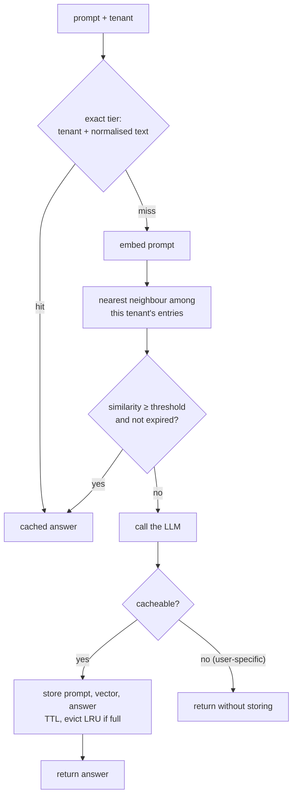

# Semantic Cache

## Problem

LLM calls are slow (hundreds of milliseconds to several seconds) and billed per token. Many workloads ask the same few questions again and again, especially support bots, internal help desks and documentation assistants, so caching answers looks like an easy win. But people rarely phrase a question the same way twice:

- "how do I reset my password", "forgot password, how to change it" and "pwd reset pls" are one question with three cache keys.
- A cache keyed by the prompt string almost never hits. In the example below, 2,000 support questions contain 1,876 distinct strings, and an exact-match cache saves just 6% of the model calls.
- Every miss pays the full price twice over: the token bill, and close to a second of latency for the user.

## Solution

Cache by **meaning** instead of by text:

1. **Embed** each prompt into a vector, so that prompts with similar meaning get vectors pointing in a similar direction.
2. On lookup, find the stored prompt whose vector is **most similar** to the new one (cosine similarity) **within the same tenant**.
3. If the similarity is at least a **threshold**, return that entry's answer. Otherwise call the model and store the new prompt, vector and answer.

Around that core, the same rules as any shared cache, plus two specific to LLM answers:

- **Exact tier first.** A map lookup on lightly normalised text is cheap and has no risk of a wrong match.
- **Tenant isolation.** One customer's answers (which may mention their product, their policies, their data) are never returned to another. The tenant is part of the key, not a filter applied afterwards.
- **TTL** so answers go stale on a schedule, and **max entries with LRU eviction** so memory is bounded.
- **Don't cache user-specific answers.** "Where is my order?" produces an answer about *this* user's order; reusing it for the next user is a privacy leak. The model call reports whether its answer is cacheable.
- **Measure false hits.** The threshold trades cost for correctness. When the caller knows the ground truth (a labelled test set, or the intent a classifier assigned), the cache counts hits whose answer was for a different label.

## Diagram



## How this implementation works

- `NewHashEmbedder(dim, opts...)` is a **toy embedding** that stands in for a real model: it lower-cases, strips punctuation, applies an optional stopword list (`WithStopwords`) and synonym map (`WithSynonyms`), then hashes each word and its character trigrams (`WithCharNGrams`) into a fixed-size `float32` vector with hash-derived signs, and L2-normalises it. It is deterministic, needs no model or network, and is good enough to show the mechanics. `Embed`, `Normalize` and `Tokens` are exported; `Cosine` compares two vectors.
- `New(embed, threshold, opts...)` returns a `*Cache`. `Embedder` is just `func(string) []float32`, so a real model client plugs in the same way. Options: `WithTTL` (default 24h), `WithMaxEntries` (default 10,000, across all tenants), `WithExactKey` (how prompts are normalised for the exact tier; the default is the raw text), `WithClock`.
- `Lookup(Query{Tenant, Prompt, Label})` checks the exact tier, then scans the tenant's entries for the highest cosine similarity (a dot product, since vectors are stored normalised). It returns a `Result` with the `Response`, `Source` (`Exact`, `Semantic` or `Miss`), `Similarity` and the `MatchedPrompt`, which is what you log when debugging a wrong answer.
- `Put(Entry{Tenant, Prompt, Response, Label, TTL})` stores an answer; a prompt with the same exact key for the same tenant replaces the old entry. `GetOrCompute(ctx, q, compute)` does lookup, model call and store, and stores only when `compute` returns `cacheable == true`.
- Each tenant has its own slice of entries: a lookup for tenant B never even iterates over tenant A's vectors. Expired entries found during a scan are removed. A global LRU list orders all entries; hits move to the front, and inserts beyond `maxEntries` evict from the back.
- `Stats` counts exact hits, semantic hits, misses, false hits (labelled hits whose entry label differs from the query label), stored, not-cacheable, evicted and expired.
- The example builds 2,000 queries from 50 intents with a seeded generator (12 sentence templates, 1–3 verbs and nouns per intent, greetings and sign-offs, skewed popularity) and a fake LLM that charges $0.002 and 900 ms per call.

**Simplification.** Lookup is a brute-force scan: O(entries per tenant) dot products. That is fine up to tens of thousands of entries; beyond it, use an approximate nearest-neighbour index ([vector-ann-index](../vector-ann-index)) per tenant or with a tenant filter. The hash embedding knows only surface forms: "reset" and "recover" are unrelated unless the synonym map says so, and "enable" and "disable" look similar because they share letters. Real embedding models are far better at paraphrase, but they share the core weakness (opposite requests are *about* the same thing), so a threshold still has to be tuned on labelled data. There is no request coalescing: concurrent misses for the same question each call the model. A production cache would also live in a shared store (Redis, a vector database) rather than in-process memory.

**What the example prints.**

```
1) No cache vs exact-match cache (keyed by the raw prompt text)
   cache                      hits  exact   sem.   wrong     LLM    cost  avg lat
   no cache                   0.0%      0      0       0    2000  $ 4.00    900ms
   exact match                6.2%    124      0       0    1876  $ 3.75    844ms

2) Semantic cache (exact tier on normalised text, then cosine similarity) at four thresholds
   semantic @ 0.95           32.8%    104    552       0    1344  $ 2.69    610ms
   semantic @ 0.90           39.4%     93    694       0    1213  $ 2.43    551ms
   semantic @ 0.80           58.1%     60   1102      40     838  $ 1.68    382ms
   semantic @ 0.70           75.2%     38   1466     158     496  $ 0.99    228ms
```

- The semantic cache at 0.90 makes about 35% fewer model calls than the exact cache with no wrong answers.
- Going down to 0.70 cuts the bill to about a quarter of the no-cache cost, but 158 of 2,000 users (8%) get the answer to a different question. The printed examples include "turn on two factor auth" being answered with the steps for turning it *off*. Cheaper and wrong is not a win for a support bot.
- The "exact" column shrinks as the threshold drops. That is not the exact tier getting worse: with more semantic hits there are fewer misses, so fewer prompts are ever stored for the exact tier to find.
- The numbers depend heavily on the embedding. A real model would reach a much higher hit rate at the same false-hit rate; the shape of the curve (more hits, then more wrong hits, as the threshold drops) is what carries over.

## Trade-offs

| Pro | Con |
| --- | --- |
| Paraphrased questions hit, unlike an exact-match cache | A hit can be the answer to a *different* question; the threshold sets how often |
| Large cuts in model cost and latency on repetitive workloads | Every lookup pays for an embedding (a model call itself, though a cheap one) and a vector search |
| Exact tier gives free, risk-free hits for verbatim repeats | Cached answers go stale when docs, prices or policies change; TTLs and invalidation are needed |
| Per-tenant keys make cross-customer leaks structurally impossible | Isolation lowers the hit rate: identical questions from different tenants are cached separately |
| False-hit counting turns threshold tuning into a measurable decision | Thresholds don't transfer between domains or embedding models; each needs its own labelled set |

## When to use / when not to

**Use it** when many users ask a bounded set of questions whose answers don't depend on who is asking: support and FAQ bots, internal help desks, documentation Q&A, classification or extraction over repeated inputs, and agents that repeat the same tool-planning prompts.

**Don't use it** when answers depend on user-specific context (account data, conversation history, retrieved private documents), when prompts are long and unique (code review, summarising a given document), when a wrong answer is costly (medical, legal, financial advice, or anything with opposite intents that embed close together), or when answers must reflect real-time data. In mixed workloads, cache only the routes you have labelled and measured.

## Real-world examples

- **GPTCache** (Zilliz) is an open-source semantic cache for LLM apps with pluggable embedding models, vector stores and similarity evaluators.
- **Redis** offers semantic caching through RedisVL (`SemanticCache`) and its LangCache service; **Upstash** has a semantic-cache library on top of its vector database. Both store prompt embeddings with a distance threshold and TTL.
- **LangChain** has LLM caches including exact-match (in-memory, SQLite, Redis) and semantic ones (`RedisSemanticCache`, GPTCache and vector-store-backed caches).
- **Provider prompt caching** (Anthropic prompt caching, OpenAI's automatic prompt caching) is a **different thing**. It caches the model's computation of a repeated *prompt prefix* (a long system prompt, tool definitions, a document) so later requests that start with the same prefix are cheaper and faster. The model still runs and generates a fresh answer for every request; nothing is reused across different questions, and an exact prefix match is required. A semantic cache skips the model entirely and returns a previous *answer*. They combine well: prompt caching makes misses cheaper, semantic caching makes them rarer.
- For production-grade Go, see the companion repos [go-rag-kit](https://github.com/neerajsinghi/go-rag-kit) (embeddings, pgvector and Atlas vector stores, hybrid retrieval and an eval harness) and [llm-otel-go](https://github.com/neerajsinghi/llm-otel-go) (OpenTelemetry tracing, token metrics and cost tracking for OpenAI and Anthropic calls, where you would watch what caching saves).

**Risks to plan for.** *Stale answers*: a cached answer outlives the policy it describes; tie TTLs to how often source content changes and flush on content deploys. *Privacy leaks across users*: never cache answers built from user-specific context, key by tenant (and by user or role where answers differ by permission), and keep prompts out of shared logs. *Threshold tuning per domain*: measure false hits on a labelled sample for each route and embedding model, and re-measure when either changes.

## Run it

```sh
go run ./patterns/ai/semantic-cache/example
go test ./patterns/ai/semantic-cache/
```

## Related patterns

- [Model router](../model-router): the other half of LLM cost control; a router sends misses to the cheapest model that can answer
- [Vector ANN index](../vector-ann-index): replaces this package's brute-force scan once a tenant has too many entries
- [Cache-aside](../../data/cache-aside): the same read-through shape, with exact keys
- [Cache eviction](../../data/cache-eviction): LRU and alternatives for choosing what to drop when the cache is full

## Further reading

- Arvind Kumar, [AI Platform Suddenly Becomes Very Expensive](https://codefarm0.medium.com/ai-platform-suddenly-becomes-very-expensive-system-design-deep-dive-on-token-reduction-model-473a3a2920a2), on cutting LLM spend with token reduction, model routing and semantic caching
