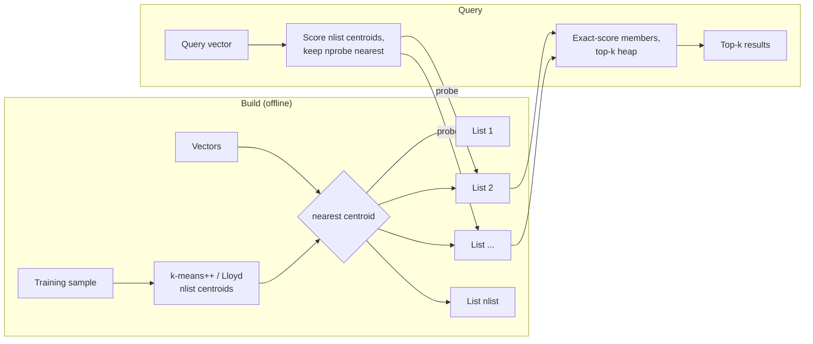

# Vector ANN Index (IVF)

## Problem

Semantic search, RAG retrieval, recommendations and deduplication all come down to the same query: *give me the k stored vectors most similar to this one*. The simple answer is a **flat** (brute-force) index that scores the query against every stored vector:

- Each query costs O(N·d): with 10 million 768-dimensional embeddings that is ~7.7 billion multiply-adds, for **every** query.
- Latency grows linearly with the corpus. A search that took 5 ms at launch takes 500 ms once the corpus is 100 times larger, and the only fix is more hardware per query.
- Classic database indexes don't help. A B-tree orders one dimension, and space-partitioning trees (k-d trees) stop working above a few dozen dimensions, where almost every cell is equally close to the query.

## Solution

Give up a little **recall** (sometimes missing a true neighbour) to avoid looking at most of the data. The **inverted file (IVF)** index does this by bucketing and then refining:

1. **Train a coarse quantiser.** Run k-means on a sample of the vectors to find `nlist` centroids. Each centroid owns a cell of the space (a Voronoi cell).
2. **File every vector** in the *inverted list* of its nearest centroid. Vectors added later go through the same step: they are filed under the nearest *existing* centroid.
3. **Query:** compare the query with the `nlist` centroids, pick the `nprobe` nearest, and exact-score only the members of those lists. Keep the top k with a heap.

`nprobe` is the dial between recall and work. With `nprobe = 1` a query scans about N/nlist vectors, but misses neighbours that sit just across a cell boundary. Each extra probe catches more of them. With `nprobe = nlist` it scans everything and gives exactly the flat answer.

The centroids are a snapshot of the data they were trained on. If new data drifts into regions the training set never covered, it gets cut up along boundaries that mean nothing for it, recall falls, and the fix is to **retrain**.

## Diagram



## How this implementation works

- **Metrics.** `Cosine` normalises every vector to unit length when it is added, so scoring is a dot product. `L2` scores by negated squared Euclidean distance, so a higher `Score` always means more similar. Ties are broken by lower ID, which makes results deterministic.
- **`Flat`** (`NewFlat(dim, metric)`) scores the query against every stored vector and keeps the top k in a min-heap of size k (the root is the worst result kept). It is the ground truth recall is measured against.
- **`IVF`** (`NewIVF(dim, nlist, metric, opts...)`, with `WithSeed` and `WithMaxIterations`):
  - `Train(sample)` runs **k-means++** seeding from a seeded PCG generator (the first centre is uniform, each next one is drawn with probability proportional to squared distance from the nearest centre so far), then **Lloyd iterations** until no assignment changes or the iteration cap is reached. Under cosine, centroids are re-normalised after each update (spherical k-means). An empty cluster is moved onto the point farthest from its centre. The same seed and data always give the same centroids.
  - `Add(id, v)` files the vector under its nearest centroid. It returns `ErrNotTrained` before training.
  - `Search(q, k, nprobe)` ranks all centroids, probes the `nprobe` nearest (`nprobe > nlist` is clamped to nlist), and returns the results plus `SearchStats{CentroidsCompared, ListsProbed, VectorsScanned}`. `Stats()` keeps cumulative query and scan counts.
  - `Retrain(sampleSize)` re-runs k-means on the stored vectors (all of them, or an evenly strided subset) and re-files everything. `TrainStats` reports the sample size, iterations, whether it converged, distance computations (seeding, Lloyd and re-filing) and how many vectors were re-filed.
  - Searches share a read lock and run in parallel. `Add`, `Train` and `Retrain` take the write lock.
- `Clustered` and `Jitter` generate seeded synthetic data: Gaussian blobs standing in for embedding "topics", and queries near stored vectors. `Recall(got, truth)` computes recall@k.
- **Work is measured as vectors scanned**, not wall time, so the example prints the same numbers on every machine.

**Simplification.** Lists hold full float32 vectors (an "IVF-Flat" index). Production indexes compress them (product quantisation, below), use SIMD distance kernels, store lists in contiguous memory or on disk, support deletes and updates, and retrain in the background and then swap the new index in. Here `Retrain` holds the write lock while it runs. Training samples are taken from the caller or strided over the stored data, not drawn at random. The synthetic blobs have no relation to real embedding distributions, so only the shape of the numbers transfers, not the values.

## Trade-offs

| Pro | Con |
| --- | --- |
| Work per query drops from N to about nprobe·N/nlist + nlist (8% of the corpus at 97% recall@10 in the example) | Approximate: some true neighbours are missed, and recall must be measured, not assumed |
| One dial (`nprobe`) trades recall for latency per query, without rebuilding | Training costs real compute (in the example, the work of ~280 flat queries) and needs a representative sample |
| Simple, memory-light structure: one centroid table plus lists of IDs and vectors | Centroids go stale: data that drifts away from the training distribution loses recall until you retrain |
| Lists are natural units for sharding, compression (IVF-PQ) and disk layout | Unbalanced lists (in the example, the largest is 2.5× the average) make some queries much more expensive than others |
| Inserts are cheap: one pass over nlist centroids | Filtered queries ("only tenant 42") can leave the probed lists with too few matches |

## When to use / when not to

**Use it** once a flat scan is too slow for your latency budget, typically from hundreds of thousands of vectors up. It fits corpora that are mostly built in batches and whose distribution changes slowly, where you can retrain on a schedule, and where memory matters (IVF-PQ compresses well).

**Don't use it** for small corpora (below ~100k vectors a flat scan is fast, exact and needs no training), when you need exact results (legal discovery, dedup with strict guarantees), or when the data changes quickly and you cannot retrain. HNSW handles incremental inserts better for that last case.

**Production alternatives:**

- **HNSW (Hierarchical Navigable Small World)** is the most common choice today. It is a multi-layer proximity graph: each vector is a node linked to a few dozen near neighbours, with sparse upper layers for long jumps and a dense bottom layer for local refinement. A query greedily walks from an entry point towards the query, keeping a candidate list of size `ef_search`, the dial that plays the role of nprobe. It usually reaches a given recall with less work than IVF, needs no training step, and supports incremental inserts. The costs are memory (the graph's links can cost as much as the vectors), slow and memory-hungry builds, and awkward deletes (tombstones plus periodic rebuilds).
- **Product quantisation (IVF-PQ).** Split each vector into m sub-vectors and replace each with the ID of its nearest sub-centroid (often 1 byte), so a 768-float vector (3 KB) becomes, say, 96 bytes. Distances are estimated from lookup tables, and the best candidates are usually re-ranked using the full vectors. This is how billion-scale indexes fit in RAM, at the cost of a further loss in recall.
- **Filtering + ANN is hard.** "Nearest neighbours *where tenant = 42 and price < 50*" breaks the assumption that the probed lists hold enough candidates. *Post-filtering* (search, then filter) can return fewer than k results when the filter is selective. *Pre-filtering* (filter, then search) can fall back to a brute-force scan, or break HNSW's graph connectivity. Real systems combine per-partition indexes, filter-aware graph traversal, raising nprobe or ef when a filter is selective, and switching to exact search when few rows match.

## Real-world examples

- **FAISS** (Meta) is the reference library: `IndexFlatL2`/`IndexFlatIP`, `IndexIVFFlat` (this pattern), `IndexIVFPQ`, `IndexHNSWFlat`, and GPU versions. Its `nprobe` parameter is the same dial.
- **pgvector** (Postgres) offers `ivfflat` (set `lists` at build time and `ivfflat.probes` per query; it recommends building after the table has data, the same training caveat) and `hnsw` (`m`, `ef_construction`, `hnsw.ef_search`).
- **Milvus** supports IVF_FLAT, IVF_SQ8, IVF_PQ, HNSW, DiskANN and GPU indexes, with `nlist`/`nprobe` as index and search parameters.
- **Qdrant** and **Weaviate** build on HNSW, with filtering integrated into graph traversal, plus quantisation options.
- **ScaNN** (Google) partitions like IVF, then uses anisotropic vector quantisation tuned for inner-product search, and re-ranks the best candidates exactly.

## Run it

```sh
go run ./patterns/ai/vector-ann-index/example
go test ./patterns/ai/vector-ann-index/
```

The example indexes 20,000 32-dimensional vectors (40 synthetic topics) with `nlist = 100`, trained on a 4,000-vector sample. Over 100 queries near the data:

| nprobe | recall@10 | vectors scanned / query | % of flat |
| ---: | ---: | ---: | ---: |
| 1 | 0.608 | 298 | 1.5% |
| 2 | 0.795 | 493 | 2.5% |
| 4 | 0.913 | 874 | 4.4% |
| 8 | 0.973 | 1,616 | 8.1% |
| 16 | 0.989 | 3,212 | 16.1% |
| 32 | 0.997 | 6,314 | 31.6% |
| 64 | 1.000 | 12,721 | 63.6% |
| 100 | 1.000 | 20,000 | 100.0% |

Recall rises fast at first and then flattens: the last few percent cost the most work. At nprobe = 1 a query scans 298 vectors rather than the average list size of 200, because the list nearest a query tends to be a big one in a dense part of the data; by nprobe = 8 the scan is back to about nprobe·N/nlist. Training cost 5.6M distance computations, about 280 flat queries, so it pays for itself after roughly 300 queries at nprobe = 8.

Then 8,000 vectors from 16 new topics are added without retraining. At nprobe = 8, recall on new-topic queries is **0.691**. Their true top-10 is scattered over 5.9 lists on average, against 3.1 for old-topic queries, because the old centroids split the new topics along boundaries that mean nothing for them. Recall on old-topic queries also slips, from 0.973 to 0.957, partly because 65 of their 1,000 true top-10 slots now hold new vectors that were filed in poorly fitting lists. After `Retrain` on a 4,000-vector sample, new-topic recall is **0.958** (neighbours in 2.8 lists) and old-topic recall is 0.962. Work per query rose only because the lists grew with the corpus.

## Related patterns

- [RAG retrieval](../rag-retrieval): the main consumer of an ANN index; retrieval quality is capped by the index's recall
- [Semantic cache](../semantic-cache): looks up "a similar enough earlier prompt" with the same nearest-neighbour search
- [Geospatial index](../../data/geospatial-index): the same "bucket, then refine" idea in 2D, with geohash cells instead of learned centroids and neighbouring cells instead of nprobe
- [Sharding](../../data/sharding): how to split a vector index too big for one machine; IVF lists, or whole sub-indexes, can be spread across shards with a scatter-gather query

See also the companion repo [go-rag-kit](https://github.com/neerajsinghi/go-rag-kit), a Go toolkit for retrieval-augmented generation, where an index like this sits behind the retriever.

## Further reading

- Arvind Kumar, [AI Search Feels Slow](https://codefarm0.medium.com/ai-search-feels-slow-system-design-deep-dive-on-vector-indexing-ann-search-and-recall-vs-latency-cd72c6d1723d), on vector index structures, ANN search and the recall vs latency trade-off
- Hervé Jégou, Matthijs Douze, Cordelia Schmid, "Product Quantization for Nearest Neighbor Search" (IEEE TPAMI, 2011), which introduced PQ and the IVF-ADC (IVF-PQ) index
- Yu. A. Malkov, D. A. Yashunin, "Efficient and robust approximate nearest neighbor search using Hierarchical Navigable Small World graphs" (2016), the HNSW paper
