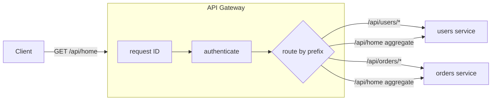
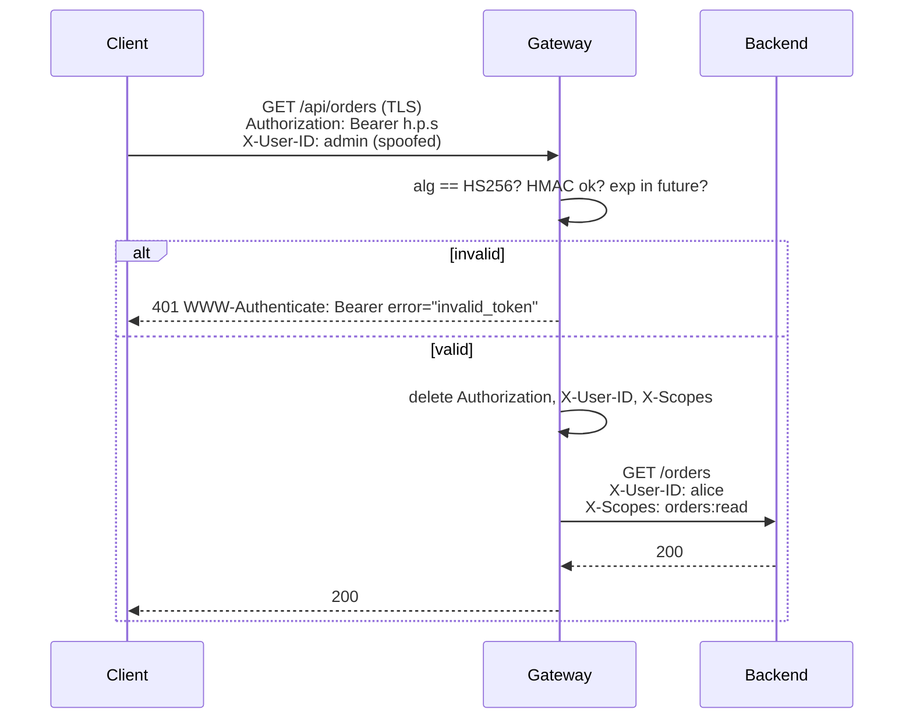

# API Gateway

## Problem

Once a system is split into many services, every client has to know every
service's address, and every service has to re-implement the same edge
concerns: authentication, request tracing, CORS, rate limiting. Screens that
need data from three services also cost the client three round trips over a
slow network.

## Solution

Put one reverse proxy in front of all services. It is the only public entry
point. It matches each request to a backend by path, checks who the caller is
once, stamps the request with a correlation ID, and forwards it. For screens
that need several services, the gateway can call them in parallel over the
fast internal network and return one combined response.

**Auth offloading.** Rather than every backend validating credentials (often
by calling an auth service per request), the gateway verifies a signed token
once at the edge:

- It checks the signature and expiry locally (no network call), and answers
  **401** for missing, expired, forged, or `alg: none` tokens before any
  backend sees the request.
- It **strips the `Authorization` header** and forwards the verified claims in
  trusted headers (`X-User-ID`, `X-Scopes`). Backends read identity from
  those headers and never handle raw credentials.
- It **deletes any client-supplied copies** of those headers first, on every
  route, public ones included. Otherwise a client could send
  `X-User-ID: admin` and be believed.
- Optionally, it caches verified tokens by hash, so a repeat token skips the
  decode and HMAC. A cache entry never outlives the token's own `exp`.

**TLS termination.** The gateway is also the usual place to terminate TLS:
clients speak HTTPS to the edge, the gateway decrypts once and does
routing, auth, and header rewriting on plaintext HTTP. That's the only way
an L7 gateway can read paths and headers at all. The hop from gateway to
backend then needs its own protection: a private network, or re-encryption
with mTLS between gateway and services (common in zero-trust and service-mesh
setups). Trusted identity headers are safe only when backends accept traffic
**only** from the gateway.

## Diagram



Auth offloading, per request:



## How this implementation works

- `New(Config)` compiles the routes, sorts them so the **longest prefix wins**,
  and builds one `httputil.ReverseProxy` per route.
- `Gateway.ServeHTTP` runs the pipeline in order:
  1. **Request ID.** It keeps an incoming `X-Request-ID` only if it is short and
     made of `[A-Za-z0-9_-]` (`validRequestID`). Otherwise it creates a random
     one. The ID goes to the backend and back to the client.
  2. **Authentication.** `authorize` calls the `Authenticate` hook unless the
     route is `Public`. The subject is stored in the request context.
  3. **Routing.** Routes match on segment boundaries, so `/users` matches
     `/users/42` but not `/usersfoo`. The proxy's `Rewrite` strips the prefix,
     joins the result onto the target path, and **removes any client-supplied
     `X-Authenticated-Subject`** before setting the real one. Without that
     step, a client could pretend to be anyone.
- **Auth offloading** (`token.go`). Set `Config.Verifier` to a
  `*TokenVerifier` (instead of `Authenticate`) and the gateway verifies
  `Authorization: Bearer <token>` itself:
  - The token is a minimal JWT: `base64url(header).base64url(payload).base64url(sig)`
    with claims `sub`, `exp` (Unix seconds), and `scopes`. `SignHS256` issues
    one (an identity provider would, in real life). `Verify` checks the
    header's `alg` is exactly `HS256` **before** touching the signature, so
    `none`, `None`, and `HS512` are all rejected. It then compares the
    HMAC-SHA256 with `hmac.Equal` (constant time), and requires a subject and
    `now < exp + leeway`. Tokens over 4 KiB are rejected outright.
  - Each failure has its own sentinel error (`ErrTokenExpired`,
    `ErrTokenSignature`, `ErrTokenAlg`, ...). The client always gets the same
    401 with `WWW-Authenticate: Bearer error="invalid_token"`, so it learns
    nothing about which check failed.
  - On success the claims go into the request context
    (`ClaimsFromContext`). The proxy's `Rewrite` deletes `Authorization` and
    any incoming `X-User-ID`/`X-Scopes`/`X-Authenticated-Subject`, then sets
    them from the claims. Aggregate parts get the same headers.
    `X-User-ID`/`X-Scopes` are stripped even when no verifier is configured.
  - `WithTokenCache(max, ttl)` keeps verified tokens keyed by SHA-256 of the
    token. An entry expires at `min(now+ttl, exp)`. When the cache is full,
    expired entries are swept, and if it is still full the new token is
    simply verified and not cached. `WithVerifierClock` makes expiry testable.

  **Simplification.** One shared HMAC secret and no `kid`, `iss`, `aud`, or
  `nbf` checks. Production gateways usually verify asymmetric tokens (RS256
  or ES256) against an identity provider's published JWKS keys, so backends
  and the gateway never hold a signing secret, and they rotate keys by `kid`.
  An HMAC verify takes microseconds, so the cache saves little here. It pays
  off with RSA verification or remote token introspection. Stateless tokens
  also can't be revoked before `exp` (neither can a cache of them), so keep
  lifetimes short or add a revocation list.
- `serveAggregate` calls each `Aggregate.Parts` URL concurrently under one
  timeout and merges the JSON bodies into an object keyed by part name. If any
  part fails, the response is a 502 that lists the failed parts. For
  partial-results semantics, see [scatter-gather](../scatter-gather).

## Trade-offs

| Pro | Con |
| --- | --- |
| One place for auth, tracing, TLS, and quotas | An extra network hop on every request |
| Clients are decoupled from the service layout | It can become a bottleneck or single point of failure unless replicated |
| Aggregation saves client round trips | Business logic tends to creep in until the gateway becomes a monolith |
| Backends can trust identity headers | Those headers can be trusted only if the gateway is the only way in |
| Verifying tokens at the edge removes per-request auth-service calls (200 to 0 in the example) | Signed tokens can't be revoked before `exp`, and the gateway now holds key material |

## When to use / when not to

**Use** it when you have several services behind one public API, especially
with mixed clients (web, mobile, partners) that need consistent auth and
observability.

**Avoid** it for a single service: a load balancer is enough. Also avoid it
when different clients need very different response shapes. In that case,
split into a [backend-for-frontend](../backend-for-frontend) per client
instead of growing one gateway.

## Real-world examples

- **Netflix Zuul** and later **Spring Cloud Gateway** fronted Netflix's
  microservices.
- **Amazon API Gateway**, **Kong**, **Envoy**-based gateways, **NGINX**, and
  **Apigee** are common products built on this pattern.

## Run it

```sh
go run ./patterns/architecture/api-gateway/example
go test ./patterns/architecture/api-gateway/
```

Steps 5 and 6 of the example send 200 requests with the same token. When
every backend re-validates through an auth service, that's 200 auth-service
calls (about 2 ms each at an assumed RTT, so 400 ms in total). With
verify-once at the edge it's 0 calls, 1 HMAC verification, and 199 cache
hits. Every request also sent a spoofed `X-User-ID: admin`, and the backend
saw `alice`. Expired, wrong-key, `alg: none`, and missing tokens all get 401
at the gateway.

## Related patterns

- [Backend for Frontend](../backend-for-frontend): a gateway per client type.
- [Rate limiter (token bucket)](../../reliability/rate-limiter-token-bucket): usually enforced at the gateway.
- [Circuit breaker](../../reliability/circuit-breaker) and [Timeout](../../reliability/timeout): protect the gateway from slow backends.
- [Scatter-gather](../scatter-gather): aggregation that returns partial results.
- [Service discovery](../service-discovery): how the gateway finds backend addresses.
- [Load balancing](../load-balancing): spreading gateway traffic over backend replicas.
- [Webhook delivery](../webhook-delivery): HMAC signatures on outbound requests.
- [Sidecar](../sidecar): moves mTLS and auth checks next to each service instead of the edge.

## Further reading

- Arvind Kumar, [API Gateway Becomes a Bottleneck](https://codefarm0.medium.com/api-gateway-becomes-a-bottleneck-system-design-deep-dive-on-gateway-scaling-authentication-cfff15529317): scaling the gateway tier and moving authentication to the edge.
- Khyati Jha, [System Design Interview Prep: High-Level Design Day-2 (HTTP/HTTPS)](https://medium.com/high-level-system-desgin-interview-prep/system-design-interview-prep-high-level-dessign-day-2-b3fa231572b7): HTTP vs HTTPS and where TLS is terminated.
