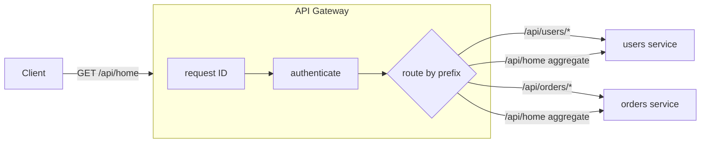

# API Gateway

## Problem

Once a system is split into many services, every client has to know every
service's address, and every service has to re-implement the same edge
concerns: authentication, request tracing, CORS, rate limiting. Screens that
need data from three services also cost the client three round trips over a
slow network.

## Solution

Put one reverse proxy in front of all services. It is the only public entry
point. It matches each request to a backend by path, checks who the caller is
once, stamps the request with a correlation ID, and forwards it. For screens
that need several services, the gateway can call them in parallel over the
fast internal network and return one combined response.

## Diagram



## How this implementation works

- `New(Config)` compiles the routes, sorts them so the **longest prefix wins**,
  and builds one `httputil.ReverseProxy` per route.
- `Gateway.ServeHTTP` runs the pipeline in order:
  1. **Request ID.** It keeps an incoming `X-Request-ID` only if it is short and
     made of `[A-Za-z0-9_-]` (`validRequestID`). Otherwise it creates a random
     one. The ID goes to the backend and back to the client.
  2. **Authentication.** `authorize` calls the `Authenticate` hook unless the
     route is `Public`. The subject is stored in the request context.
  3. **Routing.** Routes match on segment boundaries, so `/users` matches
     `/users/42` but not `/usersfoo`. The proxy's `Rewrite` strips the prefix,
     joins the result onto the target path, and **removes any client-supplied
     `X-Authenticated-Subject`** before setting the real one. Without that
     step, a client could pretend to be anyone.
- `serveAggregate` calls each `Aggregate.Parts` URL concurrently under one
  timeout and merges the JSON bodies into an object keyed by part name. If any
  part fails, the response is a 502 that lists the failed parts. For
  partial-results semantics, see [scatter-gather](../scatter-gather).

## Trade-offs

| Pro | Con |
| --- | --- |
| One place for auth, tracing, TLS, and quotas | An extra network hop on every request |
| Clients are decoupled from the service layout | It can become a bottleneck or single point of failure unless replicated |
| Aggregation saves client round trips | Business logic tends to creep in until the gateway becomes a monolith |
| Backends can trust identity headers | Those headers can be trusted only if the gateway is the only way in |

## When to use / when not to

**Use** it when you have several services behind one public API, especially
with mixed clients (web, mobile, partners) that need consistent auth and
observability.

**Avoid** it for a single service: a load balancer is enough. Also avoid it
when different clients need very different response shapes. In that case,
split into a [backend-for-frontend](../backend-for-frontend) per client
instead of growing one gateway.

## Real-world examples

- **Netflix Zuul** and later **Spring Cloud Gateway** fronted Netflix's
  microservices.
- **Amazon API Gateway**, **Kong**, **Envoy**-based gateways, **NGINX**, and
  **Apigee** are common products built on this pattern.

## Run it

```sh
go run ./patterns/architecture/api-gateway/example
go test ./patterns/architecture/api-gateway/
```

## Related patterns

- [Backend for Frontend](../backend-for-frontend): a gateway per client type.
- [Rate limiter (token bucket)](../../reliability/rate-limiter-token-bucket): usually enforced at the gateway.
- [Circuit breaker](../../reliability/circuit-breaker) and [Timeout](../../reliability/timeout): protect the gateway from slow backends.
- [Scatter-gather](../scatter-gather): aggregation that returns partial results.
- [Service discovery](../service-discovery): how the gateway finds backend addresses.
