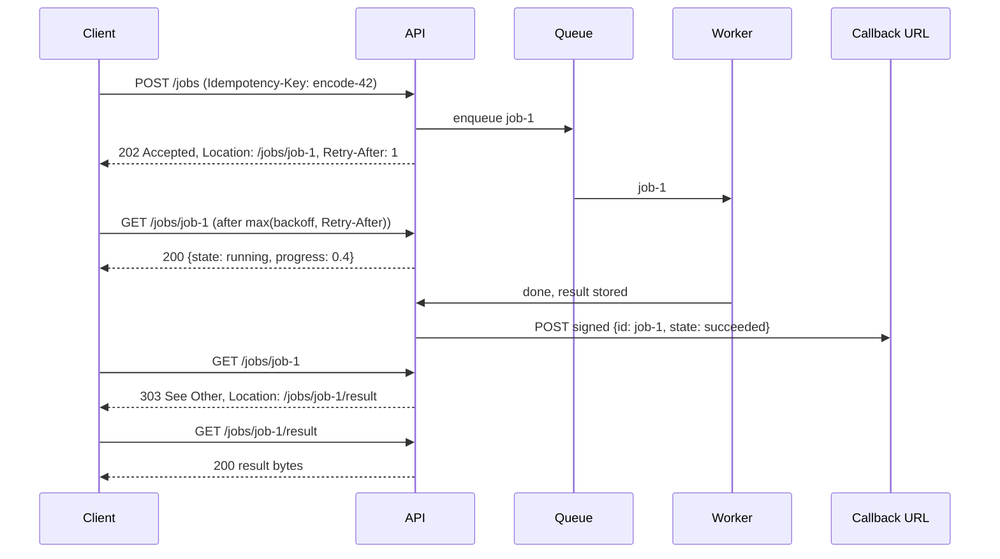

# Async Request-Reply

## Problem

Some requests take minutes: encoding a video, generating a large report,
importing a million-row CSV. Put that work behind an ordinary synchronous
endpoint and three things go wrong together:

- **The load balancer gives up first.** Most proxies and gateways cut a
  request after 30 to 60 seconds of silence, so the client gets a 504 even
  though the server is still working.
- **The retry doubles the work.** The client (or its SDK) sees the timeout and
  retries. The server cannot tell that the second request is the same job,
  so it starts another encode while the first is still running, and neither
  result ever reaches anyone.
- **Threads are held hostage.** Every attempt pins a server goroutine or
  thread, a connection and often a database transaction for the whole
  duration. A few slow jobs can exhaust the pool for everyone else.

## Solution

Split the call into "start the work" and "ask how it is going":

1. `POST /jobs` validates the request, stores it, puts it on a queue and
   answers immediately with **`202 Accepted`**, a **`Location: /jobs/{id}`**
   header and a **`Retry-After`** hint.
2. A pool of workers takes jobs off the queue and runs them, recording
   state and progress.
3. `GET /jobs/{id}` returns the status: `queued`, `running` (with progress),
   `failed`, `canceled`, or, once it has `succeeded`,
   **`303 See Other`** with `Location: /jobs/{id}/result`.
4. The client polls with **exponential backoff**, never sooner than
   `Retry-After`, and fetches the result when redirected.
5. Supporting pieces:
   - an **`Idempotency-Key`** on the submit, so a retried POST returns the
     same job instead of starting new work (and a different body under the
     same key is rejected with `422`);
   - **`DELETE /jobs/{id}`** to cancel;
   - a **retention period** after which finished jobs and their keys are
     forgotten;
   - an optional **completion callback** (`Callback-Url`) so the client does
     not have to poll at all.

## Diagram



## How this implementation works

- **`Server`** (`New(work, opts...)`) is an `http.Handler` built on Go 1.22
  method-and-wildcard routes:

  | Request | Response |
  | --- | --- |
  | `POST /jobs` | `202` + `Location` + `Retry-After`; replay of a known key: `202` + `Idempotent-Replayed: true`; key with a different body: `422`; queue full or shutting down: `503` + `Retry-After`; body over the limit: `413`; bad `Callback-Url`: `400` |
  | `GET /jobs/{id}` | `200` with the status JSON while queued, running, failed or canceled; `303` to `/jobs/{id}/result` once succeeded; `404` if unknown or expired |
  | `GET /jobs/{id}/result` | `200` with the result; `409` if not succeeded yet |
  | `DELETE /jobs/{id}` | queued: `200`, canceled at once; running: `202` with `cancelRequested: true`, the worker finishes the transition; already canceled: `200`; succeeded or failed: `409` |

- **303 rather than an inline result.** The status resource stays small and
  cacheable, and the result can live somewhere else entirely (object storage,
  a CDN, a pre-signed URL) without changing the protocol. Browsers and Go's
  default `http.Client` follow the 303 automatically, so a naive client still
  ends up with the result. The 303 also carries the status JSON for clients
  that do not follow redirects.
- **Worker pool.** `WithWorkers(n)` goroutines read from a buffered channel
  of size `WithQueueSize(n)`. A full queue answers `503` instead of blocking
  the request, which is [load shedding](../../reliability/load-shedding) at
  the front door. `Work` receives a context that is canceled by `DELETE` and
  by `Close`, plus a `progress(0..1)` callback. A panic in `Work` fails the
  job instead of killing the worker. If `Work` returns successfully after a
  cancel was requested, the success is kept: the work is already done.
- **Idempotent submit** reuses
  [`idempotency-key`](../../reliability/idempotency-key)'s `Fingerprint`
  over the body and callback URL. Creating a job takes a few microseconds
  under the server mutex, so there is no "in progress" window to handle:
  16 concurrent POSTs with one key create exactly one job
  (`TestConcurrentSameKeyCreatesOneJob`).
- **Retention.** A finished job expires `WithRetention(d)` after its
  `FinishedAt`, measured with the injectable `WithClock`. Expired jobs
  disappear lazily on lookup and in bulk via `Sweep()`. Their idempotency
  key goes with them, so a resubmit after expiry starts new work. Queued
  and running jobs never expire.
- **Callbacks** reuse [`webhook-delivery`](../webhook-delivery)'s `Sender`
  unchanged (`WithCallbacks(sender)`). On the single transition to a
  terminal state the server POSTs the status JSON, HMAC-signed, retried with
  backoff, with the **job ID as the webhook event ID**, so a
  `webhookdelivery.Receiver` drops duplicates. `Close` waits for pending
  callbacks.
- **`WithOnUpdate`** is called after every state or progress change. The
  example uses it to drive its simulation; in production it is where you
  would publish to [Server-Sent Events](../server-sent-events) or wake
  [long-poll](../long-polling) waiters, so clients do not poll on a timer.
- **`Client`** is the caller side:
  - `Submit` returns a `Submission` (status, absolute `Location`,
    `Retry-After`, replayed flag).
  - `Await` sleeps the submit's `Retry-After`, then calls `Wait`.
  - `Wait` polls with `max(backoff, Retry-After)`, where backoff doubles
    from `BaseDelay` up to `MaxDelay`. It never follows the 303
    automatically; it reads `Location` and fetches the result itself.
  - `Cancel` sends `DELETE`.
  - `Sleep` is injectable, and `TestClientWaitHonoursRetryAfterAndBackoff`
    asserts the exact delay sequence.

**Simplification.** Jobs, keys and results live in one process's memory, so
a restart loses them and replicas cannot share them. A production system
writes the job row (and its idempotency key) to a database in the same
transaction, puts the work on a durable queue such as SQS, Kafka or a jobs
table, and stores large results in object storage. Job IDs here are
sequential (`job-1`) to keep output readable. Real ones should be random and
unguessable, and every status, result and cancel request should check that
the caller owns the job. Idempotency keys should be scoped per caller.
Callback URLs supplied by clients are a server-side request forgery risk:
production systems allow-list them or resolve and block internal addresses.
`Retry-After` is sent only in its delta-seconds form.

## Trade-offs

| Pro | Con |
| --- | --- |
| No request outlives the load balancer timeout; each HTTP call takes milliseconds | Two endpoints, a job store, a queue and a worker fleet instead of one handler |
| Retried submits with an `Idempotency-Key` never duplicate work | Clients must be written to poll (or to accept callbacks); naive clients just see a `202` |
| Request goroutines are freed at once; worker concurrency is capped and tunable | Polling adds latency (up to one poll interval) and requests that return nothing new |
| Progress, cancel and retry-later fit naturally into the status resource | Job state must be stored, expired, secured per caller and kept consistent across replicas |
| Callbacks or push channels can replace polling entirely | Callbacks need a reachable, verified receiver and bring their own retry and dedup concerns |

## When to use / when not to

**Use it** when work regularly takes longer than a few seconds, or longer
than any proxy in the path allows: media processing, report and export
generation, bulk imports, ML inference batches, provisioning
infrastructure. Use it too when you want to cap concurrency on expensive
work independently of request volume.

**Avoid it** when the work reliably finishes in well under a second. A
plain synchronous call is simpler and has lower latency. If the client needs
a continuous stream of results rather than one final answer, use
[Server-Sent Events](../server-sent-events) or WebSockets instead. If the
caller is another backend service, a message queue with a reply queue (or a
[competing-consumers](../../distributed/competing-consumers) setup) may fit
better than HTTP polling.

## Real-world examples

- **Azure Architecture Center** documents this as the "Asynchronous
  Request-Reply" pattern: `202` with a status URL and `Retry-After`, then a
  redirect to the resource. Many Azure Resource Manager operations follow it
  with `Azure-AsyncOperation` and `Location` headers.
- **Google APIs** return a `google.longrunning.Operation` with a name you
  poll (`operations.get`), a `done` flag, metadata for progress, and either a
  `response` or an `error`. Cancel and delete are part of the interface.
- **AWS Step Functions** (`StartExecution` then `DescribeExecution`) and
  **AWS Batch** (`SubmitJob` then `DescribeJobs`) return a job identifier
  immediately and report states such as `RUNNING` and `SUCCEEDED`.
- **GitHub's REST API** answers `202 Accepted` on repository statistics
  endpoints while it computes them in the background, and asks clients to
  retry later.
- **Stripe** (report runs, with a `succeeded` status and a result file) and
  **Twilio** (bulk exports) run large exports as asynchronous jobs that you
  poll or get notified about through webhooks.

## Run it

```sh
go run ./patterns/architecture/async-request-reply/example
go test ./patterns/architecture/async-request-reply/
```

The example compares the two designs for a 5s video encode behind a 2s load
balancer timeout:

- **Synchronous.** Runs at 1/100 speed in real time. All 4 attempts (1 plus
  3 retries) time out, 4 encodes start, all 4 finish with nobody listening,
  and the client gets nothing: 20s of encoding for zero results.
- **Async.** Runs on a simulated clock, so its output is identical on every
  run. The client gets `202` at once and waits the 1s `Retry-After`. It then
  polls 4 times at t=1s, 2s, 4s and 8s, with backoff 1s, 2s, 4s, and gets
  the `303` and the result. The encode ran once.
  - The result arrives at t=8s although the encode took 5s, because the
    last backoff interval overshot. That gap is the latency cost of polling,
    and the callback (which fired once) or a push channel removes it.
  - A resubmit with the same key returns the same `job-1` (encodes still 1),
    and the same key with a different body gets `422`.
  - A second job is canceled while running (`202`, then `canceled`).
  - 24h later `Sweep` removes both finished jobs, and `GET /jobs/job-1` is
    `404`.

The tests cover every state transition and status code, idempotent and
concurrent submits, the `303` redirect (both followed and not), expiry with
a fake clock, both kinds of cancel, a callback verified by a real
`webhookdelivery.Receiver` that fires exactly once despite a duplicate
submit, a full queue, shutdown, a panicking worker, the client's exact
backoff sequence, and 32 concurrent clients under `-race`.

## Related patterns

- [Webhook delivery](../webhook-delivery): how the completion callback is signed, retried and deduplicated.
- [Long polling](../long-polling) and [Server-Sent Events](../server-sent-events): push progress to the client instead of making it poll.
- [Idempotency key](../../reliability/idempotency-key): makes the submit safe to retry.
- [Competing consumers](../../distributed/competing-consumers): the worker pool behind the queue, scaled across machines.
- [Split, process, merge](../../distributed/split-process-merge): break one huge job into parallel pieces behind the same status resource.
- [Load shedding](../../reliability/load-shedding): the `503` when the queue is full.
- [Timeout](../../reliability/timeout): the limit this pattern is designed to stay under.

## Further reading

- Khyati Jha, [System Design Interview Prep: High-Level Design Day-3 (REST APIs)](https://medium.com/high-level-system-desgin-interview-prep/system-design-interview-prep-high-level-design-day-3-1c3ed3cd4190): REST API design, including asynchronous endpoints that return 202 and a job status resource.
- Arvind Kumar, [YouTube Video Processing Pipeline](https://codefarm0.medium.com/youtube-video-processing-pipeline-system-design-deep-dive-on-distributed-encoding-and-async-a39a7afc4d72): a deep dive on distributed video encoding and the asynchronous upload-then-process flow it relies on.
