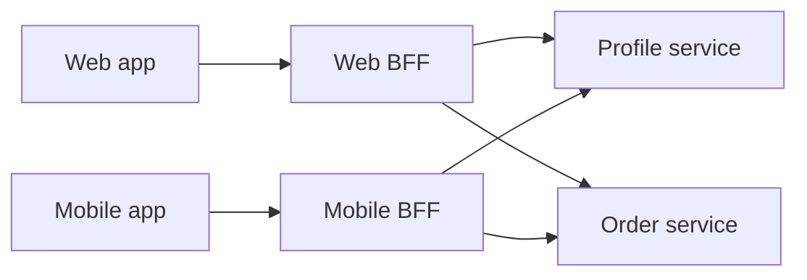

# Backend for Frontend (BFF)

## Problem

A web dashboard, a phone app, and a smart-TV app need different data from the
same domain services. The web app wants full order histories with line items.
The phone wants three summary cards and a small payload. If all of them share
one general-purpose API, each client over-fetches, makes many round trips, or
pushes the API team to add per-client flags until nobody can change it safely.

## Solution

Give each client type its own thin backend, usually owned by the team that
owns that client. Every BFF calls the same shared services, but it composes,
trims, and formats the data for its client. It also chooses its own failure
policy. Domain logic stays in the shared services. Presentation logic lives in
the BFF.

## Diagram



## How this implementation works

- `ProfileService` and `OrderService` are the shared downstream interfaces.
  Both BFFs depend on the same implementations.
- `fetchBoth` calls the two services concurrently and sorts orders
  newest-first. It sorts a **copy**, so it never reorders a slice the service
  still owns.
- `WebBFF.ServeHTTP` returns the full profile and every order with line items
  and totals. The web page cannot render with missing data, so any downstream
  error becomes a **502**.
- `MobileBFF.ServeHTTP` returns only the name, the avatar, and the newest
  `RecentLimit` order summaries (item count, not items). If the order service
  is down, it still returns **200** with `ordersUnavailable: true`, so the app
  can render its header and show a placeholder. That is a client-specific
  degradation policy, and it belongs in the BFF.

In the example, the same request costs 1,019 bytes on web and 219 bytes on
mobile.

## Trade-offs

| Pro | Con |
| --- | --- |
| Each client gets exactly the payload and round trips it needs | More deployables, and some duplicated composition code across BFFs |
| Client teams ship API changes without coordinating with every other client | Shared logic tends to leak into BFFs. Keep business rules in the services |
| Per-client failure and caching policies | One more hop. Changes to shared services must be checked against several BFFs |

## When to use / when not to

**Use** it when client types differ a lot in screen size, network, release
cadence, or team ownership, and one general API keeps growing client-specific
flags.

**Avoid** it with a single client, or several clients that need the same
shapes. A plain [API gateway](../api-gateway) or a flexible query API such as
GraphQL may be enough.

## Real-world examples

- The pattern was named and described by **Sam Newman** after its use at
  **SoundCloud**, which built separate backends for its web and mobile clients.
- **Netflix** runs device-specific adapter layers on its API platform so each
  device family gets tailored responses.

## Run it

```sh
go run ./patterns/architecture/backend-for-frontend/example
go test ./patterns/architecture/backend-for-frontend/
```

## Related patterns

- [API gateway](../api-gateway): BFFs are often gateways specialised per client.
- [Fallback](../../reliability/fallback): the mobile BFF's degraded response is a fallback.
- [Scatter-gather](../scatter-gather): BFFs fan out to many services in parallel.
- [Timeout](../../reliability/timeout): each BFF bounds its downstream calls.
