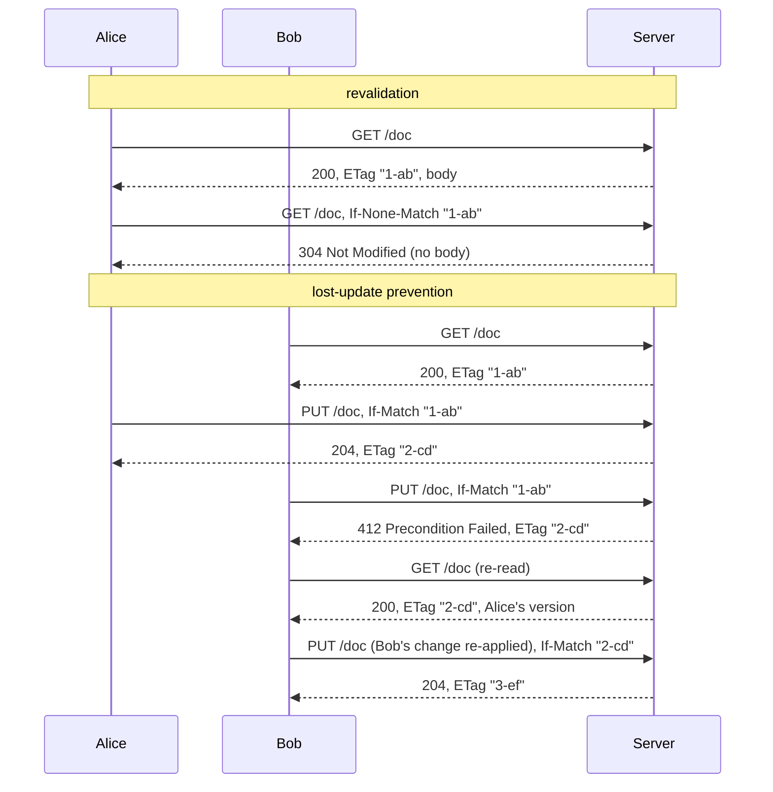

# Conditional Requests (ETag, If-None-Match, If-Match)

## Problem

HTTP clients keep asking for things they already have, and keep overwriting things they no longer have.

- **Wasted transfers.** A dashboard polls a resource every few seconds, a browser reopens a page, a CDN edge's copy reaches the end of its freshness lifetime. Each time, the full body comes down again, even when not a single byte changed. That costs bandwidth, origin CPU and latency on slow links.
- **Lost updates.** Two editors open version 1 of a document. Alice fixes the title and saves. Bob adds a tag to *his* copy, which still has the old title, and saves. Both saves return success and Alice's change is gone. Nothing failed, so nobody notices.

## Solution

Give every representation a **validator** and let clients make requests **conditional** on it (RFC 9110 §13).

1. Every response carries a strong `ETag` (an opaque, quoted version tag such as `"7-5e69f0726f8b"`) and a `Last-Modified` date.
2. **Revalidation.** A client that has a copy sends `If-None-Match: <etag>`. If the resource still has that ETag, the server answers `304 Not Modified` with headers and no body, and the client reuses its copy. `If-Modified-Since` is the older, date-based version of the same idea.
3. **Safe writes.** A client that edits sends `If-Match: <etag it read>` on `PUT`/`PATCH`/`DELETE`. The server only applies the write if that is still the current ETag. Otherwise it answers `412 Precondition Failed`, and the client re-reads, re-applies its change and tries again. This is optimistic concurrency control in HTTP headers.
4. Optionally the server **requires** a precondition on writes and rejects unconditional ones with `428 Precondition Required` (RFC 6585), so that a careless client cannot clobber anything.

Two comparison rules matter. `If-None-Match` uses **weak** comparison (`W/"x"` matches `"x"`): an equivalent copy is good enough to skip a download. `If-Match` uses **strong** comparison, so a weak tag never matches: a write must be based on exactly the bytes the client saw. `*` means "any current representation": `If-Match: *` writes only if the resource exists, and `If-None-Match: *` on `PUT` writes only if it does *not* (create-only).

## Diagram



## How this implementation works

- **`Store`** (`NewStore(WithClock(...))`) keeps resources in memory. Each write takes a store-wide, ever-increasing `Version`, so an ETag is never reused, not even after delete and re-create. The ETag is `"<version>-<first 6 bytes of SHA-256 of the body, in hex>"`. `Get` and `Put` copy bodies, so callers can't alias stored memory.
- **`Store.Mutate(key, func(cur *Resource) (Change, error))`** runs the precondition check and the write under one lock. This is the part that actually prevents lost updates: if the check and the write were separate, two requests holding the same ETag could both pass the check before either wrote.
- **`Handler`** (`NewHandler(store, WithRequireIfMatch(true))`) uses the URL path as the key. `GET`/`HEAD` set `ETag`, `Last-Modified` and `Cache-Control: no-cache` (store it, but revalidate every time). `PUT` replaces the body (201 created, 204 updated), `PATCH` applies a top-level JSON merge patch (`null` deletes a field), `DELETE` removes it. Writes return the new ETag, and a 412 carries the current ETag so the client knows what it lost to.
- **`Evaluate(r, cur)`** applies the RFC 9110 §13.2.2 order: `If-Match` first, then `If-None-Match` (304 for reads, 412 for writes), then `If-Modified-Since` for reads only when `If-None-Match` is absent. Lists, multiple header lines and `*` are supported. `ParseETagList` scans quotes instead of splitting on commas, because a comma is legal inside an entity tag. A malformed `If-Match` never matches (no write), and a malformed `If-None-Match` is treated as no match (a full response). `StrongMatch` and `WeakMatch` implement the two comparison functions.
- **`Client`** (`NewClient(httpClient, WithRevalidation(bool))`) caches GET bodies by URL with their ETag. `Get` sends `If-None-Match` when it has a copy and returns the cached body on 304 (`Fetched.Revalidated`). `Put(ctx, url, body, ifMatch)` sends `If-Match` and drops the cached copy. `Update(ctx, url, maxAttempts, modify)` is the safe read-modify-write loop: GET, `modify(current)`, PUT with `If-Match`, and on 412 start over, giving up with `ErrConflict`. `StatusError` matches `ErrPreconditionFailed`, `ErrPreconditionRequired` and `ErrNotFound` with `errors.Is`. `Stats` counts full responses, 304s, body bytes and conflicts.
- The example runs the handler on loopback with `httptest.Server` and wraps the client's connections to count the real bytes on the wire, headers included.

**Simplification.** One in-memory store and no shared HTTP cache in between: the `Client` plays the role a browser or CDN cache would. `If-Unmodified-Since`, `If-Range` and `Vary` are not implemented, and the handler never emits weak ETags (a server that only has weak ETags, for example because it compresses on the fly, cannot support `If-Match`). `Update` retries immediately. Under heavy contention on one resource, add backoff with jitter, or change the design so editors don't all write the same document. The JSON merge patch is top-level only, while RFC 7396 merges nested objects recursively.

## Trade-offs

| Pro | Con |
| --- | --- |
| A 304 is headers only: 100 polls of a 3.9 KB document downloaded 20 KB instead of 407 KB | Still a full round trip per check. To skip the request entirely, add a freshness lifetime (`max-age`) on top |
| Lost updates become a visible 412 instead of silent data loss | Clients must handle 412: re-read, merge or re-apply, retry, or show the user a conflict |
| No locks held between read and write, so readers and idle editors cost nothing | Under heavy write contention many attempts are wasted, and a hot document can starve one editor |
| Works through any HTTP intermediary, standardised, and understood by browsers and CDNs | The server must produce stable validators: a hash costs CPU, and a version needs persistent storage |
| `428` lets the server make conditional writes mandatory | `Last-Modified` has one-second resolution, so two writes in the same second look identical to `If-Modified-Since`. Prefer ETags |

## When to use / when not to

**Use it** for any API resource that is read repeatedly and changes less often than it is read (configuration, profiles, catalogues, documents, dashboards), and for any resource that more than one client can edit: documents, settings, carts, infrastructure objects, files in object storage.

**Don't bother** for responses that are different every time (live metrics, search with personalised ranking), for tiny bodies where headers dominate anyway, or for append-only operations that can't conflict (posting a new comment, which should be `POST` with an idempotency key instead). `If-Match` is not a substitute for a transaction across several resources: it guards one resource at a time.

## Real-world examples

- **Browsers, HTTP caches and CDNs** store `ETag`/`Last-Modified` with every cached response and revalidate with `If-None-Match`/`If-Modified-Since` when the copy goes stale (RFC 9111). CDN edges and shields revalidate against the origin the same way, so an unchanged object costs the origin a 304 instead of a full body.
- **The GitHub REST API** returns an `ETag` on most responses and documents that a conditional request answered with 304 does not count against your primary rate limit, which is why well-behaved polling clients always send `If-None-Match`.
- **Kubernetes** puts a `resourceVersion` on every object. An update carrying a stale `resourceVersion` is rejected with 409 Conflict, and `kubectl`, controllers and `client-go`'s `RetryOnConflict` all do the same re-read and retry loop as `Client.Update`.
- **Amazon S3** supports conditional writes: `PUT` with `If-None-Match: *` creates an object only if the key doesn't exist yet, and `If-Match: <etag>` overwrites only the version you read. Both answer 412 when the condition fails, which lets you build locks and compare-and-swap on plain object storage.
- **CouchDB** gives every document a `_rev`. An update must quote the current revision (in the body or as `If-Match`), and a stale one gets 409 Conflict. The document's ETag *is* its revision.

## Run it

```sh
go run ./patterns/architecture/conditional-requests/example
go test ./patterns/architecture/conditional-requests/
```

The example prints (byte counts include all HTTP headers):

| 100 polls of an unchanged 3,860-byte document | 200s | 304s | bytes down | bytes up |
| --- | --- | --- | --- | --- |
| Plain GET | 100 | 0 | 406,500 | 8,200 |
| `If-None-Match` + client cache | 1 | 99 | 20,004 | 11,467 |

Revalidation downloads 4.9% of the bytes (20x less), while uploads grow by about 33 bytes per request for the `If-None-Match` header. In the editor scenario, without `If-Match` both saves return success and the final document still has the draft title: Alice's edit is lost. With `WithRequireIfMatch`, an unconditional PUT gets 428, Bob's stale PUT gets 412, and `Update` succeeds on attempt 2 with both the new title and Bob's tag.

## Related patterns

- [Optimistic locking](../../data/optimistic-locking): the same compare-version-then-write idea at the database layer (`UPDATE ... WHERE version = ?`); `If-Match` is its HTTP face
- [Tiered cache](../tiered-cache): CDN edges and shields that revalidate against the origin with exactly these headers
- [API gateway](../api-gateway): a natural place to add validators, or to enforce `428` for every write route
- [Cache-aside](../../data/cache-aside): the application-side cache; ETags tell it whether its copy is still current without fetching the body

## Further reading

- Khyati Jha, [System Design Interview Prep: High-Level Design Day-3 (REST APIs)](https://medium.com/high-level-system-desgin-interview-prep/system-design-interview-prep-high-level-design-day-3-1c3ed3cd4190), on REST API design, HTTP caching and ETags
- Khyati Jha, [High Level System Design Day-6: Caching (Part 1)](https://medium.com/@khyatijha777/high-level-system-design-day-6-caching-part-1-777c05b70e7c), on cache layers and keeping cached copies valid
- RFC 9110, *HTTP Semantics*, §8.8 (validators, strong and weak comparison) and §13 (conditional requests and their evaluation order)
- RFC 9111, *HTTP Caching*, on freshness, revalidation and 304 handling in caches
