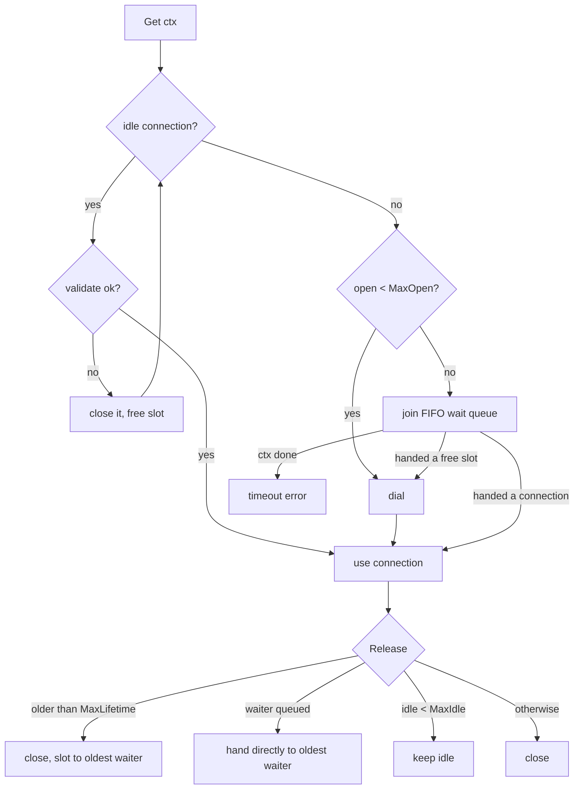

# Connection Pool

## Problem

A service that opens a new connection for every request pays for it three ways:

- **Latency.** Before the first byte of the query or call, a new connection needs a TCP handshake, usually a TLS handshake, and for databases an authentication exchange. That is several round trips, often more than the request itself.
- **Sockets and ports.** Whichever side closes a TCP connection keeps it in TIME_WAIT for a minute or more. At thousands of requests per second to the same host, the client runs out of ephemeral ports and new connects fail with `EADDRNOTAVAIL`.
- **The backend's connection limit.** Databases and proxies cap concurrent connections (Postgres `max_connections`, file descriptor limits, per-connection memory). Concurrency × (handshake + work) can easily exceed it, and then new connections are refused.

Reusing connections fixes the first two, but a "pool" with no upper bound doesn't fix the third: during a spike it opens one connection per concurrent request, which is exactly the load that breaks the backend.

## Solution

Keep a **bounded** set of open connections and lend them out:

1. **Borrow**: take an idle connection if there is one (after a quick health check), otherwise dial a new one if fewer than *MaxOpen* exist, otherwise **wait** in a FIFO queue, bounded by the caller's context deadline.
2. **Return**: give the connection straight to the oldest waiter; if nobody is waiting, keep it idle (up to *MaxIdle*), otherwise close it.
3. **Retire** connections that have been idle too long (*IdleTimeout*) or that are older than *MaxLifetime*, so the pool shrinks after a spike and picks up DNS, load-balancer and failover changes instead of pinning the same sockets forever.
4. **Discard** connections that fail the health check or that the caller reports as broken, and replace them on demand.

The bound turns overload into short waits (and, if the wait is too long, a fast timeout the caller can handle) instead of refused connections at the backend.

### Sizing: Little's law

The number of connections in use on average is

> connections ≈ throughput × time each request holds a connection

1500 req/s holding a connection for 20ms needs 1500 × 0.02 = 30 connections on average; 4000 req/s needs 80. Size `MaxOpen` a little above the peak value of that product (bursts are random), and **below** the backend's limit divided by the number of client instances. Ten app instances with `MaxOpen 50` each against a `max_connections 300` database is already a misconfiguration. Two consequences that surprise people:

- If hold time includes slow work done *while holding the connection* (calling another service in the middle of a transaction), the pool you need grows with it. Shorten the hold time before growing the pool.
- A bigger pool is not always faster: a database with 8 cores doesn't run 500 queries in parallel. Past a point, extra connections add contention, and a smaller pool with a queue in front gives better throughput and latency.

### You usually already have one

- **`database/sql`** is a pool. `SetMaxOpenConns` defaults to unlimited (the unbounded case above). `SetMaxIdleConns` defaults to 2, so a service doing hundreds of concurrent queries closes and reopens connections constantly. `SetConnMaxLifetime` and `SetConnMaxIdleTime` are off by default. Set all of them.
- **`net/http.Transport`** pools keep-alive connections per host. `MaxIdleConnsPerHost` defaults to **2** (`DefaultMaxIdleConnsPerHost`), so a client making 100 concurrent requests to one backend keeps only 2 connections idle and opens and closes the rest, piling up TIME_WAIT sockets. Raise it, and set `MaxConnsPerHost` if you want a hard cap. Also always read the response body to EOF and close it, or the connection can't be reused.
- **HTTP/2 and gRPC** multiplex many concurrent requests over one connection, so the "pool" is usually one or a few connections per backend. The limit moves to concurrent streams per connection (`SETTINGS_MAX_CONCURRENT_STREAMS`), and a single connection pins all traffic to one backend behind an L4 load balancer, which is again a reason for max connection age (gRPC's `MaxConnectionAge`).
- **Proxy pooling (PgBouncer, RDS Proxy, Odyssey)** sits between many app instances and the database and multiplexes thousands of client connections onto a few dozen server connections. In transaction mode a server connection is borrowed per transaction, so session state (prepared statements, `SET`, advisory locks) doesn't survive between transactions.

## Diagram



## How this implementation works

- `New(dial, closeFn, opts...)` returns a `Pool[C]` for any connection type. Options: `WithMaxOpen`, `WithMaxIdle`, `WithIdleTimeout`, `WithMaxLifetime`, `WithValidate`, `WithClock`. Invalid combinations (negative values, `MaxIdle > MaxOpen`, a validate func for another type) are rejected.
- `Get(ctx)` returns a `*Conn[C]` lease with `Value()`, `Reused()`, `Release()` and `Discard()`. Exactly one of `Release`/`Discard` takes effect; extra calls are ignored, so a stale handle can't return a connection someone else is using.
- `numOpen` counts connections that are idle, in use **or being dialed**: the slot is reserved under the lock before the dial runs outside it. A slot is freed only after the close function returns, so the backend never sees more than `MaxOpen` connections, even for an instant (the concurrency test checks this from the backend's side).
- Waiters sit in a FIFO list. `Release` hands the connection to the oldest waiter directly, and closing a connection (expired, discarded, failed dial) transfers its *slot* to the oldest waiter, which then dials. New arrivals never dial past a queue, so nobody jumps it. A waiter whose context ends removes itself; if a grant raced with the cancellation, it is given back.
- Idle connections are borrowed LIFO (most recently returned first). Hot connections stay hot, and the surplus after a spike ages out through `IdleTimeout`. Expired idle connections are retired lazily on `Get`; `Reap()` does the same for a background ticker.
- `Stats()` reports gauges (open, idle, in use, waiting) and counters (opens, dial errors, reuses, waits, total wait time, timeouts, discards, idle/lifetime expiries, closes due to `MaxIdle`), plus `ReuseRate()`.
- `Close()` closes idle connections, fails waiters with `ErrClosed`, and closes in-use connections as they are released.

The example simulates a database where connecting costs 30ms and at most 100 connections are allowed, in 1ms ticks with an injected clock (dial time is counted, not slept). Under 1500 req/s with a one-second spike to 4000 req/s:

| design | refused | handshakes | reuse | peak backend conns | waits | p99 |
| --- | --- | --- | --- | --- | --- | --- |
| dial per request | 1986 of 6963 | 6963 | - | 100 (at the limit) | - | 50ms |
| unbounded pool | 10 | 110 | 98.6% | 100 (at the limit) | 0 | 50ms |
| bounded pool, MaxOpen 90 | 0 | 90 | 98.7% | 90 | 491 (avg 1.8ms) | 50ms |

The per-request design also leaves ~4900 sockets in TIME_WAIT on the client. The unbounded pool mostly works because reuse is high, but it tried to open 110 connections in the spike and 10 requests failed; with a bigger spike that number grows. Then a database restart: without a health check, all 48 idle sockets are each lent out once and fail a request; with validate-on-borrow they are discarded and replaced (the 28 requests in flight fail either way). Finally a DNS move from `db-a` to `db-b`: without a max lifetime the pool stays on `db-a` forever; with a (scaled) 1s lifetime it is fully on `db-b` within half a second, at the price of redialing every connection each second.

**Simplification.** The health check runs on every borrow of an idle connection, and is free in the simulation. A real check is a round trip (`SELECT 1`, a ping frame), so production pools skip it for connections used very recently (HikariCP's 500ms bypass window), or rely on a cheap liveness check of the socket. Connections handed directly from `Release` to a waiter are not re-checked. Max lifetime has no jitter, so connections dialed together expire together (visible as a reconnect burst every second in the example); production pools subtract a small random amount. The retire sweep scans the idle list on each `Get`, which is fine for pools of tens to hundreds. There is no minimum-idle warm-up and no background dialing.

## Trade-offs

| Pro | Con |
| --- | --- |
| Handshake cost paid once per connection, not per request (98.7% reuse in the example) | Idle connections hold memory and slots on the backend even when nothing is happening |
| A hard cap protects the backend: overload becomes short waits instead of refused connections | Undersized, the pool itself becomes the bottleneck: requests queue and time out while the backend is idle |
| FIFO waiting with deadlines gives fair, bounded queueing | Pool size must be coordinated across instances; autoscaling the app can multiply it past the backend's limit |
| Health checks hide backend restarts and middlebox timeouts from requests | A health check per borrow costs a round trip; skipping it risks handing out dead sockets |
| Max lifetime follows DNS and rebalancing | Lifetime and idle timeouts cause reconnect bursts, unless jittered |
| Few long-lived connections avoid TIME_WAIT exhaustion | Connections carry session state; a pool must reset it (or the caller must not rely on it) |

## When to use / when not to

**Use it** for anything with an expensive connection setup that is used by many short requests: database clients, HTTP/1.1 clients to the same hosts, Redis/Memcached clients, LDAP, message brokers, gRPC channels to backends that don't multiplex well. In Go, first configure the pool you already have (`database/sql`, `http.Transport`, your Redis client) rather than writing a new one.

**Don't use it** (or keep it tiny) when the protocol multiplexes (HTTP/2, gRPC: one connection carries many requests), when connections are cheap and short-lived by nature (UDP, local Unix sockets), or when each connection carries user-specific session state that cannot be safely reset. For many app instances against one database, put a proxy pool (PgBouncer) in the middle instead of growing every client pool.

## Real-world examples

- **Go `database/sql`**: `MaxOpenConns`, `MaxIdleConns`, `ConnMaxLifetime`, `ConnMaxIdleTime`, with a queue of waiting requests when at the cap (served in random rather than FIFO order) and `driver.Validator`/`SessionResetter` checks on reuse.
- **Go `net/http.Transport`**: per-host idle pools of keep-alive connections, `MaxIdleConnsPerHost` (default 2), `MaxConnsPerHost`, `IdleConnTimeout`.
- **HikariCP** (JVM): `maximumPoolSize`, `maxLifetime` (with jitter), `idleTimeout`, `connectionTimeout`, and a famous sizing guide arguing for small pools.
- **PgBouncer**: session, transaction and statement pooling modes in front of Postgres.
- **Envoy**: per-upstream-host connection pools with circuit-breaker limits (`max_connections`, `max_pending_requests`, `max_requests`) and `max_connection_duration`.

## Run it

```sh
go run ./patterns/architecture/connection-pool/example
go test ./patterns/architecture/connection-pool/
```

## Related patterns

- [API gateway](../api-gateway): a gateway holds pools to every backend; their sizes cap what it can push through
- [Load balancing](../load-balancing): long-lived pooled connections stick to one backend; max lifetime lets the balancer rebalance
- [Bulkhead](../../reliability/bulkhead): a bounded pool is a bulkhead around one dependency; separate pools keep one slow backend from starving the others
- [Timeout](../../reliability/timeout): the wait for a connection needs its own deadline, shorter than the request's

## Further reading

- Arvind Kumar, [API Gateway Becomes a Bottleneck](https://codefarm0.medium.com/api-gateway-becomes-a-bottleneck-system-design-deep-dive-on-gateway-scaling-authentication-cfff15529317), on gateway scaling, including pooling connections to upstream services
