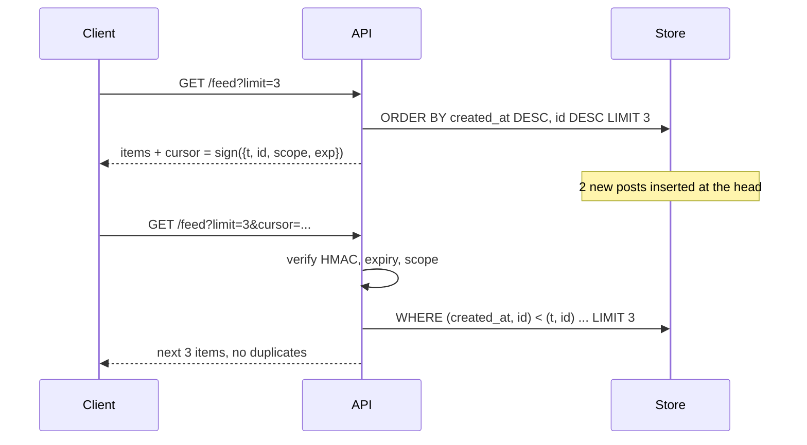

# Cursor Pagination

## Problem

`LIMIT 20 OFFSET 40` looks harmless, but it has two problems.

1. **It is wrong under writes.** If new rows arrive at the head between page
   requests, everything shifts down, and the next page repeats items the user
   already saw. A delete shifts things up, and an item is silently skipped.
   Infinite-scroll feeds hit this constantly.
2. **It gets slow.** The database still reads and discards all `OFFSET` rows,
   so page 1,000 costs 1,000 pages of work.

Exposing raw positions such as `?after_id=123` also lets clients edit the
value, guess other users' ranges, or pass a cursor from one query to a
different one.

## Solution

Use **keyset pagination**. Remember the sort key of the last item returned
and ask for "rows strictly after this key". With an index on the sort key,
that is a seek plus a short range scan, and it doesn't care what was inserted
or deleted elsewhere. The sort key must be a **total order**, so add a unique
tie-breaker such as `(created_at, id)`.

Wrap that key in an **opaque, signed cursor**. The client gets a token, not a
number. The server checks an HMAC to make sure it issued the token, checks
that it hasn't expired, and checks that it belongs to the same query.

## Diagram



## How this implementation works

- `Store` keeps items sorted newest-first by `(CreatedAt DESC, ID DESC)`.
  `after(item, pos)` defines "strictly after", including the ID tie-breaker.
- `Store.Offset` is the naive version. `Store.After` is keyset pagination: a
  binary search for the first item after the position, then a slice.
  `After` returns `more`, so the API only issues a next cursor when there
  really is a next page.
- `Codec.Encode` produces `base64url(json{t, id, scope, exp}) + "." +
  base64url(HMAC-SHA256)`. `Codec.Decode` checks, in this order:
  1. length and shape;
  2. the signature, using `hmac.Equal`, which is constant-time;
  3. expiry, using the injectable clock;
  4. **scope**, so a cursor issued for `/feed` can't be replayed against
     `/admin/feed` or a different filter.

  Every failure returns the same `ErrInvalidCursor`.
- `Handler` clamps `limit` to 1..100 and returns 400 for invalid cursors.
- `TestOffsetVsCursorUnderConcurrentWrites` reproduces both offset bugs
  (repeat on insert, skip on delete) and shows the cursor walk staying exact.
  That holds even when the item the cursor points at is deleted, because the
  cursor stores a position, not a row reference.

Signed is not encrypted. The payload is readable base64, so never put
anything secret in a cursor. If the sort key itself is sensitive, encrypt it
(for example with AES-GCM) instead of only signing it.

## Trade-offs

| Pro | Con |
| --- | --- |
| Stable under concurrent inserts and deletes | No "jump to page 37". Only next (and previous, with a reverse query) |
| O(limit) per page with an index, at any depth | The sort order must be fixed per cursor and backed by an index |
| Opaque cursors let you change the encoding later | Total counts ("page 3 of 50") need a separate, often approximate, query |
| HMAC stops forgery and cross-query reuse | A key rotation invalidates outstanding cursors unless you accept old keys for a while |

## When to use / when not to

**Use** cursors for feeds, timelines, activity logs, infinite scroll, sync
APIs, and any large or frequently changing list. They are the default for
public APIs.

**Use offsets** for small, mostly static lists where users really need page
numbers, such as admin tables or search results capped at a few pages.

## Real-world examples

- **Stripe** list endpoints use `starting_after` and `ending_before` object IDs.
- **Slack's** Web API uses opaque `next_cursor` values in `response_metadata`.
- **GraphQL Relay** connections standardise `first`, `after`, `endCursor`,
  and `hasNextPage`.
- **Twitter/X** and **Facebook Graph API** timelines paginate with opaque
  cursors.

## Run it

```sh
go run ./patterns/architecture/cursor-pagination/example
go test ./patterns/architecture/cursor-pagination/
```

## Related patterns

- [Fan-out feed](../fan-out-feed): the timelines that are usually paged this way.
- [Read replicas](../../data/read-replicas): paged reads are often served from replicas, where replication lag interacts with cursors.
- [Materialized view](../../data/materialized-view): precomputed, indexed lists that make keyset seeks cheap.
- [Webhook delivery](../webhook-delivery): another place HMAC signing protects data that clients send back.
