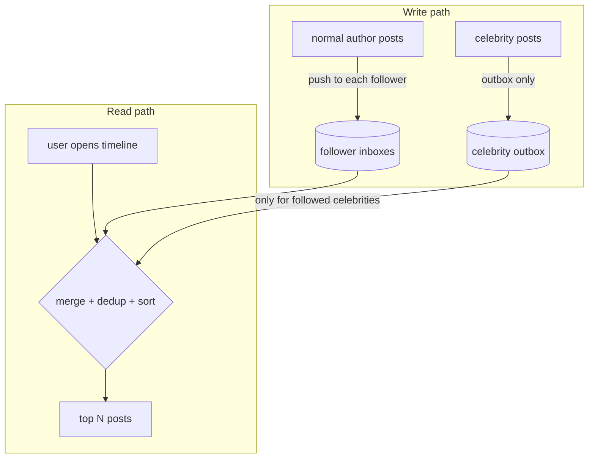

# Fan-out Feed (push, pull, hybrid)

## Problem

A home timeline shows the newest posts from everyone a user follows. Reads
vastly outnumber writes, and users expect the timeline instantly. But the
follower graph is extremely skewed: most accounts have a few hundred
followers, and a handful have tens of millions. A design that is cheap for
one case is pathological for the other.

## Solution

There are two basic strategies, plus a hybrid that combines them:

- **Fan-out-on-write (push).** When someone posts, copy the post ID into
  every follower's precomputed inbox. Reading a timeline is one lookup. A
  celebrity post means millions of writes.
- **Fan-out-on-read (pull).** Store the post once, in the author's outbox.
  At read time, fetch and merge the outboxes of everyone the user follows.
  Writes are trivial, but reads get expensive for users who follow many
  accounts.
- **Hybrid.** Push for normal authors. For authors at or above a follower
  threshold (celebrities), skip the fan-out and **merge their outboxes at
  read time**. Each read pays for a few celebrity outboxes, and no single
  post costs millions of writes.

## Diagram



## How this implementation works

- `New(strategy, celebrityThreshold, inboxCap, now)` creates the feed.
  `pulled(author)` decides each author's mode: always for `Pull`, never for
  `Push`, and `followers >= threshold` for `Hybrid`.
- `Publish` appends to the author's outbox. Unless the author is pulled, it
  also appends the post to every follower's inbox. Inboxes are **bounded**
  (trimmed in batches, amortised O(1)), just as real systems keep only the
  newest few hundred timeline entries in a cache.
- `Timeline(user, limit)`:
  - takes the newest `limit` posts from the user's inbox, **filtered by the
    current follow set**, so unfollows take effect without deleting anything;
  - adds the newest `limit` posts from each pulled author's outbox. Each
    source is sorted, so nothing older can make the top `limit`;
  - **dedups by post ID**, because a post pushed before its author crossed
    the celebrity threshold can be in both the inbox and the outbox;
  - sorts by ID, newest first, and trims to `limit`.
- `Stats` counts inbox writes and outbox reads, so the tests and the example
  can compare cost. `TestStrategiesAgree` checks that all three strategies
  return **identical timelines**. Only the cost differs.

## Trade-offs

| | Push | Pull | Hybrid |
| --- | --- | --- | --- |
| Write cost | O(followers) | O(1) | O(followers) for normal authors, O(1) for celebrities |
| Read cost | O(1) lookup | O(following) merge | lookup + O(followed celebrities) |
| Storage | a copy per follower | one copy | in between |
| Freshness | delayed by fan-out lag | always current | mixed |
| Weak spot | celebrity posts, inactive followers | users following thousands | threshold tuning, two code paths |

Other details to watch:

- **Push doesn't backfill.** A new follower sees only future posts. Pull shows
  history immediately.
- **Crossing the threshold.** A celebrity who drops below the threshold
  stops being pulled, and their pulled-era posts were never pushed. Real
  systems use hysteresis or a backfill job.
- Push work for **inactive users** is wasted. Many systems push only to
  recently active followers.

## When to use / when not to

**Use** push when the graph is fairly even and reads must be very fast. Use
pull for small systems, very write-heavy authors, or when freshness matters
more than read latency. Use **hybrid** at social-network scale with a skewed
follower distribution.

**Don't** precompute timelines when the ranking depends heavily on read-time
signals. A ranked "For you" feed is computed per request from candidates, and
fan-out only produces those candidates.

## Real-world examples

- **Twitter** described a fan-out-on-write home timeline stored in Redis,
  with celebrity tweets merged in at read time. That is the classic hybrid
  example.
- **Facebook's** News Feed was built mainly on fan-out-on-read: it aggregates
  candidates at query time and then ranks them.

## Run it

```sh
go run ./patterns/architecture/fan-out-feed/example
go test ./patterns/architecture/fan-out-feed/
```

## Related patterns

- [Materialized view](../../data/materialized-view): a pushed inbox is a per-user materialized view.
- [Pub-sub](../../distributed/pub-sub) and [Competing consumers](../../distributed/competing-consumers): how fan-out work is distributed asynchronously.
- [Cursor pagination](../cursor-pagination): how timelines are paged.
- [Cache-aside](../../data/cache-aside): timelines usually live in a cache in front of durable storage.
- [Sharding](../../data/sharding): inboxes are sharded by user.
