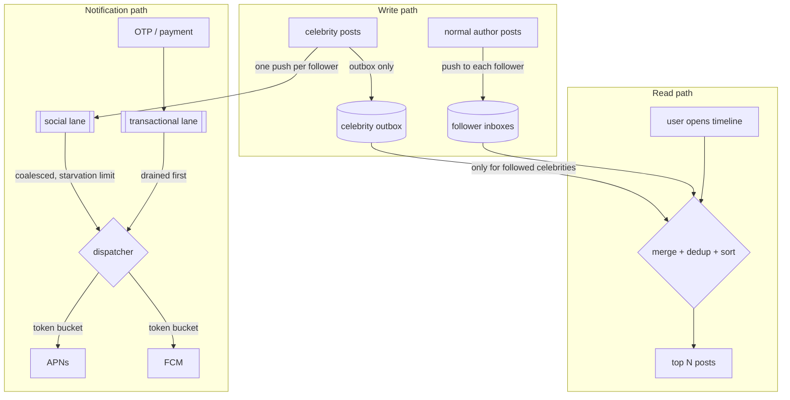

# Fan-out Feed (push, pull, hybrid)

## Problem

A home timeline shows the newest posts from everyone a user follows. Reads
vastly outnumber writes, and users expect the timeline instantly. But the
follower graph is extremely skewed: most accounts have a few hundred
followers, and a handful have tens of millions. A design that is cheap for
one case is pathological for the other.

## Solution

There are two basic strategies, plus a hybrid that combines them:

- **Fan-out-on-write (push).** When someone posts, copy the post ID into
  every follower's precomputed inbox. Reading a timeline is one lookup. A
  celebrity post means millions of writes.
- **Fan-out-on-read (pull).** Store the post once, in the author's outbox.
  At read time, fetch and merge the outboxes of everyone the user follows.
  Writes are trivial, but reads get expensive for users who follow many
  accounts.
- **Hybrid.** Push for normal authors. For authors at or above a follower
  threshold (celebrities), skip the fan-out and **merge their outboxes at
  read time**. Each read pays for a few celebrity outboxes, and no single
  post costs millions of writes.

Timelines are only half of the write path. A post also triggers **push
notifications**, and those cannot be pulled lazily: a celebrity post really
does enqueue one push per follower. A **notification dispatcher** keeps that
storm from hurting anything else:

- **Priority lanes.** Separate queues for transactional (OTP, payment, "your
  ride is here"), social and marketing pushes. The dispatcher drains higher
  lanes first, so an OTP never waits behind 200,000 "new post" pushes.
- **Anti-starvation.** Pure strict priority lets a busy transactional lane
  starve the others forever. This implementation uses a **starvation limit**:
  a lower lane passed over `n` times in a row gets the next send. That is
  simpler to reason about than weighted round robin: priority is strict
  until the limit, and each backlogged lower lane is guaranteed at least
  about one send in `n+1`.
- **Per-provider rate limits.** APNs and FCM throttle senders, so each
  provider gets its own token bucket and its own set of lanes. A throttled
  APNs never blocks FCM sends.
- **Coalescing.** Social pushes with the same user and collapse key merge
  while queued, so a like storm becomes one "alice and 41 others liked your
  post" per user per window.

## Diagram



## How this implementation works

- `New(strategy, celebrityThreshold, inboxCap, now)` creates the feed.
  `pulled(author)` decides each author's mode: always for `Pull`, never for
  `Push`, and `followers >= threshold` for `Hybrid`.
- `Publish` appends to the author's outbox. Unless the author is pulled, it
  also appends the post to every follower's inbox. Inboxes are **bounded**
  (trimmed in batches, amortised O(1)), just as real systems keep only the
  newest few hundred timeline entries in a cache.
- `Timeline(user, limit)`:
  - takes the newest `limit` posts from the user's inbox, **filtered by the
    current follow set**, so unfollows take effect without deleting anything;
  - adds the newest `limit` posts from each pulled author's outbox. Each
    source is sorted, so nothing older can make the top `limit`;
  - **dedups by post ID**, because a post pushed before its author crossed
    the celebrity threshold can be in both the inbox and the outbox;
  - sorts by ID, newest first, and trims to `limit`.
- `Stats` counts inbox writes and outbox reads, so the tests and the example
  can compare cost. `TestStrategiesAgree` checks that all three strategies
  return **identical timelines**. Only the cost differs.

The notification dispatcher (`notify.go`):

- `NewDispatcher(opts...)` takes `WithProvider(name, ratePerSec, burst)` (at
  least one), `WithDispatchClock`, `WithStarvationLimit(n)` (default 20, 0 =
  pure strict priority), `WithCoalesceWindow(d)` and `WithSingleFIFO()` (the
  baseline, one queue per provider). Invalid combinations return an error.
- `Enqueue(Notification)` puts a push in the queue for its provider and
  `Lane` (`Transactional`, `Social`, `Marketing`).
- `Dispatch()` is called on every clock tick. For each provider it picks a
  lane (the highest lane past its starvation limit, else the highest lane
  with a sendable push) and sends while the provider's token bucket allows.
  The bucket is `patterns/reliability/rate-limiter-token-bucket`, sharing
  the dispatcher's injectable clock. It returns `Delivery` values with
  `Count`, `Delay()` and `Summary()`.
- **Coalescing.** The first Social push for a `(user, CollapseKey)` waits one
  window before it is sendable. Later ones for the same pair bump its
  `Count` instead of queueing. Every coalescable push waits the same window,
  so readiness times stay in queue order and only the head of the lane needs
  a check.
- The example's step 2 fans one celebrity post out to 200,000 simulated
  pushes while an OTP arrives every 100 ms. With one FIFO queue the OTP p99
  is about 49 s. With lanes it is 0 s (sent on the tick it arrives), and
  neither run ever exceeds the provider rates. Step 3 coalesces a 200,000
  like storm into 4,000 pushes with a 5 s window.

**Simplification.** Real dispatchers run as many competing consumers over a
durable broker (SQS queues or Kafka topics per priority), retry with backoff
on provider errors, honour per-device tokens and collapse IDs, and move pushes
that keep failing to a dead-letter queue. Here everything is one in-memory
process on a simulated clock, the provider rates are made up (APNs and FCM
don't publish fixed numbers), and a send never fails. Each lane is checked
only at its head, so a coalescing Social entry still waiting out its window
holds back non-coalescing Social entries queued behind it. Give every Social
notification a collapse key, or put non-coalescing ones in their own lane.

## Trade-offs

| | Push | Pull | Hybrid |
| --- | --- | --- | --- |
| Write cost | O(followers) | O(1) | O(followers) for normal authors, O(1) for celebrities |
| Read cost | O(1) lookup | O(following) merge | lookup + O(followed celebrities) |
| Storage | a copy per follower | one copy | in between |
| Freshness | delayed by fan-out lag | always current | mixed |
| Weak spot | celebrity posts, inactive followers | users following thousands | threshold tuning, two code paths |

For the notification dispatcher:

| Pro | Con |
| --- | --- |
| OTPs and other transactional pushes stay instant during a storm; provider limits are never exceeded; coalescing cuts sends (200,000 to 4,000 in the example) and user annoyance | Lanes don't add capacity: the storm still drains at the provider rate. Coalescing adds up to one window of latency to social pushes. The starvation limit takes a small share from the top lane, and a wrongly classified push (marketing sent as transactional) defeats the whole scheme |

Other details to watch:

- **Push doesn't backfill.** A new follower sees only future posts. Pull shows
  history immediately.
- **Crossing the threshold.** A celebrity who drops below the threshold
  stops being pulled, and their pulled-era posts were never pushed. Real
  systems use hysteresis or a backfill job.
- Push work for **inactive users** is wasted. Many systems push only to
  recently active followers.

## When to use / when not to

**Use** push when the graph is fairly even and reads must be very fast. Use
pull for small systems, very write-heavy authors, or when freshness matters
more than read latency. Use **hybrid** at social-network scale with a skewed
follower distribution.

**Don't** precompute timelines when the ranking depends heavily on read-time
signals. A ranked "For you" feed is computed per request from candidates, and
fan-out only produces those candidates.

## Real-world examples

- **Twitter** described a fan-out-on-write home timeline stored in Redis,
  with celebrity tweets merged in at read time. That is the classic hybrid
  example.
- **Facebook's** News Feed was built mainly on fan-out-on-read: it aggregates
  candidates at query time and then ranks them.
- **APNs and FCM** throttle senders. FCM documents per-device and per-project
  message rate limits and returns quota errors, and APNs can throttle or
  delay pushes to a device that receives too many. Senders keep their own
  rate limiters in front of them.
- **Instagram and Facebook** aggregate notifications ("alice and 41 others
  liked your post") instead of sending one per like.
- Notification platforms commonly separate priorities into **different SQS
  queues or Kafka topics** with their own consumer pools, so a marketing
  blast or a viral post can't delay OTPs and receipts.

## Run it

```sh
go run ./patterns/architecture/fan-out-feed/example
go test ./patterns/architecture/fan-out-feed/
```

## Related patterns

- [Materialized view](../../data/materialized-view): a pushed inbox is a per-user materialized view.
- [Pub-sub](../../distributed/pub-sub) and [Competing consumers](../../distributed/competing-consumers): how fan-out work, including notification dispatch, is distributed asynchronously across workers.
- [Cursor pagination](../cursor-pagination): how timelines are paged.
- [Cache-aside](../../data/cache-aside): timelines usually live in a cache in front of durable storage.
- [Sharding](../../data/sharding): inboxes are sharded by user.
- [Token-bucket rate limiter](../../reliability/rate-limiter-token-bucket): the per-provider limit in the notification dispatcher.
- [Dead-letter queue](../../distributed/dead-letter-queue): where pushes that keep failing (invalid device tokens, repeated provider errors) should end up.

## Further reading

- Arvind Kumar, [Instagram Notification Storm](https://codefarm0.medium.com/instagram-notification-storm-system-design-deep-dive-on-fanout-architecture-and-push-notification-0e8e3d86841c): a system design walkthrough of fan-out and push notification delivery when a huge account posts.
