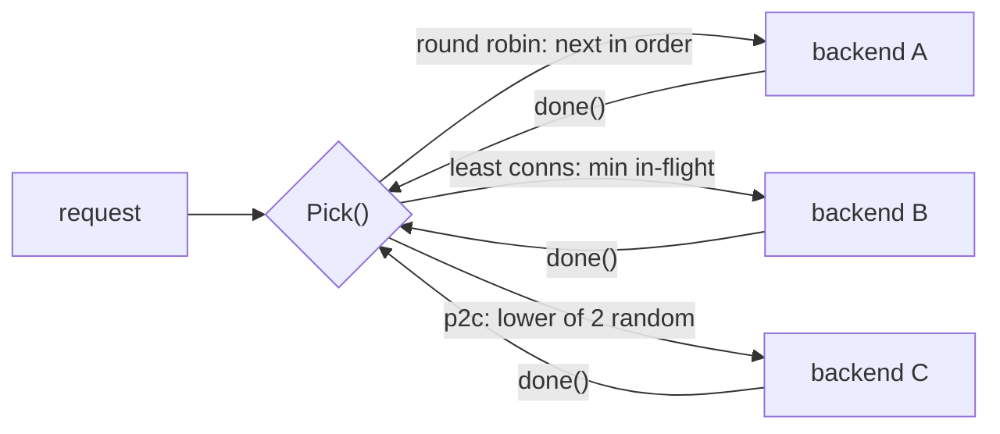

# Load Balancing

## Problem

You have N replicas of a service and a stream of requests. If you send traffic
blindly, one replica can drown while others sit idle. This happens when
replicas have different capacity, when one gets slow (GC pause, noisy
neighbour, bad disk), or when request costs vary.

## Solution

Put a selection policy in front of the replicas. That can be a dedicated
proxy or a client library. Policies trade simplicity against how much load
information they use:

| Strategy | Uses load info? | Cost per pick | Good at |
| --- | --- | --- | --- |
| Round robin | no | O(1) | uniform backends and requests |
| Weighted round robin | static weights | O(n) | known capacity differences |
| Least connections | live in-flight counts | O(n) + lock | slow backends, uneven request cost |
| Power of two choices (P2C) | in-flight of 2 random backends | O(1) | near-least-conn balance at scale, many independent balancers |
| Least response time (LRT) | EWMA latency × in-flight | O(n) + lock | backends with different speeds, even at equal in-flight |
| IP hash (modulo or rendezvous) | none: client key only | O(1) / O(n) | client affinity (local sessions, warm per-client caches) |

### Sticky sessions vs a shared session store

IP hash, or a cookie the balancer sets, gives **sticky sessions**: a user keeps
hitting the replica that holds their session in memory. It's tempting, but it
couples routing to state:

- **Scale-in and crashes lose sessions.** Remove a replica and every user
  pinned to it is moved and logged out (or loses a cart). With plain modulo
  hashing, about 80% of *all* users move when 1 of 5 replicas goes, not
  just that replica's 20%. Rendezvous or consistent hashing fixes the
  reshuffle, but not the loss.
- **Scale-out doesn't help existing users.** New replicas only get new
  clients, so a hot replica stays hot.
- **Load is uneven.** Balance follows how clients are distributed, not how
  much they send. One corporate NAT or mobile carrier gateway can put
  thousands of users behind one IP, and so behind one replica. A heavy user
  can't be spread.

The usual fix is to make replicas **stateless** and keep sessions in a
**shared store** (Redis, Memcached, a database, or a signed cookie / token
the client carries). Then any replica can serve any request, scale-in is
harmless, and you can use a load-aware strategy. Keep affinity for cases
where it's an optimisation, not a correctness requirement: cache locality,
or a WebSocket that must stay on one node.

### L4 vs L7

- An **L4** (transport) balancer routes TCP/UDP connections by IP and port
  without reading the payload. Examples: AWS NLB, IPVS, Maglev. It's very
  fast, protocol-agnostic, and can pass TLS through untouched, but it balances
  *connections*, not requests. A long-lived HTTP/2 or gRPC connection carrying
  thousands of requests stays on one backend. Its affinity options are IP or
  5-tuple hashing.
- An **L7** (application) balancer terminates the connection and parses HTTP.
  Examples: NGINX, Envoy, HAProxy in HTTP mode, AWS ALB. It can balance each
  request separately, route by path or header, retry, set cookies for
  stickiness, and use latency-aware strategies like LRT. The cost is more CPU
  per request, and it must terminate TLS to see anything.

Many setups use both: L4 in front for raw connection spreading and DDoS
absorption, L7 behind it for request routing.

## Diagram



## How this implementation works

All strategies implement `Balancer.Pick() (*Backend, done func(), error)`.
`Pick` increments the backend's in-flight counter, and the caller runs `done`
when the request finishes. `done` is idempotent.

- `RoundRobin.Pick` uses an atomic counter modulo n. It is lock-free.
- `WeightedRoundRobin.Pick` is NGINX's **smooth** WRR. Each backend gains its
  weight each round, the highest score wins, and the winner pays back the
  total. Weights 5:1:1 produce `a a b a c a a`, which spreads the heavy
  backend's turns instead of sending five in a row.
- `LeastConnections.Pick` finds the minimum under a mutex, so "find min" and
  "increment" are atomic. Without the lock, concurrent picks would all see
  the same idle backend. Ties rotate the scan's starting point, so an idle
  pool doesn't send everything to the first backend.
- `PowerOfTwo.Pick` samples two **distinct** backends (`IntN(n)` and
  `IntN(n-1)`, shifted) and keeps the less loaded one. It is O(1) and does not
  need a global view.
- `LeastResponseTime` (`NewLeastResponseTime(LRTConfig{Now, Alpha}, backends...)`)
  scores each backend as `EWMA latency × (in-flight + 1)` and picks the
  minimum. Ties rotate, as in least connections. `done` measures Pick-to-done
  time with the injected clock and updates the EWMA (`alpha` defaults to 0.3;
  the first sample sets the value). A backend with no samples is scored at
  the **mean EWMA of the measured ones**, so a new backend gets a fair share
  rather than either every request (score 0) or none (score infinity).
  `Latency(b)` exposes the current estimate.
- `IPHash` (`NewIPHash(mode, backends...)`) implements `Balancer`, plus
  `PickFor(key)` for affinity. `ClientKey(r.RemoteAddr)` strips the port.
  `HashModulo` is `hash(ip) % n`. `HashRendezvous` picks the backend with
  the highest `hash(ip, backend)`, which needs no ring or virtual nodes and
  moves only the removed backend's clients. `Add` and `Remove` change the
  pool at runtime. Keyless `Pick` falls back to round robin.

**Simplification.** LRT's EWMA is updated only when a request finishes, and
it never decays. Under light load, a backend that was slow once may never be
tried again (in the example it gets 1 of 2000 requests), so it can't show
that it recovered. Production versions such as Finagle's peak-EWMA and
Linkerd's decay the estimate over time, or probe periodically, and they also
count failures as slow. IP hash has no bounded-load cap (see consistent
hashing with bounded loads) and no weights.

The tests compare distributions directly:

- `TestSlowBackend`: one backend is 20x slower. Round robin still gives it
  25% of traffic, and requests pile up. Least connections and P2C cut its
  share to about 5% with at most 1 in flight.
- `TestPowerOfTwoVsRandom`: 20,000 long-lived connections over 20 backends.
  One random choice leaves a max-min gap of about 89. Two choices leave about 4.
- `TestLeastResponseTime*`: with sequential traffic (in-flight is always 0, so
  least connections would alternate), LRT sends all 100 requests to the 1 ms
  backend instead of a 50 ms one. Under 24 concurrent requests with a 5:1
  latency ratio, it spills about 1 in 5 to the slow one. An unmeasured new
  backend gets exactly its fair 10 of 30.
- `TestIPHashAffinityAndMovement`: 10,000 clients over 5 backends. Removing
  one moves 79.8% of clients with modulo hashing and 20.5% with rendezvous,
  and none of the rendezvous moves come from surviving backends.

The example's first table adds LRT and a mean latency column (service time
only): round robin 3.25 ms, weighted RR 2.12 ms, least connections 1.75 ms,
P2C 1.69 ms, and LRT 1.00 ms. LRT sends 1 of 2000 requests to the slow
backend, against least connections' 167. Its second step pins 1000 clients
by IP. Every client gets the same backend on its second request. Removing
`b2` moves 803 clients (80%) under modulo hashing and 208 (21%, exactly
`b2`'s clients) under rendezvous.

## Trade-offs

- **Round robin** is predictable and stateless, but it ignores load. A sick
  backend still gets its full share.
- **Weighted** handles known capacity differences but needs weights that you
  keep up to date by hand.
- **Least connections** reacts to real load, but every pick is O(n) and
  serialised. In a fleet of balancers, each sees only its own connections, and
  all of them can herd onto the same "least loaded" node when data is stale.
- **P2C** is slightly less exact than least connections. The randomness
  avoids herding, and it scales to large pools and many balancers.
- In-flight count is only one load signal. Production balancers often use
  latency (EWMA), queue depth, or server-reported utilisation.
- **Least response time** distinguishes fast from slow backends even at
  equal in-flight. But its latency signal lags, it needs a timer per request,
  and without decay or probing a once-slow backend can starve.
- **IP hash** gives affinity with no shared state. Balance follows client
  distribution (NATs make it lumpy), and with modulo hashing any pool change
  reshuffles most clients.

## When to use / when not to

**Use** round robin for homogeneous stateless services. Use least connections
or P2C when request cost varies (streaming, long polls, mixed endpoints) or
when you see tail latency caused by a slow replica.

Use LRT when replicas differ in speed (mixed hardware, a noisy neighbour, a
cold JIT or cache) and latency matters more than exact fairness.

Use IP hash only when affinity is an optimisation (cache locality) or the
protocol needs it. For user sessions, prefer stateless replicas and a shared
session store.

**Don't** use the load-aware strategies when requests must go to the replica
that holds their data (sharded caches, partitioned state). Use
[consistent hashing](../../data/consistent-hashing), or the rendezvous mode
of `IPHash`, for that.

## Real-world examples

- **NGINX**: `round-robin` (smooth weighted), `least_conn`, and
  `random two least_conn` (P2C).
- **Envoy**: `ROUND_ROBIN`, `LEAST_REQUEST` (P2C by default), `RING_HASH`, and
  `MAGLEV`.
- **HAProxy**: `roundrobin`, `leastconn`, `random(2)`, and `source` (IP hash).
- **NGINX** `ip_hash` and `hash $remote_addr consistent`. **Envoy**'s
  `LEAST_REQUEST` can weight by active requests, and Finagle and Linkerd use
  peak-EWMA latency balancing.
- **gRPC** client-side `round_robin` and `pick_first` policies.
- The P2C result comes from Michael Mitzenmacher's work on "the power of two
  choices".

## Run it

```sh
go run ./patterns/architecture/load-balancing/example
go test -v ./patterns/architecture/load-balancing/   # -v prints the comparisons
```

## Related patterns

- [Service discovery](../service-discovery): supplies the backend list.
- [Consistent hashing](../../data/consistent-hashing): affinity-based balancing.
- [Health check](../../reliability/health-check): remove dead backends from the pool.
- [Load shedding](../../reliability/load-shedding): when every backend is full.
- [Hedged requests](../../reliability/hedged-requests): another defence against a slow replica.
- [API gateway](../api-gateway): the L7 edge that usually runs these strategies, and terminates TLS.

## Further reading

- Khyati Jha, [System Design Interview Prep: High-Level Design Day-4 (Load Balancers)](https://medium.com/high-level-system-desgin-interview-prep/system-design-interview-prep-high-level-design-day-4-load-balancers-b9a35cae1991): load-balancing algorithms, L4 vs L7, and sticky sessions.
