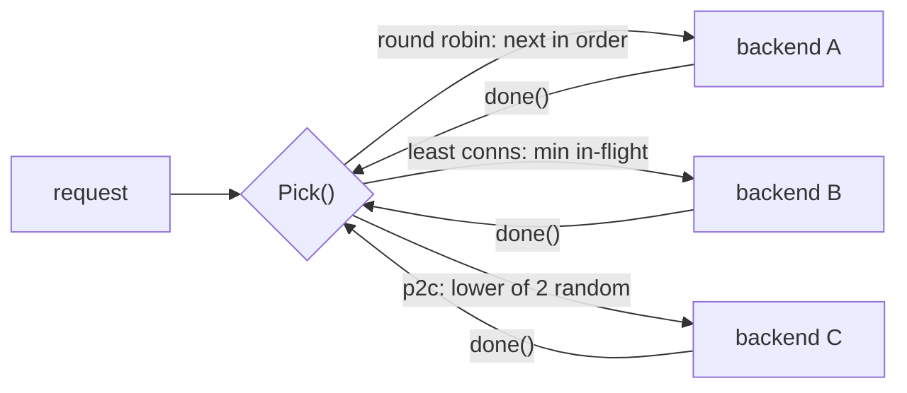

# Load Balancing

## Problem

You have N replicas of a service and a stream of requests. If you send traffic
blindly, one replica can drown while others sit idle. This happens when
replicas have different capacity, when one gets slow (GC pause, noisy
neighbour, bad disk), or when request costs vary.

## Solution

Put a selection policy in front of the replicas. That can be a dedicated
proxy or a client library. Policies trade simplicity against how much load
information they use:

| Strategy | Uses load info? | Cost per pick | Good at |
| --- | --- | --- | --- |
| Round robin | no | O(1) | uniform backends and requests |
| Weighted round robin | static weights | O(n) | known capacity differences |
| Least connections | live in-flight counts | O(n) + lock | slow backends, uneven request cost |
| Power of two choices (P2C) | in-flight of 2 random backends | O(1) | near-least-conn balance at scale, many independent balancers |

## Diagram



## How this implementation works

All strategies implement `Balancer.Pick() (*Backend, done func(), error)`.
`Pick` increments the backend's in-flight counter, and the caller runs `done`
when the request finishes. `done` is idempotent.

- `RoundRobin.Pick` uses an atomic counter modulo n. It is lock-free.
- `WeightedRoundRobin.Pick` is NGINX's **smooth** WRR. Each backend gains its
  weight each round, the highest score wins, and the winner pays back the
  total. Weights 5:1:1 produce `a a b a c a a`, which spreads the heavy
  backend's turns instead of sending five in a row.
- `LeastConnections.Pick` finds the minimum under a mutex, so "find min" and
  "increment" are atomic. Without the lock, concurrent picks would all see
  the same idle backend. Ties rotate the scan's starting point, so an idle
  pool doesn't send everything to the first backend.
- `PowerOfTwo.Pick` samples two **distinct** backends (`IntN(n)` and
  `IntN(n-1)`, shifted) and keeps the less loaded one. It is O(1) and does not
  need a global view.

The tests compare distributions directly:

- `TestSlowBackend`: one backend is 20x slower. Round robin still gives it
  25% of traffic, and requests pile up. Least connections and P2C cut its
  share to about 5% with at most 1 in flight.
- `TestPowerOfTwoVsRandom`: 20,000 long-lived connections over 20 backends.
  One random choice leaves a max-min gap of about 89. Two choices leave about 4.

## Trade-offs

- **Round robin** is predictable and stateless, but it ignores load. A sick
  backend still gets its full share.
- **Weighted** handles known capacity differences but needs weights that you
  keep up to date by hand.
- **Least connections** reacts to real load, but every pick is O(n) and
  serialised. In a fleet of balancers, each sees only its own connections, and
  all of them can herd onto the same "least loaded" node when data is stale.
- **P2C** is slightly less exact than least connections. The randomness
  avoids herding, and it scales to large pools and many balancers.
- In-flight count is only one load signal. Production balancers often use
  latency (EWMA), queue depth, or server-reported utilisation.

## When to use / when not to

**Use** round robin for homogeneous stateless services. Use least connections
or P2C when request cost varies (streaming, long polls, mixed endpoints) or
when you see tail latency caused by a slow replica.

**Don't** use any of these when requests must go to the replica that holds
their data (sticky sessions, sharded caches). Use
[consistent hashing](../../data/consistent-hashing) for that.

## Real-world examples

- **NGINX**: `round-robin` (smooth weighted), `least_conn`, and
  `random two least_conn` (P2C).
- **Envoy**: `ROUND_ROBIN`, `LEAST_REQUEST` (P2C by default), `RING_HASH`, and
  `MAGLEV`.
- **HAProxy**: `roundrobin`, `leastconn`, and `random(2)`.
- **gRPC** client-side `round_robin` and `pick_first` policies.
- The P2C result comes from Michael Mitzenmacher's work on "the power of two
  choices".

## Run it

```sh
go run ./patterns/architecture/load-balancing/example
go test -v ./patterns/architecture/load-balancing/   # -v prints the comparisons
```

## Related patterns

- [Service discovery](../service-discovery): supplies the backend list.
- [Consistent hashing](../../data/consistent-hashing): affinity-based balancing.
- [Health check](../../reliability/health-check): remove dead backends from the pool.
- [Load shedding](../../reliability/load-shedding): when every backend is full.
- [Hedged requests](../../reliability/hedged-requests): another defence against a slow replica.
