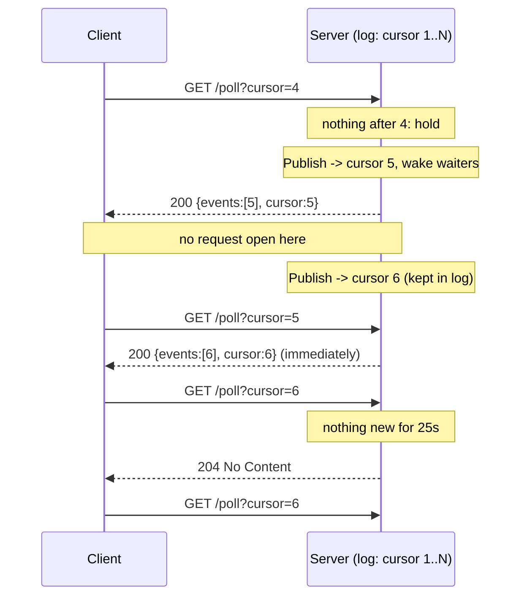

# Long Polling

## Problem

A client needs updates within a second or so of them happening: a chat
message, a job finishing, a new notification. The obvious push channels are
not always available:

- corporate proxies and some antivirus gateways buffer or cut streaming
  responses, which breaks Server-Sent Events;
- WebSockets need an `Upgrade` that old clients, strict proxies, or some API
  gateways refuse;
- serverless functions and plain request/response infrastructure can't keep
  a stream open at all.

The fallback everyone reaches for first is **short polling**: ask "anything
new?" every N seconds. It works everywhere, but it is a bad deal for sparse
updates. Almost every request comes back empty, and each update waits up to N
seconds for the next tick. Lowering N buys latency with load, linearly, for
every client, all the time.

## Solution

**Long polling** keeps plain HTTP request/response but lets the server hold a
request open until there is something to say.

1. Every event in the topic gets a **monotonically increasing cursor**.
2. The client sends `GET /poll?cursor=N`, where N is the last cursor it has.
3. If events newer than N exist, the server answers **at once** with all of
   them (one batch) and the new cursor.
4. Otherwise the server **holds** the request until an event is published,
   then answers immediately, or until a timeout (typically 25-30s), when it
   answers `204 No Content`.
5. The client re-polls straight away with the cursor it now has.

The cursor is what makes this safe. Between two polls there is a moment with
no request open. An event published then is not lost, because it is in the
log, and the next poll asks for "everything after N" and returns it without
waiting.

To protect the server, the number of held requests is **capped**: past the
cap a poll gets `503` with `Retry-After`. When a client goes away, its request
context is cancelled and the waiter is removed.

## Diagram



## How this implementation works

- `New(opts...)` returns a `*Topic`. Options: `WithMaxWait` (longest hold,
  default 25s), `WithMaxHeld` (cap on held requests, default 10000),
  `WithHistory` (events kept for clients that fall behind, default 1024),
  `WithMaxBatch` (events per answer, default unlimited) and `WithRetryAfter`.
- `Topic.Publish(data)` assigns the next cursor, appends to the bounded log,
  and wakes every held request.
- **Waking without busy loops.** The topic holds one `notify` channel. A
  waiter checks the log and, under the same lock, takes the current channel,
  then `select`s on it, its timer and its context. `Publish` closes the
  channel (a broadcast every waiter sees) and installs a new one. Because
  "check the log" and "grab the channel" happen under one lock, a publish
  either lands before the check (the waiter sees the event) or after it (the
  waiter's channel gets closed). There is no window for a lost wakeup.
  `sync.Cond` would give the same broadcast, but it can't be combined with a
  timeout or a cancelled context in one `select`.
- `Topic.Wait(ctx, cursor, hold)` is the core; `ServeHTTP` wraps it:
  - `?cursor=N` (default 0, meaning "from the start of retained history");
  - `?wait=MS` lets a client ask for a shorter hold, capped at the max;
    `wait=0` is a short poll;
  - `200` with a JSON `Batch` (`events`, `cursor`, `reset`), `204` on timeout,
    `400` on bad parameters, `503` + `Retry-After` past the cap or after
    `Close`.
- Only requests that actually wait count toward the cap. A poll that can be
  answered from the log never blocks, so it is never rejected.
- If a cursor is older than the retained history, or newer than anything
  published (the server restarted and lost its log), the answer is flagged
  `reset` and starts at the oldest retained event, so the client knows to
  refetch full state rather than silently skipping events.
- `Client` (from `NewClient(url, cursor)`) tracks its cursor. `Poll` sends one
  request; `Run` loops, calling a handler for each event in order, pausing
  `Interval` after each answer (0 for long polling) and backing off after
  errors, honouring `Retry-After` (capped by `MaxBackoff`). Setting
  `Hold = NoHold` turns it into a short-polling client, which is how the
  example compares the two against the same server.
- `Stats` counts polls answered immediately, woken, timed out, cancelled and
  rejected; `Held()` is the number waiting right now.

**Simplification.** The log lives in one process's memory. Behind a load
balancer with several instances, a client can poll any of them, so the log
and the wakeup must be shared: publish to Redis Streams, Kafka, or a database
table with a sequence column, and have each instance wake its local waiters
from a subscription to it. Production servers also authenticate, keep one log
per user or channel instead of one global topic, and add jitter to client
re-polls (see below).

## Trade-offs

| Pro | Con |
| --- | --- |
| Plain HTTP request/response: passes proxies, firewalls and gateways that break streaming | One held request (connection, goroutine, memory) per waiting client |
| Near-push latency: an update is one wakeup plus one response away | Every delivery costs a full request: headers, auth, routing, logging |
| No lost updates across polls, thanks to the cursor | Needs a retained, numbered log. Clients that fall too far behind must reset |
| Idle cost is one request per hold timeout, not one per short-poll tick | After a broadcast, every client re-polls at once (a thundering re-poll) |
| Easy to scale out: any instance can answer, given a shared log | Holds must stay under every proxy's idle timeout, or requests get cut |

## When to use / when not to

**Use** it when push matters but the path only reliably supports ordinary
HTTP: browser clients behind unknown proxies, old mobile clients, serverless
backends, or as the fallback transport for a WebSocket or SSE feature. It is
also a good fit for machine clients that want "block until something changes"
semantics with a plain HTTP API (watching configuration, waiting for a job).

**Don't use** it for high-frequency streams (prices, game state, telemetry):
at many updates per second each client re-polls constantly and you pay
request overhead per batch; SSE or WebSockets carry the same data on one
connection. If the update rate is low *and* a minute of delay is fine, plain
short polling with a long interval is simpler.

| | Short polling | Long polling | [SSE](../server-sent-events) | [WebSocket](../websocket-hub) |
| --- | --- | --- | --- | --- |
| Direction | Client asks | Client asks, server answers when ready | Server to client | Both ways |
| Latency | Up to the poll interval | One wakeup + one response | One write on an open stream | One frame on an open socket |
| Requests while idle | One per interval | One per hold timeout | None (heartbeats only) | None (pings only) |
| Works through any HTTP proxy | Yes | Yes, if holds are under the idle timeout | Often, but buffering proxies break it | Needs `Upgrade` support |
| Resume after a gap | Cursor or `If-Modified-Since` | Cursor in every request | `Last-Event-ID` | Up to you |
| Server cost per idle client | Nothing held | One held request | One open stream | One open socket |

### Proxy and load-balancer idle timeouts

Every hop between client and server has an idle timeout: many load balancers
and reverse proxies default to around 60 seconds, some corporate proxies use
30 seconds or less, and mobile carrier middleboxes can be shorter still. A
held request carries no bytes, so it looks idle. If the hold outlasts any
hop's timeout, the hop closes the connection and the client sees an error
instead of a clean `204`. That is why holds are usually 20-30 seconds, and
why this package defaults to 25s. Make the client's HTTP timeout longer than
the hold, or every poll will fail just before the server would answer.

### Thundering re-poll after a broadcast

A publish wakes every waiting client at once, they all receive a response in
the same instant, and they all send their next poll in the same instant. With
100,000 clients on a topic, one event becomes a spike of 100,000 requests,
which then repeats at every hold timeout because they are now synchronised.
Mitigations: keep per-user topics so a broadcast is rare; batch, so a burst
of events costs one round trip rather than one per event (`Batch` returns
everything after the cursor); add a small random delay before re-polling
(jitter) to spread the spike; jitter the hold timeout too, so timeouts don't
line up; and keep the held-request cap, so a spike turns into `503` +
`Retry-After` rather than a crashed server.

## Real-world examples

- **Comet-era web chat.** Before WebSockets were widely available, browser
  chat (Facebook's early web chat among the best known) and similar "Comet"
  applications kept an HTTP request parked on the server and answered it when
  a message arrived.
- **Dropbox** exposes a `longpoll` endpoint for file changes: a client sends
  a cursor, the call blocks until something changes or a timeout passes, and
  then it fetches the changes with that cursor.
- The **Telegram Bot API** `getUpdates` method takes an `offset` (the cursor)
  and a `timeout`, and holds the request until an update arrives.
- **Consul blocking queries** take an `index` (the cursor, returned as
  `X-Consul-Index`) and a `wait` duration, and return when the data's index
  moves past it or the wait expires.
- **etcd and Kubernetes watches** resume from a revision /
  `resourceVersion`. A client that asks for a revision older than the
  retained history gets an error and must re-list, the same role `reset`
  plays here.

## Run it

```sh
go run ./patterns/architecture/long-polling/example
go test ./patterns/architecture/long-polling/
```

The example scales time down (1 simulated second = 8ms) so it finishes in
about half a second. Both clients watch the same topic, which gets 9 sparse
updates over 60 simulated seconds. A typical run on an idle machine:

| | Requests | Empty | Avg latency | Max latency |
| --- | --- | --- | --- | --- |
| Short polling, every 2s | 27-28 | 20-21 | 0.7-0.95s | 1.6-2.2s |
| Long polling, 25s hold | 11 | 1 | about 0.06s | 0.2-0.8s |

Long polling's 11 requests are 9 answered with an update, 1 that timed out
during the 28.5s silence (the one empty answer) and 1 still held when the run
ended. Usually all 9 are held polls woken by a publish. The server line can
show fewer when an update lands while the client is between polls; that poll
is then answered at once from the log, which is the cursor doing its job.
Short polling delivers every update too, but in fewer non-empty answers
(updates 0.2s or 0.7s apart arrive in the same tick) and with a delay that
averages about half the interval. Because the run uses real timers, the
numbers move a little between runs; on a heavily loaded machine a few
milliseconds of scheduling delay already equal a simulated second.

The tests cover a waiter woken by a publish, an empty answer on timeout (and
`204` over HTTP), an update published between two polls being returned
immediately by the next one, 50 waiters all woken by one publish, a cancelled
client removing its waiter (directly and over HTTP), the held-request cap
with `503` and `Retry-After`, reset on stale or future cursors, and three
clients receiving 200 concurrently published events in order with no gaps or
duplicates. They pass under `-race`.

## Related patterns

- [Server-sent events](../server-sent-events): the streaming alternative, with the same cursor idea as `Last-Event-ID`.
- [WebSocket hub](../websocket-hub): the bidirectional alternative when the path supports it.
- [Cursor pagination](../cursor-pagination): the poll cursor is a cursor into an append-only log.
- [Pub-sub](../../distributed/pub-sub): the topic is a tiny in-process pub-sub with a replay log.
- [Load shedding](../../reliability/load-shedding): the held-request cap sheds load with `503` instead of falling over.
- [Retry with backoff](../../reliability/retry-backoff): how clients should react to errors and `Retry-After`.
- [Webhook delivery](../webhook-delivery): the push alternative when the client is a server that can receive requests.

## Further reading

- Khyati Jha, [High Level System Design Day-13: WebSockets (Part 1)](https://medium.com/high-level-system-desgin-interview-prep/high-level-system-design-day-13-websockets-part-1-0e1a6b4b3cc4), comparing polling, long polling and WebSockets.
