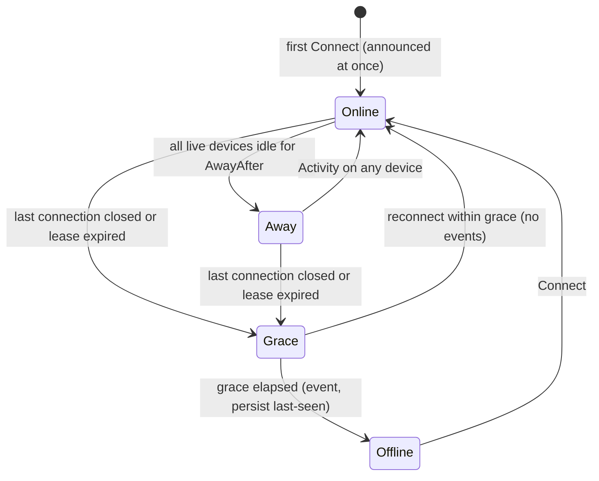
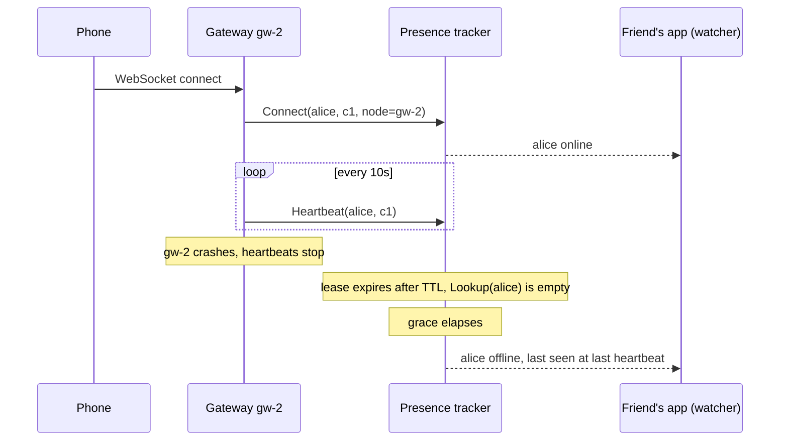

# Presence

## Problem

Real-time products keep asking three questions about every user, all the time:

- **Is this person online, and when were they last seen?** Chat apps show "online", "typing" or "last seen 5 min ago" next to every contact.
- **Which connection server holds their socket?** With millions of WebSocket connections spread over many gateway nodes, a message for Bob has to be sent to the node Bob is connected to, on every device he has open.
- **Where is the rider right now, and how fresh is that?** A delivery or ride-hailing map needs the latest GPS fix along with its age, and must never move the pin back to an older fix that arrived late.

The obvious design, a `last_seen` column updated on every heartbeat, fails on cost. Heartbeat interval × users becomes the write rate: 1 million connected users heartbeating every 10s is 100,000 writes per second of data that is worthless a minute later. The naive design also flickers. Phones drop their connection whenever they change cell towers, enter a lift or switch from Wi-Fi to 4G, and if every drop is announced, friends see "offline, online, offline" and the presence fan-out multiplies.

## Solution

Keep presence as **leases in fast, expiring memory**, separate from the system of record:

1. Each connection holds a **TTL lease** keyed by (user, connection), recording the **gateway node** that owns the socket. The gateway renews it with heartbeats. If a node crashes, its heartbeats stop and its leases expire on their own, as in [service discovery](../service-discovery).
2. A user's state is derived from all their leases. **Online** if any device is live and active, **away** if connected but idle, **offline** when no lease is left. Multi-device works because the user is online while any device is.
3. **Flap suppression.** When the last connection goes away, wait an **offline grace period** before announcing it. A reconnect inside the grace period produces no events at all. Online is announced at once, since only offline is the noisy direction.
4. **Last seen** is the last heartbeat or disconnect from any device. Write it to the durable store once, on the offline event, not on every heartbeat.
5. **Watchers** subscribe to the users they can actually see and receive **coalesced** changes: one event per user per delivery, and nothing for a user who went offline and came back between deliveries.
6. **Routing.** `Lookup(user)` returns the live connections with their node IDs, so a message is forwarded to the right gateway(s), or sent as a push notification when there are none.
7. **Latest position** is stored with the time the device measured it. Writes that are not newer than the stored fix are rejected, and readers pass a max age so a rider in a tunnel shows as "updating" rather than frozen in the wrong place.

## Diagram





## How this implementation works

- `New(opts...)` returns a `*Tracker`. Options: `WithClock`, `WithTTL` (default 30s), `WithAwayAfter` (default 5m, 0 disables away), `WithOfflineGrace` (default 15s, 0 announces offline at once). Invalid values return errors.
- `Connect(Connection{User, ID, Device, Node})` creates or replaces a lease and counts as activity. `Heartbeat` renews the lease without marking activity, so a backgrounded app goes away. `Activity` renews and marks active. A heartbeat after expiry returns `ErrUnknownConnection`: the client must reconnect, so a late heartbeat cannot revive a dead socket. `Disconnect` handles a clean close and starts the grace period at once, without waiting for the TTL.
- `Lookup(user) []Connection` and `Status(user) Presence` expire leases **lazily**: an expired lease is invisible immediately, even if nothing has swept. During the grace period `Lookup` is already empty while `Status` still shows the last state. That split is deliberate: routing must fail fast (queue or push-notify), while the UI should stay stable.
- `Sweep()` reconciles every user: it drops expired leases, ends grace periods, turns idle users away, and emits the resulting events. Run it every second or so. Without it, reads are still correct, but watchers only hear about time-driven changes (a crashed node, an ended grace period) once something touches that user.
- Each user keeps an announced state. An event is emitted only when the derived state differs from it, which is what makes flap suppression work: holding the old state during grace means a reconnect re-derives the same state and emits nothing.
- `Watch(users...)` returns a `Watcher`, and `Add`/`Remove` change its set as contacts scroll into view. Pending events are kept per user (latest wins). If a user changes back to what this watcher last received, the pending event is dropped. `Drain()` returns the events sorted by user, each with `Prev` and `State`. `Notify()` is a 1-buffered signal channel that never blocks the tracker. A newly watched user who is not offline is delivered on the next drain.
- `UpdatePosition(user, conn, Position{Lat, Lng, At})` renews the lease and rejects a fix whose `At` is not after the stored one (`ErrStalePosition`). `LatestPosition(user, maxAge)` returns the fix, or the fix plus `ErrStalePosition` when it is older than `maxAge`.
- `Stats()` counts lease renewals, announced state changes, and events delivered after coalescing. The example uses them to compare runs with and without grace.

**Simplification.** This is a single in-process tracker behind one mutex. A production presence service is sharded by user ID across processes, or is a Redis cluster where each connection is a key with `SET ... EX ttl` (renewed with `EXPIRE`), with keyspace notifications or a sweeper turning expiries into events, and events fanned out through [pub/sub](../../distributed/pub-sub) to the gateways that hold the watchers. Several further simplifications: clocks are trusted (a future-dated GPS fix would block newer ones, so production stores should cap `At` at server time plus a small skew), last-seen is not persisted, there are no privacy rules ("hide my last seen"), and a crashed node's users who reconnect elsewhere briefly have two connections in `Lookup`, one of them dead, until the old lease expires.

## Trade-offs

| Pro | Con |
| --- | --- |
| Heartbeats cost a memory write, not a DB write. Durable writes happen once per session (last-seen on offline) | Presence is lost if the store restarts. It rebuilds within one heartbeat interval, but everyone looks offline until then |
| Crashed gateways need no cleanup: their leases simply expire | Detection lag: up to TTL before routing stops, TTL + grace before friends see offline |
| The grace period removes most offline/online flicker and the fan-out it causes | Offline is announced late by design. A user who really left still looks online for the grace period |
| Per-watcher coalescing bounds event volume to one per user per delivery | Watchers see the latest state, not the full history: brief changes are deliberately lost |
| Timestamped positions make out-of-order and stale fixes detectable by every reader | Depends on device clocks. Skewed or future-dated timestamps need clamping |

The expensive part is usually not the heartbeats but **fan-out**: one user changing state must be delivered to everyone watching them. With 200 friends each, a flap is 400 deliveries. That is why watchers should subscribe only to visible contacts (the open conversation list, the friends currently on screen, the riders in the map viewport) and why big group chats usually show a member count instead of live presence for every member.

## When to use / when not to

**Use it** for chat and collaboration presence (online, away, last seen, typing), for connection registries that route messages to the right gateway node, for live location of riders, drivers or devices where only the latest value matters, and for any "who is here right now" view in multiplayer or collaborative editing.

**Don't use it** as the source of truth for anything that must survive a restart: audit trails, billing by connected minutes, or the full location history of a trip (append those to a durable log or time-series store). Also don't build per-user presence fan-out for very large groups or followers: query presence on demand instead. If you only need to know whether a server is up, plain [service discovery](../service-discovery) or a [health check](../../reliability/health-check) is enough.

## Real-world examples

- **WhatsApp** shows "online", "typing" and "last seen", derived from connection state on its chat servers rather than from its message store, and lets users hide last-seen and online status.
- **Slack** sends presence changes over the WebSocket only for users a client has explicitly subscribed to (a `presence_sub` message), and switches users to away after a period of inactivity.
- **Discord** keeps presence and session state in in-memory services behind its gateway and fans updates out per guild. For very large guilds it limits which members' presence a client receives, because fan-out dominates the cost.
- **Redis key TTL presence** is the common do-it-yourself design: `SET presence:{user}:{conn} {node} EX 30` on every heartbeat, a scan or keyspace notifications for expiry, and pub/sub for change events.
- **Phoenix Presence** (Elixir) replicates presence across the cluster with a CRDT (a delta-based observed-remove set), so every node can answer "who is online" without a central store and node crashes are cleaned up automatically.
- **Uber, Swiggy and other delivery apps** keep riders' latest locations in in-memory, geo-indexed stores (Redis GEO or custom geospatial services), with timestamps so that stale or out-of-order GPS updates are discarded rather than shown.

## Run it

```sh
go run ./patterns/architecture/presence/example
go test ./patterns/architecture/presence/
```

The example's numbers: in 10 simulated minutes, 200 flaky users out of 1,000 drop their socket 4,583 times. Without a grace period that produces 9,113 presence state changes (7,033 still delivered after a watcher's 5s coalescing). With a 15s grace period it produces 447: only the 233 drops that were real 25-40s outages are announced, minus the few still open when the run ends. When gateway gw-2 crashes holding 333 users, `Lookup` stops routing to it 20-29s after the crash (TTL after each user's last heartbeat) and all 333 offline events arrive between crash+35s and crash+44s (adding the grace period). The multi-device and live-tracking steps print a user going online, away, online and offline across two devices with "last seen 5m15s ago", and a late GPS fix being rejected and a 21s-old fix flagged as stale.

## Related patterns

- [Service discovery](../service-discovery): the same heartbeat-renewed TTL leases, applied to service instances instead of user connections
- [WebSocket hub](../websocket-hub): the gateway that holds the sockets, sends the heartbeats and delivers routed messages
- [Long polling](../long-polling): the fallback transport. Each poll acts as a heartbeat, and the gap between polls needs a grace period
- [Server-sent events](../server-sent-events): a one-way channel for pushing presence events to watchers
- [Fan-out feed](../fan-out-feed): the same fan-out cost question, for posts instead of presence changes
- [Health check](../../reliability/health-check): liveness for servers. Presence is the user-level equivalent
- [Gossip](../../distributed/gossip): decentralised membership and failure detection, the approach behind CRDT-replicated presence
- [Pub/sub](../../distributed/pub-sub): how presence events reach gateway nodes in a multi-node deployment

## Further reading

- Khyati Jha, [High Level System Design Day-15: WebSockets (Part 3)](https://medium.com/high-level-system-desgin-interview-prep/high-level-system-design-day-15-websockets-part-3-5e3156e7c356), on tracking which server holds which connection when WebSockets are scaled out
- Khyati Jha, [High Level System Design Day-17: WebSockets (Part 5)](https://medium.com/high-level-system-desgin-interview-prep/addhigh-level-system-design-day-17-websockets-part-5-fea1631aaaa2), on connection registries and presence for real-time systems
- Arvind Kumar, [Swiggy Shows Wrong Rider Location](https://codefarm0.medium.com/swiggy-shows-wrong-rider-location-system-design-deep-dive-on-real-time-gps-tracking-and-eventual-b49e5f18fccd), on real-time GPS tracking, stale and out-of-order location updates, and eventual consistency
