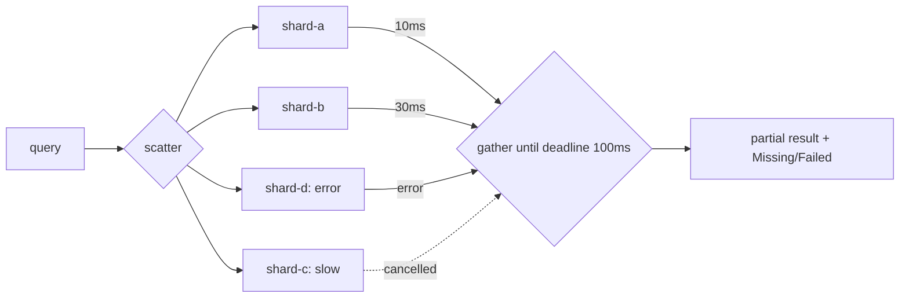

# Scatter-Gather

## Problem

Answering one request may need data from many independent sources: the
shards of a search index, several suppliers' price APIs, many
recommendation models. Calling them one after another makes total latency
the **sum** of their latencies. Calling them in parallel but waiting for all
of them makes it the **max**, so a single slow or dead source decides how
fast you respond.

## Solution

Send the request to every source concurrently (**scatter**). Collect replies
(**gather**) until all have answered, or enough have answered, or a
deadline passes. Return what you have, along with which sources failed or
were too slow, and cancel the stragglers. The caller decides whether partial
results are good enough to show.

## Diagram



## How this implementation works

`Gather[T](ctx, sources, Options{Timeout, Need})` is generic over the result
type.

- It derives one context with the timeout, and a single `defer cancel()`
  aborts every outstanding fetch when `Gather` returns.
- Each source runs in its own goroutine and sends to a channel **buffered
  for every source**, so a straggler that finishes late never blocks. This
  is the classic way to avoid leaking goroutines.
  `TestStragglersAreCancelledAndDontLeak` checks it.
- The gather loop stops when nothing is pending, when `Need` successes have
  arrived (early return for "first k answers"), or when the context is done.
  Go's `select` picks randomly among ready cases, so on deadline it **drains
  results that were already waiting**. Results from sources that aborted
  because of *our* deadline (a context error) are reported as `Missing`,
  not `Failed`.
- `safeFetch` turns a panicking or nil source into an error, so one bad
  source can't crash the request.
- `Result` contains `Responses`, `Failed`, and `Missing` (all sorted, so
  output is deterministic), plus `Complete()`.

## Trade-offs

| Pro | Con |
| --- | --- |
| Latency is bounded by the deadline, not by the slowest source | Answers may be incomplete. Callers and UIs must handle that |
| Failures are isolated per source | Load on the backends is multiplied by the fan-out width |
| `Need` cuts tail latency when k answers are enough | Cancelled work is wasted. Sources must honour cancellation, or they keep running |
| Simple to reason about: one deadline | Picking the deadline is a trade-off between completeness and speed |

As fan-out grows, the chance that *some* source is slow approaches 1. With
100 shards that each have a 1% chance of being slow, about 63% of queries
hit at least one slow shard. That is why deadlines, partial results, and
[hedged requests](../../reliability/hedged-requests) go together.

## When to use / when not to

**Use** it for sharded search, federated queries, price and availability
aggregation, and any read that combines independent sources where a partial
answer has value.

**Avoid** it when the answer is meaningless unless complete, such as a bank
balance or a checkout total. In those cases fail fast instead, or use an
aggregate that waits for all parts, as in the [API gateway](../api-gateway)
aggregation. Also avoid it when sources depend on each other's output.

## Real-world examples

- **Elasticsearch** and **OpenSearch** query every shard and merge the
  results. Their responses report `_shards.failed`, and `timeout` returns
  partial results with `timed_out: true`.
- **Google's web search** fans out to thousands of leaf servers. This is the
  setting of Dean and Barroso's "The Tail at Scale".
- **Apache Camel** and other enterprise-integration frameworks provide
  Scatter-Gather as a named EIP from Hohpe and Woolf.

## Run it

```sh
go run ./patterns/architecture/scatter-gather/example
go test ./patterns/architecture/scatter-gather/
```

## Related patterns

- [Hedged requests](../../reliability/hedged-requests): duplicate slow calls to cut tail latency.
- [Timeout](../../reliability/timeout): the deadline that bounds the gather.
- [Bulkhead](../../reliability/bulkhead): cap concurrent calls per source.
- [Quorum](../../distributed/quorum): "Need k of n" with consistency semantics.
- [API gateway](../api-gateway) and [Backend for Frontend](../backend-for-frontend): all-or-nothing aggregation.
