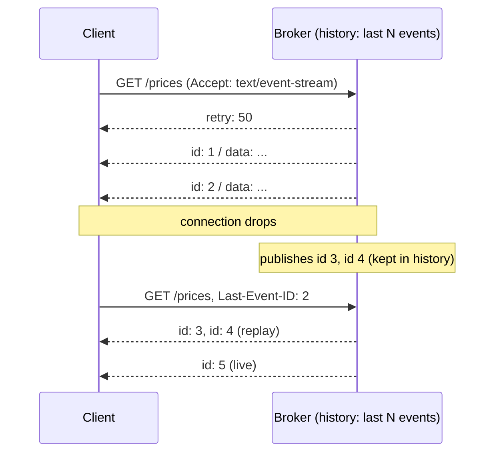

# Server-Sent Events (SSE)

## Problem

Browsers and services often need a live stream of server updates, such as
prices, build logs, notifications, or LLM tokens. Polling is wasteful and
laggy. WebSockets are bidirectional and heavier than needed, need special
proxy support, and give you no built-in way to resume after a disconnect.
Mobile and corporate networks drop long-lived connections all the time, and
any event published during the gap is silently lost.

## Solution

**SSE** is a plain HTTP response with `Content-Type: text/event-stream` that
never ends. The server writes `id:`, `event:`, and `data:` lines, and a blank
line terminates each event. The protocol has resumption built in:

- every event carries an `id`;
- on reconnect, the client sends `Last-Event-ID`;
- the server replays whatever came after that ID from a bounded history, then
  continues live.

`retry:` tells clients how long to wait before reconnecting. Comment lines
(`: ping`) keep idle connections alive through proxies.

## Diagram



## How this implementation works

- `Broker.Publish` assigns a monotonically increasing ID, appends to a
  bounded history, and does a **non-blocking** send to every subscriber. A
  subscriber whose buffer is full is **dropped** (its channel is closed). One
  slow client can't stall the publisher, and the dropped client recovers
  through `Last-Event-ID` replay.
- `Broker.subscribe` takes the replay backlog **and** registers the live
  channel under the same lock. No event can fall between replay and live, so
  there are no gaps and no duplicates.
- If the requested ID is older than the retained history, or newer than
  anything published (for example after a server restart), the broker sends
  an `event: reset` first, so the client knows to refetch full state.
- `Broker.ServeHTTP`:
  - sets SSE headers, including `X-Accel-Buffering: no` for nginx;
  - writes `retry:`, the optional reset, and the backlog;
  - streams live events with `http.ResponseController.Flush`;
  - sends `: ping` heartbeats;
  - stops on client disconnect, on being dropped, or on `Broker.Close()`.
- `writeEvent` splits multi-line data into several `data:` lines and strips
  newlines from the event type, so a payload can't inject extra fields.
- `Client.Subscribe` is a spec-following parser. It handles comments,
  multi-line data, `retry:`, and events without data, which are not
  dispatched. It remembers the last ID and reconnects with `Last-Event-ID`.
  `TestClientReconnectsWithoutLossOrDuplicates` drops the connection with
  `httptest.Server.CloseClientConnections`, publishes during the outage, and
  checks exact delivery.

## Trade-offs

| Pro | Con |
| --- | --- |
| Plain HTTP: works through proxies, load balancers, and HTTP/2 | Server-to-client only. Client messages need separate requests |
| Built-in reconnect and resume with `Last-Event-ID` | Text-only (UTF-8). Binary data must be encoded |
| The browser `EventSource` API needs no library | HTTP/1.1 browsers limit about 6 connections per origin. HTTP/2 multiplexing fixes this |
| Cheap per connection with goroutines | Replay depth is bounded by memory. Beyond it, clients must reset |

Across several server instances, each broker's history is local. Back it with
a shared log (Redis Streams, Kafka) so a client can resume on any instance.
Otherwise you need sticky routing.

## When to use / when not to

**Use** it for one-way live feeds: dashboards, notifications, progress and
log tailing, LLM token streaming, and change feeds to browsers.

**Avoid** it when the client must send frequent messages on the same channel
(games, collaborative editing). Use WebSockets there. Also avoid it for
binary, high-frequency data, and for service-to-service streaming, where
gRPC streams or a message broker are better.

## Choosing a real-time transport

SSE is one of four common ways to get fresh server data to a client. They
differ mostly in who can talk, what each message costs, and what happens when
the connection breaks.

| | Short polling | [Long polling](../long-polling) | SSE | [WebSocket](../websocket-hub) |
| --- | --- | --- | --- | --- |
| **Direction** | client pulls | client pulls, server answers when it has data | server to client | both ways on one connection |
| **Latency** | up to one poll interval | about one round trip after the event | near-immediate | near-immediate |
| **Overhead per message** | a full HTTP request and response, even when nothing changed | a full request and response per delivery (or batch) | a few bytes of `id:`/`data:` framing on an open response | 2 to 14 bytes of frame header |
| **Proxy / firewall friendliness** | best: ordinary short requests | good, but idle timeouts on proxies cap the hold time | good: plain HTTP, but buffering proxies must be told not to buffer | weakest: needs the `Upgrade` handshake to survive every hop; some corporate proxies block it |
| **Reconnect / resume** | nothing to resume; the next poll asks again | the client sends its cursor with each request | built in: automatic reconnect plus `Last-Event-ID` | none in the protocol; the app must add its own sequence numbers and replay |
| **Browser support** | everywhere | everywhere | `EventSource` in every modern browser (not old IE) | every modern browser |
| **Server cost per client** | low between polls, but every poll pays full request cost, so cost scales with clients × poll rate | one parked request per client, re-created after each delivery | one open response (a goroutine and a socket) per client | one open socket plus per-connection read/write state and send buffers |
| **Choose it when** | updates are rare, staleness of seconds is fine, or the client is something you cannot change | you need lower latency than polling but cannot hold streams open, or as a fallback | the feed is one-way: notifications, dashboards, logs, LLM tokens | the client also sends frequently: chat, games, collaborative editing |

A rule of thumb: start with polling when freshness is loose, move to SSE when
the server has to push, and reach for WebSockets only when the client has to
push often too. Whatever you pick, a server that fans out to many clients
needs a per-connection bound on what it buffers (see
[Backpressure](../../distributed/backpressure)) and a way to notice dead
connections (see [Health check](../../reliability/health-check)).

## Real-world examples

- The **OpenAI** and **Anthropic** APIs stream completions as SSE
  (`stream: true`).
- The **Mercure** protocol and the **Wikimedia EventStreams** (recent
  changes) feed are built on SSE with `Last-Event-ID` resumption.
- The browser `EventSource` API is part of the **WHATWG HTML Living
  Standard**.

## Run it

```sh
go run ./patterns/architecture/server-sent-events/example
go test ./patterns/architecture/server-sent-events/
```

## Related patterns

- [Pub-sub](../../distributed/pub-sub): the broker is an in-process pub-sub with a replay log.
- [Backpressure](../../distributed/backpressure): dropping slow subscribers is one backpressure policy.
- [Write-ahead log](../../data/write-ahead-log) and [Event sourcing](../../data/event-sourcing): durable, numbered logs that make replay possible.
- [Fan-out feed](../fan-out-feed): what you'd stream to users in real time.
- [Cursor pagination](../cursor-pagination): `Last-Event-ID` is a cursor into the event stream.
- [Long polling](../long-polling): the request-per-delivery alternative when streams can't stay open.
- [WebSocket hub](../websocket-hub): the bidirectional alternative, with its own fan-out and backpressure needs.
- [Health check](../../reliability/health-check): per-connection heartbeats, the general form of the `: ping` comments.

## Further reading

- Khyati Jha, [High Level System Design Day-13: WebSockets (Part 1)](https://medium.com/high-level-system-desgin-interview-prep/high-level-system-design-day-13-websockets-part-1-0e1a6b4b3cc4), an introduction to WebSockets as a real-time transport
