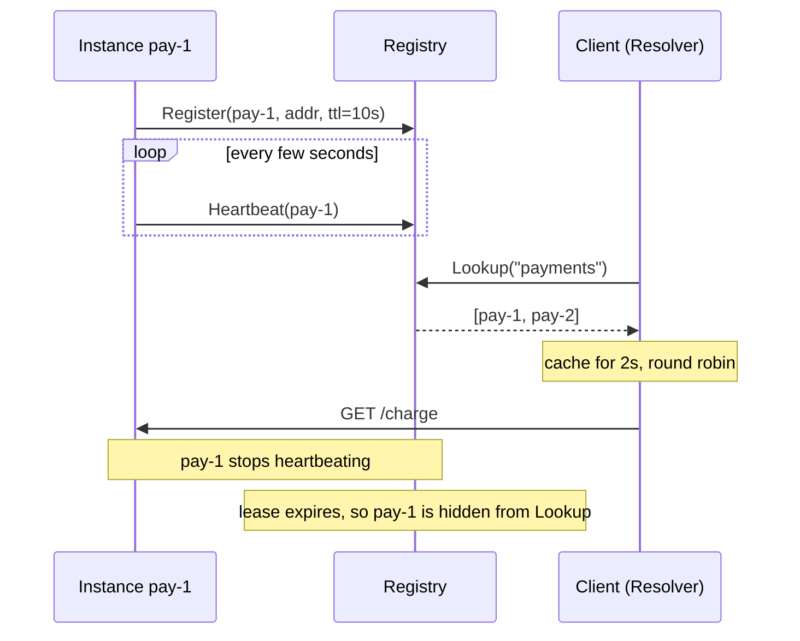

# Service Discovery

## Problem

In a dynamic environment, instances start, crash, autoscale, and move between
hosts all the time, so their IPs and ports keep changing. Hard-coded addresses
or hand-edited config files go stale within minutes. A crashed instance also
never announces that it is gone.

## Solution

Keep a **registry** of live instances. Each instance registers itself with a
**lease (TTL)** and renews it with periodic heartbeats. If the heartbeats stop,
the lease expires and the instance disappears, whether it crashed, hung, or was
partitioned. Graceful shutdowns deregister explicitly.

With **client-side discovery**, callers query the registry, cache the result
briefly, and pick an instance themselves. No central load balancer sits in the
request path.

## Diagram



## How this implementation works

- `Registry.Register` stores an `Instance` with `expiresAt = now + ttl`.
  `Heartbeat` pushes `expiresAt` forward. Once a lease has expired, `Heartbeat`
  returns `ErrUnknownInstance`, and the instance must register again. That way
  a process that restarted with a new address cannot silently revive a stale
  entry.
- `Lookup` filters by `now.Before(expiresAt)`, so an expired instance is
  invisible immediately. `Sweep` only reclaims memory. Correctness never
  depends on it running.
- `Resolver.Pick` is the client side. It caches `Lookup` results for
  `cacheTTL`, rotates through instances round-robin, and **does not cache empty
  results**, so a service that is just starting becomes reachable quickly.
  `Invalidate` lets a caller drop the cache after a connection error.
- The clock is injected (`now func() time.Time`), so tests and the example
  step through lease expiry deterministically.

## Trade-offs

| Pro | Con |
| --- | --- |
| Crashed instances drop out automatically | Detection lag of up to one TTL (plus client cache TTL). Calls in that window fail |
| No load balancer hop. Clients can use smart balancing | Every client language needs a discovery library |
| Registry outage doesn't stop traffic if clients keep their cache | The registry must be highly available and is itself a consensus problem |
| Short TTLs detect failures quickly | Short TTLs mean more heartbeat traffic, and a GC pause can cause false expiry |

Leases detect that a process has stopped, not that it is healthy. Pair them
with real [health checks](../../reliability/health-check).

## When to use / when not to

**Use** it when instances are ephemeral (containers, autoscaling groups) and
you control the clients, or as the backing store for gateways and service
meshes.

**Avoid** a custom registry when your platform already provides one, such as
Kubernetes Services and DNS, or cloud load balancers. For a handful of static
hosts, use config or DNS.

## Real-world examples

- **Netflix Eureka**: a REST registry with heartbeat renewals and client-side
  caching, used with the Ribbon client-side load balancer.
- **HashiCorp Consul**: service catalog with TTL and active health checks, plus
  a DNS interface.
- **etcd** and **ZooKeeper**: leases and ephemeral nodes are used as registries.
  Kubernetes Endpoints are stored in etcd.

## Run it

```sh
go run ./patterns/architecture/service-discovery/example
go test ./patterns/architecture/service-discovery/
```

## Related patterns

- [Load balancing](../load-balancing): what the client does with the instance list.
- [Health check](../../reliability/health-check): the signal that should drive registration.
- [Gossip](../../distributed/gossip): decentralised membership instead of a central registry.
- [Leader election](../../distributed/leader-election): uses the same lease and TTL mechanism.
- [API gateway](../api-gateway): server-side discovery, where the gateway does the lookup.
