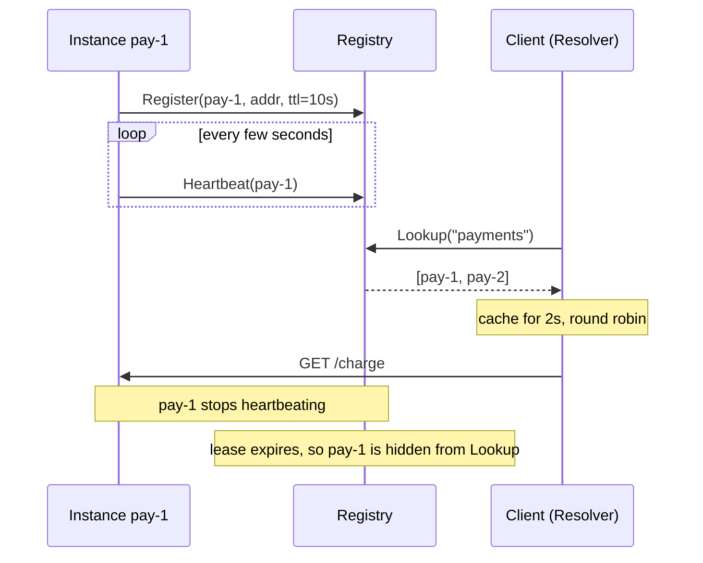
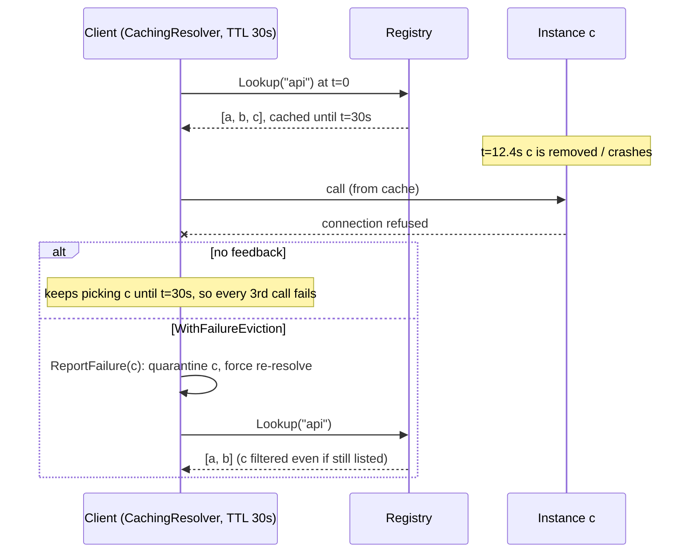

# Service Discovery

## Problem

In a dynamic environment, instances start, crash, autoscale, and move between
hosts all the time, so their IPs and ports keep changing. Hard-coded addresses
or hand-edited config files go stale within minutes. A crashed instance also
never announces that it is gone.

## Solution

Keep a **registry** of live instances. Each instance registers itself with a
**lease (TTL)** and renews it with periodic heartbeats. If the heartbeats stop,
the lease expires and the instance disappears, whether it crashed, hung, or was
partitioned. Graceful shutdowns deregister explicitly.

With **client-side discovery**, callers query the registry, cache the result
briefly, and pick an instance themselves. No central load balancer sits in the
request path.

**The stale-endpoint problem.** Any client-side cache, whether a DNS stub
resolver honouring a record's TTL or a discovery library caching a lookup,
keeps using its answer until it expires. When an instance is removed or
crashes, clients that resolved earlier keep sending to the dead address for
up to one TTL. Clients that ignore TTL keep sending to it until they restart.
Older JVMs cached successful lookups forever when a security manager was
installed, and long-lived connection pools and hard-coded IPs behave the same
way. Mitigations:

- **Short TTLs** bound the stale window, at the cost of more lookups.
- **Negative feedback.** On a connection-level failure, evict that endpoint
  from the cached answer, re-resolve, and quarantine the address briefly, so
  one failed call fixes the cache instead of a TTL's worth of failures.
- **Health-aware resolution.** The source should return only instances that
  are live (leases, health checks), unlike a plain DNS zone that serves a
  record until someone deletes it. A client TTL can never beat the health
  signal behind it.

## Diagram



Stale endpoint, with and without negative feedback:



## How this implementation works

- `Registry.Register` stores an `Instance` with `expiresAt = now + ttl`.
  `Heartbeat` pushes `expiresAt` forward. Once a lease has expired, `Heartbeat`
  returns `ErrUnknownInstance`, and the instance must register again. That way
  a process that restarted with a new address cannot silently revive a stale
  entry.
- `Lookup` filters by `now.Before(expiresAt)`, so an expired instance is
  invisible immediately. `Sweep` only reclaims memory. Correctness never
  depends on it running.
- `Resolver.Pick` is the client side. It caches `Lookup` results for
  `cacheTTL`, rotates through instances round-robin, and **does not cache empty
  results**, so a service that is just starting becomes reachable quickly.
  `Invalidate` lets a caller drop the cache after a connection error.
- The clock is injected (`now func() time.Time`), so tests and the example
  step through lease expiry deterministically.
- `CachingResolver` (`caching.go`) is a DNS-style resolver over any
  `Lookuper`:
  `NewCachingResolver(src, ttl, WithResolverClock(now), WithIgnoreTTL(), WithFailureEviction(quarantine))`.
  `Resolve` serves the cached answer while `now < fetchedAt + ttl`, and
  `Pick` round-robins over it. `ttl` 0 means look up every call.
  `WithIgnoreTTL` keeps the first answer forever, to demonstrate the old-JVM
  failure mode. `ReportFailure(service, inst)` is the negative-feedback hook.
  With eviction on, it quarantines `inst.Addr` for `quarantine`, and forces
  the next `Resolve` to re-query the source and filter that address out.
  Quarantine matters when the source lags. A crashed instance stays in the
  registry until its lease lapses, and without quarantine the forced
  re-resolve would just return it again. If every endpoint is quarantined,
  the full list is returned ("panic mode"): trying a maybe-dead endpoint beats
  failing every call. Without eviction, `ReportFailure` is a no-op, and that
  is the plain-TTL baseline. `Stats()` reports lookups, cache hits, and
  evictions.

  **Simplification.** The TTL is a resolver setting rather than per-record,
  as in real DNS, and there's no negative caching (NXDOMAIN) or
  stale-while-revalidate. The example detects failure on the first call. A
  real client may need a connect timeout first, and must not report
  application errors such as HTTP 500, which don't mean the address is gone.
  The existing `Resolver.Invalidate` is a coarser version of the same
  feedback. It drops the whole cached answer without quarantine, so a lagging
  registry can hand the dead instance straight back.

The example's last step runs 600 calls over 60 simulated seconds (10/s, round
robin over a, b, c). Instance c goes away at t=12.4s. In "scale-in" it
deregisters at once. In "crash" it stops heartbeating, and its 10s lease
lapses at t=22s.

| Client resolver | Errors (scale-in) | Errors (crash) | Lookups |
| --- | --- | --- | --- |
| no cache | 0 | 32 | 600 |
| TTL 1s | 2 | 32 | 60 |
| TTL 5s | 9 | 42 | 12 |
| TTL 30s | 59 | 59 | 2 |
| ignores TTL | 159 | 159 | 1 |
| TTL 30s + evict on failure | 1 | 1 | 3 |
| TTL 5s + evict on failure | 1 | 1 | 13 |

The errors track the stale window: the rest of the current TTL period after
c disappears. Even with no cache, a crash costs about 10s of errors, because
the registry only learns when the lease lapses. The lags add up, too: the
TTL-5s cache refreshed at t=20s still received c and kept it until t=25s.
Evict-on-failure turns all of that into one failed call.

## Trade-offs

| Pro | Con |
| --- | --- |
| Crashed instances drop out automatically | Detection lag of up to one TTL (plus client cache TTL). Calls in that window fail |
| No load balancer hop. Clients can use smart balancing | Every client language needs a discovery library |
| Registry outage doesn't stop traffic if clients keep their cache | The registry must be highly available and is itself a consensus problem |
| Short TTLs detect failures quickly | Short TTLs mean more heartbeat traffic, and a GC pause can cause false expiry |
| Client-side caching cuts registry/DNS load (600 lookups to 2 at TTL 30s) | Cached answers go stale: 59 failed calls after a scale-in at TTL 30s, unless failures evict endpoints |

Leases detect that a process has stopped, not that it is healthy. Pair them
with real [health checks](../../reliability/health-check).

## When to use / when not to

**Use** it when instances are ephemeral (containers, autoscaling groups) and
you control the clients, or as the backing store for gateways and service
meshes.

**Avoid** a custom registry when your platform already provides one, such as
Kubernetes Services and DNS, or cloud load balancers. For a handful of static
hosts, use config or DNS.

## Real-world examples

- **Netflix Eureka**: a REST registry with heartbeat renewals and client-side
  caching, used with the Ribbon client-side load balancer.
- **HashiCorp Consul**: service catalog with TTL and active health checks, plus
  a DNS interface.
- **etcd** and **ZooKeeper**: leases and ephemeral nodes are used as registries.
  Kubernetes Endpoints are stored in etcd.
- **DNS-based discovery** (Kubernetes headless Services, Consul DNS, AWS
  Cloud Map) relies on short TTLs (Consul defaults to 0). The JVM's
  `networkaddress.cache.ttl` is the classic example of a client cache that
  outlives the record. gRPC and Envoy re-resolve on connection failure, and
  Envoy's outlier detection ejects failing hosts, much like
  `WithFailureEviction`.

## Run it

```sh
go run ./patterns/architecture/service-discovery/example
go test ./patterns/architecture/service-discovery/
```

## Related patterns

- [Load balancing](../load-balancing): what the client does with the instance list.
- [Health check](../../reliability/health-check): the signal that should drive registration.
- [Gossip](../../distributed/gossip): decentralised membership instead of a central registry.
- [Leader election](../../distributed/leader-election): uses the same lease and TTL mechanism.
- [API gateway](../api-gateway): server-side discovery, where the gateway does the lookup.
- [Serve stale](../../reliability/serve-stale): the opposite trade. It keeps a stale value on purpose when the source fails.
- [Circuit breaker](../../reliability/circuit-breaker): per-endpoint failure feedback at the call level.

## Further reading

- Khyati Jha, [High Level System Design Day-5: DNS](https://medium.com/high-level-system-desgin-interview-prep/high-level-system-design-day-5-dns-12fdbdf0bcb5): how DNS resolution and TTL-based caching work.
