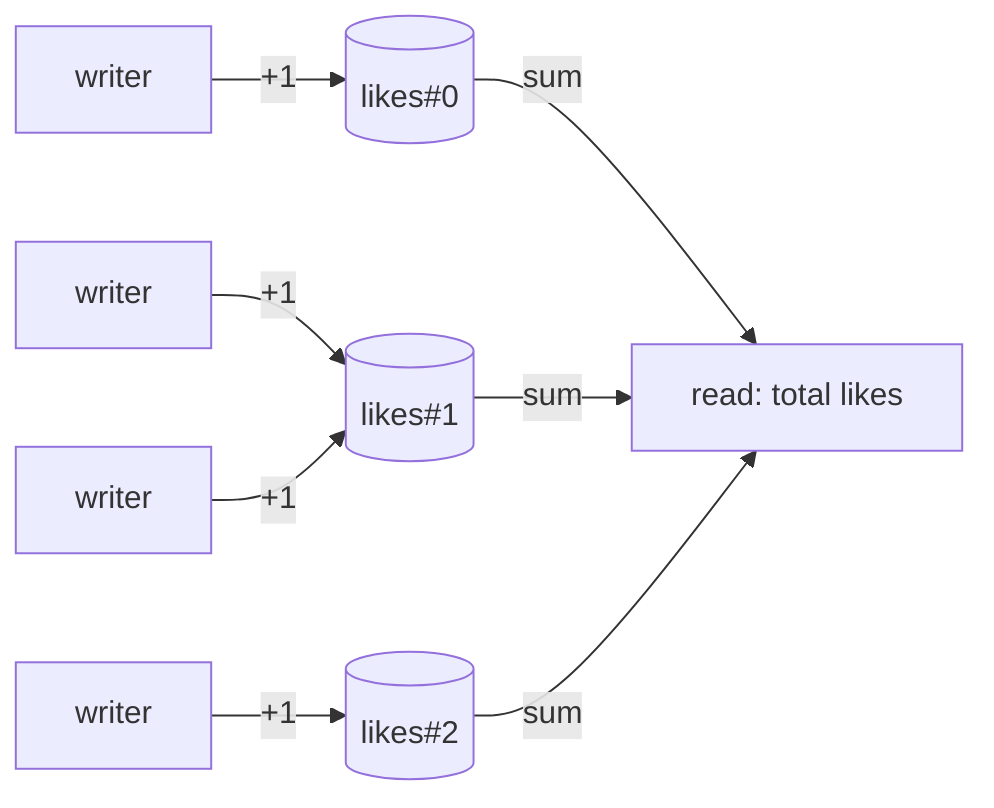

# Sharded Counters

## Problem

A single counter that takes heavy write traffic, such as likes on a viral
post, views of a live video, or an API quota, becomes a hot spot. In a
database, every increment of that one row serialises on its row lock or lands
on one partition, and many stores cap writes per key or document. In memory,
every core fights over the same cache line. Throughput hits a ceiling no
matter how much hardware you add.

## Solution

Split the one logical counter into **N shards**. Each write goes to a random
shard, so writes are spread out and don't contend. A read sums all N shards.
You trade cheap, parallel writes for reads that cost N lookups and are only
approximately consistent while writes are in flight.

## Diagram



## How this implementation works

- `Counter` is the in-process flavour. Each shard is an `atomic.Int64` padded
  to 64 bytes (`paddedInt`), so shards sit on separate cache lines and cores
  don't **false-share**. `Add` picks a shard with `math/rand/v2`'s lock-free
  top-level `IntN`. `Value` sums the shards.
- `Distributed` is the storage flavour. Shards are rows named
  `"<name>#<i>"` in any `RowStore`, which needs only an atomic `Increment` and
  a `Get`. `Value` reads all N rows and fails if any shard can't be read.
  Returning a silently low count would be worse.
- `MemStore` models a database with per-row locks, where each write holds the
  row for `WriteCost`. That makes the contention real. In the example, 100
  increments take about 250ms on 1 shard and about 29ms on 20 shards.
- `TestShardingRaisesWriteThroughput` checks that speedup, and the benchmarks
  compare a single atomic with the padded sharded counter
  (`go test -bench . ./patterns/architecture/sharded-counters/`).

## Trade-offs

| Pro | Con |
| --- | --- |
| Write throughput scales roughly with shard count | Reads cost N lookups. Cache them or roll them up periodically |
| No coordination between writers | Reads during writes are not a point-in-time snapshot |
| Simple. Works on any store with atomic increments | You can't enforce limits exactly ("stop at 100") without reading every shard |
| Shard count can grow (old rows keep their values) | Shrinking means merging rows. Too many shards waste storage and slow reads |

## When to use / when not to

**Use** it for write-heavy, read-tolerant aggregates: likes, views, download
counts, metrics, rough quotas.

**Avoid** it when you need exact, strongly consistent reads tied to the write,
such as inventory you must not oversell or balances. Avoid it too when write
rates are modest enough for one row. For very high-volume analytics, batching
increments in memory and flushing periodically (write-behind) can be cheaper
still.

## Real-world examples

- **Google Cloud Firestore** documents "distributed counters" as the
  recommended workaround for its per-document write rate limit.
- The **Google App Engine** Datastore docs popularised the "sharding counters"
  pattern.
- **DynamoDB** hot-partition guidance recommends write sharding with random
  key suffixes.
- **Java's `LongAdder`** is the in-process equivalent: striped cells, summed
  on read.

## Run it

```sh
go run ./patterns/architecture/sharded-counters/example
go test ./patterns/architecture/sharded-counters/
```

## Related patterns

- [Sharding](../../data/sharding): the same idea applied to whole datasets.
- [Write-behind cache](../../data/write-behind-cache): buffer increments and flush them in batches.
- [Materialized view](../../data/materialized-view): keep a rolled-up total for cheap reads.
- [Consistent hashing](../../data/consistent-hashing): how keys map to partitions.
