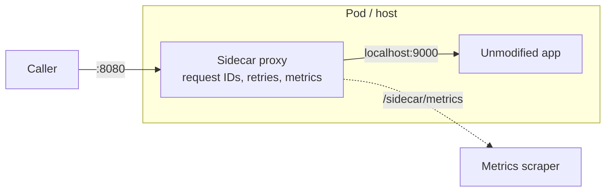

# Sidecar

## Problem

Every service needs the same plumbing: retries, timeouts, metrics, tracing
headers, mTLS, rate limits. Building it into each app means re-implementing it
in every language and framework you run, keeping those implementations in
sync, and redeploying every service to change a retry policy. Some apps can't
be changed at all, such as legacy binaries or third-party software.

## Solution

Deploy a helper process next to each app instance, in the same pod, VM, or
host, sharing its lifecycle and network namespace. All traffic in and out of
the app flows through this **sidecar**, which applies the cross-cutting
behaviour. The app stays unmodified and talks plain HTTP to localhost.
Platform teams upgrade the sidecar on its own schedule.

## Diagram



## How this implementation works

This is an in-process simulation: an `httputil.ReverseProxy` stands in for the
sidecar process. The app under test is a plain `httptest.Server` that has no
idea the sidecar exists.

- `New(target, Config)` builds the proxy. Its `Transport` is a
  `retryTransport` that wraps the real one.
- `Sidecar.ServeHTTP`:
  - answers `MetricsPath` itself, so the request never reaches the app;
  - injects an `X-Request-ID` if the caller didn't send one;
  - times the request with the injected `Now` clock and records the status
    using a small `statusRecorder` wrapper.
- `retryTransport.RoundTrip` retries on transport errors and 502/503/504, but
  **only for idempotent, bodiless requests**. A `POST` might have taken effect
  before the error, and a request body is a stream that the first attempt
  already consumed. Backoff uses `Config.Sleep`, which by default is a timer
  that **stops when the request context is cancelled**, so a client hanging up
  does not leave the sidecar retrying.
- `Snapshot` returns a deep copy of the metrics, so callers can't race the
  live map.

## Trade-offs

| Pro | Con |
| --- | --- |
| Works in any language, including apps you can't modify | An extra hop and process per instance (latency, CPU, memory) |
| Upgrade networking policy without redeploying apps | More moving parts. Startup and shutdown ordering between app and sidecar matter |
| Uniform telemetry and security across the fleet | The app can't see what the sidecar did. Retries can hide problems or multiply load |
| Clear ownership: platform team versus app team | Debugging spans two processes. Config drift between sidecars is possible |

Retries at every layer multiply. Three layers with three attempts each can
turn one request into 27, so budget retries in one place.

## When to use / when not to

**Use** it for polyglot fleets, service meshes, legacy apps you must wrap, or
when a platform team needs to roll out networking or security policy
independently of app releases.

**Avoid** it for a small, single-language system, where a shared library is
simpler and cheaper. Also avoid it for latency-critical paths where an extra
local hop matters, or when the concern really needs app knowledge, such as
business-level retries or idempotency keys.

## Real-world examples

- **Istio** and other service meshes inject an **Envoy** sidecar into every
  Kubernetes pod.
- **Linkerd** runs its own `linkerd2-proxy` sidecar.
- **Dapr** exposes state, pub/sub, and bindings to apps through a sidecar.
- Log shippers such as **Fluent Bit**, run as sidecar containers, are another
  common use.

## Run it

```sh
go run ./patterns/architecture/sidecar/example
go test ./patterns/architecture/sidecar/
```

## Related patterns

- [Retry with backoff](../../reliability/retry-backoff): the retry policy the sidecar applies.
- [Circuit breaker](../../reliability/circuit-breaker) and [Timeout](../../reliability/timeout): other common sidecar features.
- [API gateway](../api-gateway): the same idea at the edge rather than per instance.
- [Strangler fig](../strangler-fig): a proxy in front of a legacy app, used for migration.
