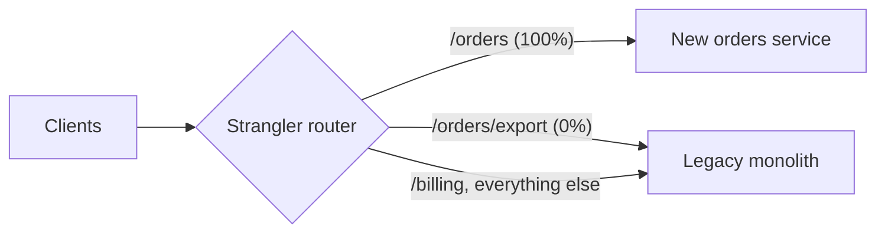

# Strangler Fig

## Problem

You need to replace a legacy system, but a big-bang rewrite is risky. It takes
months, freezes features, and usually ends in one terrifying cutover weekend
with no easy way back. Meanwhile the legacy system keeps serving real users
and keeps changing.

## Solution

Put a routing facade in front of the legacy system. Re-implement one
capability at a time in the new system, and move its traffic over through the
facade. Start with a small percentage and grow it, with instant rollback. The
new system grows around the old one, like a strangler fig around its host
tree, until the legacy system serves nothing and can be switched off.

## Diagram



## How this implementation works

- `NewRouter(legacy, modern, key)` takes two `http.Handler`s. In the example
  these are `httputil` reverse proxies to two loopback servers. With no rules,
  everything goes to legacy.
- `SetRule(Rule{Method, Prefix, Percent})` adds or updates a rule at runtime.
  It is safe while serving traffic, and setting `Percent: 0` is the rollback.
  Rules are kept **most-specific first**: longer prefixes win, and a
  method-specific rule beats an any-method one. So `/orders` at 100% and
  `/orders/export` at 0% work together.
- `Decide` uses `bucket(route, key)`, an FNV hash of the route plus the
  stickiness key (default `X-User-ID`), mod 100. This has three properties the
  tests check:
  - **Sticky:** a user always sees the same backend for a route.
  - **Monotonic:** raising 10% to 50% only adds users. Nobody flips back and
    forth.
  - **Per-route spread:** different routes canary on different users.
- Every response carries `X-Served-By`, and `Counts()` reports totals, so you
  can see the migration progress.

## Trade-offs

| Pro | Con |
| --- | --- |
| Incremental, reversible, low-risk migration | Two systems in production for a long time, which costs more to run and operate |
| Value ships continuously, not after a rewrite | Shared data is the hard part. Both systems may need the same database, or syncing |
| Canary percentages catch regressions early | The facade is a critical new component and a potential bottleneck |
| Rollback is a config change | Migrations stall at 90% easily. The last endpoints are the ugliest |

## When to use / when not to

**Use** it to replace or decompose a large legacy system that must keep
running, especially an HTTP or message-based one where requests can be
intercepted.

**Avoid** it when the old system is small enough to rewrite and swap safely,
or when you can't intercept calls, as with deeply embedded libraries or
batch jobs with no seam. You need a seam to route on.

## Real-world examples

- **Martin Fowler** named the pattern in 2004 (originally "StranglerApplication")
  after the strangler figs he saw in the Queensland rainforest.
- It is the standard approach for monolith-to-microservices migrations in
  **AWS** and **Microsoft Azure** architecture guidance, usually with an API
  gateway or load balancer as the facade.

## Run it

```sh
go run ./patterns/architecture/strangler-fig/example
go test ./patterns/architecture/strangler-fig/
```

## Related patterns

- [API gateway](../api-gateway): the usual place to host the routing facade.
- [Sidecar](../sidecar): another proxy that wraps an app it doesn't change.
- [Transactional outbox](../../distributed/transactional-outbox) and [CQRS](../../data/cqrs): help keep legacy and new data in sync during migration.
- [Circuit breaker](../../reliability/circuit-breaker): fall back to legacy if the new service misbehaves.
