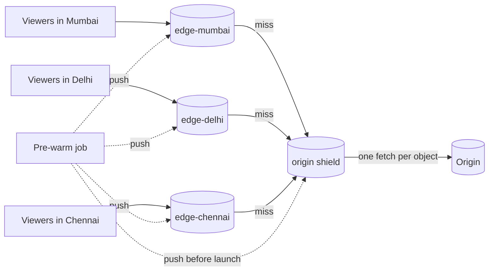

# Tiered Cache (CDN Edges, Origin Shield, Pre-warming)

## Problem

A content service puts caches close to users (CDN edges, one per city or region), and those edges absorb almost all traffic in steady state. Two situations still hurt the origin:

- **Launches.** A new season, a game patch or a live match starts and millions of users request the same new object within seconds. Every edge misses at the same moment. Even if each edge collapses its own viewers into one request, an origin behind 300 edges still gets 300 simultaneous requests for a large object, often while it is under launch load itself.
- **The long tail.** Each edge sees only its own region's traffic. A title that is requested once an hour in each of 50 cities is "cold" at every edge and keeps going to the origin, even though globally it's requested 50 times an hour.

## Solution

Arrange caches in tiers, each fetching its misses from the tier behind it:

1. **Edges** serve users and coalesce concurrent misses for the same key into one fetch.
2. An **origin shield** (a mid-tier or regional cache) sits between all edges and the origin. Edge misses go to the shield, which coalesces them again, so the origin sees **one** request per object no matter how many edges miss. The shield sees everyone's traffic, so it also catches the long tail.
3. **Pre-warming** (push): for predictable launches, fetch the content once and push it into the shield and edges *before* traffic arrives. The first viewer is already a hit.

## Diagram



## How this implementation works

- `Fetcher[V]` is `func(ctx, key) (V, error)`. The origin is a `Fetcher`, and `(*Tier).Fetch` has the same signature, so a topology is plain composition: `shield := NewTier("shield", ttl, origin)`, `edge := NewTier("edge", ttl, shield.Fetch)`. Remove the shield by passing `origin` to the edges.
- Each `Tier` is a TTL cache with request coalescing: the first miss for a key starts a fetch from the parent in a goroutine (detached from that caller's cancellation with `context.WithoutCancel`); concurrent misses wait on the same `call`. Errors are passed to every waiter and never cached.
- `Put` pushes a value into a tier, and `Purge` removes one (a CDN purge, per tier). `Prewarm(ctx, origin, keys, tiers...)` fetches each key from the origin once and pushes it into every tier.
- `Stats` counts hits, misses, shared waiters and parent fetches per tier; `HitRatio` turns them into the metric CDNs report.

**Simplifications.** Real CDNs route each edge to a *specific* shield (often one per region) and may chain several tiers. They also cache partial objects (byte ranges), honour origin `Cache-Control` headers, and use consistent hashing *within* each tier. One shield and whole objects are enough to show the effect.

## Trade-offs

| Pro | Con |
| --- | --- |
| The origin sees about one request per object per shield TTL, regardless of edge count | An extra hop on every edge miss adds latency |
| The shield's pooled traffic lifts the hit ratio for long-tail content | The shield is a concentration point: it must be scaled and replicated, or it becomes the origin's new single point of failure |
| Pre-warming makes launch-time misses zero | Pre-warming needs a schedule and storage; push too much and you evict useful content |
| Edges stay small and cheap; only the shield needs a large cache | Purges must reach every tier, or a stale copy survives in one of them |

## When to use / when not to

**Use a shield** whenever many edges or regional caches front one origin: video and image delivery, software downloads, game patches, API responses cached at the edge, static sites with many PoPs.

**Pre-warm** content whose demand you can predict: scheduled releases, live-event assets, the next episode in a series, app updates.

**Skip it** for highly personalised or uncacheable responses (they pass through every tier for nothing), and for small single-region deployments where one cache layer already sees all the traffic.

## Real-world examples

- **Netflix Open Connect** places appliances inside ISP networks and fills them with tomorrow's popular titles during off-peak hours, which is pre-warming at continental scale.
- **Cloudflare Tiered Cache**, **CloudFront Origin Shield**, **Fastly shielding** and **Akamai tiered distribution** are all this pattern, sold as a product setting.
- **Varnish** and **Nginx** deployments are often stacked as edge and mid-tier caches with request collapsing (`proxy_cache_lock`) at each tier.

## Run it

```sh
go run ./patterns/architecture/tiered-cache/example
go test ./patterns/architecture/tiered-cache/
```

## Related patterns

- [Cache-aside](../../data/cache-aside): the coalescing each tier uses, in a single process
- [Two-tier cache](../../data/two-tier-cache): the same layering inside an application (in-process L1, shared L2)
- [Serve-stale](../../reliability/serve-stale): what edges and shields do when the origin is down
- [Refresh-ahead](../../data/refresh-ahead): keep hot objects from expiring at every edge at once
- [Load shedding](../../reliability/load-shedding): protect the origin if a launch overwhelms the shield anyway

## Further reading

- Arvind Kumar, [Netflix Buffers After a New Season Release](https://codefarm0.medium.com/netflix-buffers-after-a-new-season-release-system-design-deep-dive-on-cdn-architecture-and-cache-51ecc36a64e2), an interview scenario on CDN architecture and pre-warming
- Khyati Jha, CDN series: [Part 1](https://medium.com/high-level-system-desgin-interview-prep/high-level-system-design-day-10-cdn-part-1-fd28b3363b0f), [Part 2](https://medium.com/high-level-system-desgin-interview-prep/high-level-system-design-day-11-cdn-part-2-b6de9b7886cd), [Part 3](https://medium.com/high-level-system-desgin-interview-prep/high-level-system-design-day-12-cdn-part-3-82c1c6eeac3f), which cover pull and push CDNs, origin shields and multi-tier CDNs
