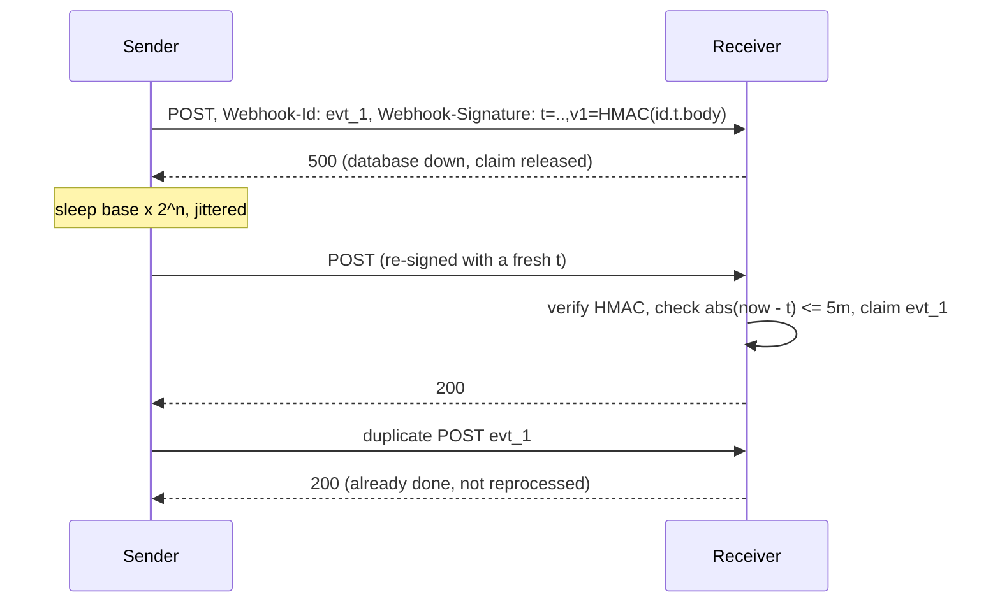

# Webhook Delivery

## Problem

Your platform has to notify customers' servers when something happens, such
as "payment succeeded". Those servers are on the public internet, run by
someone else, and are often down, slow, or misconfigured. Meanwhile the
receivers must answer two questions: "did this really come from you?" and
"have I already handled this?" An attacker who captures one request might
otherwise replay it forever.

## Solution

**Sender**

- Sign each payload with a shared secret: HMAC over `id.timestamp.body`.
- Deliver **at least once**, retrying with capped exponential backoff and
  jitter on network errors, 5xx, 408, and 429.
- Treat other 4xx responses as permanent failures and stop.

**Receiver**

- Verify the signature in constant time.
- Reject timestamps outside a tolerance window, which blocks replays of
  captured requests.
- **Deduplicate by event ID**, so at-least-once delivery becomes
  effectively-once processing.
- Return 2xx only after the event is safely handled.

## Diagram



## How this implementation works

- `Sign` and `Verify`:
  - The **event ID is inside the signed content**. If it weren't, an
    attacker could resend a captured body under a fresh ID and bypass
    deduplication.
  - `Verify` accepts several secrets (**key rotation**) and several `v1=`
    entries.
  - It compares with `hmac.Equal` and checks
    `abs(now - t) <= tolerance` in both directions.
- `Sender.Deliver`:
  - **re-signs every attempt** with a fresh timestamp. Otherwise retries
    sent after the tolerance window would always be rejected;
  - uses `backoff(base, max, attempt)`, which is overflow-safe;
  - applies "full jitter" by default and honours `Retry-After`, capped at
    `MaxDelay`;
  - is fully injectable (`Now`, `Sleep`, `Jitter`), so the tests assert
    exact delay sequences without sleeping;
  - stops sleeping as soon as the context is cancelled.
- `Receiver.ServeHTTP`:
  - limits the body to 1 MiB and verifies it;
  - **claims** the ID before calling `Handle`. A concurrent duplicate
    receives `503 Retry-After: 1`, and a completed duplicate receives `200`;
  - **releases the claim if `Handle` fails**, so the sender's retry can
    process the event.
  - `TestConcurrentDuplicatesProcessedOnce` fires 8 simultaneous deliveries
    of one ID and checks that the handler runs once.
- `Receiver.Forget` prunes old IDs. Keep them **longer than the sender's
  whole retry window**. Retries carry fresh timestamps, so the timestamp
  check alone does not catch a late duplicate.

In production the dedup set lives in a database, ideally written in the same
transaction as the side effect. An in-memory map loses its state on restart.

## Trade-offs

| Pro | Con |
| --- | --- |
| Customers get push notifications without polling | You own a retry queue for thousands of unreliable endpoints |
| HMAC is simple and needs no PKI | Shared secrets must be distributed, stored, and rotated |
| Timestamp tolerance blocks replays | Needs reasonably synced clocks. Too tight a tolerance rejects legitimate slow deliveries |
| At-least-once plus dedup gives effectively-once processing | Ordering is not guaranteed. Receivers must cope with out-of-order events |

Sender-side practice: deliver from a queue rather than the request path
(see [transactional outbox](../../distributed/transactional-outbox)), isolate
slow endpoints with per-endpoint concurrency limits, and disable endpoints
that fail for days.

## When to use / when not to

**Use** webhooks to notify third-party systems about events in your platform,
such as payments, repository pushes, or form submissions.

**Avoid** them for internal service-to-service events, where a message broker
gives you durability, ordering, and replay. Avoid them too when consumers
can't expose a public HTTPS endpoint. Offer an events API they can poll
instead.

## Real-world examples

- **Stripe** signs with a `Stripe-Signature: t=...,v1=...` header (HMAC-SHA256
  over `timestamp.payload`), uses a default 5-minute tolerance, and retries
  with exponential backoff for up to three days.
- **GitHub** sends `X-Hub-Signature-256` (HMAC-SHA256) and a unique
  `X-GitHub-Delivery` ID.
- **Standard Webhooks** (used by Svix and others) specifies `webhook-id`,
  `webhook-timestamp`, and `webhook-signature` headers that sign
  `id.timestamp.body`, as this implementation does.

## Run it

```sh
go run ./patterns/architecture/webhook-delivery/example
go test ./patterns/architecture/webhook-delivery/
```

## Related patterns

- [Retry with backoff](../../reliability/retry-backoff): the sender's retry policy.
- [Idempotency key](../../reliability/idempotency-key): the receiver's dedup is the same idea.
- [Transactional outbox](../../distributed/transactional-outbox): enqueue deliveries reliably alongside the state change.
- [Bulkhead](../../reliability/bulkhead): keep one slow customer endpoint from starving the others.
- [Cursor pagination](../cursor-pagination): HMAC also protects tokens that clients send back.
