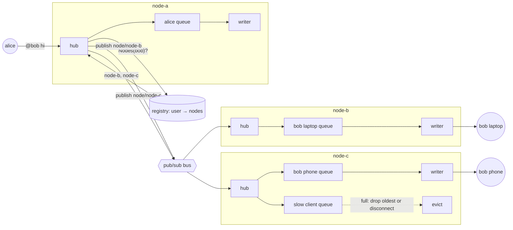

# WebSocket Hub

## Problem

Chat, live location, multiplayer state and collaborative editing need messages
to flow both ways, in real time, to millions of connected users. That brings
problems that plain request/response never has:

- **Connections are pinned.** A WebSocket is one long-lived TCP socket, so it
  lives on exactly one server node. A message for Bob can come from anywhere
  (Alice's node, a backend job, another region), but only the node holding
  Bob's socket can write to it. Bob may also be online from a phone and a
  laptop, on two different nodes.
- **One slow client can stall everyone.** If the code that fans a message out
  writes to each socket in turn, a phone on a bad link with a full TCP window
  blocks the loop, and every user after it waits.
- **Dead connections look alive.** When a NAT box drops its mapping or a
  phone goes to sleep, no FIN arrives. The server's socket stays "open",
  holding memory and a file descriptor, and messages sent to it disappear.

## Solution

A **hub** per node owns the connections that landed on it, and the nodes are
joined by a **bus** and a **connection registry**:

1. **Upgrade.** The client sends an HTTP `GET` with `Upgrade: websocket`. The
   server answers `101 Switching Protocols`, and from then on both sides
   exchange RFC 6455 frames on the same socket.
2. **Register.** The node records "user → this node" in a shared registry
   (Redis, DynamoDB) and keeps the connection in a local map.
3. **Route.** To reach a user, any node looks them up in the registry and
   publishes the message to the topic of each node holding one of their
   connections. The owning node, and only that node, writes it to the socket.
4. **Isolate writers.** Every connection has a bounded send queue drained by
   its own writer goroutine. Delivery only enqueues, so it never waits on a
   socket. When a queue is full, a policy decides: drop the oldest message
   (fine for location or prices, where only the latest matters) or disconnect
   the client (better for chat: it reconnects and fetches history).
5. **Heartbeat.** The server pings every connection on an interval and closes
   the ones that have been silent (no pong, no message) for longer than a
   timeout, then removes them from the registry.

## Diagram



## How this implementation works

- **Handshake.** `Upgrade(w, r)` checks `GET`, an `Upgrade: websocket` token,
  a `Connection: Upgrade` token (`keep-alive, Upgrade` counts),
  `Sec-WebSocket-Version: 13` (otherwise `426` advertising version 13), and a
  `Sec-WebSocket-Key` that decodes to 16 bytes. It takes the socket with
  `http.Hijacker` and writes the `101` with `Sec-WebSocket-Accept = base64(SHA-1(key + GUID))`
  (`AcceptKey`, tested against the RFC's own example). It keeps the hijacked
  `bufio.Reader`, which may already hold the client's first frames.
  `Dial(ctx, "ws://…")` is the client side. It sends a random key, checks the
  accept value, and masks every frame it sends.
- **Framing.** `AppendFrame`, `WriteFrame` and `ReadFrame` handle FIN, the
  opcodes, and the shortest length form: 7-bit up to 125, 16-bit up to 65535,
  64-bit beyond. They also handle the 4-byte XOR mask. `ReadFrame` rejects
  set RSV bits (no extension was negotiated), reserved opcodes, non-minimal
  lengths, a 64-bit length with the top bit set, fragmented control frames,
  and control payloads over 125 bytes. It also checks the size limit
  *before* allocating.
- **Conn.** `ReadMessage` reassembles continuation frames, with pings allowed
  between fragments, and caps the reassembled size too. It checks that text
  is valid UTF-8 and answers pings with pongs. On a protocol violation it
  sends a close frame with the right code (1002 protocol, 1007 bad payload,
  1009 too big) before dropping the socket. A server-side `Conn` rejects
  unmasked client frames, and a client-side one rejects masked server frames.
  `CloseHandshake(code, reason)` sends a close frame. When the peer's close
  arrives, it is echoed if this side hasn't sent one, and the TCP connection
  closes. If no reply comes, the socket is dropped after a second. Writes go
  through one mutex, so the read loop (pongs, close echoes) and the writer
  goroutine can share a connection.
- **Hub.** `New(node, opts...)` returns one node. `ServeHTTP` authenticates
  the user (`WithAuth`, by default a `?user=` query parameter), upgrades,
  and calls `Register(user, conn)`. Register returns a connection ID like
  `node-a/17` and starts a read goroutine and a writer goroutine. The writer
  pops **one message at a time**, so while it is blocked on a full socket the
  queue still has its whole capacity. The queue overflowing is what tells you
  a client is stuck. `WithQueueSize` and `WithSlowPolicy(DropOldest | Disconnect)`
  set the policy. `WithWriteTimeout` bounds each socket write, so a writer
  never stays stuck forever under `DropOldest`.
- **Heartbeat.** `Heartbeat()` is one sweep. Connections silent for longer
  than the pong timeout are closed, and the rest get a ping. Any frame
  counts as a sign of life, pong or message. `Run(ctx)` calls it on a real
  ticker every ping interval. Tests and the example call it directly with
  `WithClock(fake.Now)`, so "30 seconds of silence" takes no real time.
  `WithHeartbeat` refuses a timeout no longer than the interval, which would
  cut healthy clients off.
- **Cluster.** `NewCluster()` holds a [pub-sub](../../distributed/pub-sub)
  broker and a `Registry` that counts connections per (user, node). The
  count matters: a user with two devices on node-b stays registered when one
  disconnects. Each hub subscribes to `node/<name>` and `broadcast`.
  `SendToUser` delivers locally and publishes to every other node holding
  the user. It returns the number of nodes it routed to, or `ErrUserOffline`.
  `Broadcast` delivers locally and publishes once. Each node skips its own
  broadcast when it comes back from the bus.
- `Stats()` counts accepted, received, enqueued, written, forwarded,
  from-bus, dropped, slow and dead evictions, pings, pongs and bus drops. The
  tests use `Written` to prove that only the owning node writes to a socket.

**Simplification.**
- No extensions (`permessage-deflate`), no subprotocol negotiation
  (`Sec-WebSocket-Protocol`), no `Origin` check, and no TLS (`wss://`). In
  production TLS usually ends at the load balancer.
- Outgoing messages are always one unfragmented text frame.
- The bus is in-process, so it never loses a message except by overflowing a
  node's buffer, which is counted in `BusDropped`. Redis pub/sub, by
  contrast, is fire-and-forget and loses messages during a network blip.
  Chat systems therefore also write messages to a durable store and let
  clients fetch what they missed after reconnecting.
- The registry has no leases. If a node crashes, its entries stay until
  someone cleans them up. Real registries use TTLs refreshed by the
  heartbeat (see [presence](../presence)).
- Authentication is a query parameter standing in for a signed token.

## Trade-offs

| Pro | Con |
| --- | --- |
| Full duplex with tiny per-message overhead (2 to 14 bytes of header) | Stateful: every connection is pinned to a node, so deploys and scale-in must drain connections |
| A message reaches a user on any node, and all their devices | An extra hop through the bus and a registry lookup for every message |
| A slow client costs its own queue, not everyone's latency | A bounded queue means dropping or disconnecting: you must pick which, per message type |
| The heartbeat finds dead sockets the OS never reports | Pings cost battery and bandwidth on mobile, and detection lags by up to interval + timeout |
| No polling: the server pushes the moment something happens | Needs L7 load balancers and proxies that understand `Upgrade`, and long idle timeouts |

**WebSocket vs SSE vs long polling.** [Server-sent events](../server-sent-events)
are plain HTTP, one way (server to client), and resumable through
`Last-Event-ID`. Choose them when clients mostly listen. [Long polling](../long-polling)
works through anything that speaks HTTP, but it pays a request per message
batch and a round trip of latency after each one. WebSockets win when both
sides talk often (chat, games, live cursors) or the data is binary. Unlike
SSE they have no built-in resume, so the application must add sequence
numbers and catch-up.

**Load balancing.** The upgrade request is ordinary HTTP, so an L7 load
balancer (nginx, Envoy, ALB) can route it. It must pass `Upgrade` and
`Connection` through, and its idle timeout must be longer than the ping
interval, or it will cut quiet connections itself. Once upgraded, the
connection is sticky by nature: every frame goes to the same node. Sticky
sessions are only a separate concern for fallbacks such as Socket.IO's
long polling, where each poll is a new request. Prefer least-connections
over round-robin ([load balancing](../load-balancing)): connections live for
hours, so a node added during a deploy starts empty and round-robin never
evens out the load.

**Connection limits per node.** Each connection costs:
- a file descriptor (raise `ulimit -n` and `fs.file-max`);
- kernel socket buffers, which take tens to hundreds of KiB when full. In
  the example a client that stopped reading absorbed about 540 KiB before
  the hub noticed;
- here, two goroutines (a few KiB of stack each), the send queue, and a
  `bufio.Reader`.

That is why gateways cap the queue length *and* the message size, shrink
socket buffers, and use event-loop designs (epoll with a few goroutines)
once a node holds hundreds of thousands of connections. A single client IP
also runs out of ephemeral ports at about 64k connections per server
address, which matters for load-testing rigs and proxies.

## When to use / when not to

**Use it** for two-way, low-latency traffic to many users: chat and
presence, live location (riders, deliveries), multiplayer games,
collaborative editing, trading UIs, and notification gateways for mobile
apps that are in the foreground.

**Don't use it** when updates flow one way and are infrequent. SSE or plain
polling is simpler, cacheable and stateless. Don't use it for
service-to-service streaming (use gRPC streams or a message broker), or for
apps in the background on mobile, where the OS kills sockets anyway and
push notifications (APNs/FCM) are the channel.

## Real-world examples

- **Slack** and **Discord** run gateway fleets that hold the WebSocket
  connections and fan out events from backend services. Discord's gateway
  uses heartbeats with an interval set by the server, plus session resume
  after a reconnect. Slack routes messages through channel servers to the
  gateways holding the members' sockets.
- **WhatsApp** keeps each phone connected to one chat server (originally
  Erlang/FreeBSD, famously around two million connections per box). A
  message is routed to the server holding the recipient's connection, or
  stored for later if they are offline.
- **Socket.IO adapters** (Redis, Postgres, cluster) broadcast across nodes
  with pub/sub exactly as `Broadcast` does here. The Redis adapter
  publishes each emit and every node delivers to its local sockets.
- **AWS API Gateway WebSocket APIs** give every connection a
  `connectionId`. Backends store user → connectionId in DynamoDB (the
  registry) and push with `POST @connections/{id}`. This is the same split
  as `Register`'s connection IDs, with the gateway as the owning node.

## Run it

```sh
go run ./patterns/architecture/websocket-hub/example
go test ./patterns/architecture/websocket-hub/
```

The example runs 3 nodes on loopback with 205 connections: 200 users, alice,
bob on two nodes, a client that never reads, and one that never answers
pings. One run printed:

- Chat: alice on node-a reached both of bob's devices (node-b and node-c) in
  about 1 to 2.5 ms. Socket writes were `a=0 b=1 c=1`.
- Broadcast: a broadcast from node-b was read by 204 of 205 connections.
  The one that never reads has its copy sitting in a socket buffer.
- Slow client: with a 16-slot queue and the `disconnect` policy, it was
  evicted at update 152 of 200 (4 KiB each). The kernel socket buffers on
  both ends absorbed about 540 KiB before the queue started to fill. The 30
  other watchers got all 6000 deliveries, with p50 about 160 µs and p99
  about 1 ms. Their p50 was about the same before and after the eviction (155 vs 158 µs).
- Heartbeat: on a fake clock, the client that stopped answering pings was
  removed at +30 s, and the registry forgot it.

Latencies vary from run to run, and the eviction point depends on the OS's
loopback buffer sizes (152 on macOS here). The tests avoid both
dependencies. They use `net.Pipe`, which has no buffer, as a perfectly stuck
client, and a fake clock for the heartbeat.

## Related patterns

- [Pub-sub](../../distributed/pub-sub): the bus between nodes, used directly by this package.
- [Backpressure](../../distributed/backpressure): bounded per-connection queues with drop-oldest or disconnect are backpressure policies at the edge.
- [Health check](../../reliability/health-check): the ping/pong heartbeat is a health check run by the server against every client.
- [Presence](../presence): the connection registry plus heartbeats, with TTLs, is how "online" status is built.
- [Server-sent events](../server-sent-events) and [Long polling](../long-polling): the one-way and lowest-common-denominator alternatives.
- [Load balancing](../load-balancing): least-connections keeps long-lived connections spread out.

## Further reading

- RFC 6455, *The WebSocket Protocol*: the handshake, framing, masking and closing rules implemented here.
- Khyati Jha, [High-Level System Design Day-13: WebSockets (Part 1)](https://medium.com/high-level-system-desgin-interview-prep/high-level-system-design-day-13-websockets-part-1-0e1a6b4b3cc4): the basics, from the HTTP upgrade to persistent, full-duplex connections, and how they compare with polling.
- Khyati Jha, [Day-14: WebSockets (Part 2)](https://medium.com/high-level-system-desgin-interview-prep/high-level-system-design-day-14-websockets-part-2-6690efe31651): heartbeats and detecting dead connections.
- Khyati Jha, [Day-15: WebSockets (Part 3)](https://medium.com/high-level-system-desgin-interview-prep/high-level-system-design-day-15-websockets-part-3-5e3156e7c356): the connection registry and presence across many servers.
- Khyati Jha, [Day-16: WebSockets (Part 4)](https://medium.com/high-level-system-desgin-interview-prep/high-level-system-design-day-16-websockets-part-4-fb945fae6297): backpressure and dealing with slow consumers.
- Khyati Jha, [Day-17: WebSockets (Part 5)](https://medium.com/high-level-system-desgin-interview-prep/addhigh-level-system-design-day-17-websockets-part-5-fea1631aaaa2): fanning messages out across nodes with pub/sub.
- Arvind Kumar, [Swiggy Shows Wrong Rider Location](https://codefarm0.medium.com/swiggy-shows-wrong-rider-location-system-design-deep-dive-on-real-time-gps-tracking-and-eventual-b49e5f18fccd): real-time GPS tracking and eventual consistency, a deep dive into why live location goes stale or wrong and how to design for it.
