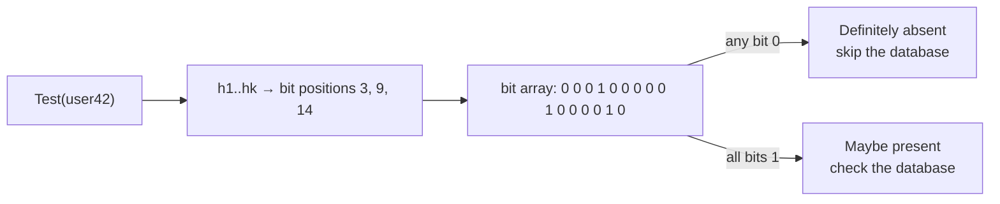

# Bloom Filter

## Problem

You need to ask "have I seen this key?" millions of times a second: is this username taken, is this URL already crawled, does this SSTable contain this key, is this password in a breach list. Most answers are "no". Keeping the full set in memory is too expensive, and asking the database or disk each time is too slow.

## Solution

A Bloom filter is a bit array of `m` bits plus `k` hash functions:

- **Add(x):** set the `k` bits `h_1(x) … h_k(x)`.
- **Test(x):** if any of those bits is 0, `x` is **definitely not** in the set. If all are 1, it is **probably** in the set.

There are no false negatives. False positives happen when other items happen to have set all `k` bits. For `n` items and a target false-positive rate `p`, the optimal parameters are

```
m = -n · ln(p) / (ln 2)²      ≈ 9.6 bits per item for p = 1%
k = (m / n) · ln 2            ≈ 7 hash functions for p = 1%
```

Each factor-of-10 improvement in `p` costs only about 4.8 more bits per item, whatever the size of the items.

## Diagram



## How this implementation works

- `New(n, p)` validates its input and sizes the filter with `OptimalParams`. `NewWithParams(m, k)` gives full control, and it refuses `m = 0` and absurdly large sizes rather than panicking or exhausting memory.
- `hashes` makes **one** FNV-1a pass and derives a second hash with a splitmix64 mix, forced odd. `Add` and `Test` probe `(h1 + i·h2) mod m` for `i = 0..k-1`. This is the Kirsch–Mitzenmacher double-hashing technique, which keeps the asymptotic false-positive rate of k independent hashes.
- Bits are packed into `[]uint64`. An `RWMutex` makes the filter safe for concurrent `Add` and `Test`.
- `EstimatedFPR()` computes `(1 - e^(-kn/m))^k` from the actual insert count, so you can alert when a filter is overfilled.
- The tests **measure** the real false-positive rate for p = 10%, 1%, and 0.1% by probing 100,000 keys that were never inserted, and require it to be within 0.5p to 1.5p of the target. They also check for zero false negatives and that the rate blows up when the filter is overfilled.

## Trade-offs

| Pro | Con |
| --- | --- |
| Tiny: about 10 bits per item at 1%, whatever the key size | False positives. The "maybe" answers still need the real check |
| O(k) add and test, cache-friendly | No deletion. Clearing bits would create false negatives (use a counting or cuckoo filter) |
| Never a false negative | Must be sized up front. Overfilling quickly destroys accuracy |
| Filters can be merged with bitwise OR (same m, k) | Can't list or count its members |

## When to use / when not to

**Use it** to skip expensive lookups for keys that are usually absent: LSM-tree SSTable reads, cache-penetration guards, crawler URL dedup, "already recommended" checks, distributed joins (send a filter instead of the key set).

**Avoid it** when false positives are unacceptable and there's no fallback check, when you need deletes (use a cuckoo filter), or when the set is small enough to store exactly.

## Real-world examples

- **RocksDB**, **LevelDB**, **Apache Cassandra**, and **HBase** keep a Bloom filter per SSTable/HFile, so a point read skips files that can't contain the key.
- **Google Chrome** once used a Bloom filter for its Safe Browsing list of malicious URLs.
- **Bitcoin** SPV clients used Bloom filters (BIP 37) to request only relevant transactions.
- **Redis** offers Bloom filters through the RedisBloom module.

## Run it

```sh
go run ./patterns/data/bloom-filter/example
go test ./patterns/data/bloom-filter/
```

## Related patterns

- [LSM tree](../lsm-tree): the classic consumer, one filter per immutable segment
- [Cache-aside](../cache-aside): a filter in front of the cache stops lookups for keys that don't exist
- [Sharding](../sharding): send a filter instead of the key list for cross-shard joins
- [Gossip](../../distributed/gossip): compact set summaries are a common gossip payload
