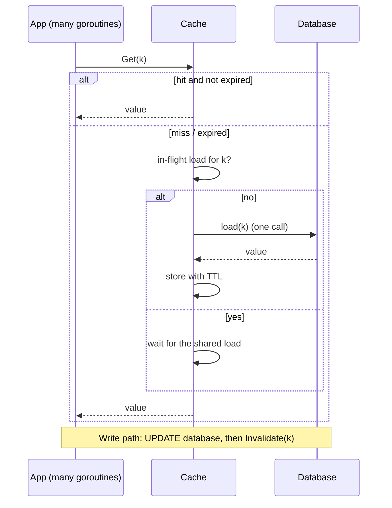

# Cache-Aside (Lazy Loading)

## Problem

Your database serves the same hot rows over and over. Reads are slow and expensive, and the database becomes the bottleneck. You want a cache, but you don't want the cache to be in the write path or to need to know about every table.

Naive caching brings two failure modes of its own:

- **Stale data forever.** If an invalidation is missed, the cache serves the old value indefinitely.
- **Cache stampede (thundering herd).** When a hot key expires, hundreds of concurrent requests miss at the same moment and all hit the database together.

## Solution

The application manages the cache explicitly:

1. **Read:** look in the cache. On a hit, return it. On a miss, load from the database, store the result in the cache with a TTL, and return it.
2. **Write:** write to the database, then **invalidate** (delete) the cache entry. The next read repopulates it.

To prevent stampedes, concurrent misses for the same key are **coalesced**: the first miss starts a load, and everyone else waits for that same result (the idea behind Go's `singleflight`).

## Diagram



## How this implementation works

- `New(loader, ttl, opts...)` builds a `Cache[K, V]`. `WithClock` injects a clock so tests can step through TTL expiry with no sleeping.
- `Get` checks `entries` under a mutex. On a miss it looks in `inflight`: if a `call` already exists for that key, the caller waits on its `done` channel. If not, it registers a new `call` and starts `doLoad` in a goroutine.
- The shared load runs with `context.WithoutCancel`. If the first caller gives up, the load still finishes for everyone else. Each caller's own `ctx` still limits how long that caller waits.
- Errors are passed to every waiter but **never cached**, so a database blip doesn't become a cached failure.
- `Invalidate` deletes the entry and marks any in-flight load as `stale`. That closes a classic race: a load that started before a write must not cache the pre-write value after the write's invalidation.
- `Stats` exposes hits, misses, loads, and shared waiters so you can watch the dedup working.
- **Negative caching** (`WithNegativeTTL`): when the loader returns `ErrNotFound` (or wraps it), the miss itself is cached for a short TTL. Without it, lookups of keys that don't exist (deleted items, mistyped URLs, scrapers enumerating IDs) bypass the cache entirely and every one of them hits the database. Other errors are still never cached, and `Invalidate` clears a cached miss when the key is created.
- **TTL jitter** (`WithTTLJitter`): each entry's TTL is shortened by a random fraction, so keys loaded together (after a deploy or a warm-up) don't all expire in the same second. [Refresh-ahead](../refresh-ahead) covers this, and probabilistic early refresh, in depth.

## Trade-offs

| Pro | Con |
| --- | --- |
| Only data that is actually read gets cached | The first read of every key (and every read after expiry) pays the full miss latency |
| The cache is optional: if it fails, reads fall through to the DB | Read and write paths can race. Invalidation plus TTL bounds staleness but doesn't eliminate it |
| Works with any data source, and the cache needs no schema knowledge | Every caller must follow the protocol (invalidate after write). One that forgets causes staleness |
| Request coalescing keeps the DB load at about 1 query per key per TTL | Waiters are tied to one load. A slow load slows every waiter |
| Negative caching shields the DB from lookups of missing keys | A key created after a cached miss stays invisible for the negative TTL unless the writer invalidates it |

## When to use / when not to

**Use it** for read-heavy workloads where some staleness is acceptable: user profiles, product catalogues, configuration, rendered fragments.

**Avoid it** when reads must always see the latest write (use the database, or [write-through](../write-through-cache)), when the working set is too large or uniformly random to get a useful hit rate, or when write volume is so high that entries are invalidated before they are ever read again.

## Real-world examples

- The canonical way applications use **Memcached** and **Redis** in front of relational databases (AWS's ElastiCache documentation calls this strategy "lazy loading").
- Go's `golang.org/x/sync/singleflight` package exists for exactly this request-coalescing problem. It came from **groupcache**, which uses it to dedupe concurrent cache fills.
- Facebook's "Scaling Memcache at Facebook" paper (NSDI 2013) describes demand-filled look-aside caching with delete-on-write, and *leases* to prevent stampedes and stale sets.

## Run it

```sh
go run ./patterns/data/cache-aside/example
go test ./patterns/data/cache-aside/
```

## Related patterns

- [Refresh-ahead](../refresh-ahead): TTL jitter and early refresh, so hot keys never miss
- [Cache eviction](../cache-eviction): what to drop when a bounded cache is full
- [Two-tier cache](../two-tier-cache): an in-process L1 in front of a shared cache, for hot keys
- [Write-through cache](../write-through-cache): keep the cache updated on every write instead of invalidating
- [Write-behind cache](../write-behind-cache): absorb writes in the cache and flush them asynchronously
- [Read replicas](../read-replicas): another way to scale reads, with replication lag instead of TTL staleness
- [Circuit breaker](../../reliability/circuit-breaker) and [fallback](../../reliability/fallback): what to do when the loader's backend is down
- [Load shedding](../../reliability/load-shedding): the other defence against a herd of requests

## Further reading

- Arvind Kumar, [Redis Cache Causes Production Outage](https://codefarm0.medium.com/redis-cache-causes-production-outage-system-design-deep-dive-on-cache-stampede-ttl-jitter-and-0e44d9366c82), an interview scenario on stampedes, TTL jitter and request coalescing
- Khyati Jha, [High Level System Design Day-8: Caching (Part 3)](https://medium.com/high-level-system-desgin-interview-prep/high-level-system-design-day-8-caching-part-3-e3c7a27b7235), which covers negative caching and stampede remedies
