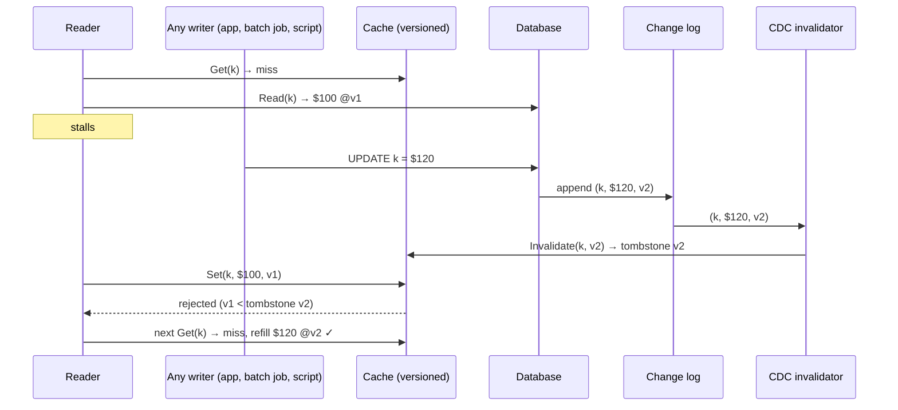

# CDC Cache Invalidation

## Problem

[Cache-aside](../cache-aside) usually invalidates from application code: "update the database, then delete the cache key". That rule has two weak spots:

- **It only covers writers that know about the cache.** An admin script, a nightly batch job, another service sharing the table, a backfill or a schema migration all write the database directly. Their keys stay stale until the TTL expires, and nothing tells you which ones.
- **It races.** A reader misses, reads version 1 from the database, and stalls (GC pause, slow network). A writer commits version 2 and deletes the key. The reader wakes up and stores version 1. The delete has already happened, so nothing will remove the stale value: it is served until its TTL runs out.

Making every writer remember to invalidate doesn't fix the race, and lowering the TTL only shortens the damage while costing hit rate.

## Solution

Take invalidation away from the writers and give it to the database's own commit log, and make the cache refuse to go backwards:

1. **Tail the change log (CDC).** Every committed change already goes, in commit order, into the database's log (MySQL binlog, Postgres WAL). An invalidator consumes that log and deletes (or overwrites) each changed key. Any write, from any path, is seen.
2. **Versioned entries.** Each cache entry carries the row version it was read at (here, the commit's log sequence number). `Set` is a compare-and-set: it is rejected if the cache already holds that version or a newer one.
3. **Tombstones.** An invalidation does not just delete the key. It leaves a short-lived tombstone that records the version that caused it. A late `Set` of an older version hits the tombstone and is rejected. That closes the delete-then-stale-set race.
4. **Idempotent, at-least-once delivery.** Change streams redeliver after restarts. Because every operation compares versions, a duplicate or replayed change can never move an entry to an older version, so the invalidator needs no exactly-once machinery.
5. **Measure lag.** The invalidator reports how many changes it has not applied and how long ago the oldest of them committed. That age is the longest any reader can currently be served a stale value.

## Diagram



## How this implementation works

- `NewDB` is an in-memory table. `Write` and `Delete` change the row and append a `Change{Version, Key, Value, Deleted, CommittedAt}` under the same lock, so the log is the commit order and `Version` is a log sequence number. `ChangesSince(after, limit)` is the CDC feed.
- `NewCache(ttl, opts...)` stores `{value, version, tombstone, expires}`. `Set(key, value, version)` is accepted if the key is absent, holds an older value, or holds a tombstone whose version is not newer (a tombstone at v blocks anything older than v; the row as of v itself may be filled). `Invalidate(key, version)` writes a tombstone unless the cache already holds that version or a newer one, in which case it is a no-op. `ReadThrough(db, key)` is the cache-aside read path in one call. `WithoutVersionCheck()` turns all of this off, giving the plain cache used as the "before" in the example.
- `NewInvalidator(db, cache, opts...)` keeps a position (the last version applied). `Poll` applies up to `WithBatchSize(n)` changes. `WithMode(ModeDelete)` (default) tombstones changed keys. `ModeUpdate` writes the new value at its version so readers keep hitting (deletions still tombstone). `Rewind(v)` replays from an earlier offset, as after a consumer restart. `Lag()` returns `Events` behind and `Time` since the oldest unapplied commit. `Stats` counts applied and redelivered changes.
- `Scheduler` runs scripted steps strictly in order and prints a trace. The race is reproduced by choosing the order of calls, not by hoping goroutines interleave badly, so the test and the example are identical on every run. A separate `-race` test does run real writers, readers and the invalidator concurrently and checks that the cache converges to the database.

**Simplification.** The database, log and cache live in one process and the log is a slice. In production the log is the database's replication stream read by a connector (Debezium, a logical replication slot), shipped through Kafka or Kinesis, and the cache is Redis or Memcached, where the version check must run server-side (a Lua script, `SET` guarded by a stored version, or memcached's CAS). Tombstones expire after `WithTombstoneTTL` (default: the cache TTL): a fill slower than that can still slip in, so it must comfortably exceed your slowest read-then-set. The invalidator here never loses its position. A real one checkpoints offsets and, after a crash, replays from the last checkpoint, which is exactly the redelivery the versions make harmless.

## Trade-offs

| Pro | Con |
| --- | --- |
| Every committed write invalidates, whoever made it: batch jobs, scripts, migrations, other services | Another moving part: a connector, a log or topic, a consumer, its offsets and its monitoring |
| Versioned sets and tombstones close the delete-then-stale-set race instead of shrinking it | Every cached value must carry its row version, and the cache must do an atomic compare-and-set |
| At-least-once delivery is fine: duplicates and replays are no-ops | Staleness is now bounded by consumer lag rather than zero: a slow or stuck invalidator means stale reads |
| Writers get simpler: no cache code in the write path | The change log speaks in rows, so derived keys (lists, aggregates, rendered pages) need a mapping from row to keys |
| Update mode keeps hit rate after bulk changes | Update mode writes keys nobody may read again, and a bulk job turns into a burst of cache writes |

## When to use / when not to

**Use it** when more than one path writes the data behind a cache (several services, admin tools, ETL, backfills), when you have seen stale-forever bugs from missed or racing invalidations, or when you already run CDC for search indexes, [materialized views](../materialized-view) or analytics and can add a consumer.

**Don't use it** when one service owns the data and a short TTL is acceptable (plain [cache-aside](../cache-aside) is simpler), when reads must see the writer's own update immediately (CDC is asynchronous: invalidate synchronously too, or read your own writes from the database), or when your database can't expose an ordered change stream.

## Real-world examples

- **Debezium** reads the MySQL binlog or Postgres logical decoding stream and publishes row changes to **Kafka**; a consumer deletes or refreshes the matching Redis keys. This is a common way to keep caches and search indexes in sync.
- **Facebook** ran **McSqueal**, a daemon that read MySQL commit logs and issued memcache deletes, so invalidations survived application crashes and covered every writer. Its memcache **leases** solved the stale-set race: a miss hands the reader a token, and a delete invalidates it, so the late set is refused ("Scaling Memcache at Facebook", NSDI 2013). Tombstone versions here do the same job.
- **DynamoDB Streams**, **MongoDB change streams** and **Cosmos DB change feed** give the same ordered per-item change feed, commonly used to invalidate DAX, ElastiCache or application caches.

## Run it

```sh
go run ./patterns/data/cdc-cache-invalidation/example
go test ./patterns/data/cdc-cache-invalidation/
```

What the example prints:

1. **The race.** With a plain cache the reader's late `Set` is accepted, and 60 of 120 one-second reads serve the old price: exactly the 60s TTL. With versioned sets the `Set` hits tombstone v2 and is rejected: 0 of 120.
2. **A batch job** reprices 1,000 of 5,000 cached SKUs directly in the database while the app updates 50 through its own code. App-driven invalidation leaves **1,000** stale keys. The CDC invalidator applies all 1,050 changes and leaves **0**. Delete mode then needs 1,050 database reads to refill; update mode needs none.
3. **Lag.** With 100 writes/s and 1,000 reads/s, polling every 100ms gives a maximum lag of 90ms and the oldest stale read was 89ms old. Polling every second gives 990ms and 985ms. A consumer capped at 50 changes/s falls behind: lag reaches 5.04s, the oldest stale read 4.85s, and 500 changes are still unapplied at the end. In every case the oldest stale read is within the lag metric.

## Related patterns

- [Cache-aside](../cache-aside): the read path used here, and the app-driven invalidation this replaces
- [Write-ahead log](../write-ahead-log): the log that CDC reads, and why it is ordered and complete
- [Materialized view](../materialized-view): another consumer of the same change stream
- [Transactional outbox](../../distributed/transactional-outbox): when you need to publish domain events with the write rather than raw row changes
- [Idempotent consumer](../../distributed/idempotent-consumer): the general technique; here the row version is the dedup key
- [Refresh-ahead](../refresh-ahead): keeps hot keys warm, which matters after delete-mode invalidations

## Further reading

- Khyati Jha, [High Level System Design Day-7: Caching (Part 2)](https://medium.com/high-level-system-desgin-interview-prep/high-level-system-design-day-7-caching-part-2-9b61df0289db), on cache races, CDC-driven invalidation and key versioning
- Nishtala et al., [Scaling Memcache at Facebook](https://www.usenix.org/conference/nsdi13/technical-sessions/presentation/nishtala) (NSDI 2013), on McSqueal invalidation from MySQL commit logs and leases against stale sets
