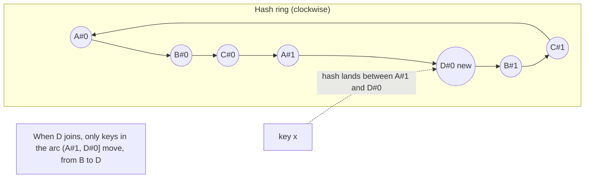

# Consistent Hashing

## Problem

You spread keys across N cache or storage nodes with `hash(key) % N`. That works until N changes. Going from 4 to 5 nodes changes the owner of about **80%** of keys. For a cache that means a near-total miss storm. For a datastore it means moving most of your data.

## Solution

Hash both nodes and keys onto the same circular space (a ring of 2^64 positions). A key belongs to the **first node clockwise** from its hash. When a node joins, it takes over only the arcs just before its positions. When a node leaves, its arcs pass to its clockwise neighbours. Only about **K/N** keys move.

A single position per node gives very uneven arcs, so each physical node is placed at many **virtual node** positions. More vnodes means more even load, at the cost of a bigger ring to search (`O(log(N·V))` per lookup).

## Diagram



## How this implementation works

- `New(vnodes)` creates a `Ring`. `Add(node)` hashes `node#0 … node#(vnodes-1)` and inserts each position into a sorted `hashes` slice, with an `owner` map from position to node. `Remove` filters those positions out.
- `hash` is FNV-1a followed by a **splitmix64 finaliser**. Raw FNV of near-identical strings like `node#1` and `node#2` clusters on the ring, and the finaliser spreads them uniformly.
- `Get(key)` binary-searches for the first position `>= hash(key)` and wraps to index 0 past the end.
- `GetN(key, n)` keeps walking clockwise and collects **distinct** physical nodes. This is how Dynamo-style systems choose replica sets.
- `Assign` and `Moved` are measurement helpers. The tests check that adding a 5th node moves about 20% of keys, all of them **to** the new node, and that removing a node moves only that node's keys.
- Lookups take an `RWMutex` read lock, so the ring is safe for concurrent membership changes.

## Trade-offs

| Pro | Con |
| --- | --- |
| Adding or removing a node moves about 1/N of keys | Load is only statistically even. It needs many vnodes, and hot keys still create hotspots |
| No central mapping table, so every client computes the same placement | Lookup is `O(log(N·V))` instead of `O(1)` |
| Heterogeneous capacity: give bigger nodes more vnodes | Membership must be agreed (gossip, a coordinator), or clients disagree on owners |
| Natural replica placement by walking the ring | Range scans are impossible, because adjacent keys scatter |

## When to use / when not to

**Use it** for distributed caches, partitioned key-value stores, sticky load balancing, and any system where nodes come and go and reshuffling is expensive.

**Avoid it** when membership is static (plain modulo is simpler), when you need range queries (use [range sharding](../sharding)), or when you need a tiny exact mapping with no memory overhead (look at jump consistent hash or rendezvous hashing).

## Real-world examples

- **Amazon Dynamo** (2007 paper) and its descendants **Apache Cassandra** and **Riak** partition data with a consistent-hash ring and virtual nodes. Cassandra calls them vnodes/tokens.
- Memcached clients such as **libketama**-based ones (ketama hashing) use it to spread keys across memcached servers.
- **Nginx** `hash ... consistent` and **HAProxy** `hash-type consistent` use it for upstream selection.
- **Discord** has written about using a consistent-hash ring to route to its Elixir services.

## Run it

```sh
go run ./patterns/data/consistent-hashing/example
go test ./patterns/data/consistent-hashing/
```

## Related patterns

- [Sharding](../sharding): hash vs range partitioning and resharding costs
- [Gossip](../../distributed/gossip): how nodes learn ring membership
- [Quorum](../../distributed/quorum): reading and writing to the N replicas `GetN` picks
- [Load balancing](../../architecture/load-balancing): consistent hashing gives sticky, cache-friendly balancing
- [Service discovery](../../architecture/service-discovery): the source of the node list
