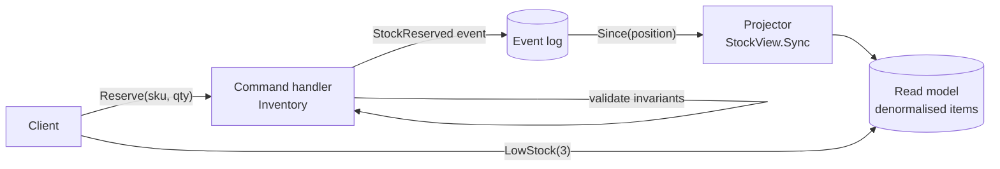

# CQRS (Command Query Responsibility Segregation)

## Problem

One model serves both writes and reads. Writes need a normalised shape that's easy to validate ("don't oversell stock"). Reads want denormalised, query-specific shapes ("low-stock items across all warehouses, sorted", "orders per SKU"). Serving both from the same tables means complex joins on every read, indexes that slow every write, and a model that is bad at both jobs. Read and write load also can't be scaled independently.

## Solution

Split the system into two models:

- **Command side (write model):** accepts commands, enforces invariants against the minimal state it needs, and records what happened as **events** in an append-only log.
- **Query side (read model / projection):** consumes those events and maintains one or more denormalised views, each shaped for a specific query. It never validates business rules. It just reflects what the write side decided.

The read model trails the write model, so the two are **eventually consistent**. The read model is fully derived, so you can delete it and rebuild it from the log, or add new views later.

## Diagram



## How this implementation works

- `Inventory` is the write model. `AddStock` and `Reserve` validate input (`ErrInvalidQty`, `ErrUnknownSKU`, `ErrInsufficient`) and, under a single lock, update the minimal `available` state and append a `StockAdded` or `StockReserved` event. A rejected command emits nothing.
- `Log` is the append-only event log. `Since(seq)` returns a copy of the newer records.
- `StockView` is the read model. `Sync(log)` applies records after its `position`. It skips records it has already seen, so repeated or concurrent syncs are safe. It maintains denormalised `Item`s (available, reserved, order count) and answers `Get` and `LowStock`.
- `Sync` is explicit so the lag is visible and tests are deterministic. In production it would be a consumer loop on Kafka, a change stream, or an outbox.
- The tests check that rejected commands produce no events, that the view lags until synced, that an incremental view equals one rebuilt from scratch, and that concurrent reservations never oversell.

## Trade-offs

| Pro | Con |
| --- | --- |
| Each side gets the right model, storage, and indexes | Two models, a log, and a projector to build and operate |
| Read and write workloads scale independently | **Eventual consistency**: users may not see their own write right away |
| New read views can be added later by replaying the log | Projections must be idempotent and handle replays, ordering, and schema evolution |
| Write model stays small and focused on invariants | Overkill for CRUD apps where reads and writes share a shape |

## When to use / when not to

**Use it** when read and write shapes or loads differ sharply (dashboards, search, feeds over a transactional core), when several different read views of the same data are needed, or together with [event sourcing](../event-sourcing).

**Avoid it** for simple CRUD domains, when every read must reflect the latest write, or when the team can't take on the operational cost of asynchronous projections.

## Real-world examples

- The pattern was named by Greg Young, building on Bertrand Meyer's *Command-Query Separation*. Martin Fowler's bliki entry "CQRS" describes it, along with the warning that it adds risky complexity for most systems.
- **Axon Framework** (Java) and **EventStoreDB** are built around CQRS with event-sourced write models and projections.
- A common production form: an OLTP database for writes, with change data capture (for example **Debezium**) feeding **Elasticsearch** or a cache for queries.

## Run it

```sh
go run ./patterns/data/cqrs/example
go test ./patterns/data/cqrs/
```

## Related patterns

- [Event sourcing](../event-sourcing): store the write model *as* the event log
- [Materialized view](../materialized-view): the mechanics of maintaining a read model incrementally
- [Read replicas](../read-replicas): same-shape read copies, the simpler alternative
- [Transactional outbox](../../distributed/transactional-outbox): publish events reliably from the write side
- [Pub-sub](../../distributed/pub-sub): distribute events to many projections
