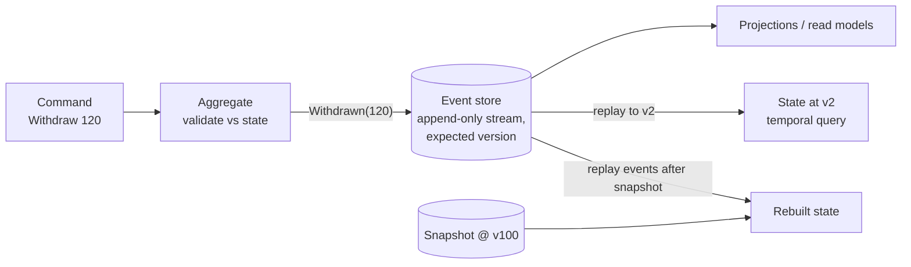

# Event Sourcing

## Problem

A typical table stores only the *current* state: `UPDATE accounts SET balance = 460`. Each update throws away the earlier value and the reason for the change. You can't answer "what was the balance last Tuesday?" or "why did it change?", audit logs drift from the real data, and adding a new view of the history is impossible because the history is gone.

## Solution

Store the **events** that happened (`Opened`, `Deposited(500)`, `Withdrawn(120)`) in an append-only stream per aggregate. They are the source of truth. Current state is derived by replaying them (a left fold).

- **Commands** are validated against the current state and produce new events. Events are facts, so applying one never fails.
- **Optimistic concurrency:** an append states the version it expects the stream to be at. If someone else appended first, the write is rejected, and the caller reloads and retries.
- **Snapshots:** for long streams, periodically store the folded state at version N, and on load replay only the events after N.
- **Temporal queries:** replay up to any version to see past state.

## Diagram



## How this implementation works

- `Store.Append(stream, expectedVersion, events...)` appends atomically only if `len(stream) == expectedVersion`. Otherwise it returns `ErrConcurrency`. `Load(stream, after, upto)` returns a slice of the stream and counts events read.
- `Account` is the aggregate. Commands (`Open`, `Deposit`, `Withdraw`, `Close`) check invariants and call `raise`, which applies the event to `State` and queues it in `pending`. `State.apply` is the only place state changes, and it is used both for new events and for replay.
- `Repository.Load` starts from the latest snapshot (if any) and applies newer events. `Save` appends `pending` with `expected = Version - len(pending)` and stores a snapshot whenever the version crosses a multiple of `snapshotEvery`.
- `Repository.LoadAt(id, v)` replays from the beginning up to version `v` and ignores snapshots, which may be newer than `v`.
- The tests cover command validation, rebuilding, a lost-update race caught by `ErrConcurrency`, snapshot replay counts, and temporal queries.

## Trade-offs

| Pro | Con |
| --- | --- |
| Complete, reliable audit trail. History *is* the data | Querying current state across aggregates needs projections ([CQRS](../cqrs)) |
| Temporal queries and debugging by replay | Event schemas live forever, so you need versioning and upcasting |
| New read models can be built from the full history | Replay cost grows with stream length, so you need snapshots |
| Natural fit for event-driven integration | "Delete" is hard (GDPR): you need crypto-shredding or stream rewriting |
| Optimistic concurrency per aggregate scales well | A steep learning curve, and overkill for CRUD |

## When to use / when not to

**Use it** for domains where history and auditability matter: ledgers, payments, order lifecycles, inventory, workflow engines, collaborative editing. It also fits well when the domain already thinks in events.

**Avoid it** for simple CRUD, for data with no meaningful history, or when the team can't invest in event versioning and projections.

## Real-world examples

- **Accounting ledgers** and **bank transaction logs** are the original form: the balance is derived from the entries.
- **Git** stores history as an append-only DAG of commits and derives the working tree from it.
- **EventStoreDB** and **Axon Server** are databases built for event sourcing. **Marten** provides it on PostgreSQL.
- **Apache Kafka** with log compaction and Kafka Streams is often used as an event-sourced backbone.

## Run it

```sh
go run ./patterns/data/event-sourcing/example
go test ./patterns/data/event-sourcing/
```

## Related patterns

- [CQRS](../cqrs): event sourcing's usual partner for queries
- [Materialized view](../materialized-view): projections built from the event stream
- [Write-ahead log](../write-ahead-log): the storage-engine sibling, an append-only log replayed on recovery
- [Transactional outbox](../../distributed/transactional-outbox): publishing events to other services reliably
- [Saga choreography](../../distributed/saga-choreography): event-driven workflows across aggregates
- [Idempotency key](../../reliability/idempotency-key): making command retries safe
