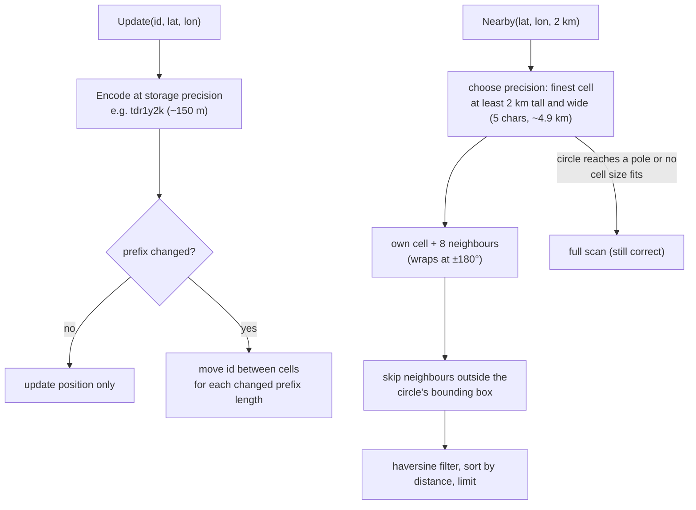

# Geospatial Index (geohash)

## Problem

"Find the drivers within 2 km of me" is easy to write as a loop: compute the distance from the rider to every driver and keep the close ones. That is O(N) per query, and almost all of the work is wasted on drivers on the other side of the city.

- A ride-hailing or delivery city has ~100k active drivers, each sending a new position every few seconds, and thousands of "who is near me?" queries per second. A full scan multiplies those two numbers.
- A plain database index doesn't help: a B-tree on `lat` (or `lon`) narrows to a thin stripe around the world, not a small area, and the two-column range query still scans the whole stripe.
- Positions change constantly, so whatever structure you build must make an update cheap, not just a lookup.

## Solution

Divide the world into cells, bucket each driver by cell, and only look at the cells near the query.

1. **Geohash encoding.** Repeatedly halve the longitude range (east half = 1, west half = 0), then the latitude range, alternating, starting with longitude. Every 5 bits become one base32 character (`0123456789bcdefghjkmnpqrstuvwxyz`). `57.64911, 10.40744` becomes `u4pruydqqvj`. Each character shrinks the cell 32-fold, and **a shared prefix means the same larger cell**, so one string encodes a cell at every zoom level.
2. **Index**: for every prefix length up to a storage precision, map cell → set of IDs. A location update re-encodes the driver and moves it only between the cells whose prefix changed.
3. **Query**: pick the finest cell size that is at least as tall and as wide as the radius, take the query's own cell plus its **8 neighbours**, drop neighbours the circle can't reach, then filter the candidates by exact haversine distance and sort by distance.

**Why the neighbours are needed.** A cell is just a bucket. A rider 50 m from the eastern edge of their cell has drivers 100 m away that live in the cell to the east. Searching only the own cell misses them, no matter how good the cell size. Because the cell is at least one radius wide, the circle can reach at most one cell beyond the own cell in each direction, so the 3x3 block always covers it.

## Diagram



## How this implementation works

- `Encode(lat, lon, precision)` and `Decode(hash) (Box, error)` convert between points and cells (1 to 12 characters). `Box.Center()` gives the cell middle. Inputs are validated: latitude in [-90, 90], longitude in [-180, 180], no NaN, only valid base32 characters.
- `Neighbours(hash) ([8]string, error)` returns cells indexed by `North`, `NorthEast`, ... `NorthWest`. It decodes the cell, steps one cell height or width from the centre and re-encodes. East and west **wrap across the antimeridian**: the east neighbour of a cell touching +180° starts at -180°. Cells touching a **pole** have no northern (or southern) neighbours, so those entries are `""`; the cells "across" the pole (same row, longitude + 180°) are not returned.
- `New(WithPrecision(p))` creates an `Index` (default storage precision 7, about 153 m x 153 m). It keeps `levels[k][prefix]` → ID set for every k up to p, plus each ID's position and cached `cos(lat)`.
- `Update(id, lat, lon)` inserts or moves an ID. If the storage cell didn't change, it is one map write. Otherwise it walks the levels and moves the ID only where the prefix differs. `Remove(id)` deletes it from every level. `Stats()` counts updates, cell changes, queries and full scans.
- `Nearby(lat, lon, radiusMeters, limit)` / `NearbyStats(...)` choose the query precision: the finest k (up to the storage precision) whose cells are at least `radius` tall and at least `radius` wide at the circle's most poleward latitude (cells narrow as `cos(lat)`). The 3x3 block is pruned to cells that intersect the circle's bounding box (tested with ±360° shifts so it works across the antimeridian). Results are sorted by distance, then ID; `limit` 0 means all. `QueryStats` reports the precision, cells searched, and **candidates examined** (distances computed).
- **Poles.** If the circle touches a pole, or no cell is wide enough (very large radius at high latitude), `Nearby` falls back to a full scan, counted in `Stats().FullScans`. Answers are always correct; only the cost changes. Tests check the index against brute force near the pole, across the antimeridian, at 70°N, in a city and over the whole world.
- `BruteForce(...)` is the O(N) scan, kept as the baseline and as a correctness oracle. `IDsInCell(hash)` and `Position(id)` let you inspect the index (the example uses them to show the own-cell-only bug).
- An `RWMutex` guards everything; queries take the read lock, updates the write lock.

**Simplification.** Production systems differ in a few ways. Storing an ID at every prefix length costs `precision` set entries per driver; Redis instead stores one 52-bit interleaved integer as the score in a sorted set and turns each cell into a score range, which gives every precision for free. The 3x3 block at a cell size ≥ radius can examine several times the circle's area (in the example, about 6x the true results); covering the circle with many smaller cells, or with S2/H3 cell coverings, examines fewer candidates at the cost of more lookups. Distances use a spherical Earth (haversine, ~0.5% error vs the WGS84 ellipsoid), which is fine for "near me" and not for surveying. A real fleet also expires drivers that stop reporting, which this index leaves to the caller (`Remove`).

## Trade-offs

| Pro | Con |
| --- | --- |
| A query examines a few cells' worth of drivers instead of all of them (42x fewer distance computations in the example) | Cells are rectangles that shrink with latitude, so cell size vs radius needs care, and near the poles the scheme breaks down (here: full scan) |
| Updates are cheap: most moves stay in the same cell, and a move only touches the prefixes that changed | Must search neighbours: the own cell alone misses about a third of the results in the example |
| A geohash is a plain string, so it works as a key in any KV store, a sorted set, or a database column with a prefix index | Two points metres apart can have completely different hashes (across a cell edge, the equator, or the antimeridian), so prefix equality is not "nearness" |
| One encoding covers every zoom level: shorter prefix = bigger cell | Density varies: a downtown cell can hold thousands of drivers while a suburban one is empty, so a fixed precision is too coarse in one place and too fine in another |
| Easy to shard: route each cell (or prefix) to a partition | Hot cells (airport, stadium) become hot partitions |

## When to use / when not to

**Use it** for radius or "k nearest" queries over many points that move often: drivers, couriers, scooters, nearby users, stores near me, geofenced alerts. It shines when updates are frequent and you need something you can put in Redis or a KV store.

**Use something else** when:

- **Quadtree**: point density varies a lot (cities vs countryside). A quadtree splits a cell only when it holds too many points, so busy areas get small cells and empty areas stay big. It adapts where a fixed-precision geohash can't, but it's an in-memory tree that's harder to distribute.
- **S2 cells (Google)**: you need correctness everywhere on the globe, including poles, and precise coverings of arbitrary regions. S2 projects a cube onto the sphere and numbers cells along a Hilbert curve, so cells are roughly equal-area and neighbours are better localised than with geohash. Used by Google Maps, Foursquare and MongoDB's 2dsphere index.
- **H3 hexagons (Uber)**: you aggregate per cell (demand, supply, prices). Every hexagon has 6 neighbours at the same distance, so smoothing and "ring k" searches are uniform. Squares have 4 near and 4 far (diagonal) neighbours.
- **R-tree (PostGIS, SQLite, Oracle Spatial)**: you store shapes (polygons, roads, delivery zones) and need intersection or containment queries, mostly on data that doesn't change every few seconds. R-trees are great for static geometry and slower to update.

## Real-world examples

- **Redis GEO**: `GEOADD` stores each member in a sorted set with a 52-bit geohash as its score; `GEOSEARCH ... BYRADIUS` picks a cell size from the radius, searches the cell and its 8 neighbours as score ranges, then filters by distance, the same algorithm as this package.
- **Uber H3**: the hexagonal grid behind surge pricing and dispatch; demand and supply are counted per hexagon, and a rider's request looks at the surrounding rings.
- **Elasticsearch**: the `geo_distance` query and `geohash_grid` / `geotile_grid` aggregations index `geo_point` fields with a BKD tree.
- **MongoDB**: `2dsphere` indexes use S2 cells under the hood for `$near` and `$geoWithin`. The legacy `2d` index used geohashes.
- **Lyft, Swiggy, DoorDash** and similar match riders or orders with nearby drivers by bucketing live positions into cells (geohash, S2 or H3), refreshing positions every few seconds and searching rings of cells outward until enough candidates are found.

## Run it

```sh
go run ./patterns/data/geospatial-index/example
go test ./patterns/data/geospatial-index/
```

The example indexes 100,000 seeded drivers in a 0.5° x 0.5° box (roughly Bengaluru-sized) and runs 500 queries with a 2 km radius. It prints:

- **Candidates per query**: brute force examines 100,000; the index examines about 2,357 (3.4 precision-5 cells on average after pruning) for about 404 actual results, 42x fewer distance computations. The first 10 queries are re-run by brute force and the answers are identical.
- **Edge-of-cell bug**: searching only the own cell would miss 67,349 of 201,781 results (33.4%), and 474 of 500 queries would lose at least one driver. With a 2 km radius and ~4.9 km cells, most query points are within 2 km of some edge.
- **Live updates**: in each of 2 ticks every driver moves up to ~30 m; about 18.6-18.9% of the updates move a driver into a different precision-7 cell, the rest only update the position. Queries still match brute force afterwards.
- **Antimeridian**: a rider at lon 179.999 (cell `ruzzr`) finds a driver at lon -179.999 (cell `2hbp2`) 213 m away, through the wrapped east neighbour.

Tests cover the Wikipedia example (`u4pruydqqvj`), encode/decode round trips at every precision, the known neighbours of `dqcjq`, antimeridian and polar neighbours, `Nearby` against brute force on seeded random data in five regions (city, 70°N, antimeridian, near the pole, whole world), the own-cell miss, updates moving IDs between cells at every level, `Remove`, validation, and concurrent updates and queries under `-race`.

## Related patterns

- [Sharding](../sharding): partition location data by region or cell prefix so each shard owns an area; hot cells become hot shards
- [Presence](../../architecture/presence): tracks who is online and their latest heartbeat; the same live-update stream feeds the latest positions this index stores
- [Leaderboard / top-k](../leaderboard-top-k): another sorted-set-shaped problem; Redis serves both from sorted sets, with geohash scores for GEO

## Further reading

- Khyati Jha, [High Level System Design Day-9: Caching (Part 4)](https://medium.com/high-level-system-desgin-interview-prep/high-level-system-design-day-9-caching-part-4-ebec82ded648), a case study that caches location data on a geospatial grid
- Arvind Kumar, [Swiggy Shows Wrong Rider Location](https://codefarm0.medium.com/swiggy-shows-wrong-rider-location-system-design-deep-dive-on-real-time-gps-tracking-and-eventual-b49e5f18fccd), on real-time GPS tracking, stale positions and eventual consistency
- Arvind Kumar, [Uber Surge Pricing During Rain](https://codefarm0.medium.com/uber-surge-pricing-during-rain-system-design-deep-dive-on-real-time-demand-supply-and-dynamic-f71fd58fdb03), on counting demand and supply per area in real time to set prices
