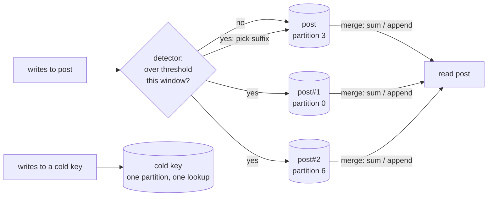

# Hot-Key Salting (Write Sharding of Partition Keys)

## Problem

Partitioned stores (DynamoDB, Cassandra, Bigtable, a Kafka topic) hash each partition key to exactly one partition, and each partition has its own throughput ceiling. DynamoDB, for example, documents roughly 1,000 write units per second per partition. When one logical key gets more writes than that, such as a celebrity's post collecting likes, a flash-sale product's stock events, or a time-series table keyed by today's date, every write for it lands on the same partition:

- That partition throttles, even though the table as a whole has plenty of unused capacity. Raising provisioned capacity or adding partitions doesn't help, because the key still hashes to one place.
- Unrelated keys that happen to share the partition get throttled too (in the example below, about 1,200 ordinary writes are rejected alongside the hot post's).

## Solution

Split the hot logical key into **K physical keys** by appending a suffix (a "salt"): `post`, `post#1`, ..., `post#K-1`. Each suffix hashes independently, so the key's writes spread over up to K partitions.

- **Writes** go to one suffix, picked at random or round-robin. Each partition sees about 1/K of the key's write rate.
- **Reads** scatter-gather all K suffixes and combine them with a **merge function**: sum for counters, append or union for item lists, max for "latest timestamp".
- **Adaptive salting.** Salting every key would make every read cost K lookups. Instead, a per-key write-rate counter watches traffic over a short window, and only keys that cross a threshold are salted. Cold keys stay single-lookup.
- **Lossless transition.** Suffix 0 is the original, unsalted key. When a key is promoted, the writes it took before promotion are already one of the K keys every read fetches. Nothing has to be migrated.

This is the general, partition-key version of [sharded counters](../../architecture/sharded-counters). That pattern splits one known counter into N rows up front. This one works for any value with an associative merge, and decides per key, at runtime, which keys need splitting.

## Diagram



## How this implementation works

- `Table[V]` simulates the store: FNV-1a hash of the physical key modulo N partitions, and a per-partition budget of writes per clock second. A write over budget returns `ErrThrottled` and isn't applied. Reads are counted per partition but not throttled, since DynamoDB meters them separately.
- `Salter[V]` sits in front of the table. `New(table, merge, opts...)` takes the merge func, which is used twice: to fold a write into the stored value of one suffix, and to combine the suffixes on read. It must be associative, and you must not care about the order suffixes are merged in. `Sum` and `Concat` are provided.
- Modes: `Unsalted` salts only keys listed with `WithHotKeys`, `SaltAll` salts every key with the same K, and `Adaptive` (the default) also salts any key the detector flags. `WithShards(k)` sets K (default 8).
- The detector (`WithDetector(threshold, window)`, default: half a partition's per-second capacity over 1s) counts write attempts per cold key in a fixed window and clears the counts at each rollover, so memory is bounded by the distinct keys written per window. Throttled attempts count too: they are demand. Once promoted, a key stays salted.
- `WithPicker` chooses the suffix (default `rand.IntN`; `RoundRobin()` gives an exact spread). `WithClock` drives the detector windows. The picker is called under the Salter's lock, so a seeded `*rand.Rand` is safe to pass.
- `Read` returns the merged value and whether any suffix existed. `Fanout`, `PhysicalKeys`, `HotKeys` and `Stats` (writes, throttled, reads, lookups, promotions) expose the read cost. Keys may not contain `#`, so a real key can never collide with another key's suffix.
- Suffixes are hashed like any other key, so two suffixes can land on the same partition and some partitions get none. The example prints this: with K=8 over 8 partitions, the hot post's suffixes landed on `[0 0 1 6 7 4 5 2]`, so partition 0 carries two-eighths of the hot load and partition 3 none. [Two-tier cache](../two-tier-cache) shows the alternative of choosing suffixes that land on distinct nodes, which works only when you can see the hash function.

**Simplifications.** The hot-key set lives in one `Salter`'s memory. With many app servers, every reader must learn about a promotion, or a reader that still thinks the key is cold reads only suffix 0 and under-counts. Real systems store the salted-key list (and its K) somewhere shared, such as a config service, a marker item in the table, or a key-naming convention, or simply always fan out for a known category of key. Detection here is an exact counter per key. At high cardinality, production systems sample traffic or use a count-min sketch or heavy-hitters algorithm. K can safely grow later (readers fan out to more suffixes, which include the old ones), but this implementation uses one K and never un-salts. Shrinking K, or returning a key to cold, needs a merge-and-delete job so no suffix is orphaned. Reads while writes are in flight are not a point-in-time snapshot. Throttled writes are returned to the caller, not retried.

## Trade-offs

| Pro | Con |
| --- | --- |
| A single key's write ceiling rises to about K times one partition's | Reads of a salted key cost K lookups (scatter-gather), plus K times the read capacity |
| Works for any value with an associative merge, not just counters | Values that need conditional writes or uniqueness checks ("stock >= 0") can't be checked on one suffix |
| Adaptive mode makes only hot keys pay the read fan-out | Detection lags: until a key crosses the threshold, its writes still hit one partition |
| Suffix 0 is the original key, so promotion needs no data migration | Every reader must know which keys are salted, which is shared state across app servers |
| Pure client-side change; the table schema stays the same | Hashed suffixes can collide on a partition, so the spread is uneven unless K is larger than the hot factor |

## When to use / when not to

**Use it** for write-heavy, skewed keys whose value can be split and merged: like and view counters, per-day aggregates keyed by date, event logs and activity lists for a popular entity, append-only time-series buckets, and Kafka topics where a few keys dominate (salting the key trades per-key ordering for spread).

**Avoid it** when writes need a read-modify-write check against the whole value (inventory you must not oversell, unique constraints), when reads vastly outnumber writes (use [two-tier cache](../two-tier-cache) and replicate the hot key for reads instead), or when per-key ordering matters across suffixes. If the skew comes from a bad key design, such as a status flag or a date as the whole partition key, fix the key first; salting is for skew that is inherent in the traffic.

## Real-world examples

- **DynamoDB** best-practice guidance on write sharding describes exactly this: random suffixes for maximum spread, or "calculated" suffixes derived from an item attribute so a single item can be read with one lookup. Adaptive capacity and split-for-heat soften but don't remove the per-partition limit.
- **Cassandra** and **Bigtable** schema guides warn about hotspotting on monotonically increasing or low-cardinality row keys, and recommend bucketing or salting (for example a hash prefix on the row key, or `(sensor_id, day, bucket)` partitions).
- **Kafka** producers keyed by user or tenant can overload one partition when one key is huge; teams salt the key or use a custom partitioner for known heavy keys, accepting the loss of per-key ordering.
- **Instagram and Twitter** like and view counters for celebrity posts are a well-known case: counts are sharded across rows or cache keys and merged on read, often with a cached rolled-up total so the fan-out isn't paid per view.

## Run it

```sh
go run ./patterns/data/hot-key-salting/example
go test ./patterns/data/hot-key-salting/
```

With 8 partitions of 1,000 writes/s and a 4,000 writes/s workload (2,500/s on one post), the example prints:

| Run | Throttled writes | Hot post likes lost | Lookups to read all 301 posts |
| --- | --- | --- | --- |
| No salting | 16,886 of 40,000 (42.2%) | 15,708 of 25,000 (62.8%) | 301 |
| Salt every key, K=8 | 0 | 0 | 2,408 |
| Adaptive, threshold 500/s | 169 (0.4%) | 126 (0.5%) | 308 |

All 169 adaptive throttles happen in the first simulated second: the post's first 500 writes went to the unsalted key before the detector promoted it, and that partition was also taking two suffixes' worth of the post's remaining writes. In every run, the merged reads add up to exactly the number of accepted writes.

## Related patterns

- [Sharded counters](../../architecture/sharded-counters): the counter-specific, configured-up-front version of this idea, in memory and over a row store
- [Sharding](../sharding) and [consistent hashing](../consistent-hashing): how keys map to partitions, and why one key can't be split by them
- [Two-tier cache](../two-tier-cache): the read-side hot-key fix, replicating a hot key for reads instead of splitting it for writes
- [Scatter-gather](../../architecture/scatter-gather): the fan-out-and-merge read path a salted key needs

## Further reading

- Arvind Kumar, [DynamoDB Hot Partition Problem](https://codefarm0.medium.com/dynamodb-hot-partition-problem-system-design-deep-dive-on-partition-keys-sharding-strategies-and-9b6758e494ef), a deep dive on partition-key choice and write-sharding strategies
- Khyati Jha, [High Level System Design Day-8: Caching (Part 3)](https://medium.com/high-level-system-desgin-interview-prep/high-level-system-design-day-8-caching-part-3-e3c7a27b7235), which covers hot keys and scattering them across nodes
